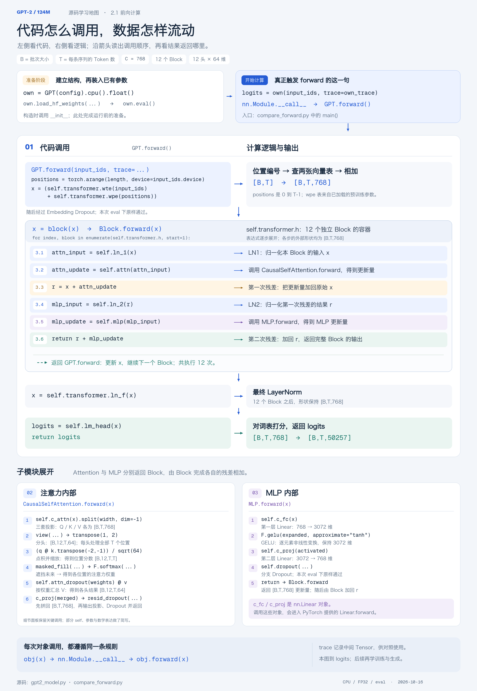

# GPT-2 124M Learning Lab

[English](README.en.md) | [中文](README.md)

A hands-on study project for understanding GPT-2 through model inspection, an independent PyTorch implementation, and numerical comparisons against Hugging Face Transformers.

The learning sequence follows Andrej Karpathy's [Let's reproduce GPT-2 (124M)](https://www.youtube.com/watch?v=l8pRSuU81PU) and [build-nanogpt](https://github.com/karpathy/build-nanogpt). This repository adapts that material into small lessons with detailed comments, diagrams, and reproducible experiments. The stage-by-stage comparison harness is an additional teaching exercise.

Repository: [guqun/GPT-2-124M](https://github.com/guqun/GPT-2-124M).

## Current progress

**Progress: Stage 2 → Unit 2 (reproducing GPT-2) → Section 2.2 → Learning block 9 (BF16 automatic mixed precision), discussed with a reported basic understanding on 2026-10-19.** Blocks are numbered consecutively across this project: block 8 is the first block in section 2.2. The learner reports a basic understanding of devices, timing, TF32, and BF16; GPU performance experiments remain pending. The learner confirmed completion of section 2.1 on 2026-10-19. Self-checks remain available for review.

Stage 1 covers the previously completed neural-network and Transformer foundations. Within Stage 2, Unit 1 (tokenization) has covered all four planned sections and delivered its planned experiments; Unit 2 has completed section 2.1 and is studying 2.2, bringing its progress to **1/5 sections**. Units 3–7 have not started. Stage 2 progress is **5/32 completed planned sections**. Independent mastery is recorded separately from content coverage and verified code.

The first two learning blocks of Stage 2 → Unit 2 → Section 2.1 have been covered and their experiments verified:

1. **Inspect a pretrained checkpoint:** distinguish configuration, model code, trained weights, and tokenizer files; inspect tensor names, shapes, parameter counts, and weight sharing.
2. **Implement and verify the forward pass:** build GPT-2 with PyTorch, import the same pretrained weights used by the reference model, compare intermediate outputs, and check causal masking.

The third block, text generation with our own model, has been introduced and run. On 2026-10-18, the learner reported a basic understanding; self-checks remain available for review. The fourth block's Tiny Shakespeare single-batch experiment has been verified and discussed as a review of Stage 1 foundations. Block 5 has now covered sequential sampling, shifted targets, predictions at every position, causal masking, the batch dimension, and cursor wraparound. The learner reported a basic understanding; its code, lesson, and flow diagram are archived. The learner now reports a basic understanding of block 6 (weight tying); their independent training run is not confirmed. The learner reports a basic understanding of block 7 (parameter initialization). After reviewing the seven blocks and their experiments, the learner confirmed section 2.1 complete and moved to 2.2. Self-checks are review material rather than an additional completion requirement. Each block has a separate script and lesson, preserving earlier materials. Forward comparison and generation use pretrained weights; these training experiments start with random weights. Full GPT-2 pretraining remains ahead.

The [learning-plan review](docs/learning-plan-review.md) distinguishes original course content, the agreed Notion roadmap, local adaptations, and evidence of learner progress. The latest milestone synchronized to the [Notion plan](https://app.notion.com/p/340eaea31414819197bde537d339d0fc) is completion of section 2.1; block 9 is recorded locally and in the new review note, while the overall plan has not been updated in this pass. The [section 2.1 review](docs/section-2.1-review.md) separates course coverage, verified experiments, and independent mastery.

The [GPU training review notes](docs/gpu-training-notes.md) (Chinese) collect the discussion of devices, MPS, measurement, TF32, BF16 casts, gradients, and FP32 parameter updates, with the full precision-flow diagram and worked examples. A [Notion copy with the image](https://app.notion.com/p/3feeaea3141481af8e6fd509bee27fc7) is archived; the overall Notion plan was not changed in this documentation pass. The next topic is `torch.compile`; it has not started.

## Learning block 9: BF16 automatic mixed precision

[train_mixed_precision.py](train_mixed_precision.py) and [lesson09.md](lesson09.md) follow [the video around 1:39:28–1:47:34](https://www.youtube.com/watch?v=l8pRSuU81PU&t=5968s) and [historical commit 177e4cd](https://github.com/karpathy/build-nanogpt/commit/177e4cd5b4cc05df4bb637ed1a9e55911d6f1e2c). Forward computation and cross-entropy run inside `autocast`; backward and AdamW run outside it. Parameters retain FP32 storage while eligible operations and their outputs use BF16.

```bash
.venv/bin/python train_mixed_precision.py --device cpu --probe-only --batch-size 1 --seq-len 8
.venv/bin/python train_mixed_precision.py --device cpu --precision bf16 --batch-size 1 --seq-len 8 --warmup-steps 1 --steps 2
```

The current Mac uses `/Users/guqun/micrograd/venv/bin/python`. The first command observes both precisions on identical parameters and inputs without updates. The second runs three training updates. All 29 tests pass; full-model [dtype observations](artifacts/lesson09-cpu-dtypes.json) and [CPU training results](artifacts/lesson09-cpu-bf16-smoke.json) are archived. Parameters, parameter gradients, loss, and AdamW moments remain FP32; logits use BF16. These B=1/T=8 CPU checks establish behavior, not GPU speedup. Matched CUDA performance commands are included in the lesson; GPU measurements remain pending.

## Learning block 8: GPU execution, timing, and TF32

[benchmark_training.py](benchmark_training.py) and [lesson08.md](lesson08.md) begin section 2.2, following [the video around 1:22–1:39](https://www.youtube.com/watch?v=l8pRSuU81PU&t=4938s) and [historical commit 5265b20](https://github.com/karpathy/build-nanogpt/commit/5265b2042aaaa84943313002671b8b3ca7749b06). The script checks devices, synchronizes accelerator work before reading elapsed time, excludes warmup from summary statistics, and reports total training tokens divided by total measured time.

```bash
.venv/bin/python benchmark_training.py --inspect-only
.venv/bin/python benchmark_training.py --device cpu
```

The current Mac uses `/Users/guqun/micrograd/venv/bin/python`. Defaults are the full 124M model, B=4/T=32, two warmup updates and five measured updates. The 25 tests available at this block passed; [the CPU report](artifacts/lesson08-cpu-baseline.json) is archived. The lesson includes CUDA `highest`/`high` comparison commands. This environment has neither CUDA nor usable MPS, so actual GPU/TF32 speedup remains unmeasured. The learner reports a basic understanding of both this block and block 9 above; GPU experiments remain pending.

## Learning block 7: parameter initialization

[train_initialization.py](train_initialization.py) and [lesson07.md](lesson07.md) follow [the video around 1:13:03](https://www.youtube.com/watch?v=l8pRSuU81PU&t=4383s) and [historical commit 9ac321e](https://github.com/karpathy/build-nanogpt/commit/9ac321e299f06c0414bd577fd2776f4562283a8a). Shared weights are retained. Ordinary weights use a normal distribution with std 0.02, Linear biases start at zero, and residual output projections use std `0.02/sqrt(2L)`. LayerNorm retains its default scale and offset. Initialization runs before training, not before each batch.

```bash
.venv/bin/python train_initialization.py --inspect-only
.venv/bin/python train_initialization.py
```

The current Mac uses `/Users/guqun/micrograd/venv/bin/python`. Inspection includes actual initial statistics and the video's independent residual-sum example. All 22 behavior tests pass; the full 50-step CPU/FP32 run is in [the report](artifacts/lesson07-initialization-report.json). [Historical-source comparisons](artifacts/lesson07-course-alignment.json) match initial parameters, logits/loss, gradients, and one AdamW update for two seeds and a small configuration with head dimension 64. This does not assert parity with the video's full GPU training trajectory. The learner reports a basic understanding and has confirmed section 2.1 complete; self-checks remain available for review.

## Learning block 6: weight tying

[train_weight_tying.py](train_weight_tying.py) and [lesson06.md](lesson06.md) follow [the video around 1:05:55](https://www.youtube.com/watch?v=l8pRSuU81PU&t=3955s) and [historical commit ec39245](https://github.com/karpathy/build-nanogpt/commit/ec39245425b2c82a38c0787f27e5f9d7082c973b). The script assigns the input embedding parameter to the existing output parameter, preserving the author's initialization direction. It starts a fresh random model, reuses block 5's sequential loader, and introduces no dedicated GPT-2 initialization yet.

```bash
.venv/bin/python train_weight_tying.py --inspect-only
.venv/bin/python train_weight_tying.py
```

The current Mac uses the authorized existing interpreter `/Users/guqun/micrograd/venv/bin/python` in place of `.venv/bin/python`. Inspection reports 163,037,184 → 124,439,808 unique parameters. All 19 behavior tests pass, including summed input/output gradients and a single optimizer update of the shared parameter. The full 50-step run is recorded in [the report](artifacts/lesson06-weight-tying-report.json). Losses use changing training batches and do not establish a held-out benefit from tying.

## Project guide

| File or directory | Purpose |
| --- | --- |
| [inspect_checkpoint.py](inspect_checkpoint.py) | Inspect a locally cached GPT-2 configuration and pretrained weights using the Hugging Face model. |
| [gpt2_model.py](gpt2_model.py) | Independent GPT-2 architecture, forward computation, and Hugging Face weight import. |
| [compare_forward.py](compare_forward.py) | Run both implementations on identical inputs, compare intermediate tensors, and check causality. |
| [lesson02.md](lesson02.md) | Step-by-step instructions for the forward comparison lesson, in Chinese. |
| [generate_text.py](generate_text.py) | Greedy and temperature/top-k generation with the independent GPT-2, step logs, and an optional reference check. |
| [lesson03.md](lesson03.md) | Text generation lesson, measured examples, and self-checks, in Chinese. |
| [Generation flow map](docs/diagrams/gpt2-generation-flow.md) | Diagram and source navigation using matching M/G/S step labels, with tensor shapes, selection branches, and stopping paths. |
| [train_step.py](train_step.py) | Tiny Shakespeare single-batch overfitting: random initialization, shifted targets, cross-entropy, and 50 AdamW updates. |
| [lesson04.md](lesson04.md) | Source mapping, training data and expectations, execution order, shapes, flow diagram, and measured results, in Chinese. |
| [train_dataloader.py](train_dataloader.py) | Sequential full-corpus batches: persistent cursor, shifted targets, wraparound, and a data-only preview. |
| [lesson05.md](lesson05.md) | Comparison with Stage 1 random sampling and block 4 fixed data, source mapping, and measured checks, in Chinese. |
| [train_weight_tying.py](train_weight_tying.py) | Input/output parameter sharing, inspection, and sequential training. |
| [lesson06.md](lesson06.md) | Shared lookup/scoring, parameter savings, and gradient accumulation, in Chinese. |
| [train_initialization.py](train_initialization.py) | Course initialization, residual-sum demonstration, and sequential training. |
| [lesson07.md](lesson07.md) | Initialization timing, distributions, residual scaling, source boundaries, and measured checks, in Chinese. |
| [benchmark_training.py](benchmark_training.py) / [lesson08.md](lesson08.md) | Device selection, synchronized timing, throughput, and a CUDA TF32 comparison. |
| [train_mixed_precision.py](train_mixed_precision.py) / [lesson09.md](lesson09.md) | BF16 autocast, per-layer dtype observations, and matched training comparisons with FP32 parameters. |
| [Data-loader flow map](docs/diagrams/gpt2-dataloader-flow.md) | Saved PNG/SVG diagram with M1–M4 / L1–L4 source locations, tensor shapes, cursor wraparound, and the training loop. |
| [data/tiny_shakespeare/](data/tiny_shakespeare/README.md) | Original course text, pinned source, and checksum. |
| [docs/lesson01-02-notes.md](docs/lesson01-02-notes.md) | Consolidated learning notes, questions, explanations, and self-checks, in Chinese. |
| [docs/diagrams/](docs/diagrams/) | Diagram mapping Python calls to the mathematical operations. |
| [artifacts/](artifacts/) | Saved inspection results, comparison reports, and learning-note archives. |
| [python_foundations/](python_foundations/README.md) | Python and PyTorch reading material for experienced Java, C++, and Dart developers. |

## Model and data flow

The implemented model uses the GPT-2 124M configuration:

| Property | Value |
| --- | ---: |
| Vocabulary size | 50,257 |
| Maximum sequence length | 1,024 |
| Hidden dimension | 768 |
| Transformer blocks | 12 |
| Attention heads per block | 12 |
| Dimension per head | 64 |
| MLP intermediate dimension | 3,072 |
| Unique trainable parameters | 124,439,808 |

The table describes the default tied-weight model used for pretrained comparisons and generation. The first overfitting stage follows the earlier video version, with separate input/output tables and PyTorch default initialization; it temporarily has 163,037,184 parameters. Weight tying is introduced later in the video.

```text
Token IDs [B, T]
    │
    ├─ Token embedding lookup
    └─ Position embedding lookup
              │ add, then embedding dropout
              ▼
         [B, T, 768]
              │
         12 Transformer blocks
           r = x + Attention(LN1(x))
           x = r + MLP(LN2(r))
              │
         Final LayerNorm
              │
         lm_head (shares the token embedding weight)
              ▼
         Logits [B, T, 50257]
```

`B` is the batch size and `T` is the number of token positions. Each block has its own parameters. Attention projects Q/K/V, splits them into heads, applies scaled dot-product attention with a causal mask, concatenates the head outputs, and projects back to 768 dimensions. The MLP expands 768 → 3,072, applies the GPT-2 GELU approximation, and projects back to 768.

Our code defines this computation using PyTorch tensors and layers; it does not call Hugging Face's `GPT2Block` for its forward pass. The Hugging Face model is the separate reference implementation. Its `Conv1D` projection weights are transposed when copied into our `nn.Linear` layers.

The [call map and reading guide](docs/diagrams/gpt2-forward-call-map.md) connect `GPT.forward`, `Block.forward`, and the Attention/MLP calls. The diagram and source comments are currently in Chinese.



## Run the experiments

### Environment and checkpoint

Use a Python environment with PyTorch, Transformers, and safetensors installed. The saved forward comparison was run with **Python 3.9.6, PyTorch 2.2.2, and Transformers 4.57.6**, on **CPU with float32**. These are the recorded versions, rather than a claim of compatibility with every newer release.

On the verified macOS Python 3.9 setup, run these commands from the repository root:

```bash
/usr/bin/python3 -m venv .venv
.venv/bin/python -m pip install -r requirements.txt
.venv/bin/hf download openai-community/gpt2 config.json model.safetensors tokenizer.json \
  --revision 607a30d783dfa663caf39e06633721c8d4cfcd7e \
  --local-dir .cache/gpt2/607a30d783dfa663caf39e06633721c8d4cfcd7e
```

The weights are approximately 548 MB and the tokenizer is approximately 1.4 MB. The environment and model cache are Git-ignored. After setup, run `.venv/bin/python inspect_checkpoint.py`, `.venv/bin/python compare_forward.py`, or `.venv/bin/python generate_text.py`.

The scripts read existing local files. They do not download weights. The model directory must contain at least:

```text
config.json
model.safetensors
tokenizer.json  # additionally required for text generation
```

By default, they first look for this fixed snapshot inside the repository:

```text
.cache/gpt2/607a30d783dfa663caf39e06633721c8d4cfcd7e
```

They also support the original Hugging Face cache snapshot:

```text
~/.cache/huggingface/hub/models--gpt2/snapshots/607a30d783dfa663caf39e06633721c8d4cfcd7e
```

Use `--model-dir` if the files are stored elsewhere. Model weights and virtual environments are excluded from this Git repository.

### Inspect the checkpoint

From the repository directory, using the Python interpreter for your environment:

```bash
python inspect_checkpoint.py --model-dir /path/to/gpt2-snapshot
```

Useful options:

- `--all`: list every unique named parameter.
- `--token-id 17250`: inspect a different row of the token embedding table.
- `--json /tmp/gpt2-checkpoint-report.json`: save the inspection results as JSON.

The existing [inspection report](artifacts/lesson01-report.json) records configuration values, shapes, example parameter values, parameter counts, and embedding/output weight sharing.

### Compare the forward pass

```bash
python compare_forward.py --model-dir /path/to/gpt2-snapshot
```

The script loads identical pretrained weights into both implementations, switches both to evaluation mode, and runs under `torch.inference_mode()`. The reference uses eager attention with its KV cache disabled. Inputs are fixed token ID sequences with equal lengths within each batch; padding is not part of this experiment.

Results are printed to the terminal and saved to `artifacts/lesson02-report.json`, replacing the previous report at that path. Use `--report /tmp/gpt2-forward-report.json` to keep the checked-in report unchanged. A failed comparison produces a nonzero exit status.

### Generate text

```bash
.venv/bin/python generate_text.py --prompt "Hello, I'm a language model," --check-reference --report .cache/runtime-check/lesson03-greedy.json
.venv/bin/python generate_text.py --prompt "Hello, I'm a language model," --strategy sample --temperature 0.8 --top-k 50 --seed 42 --report .cache/runtime-check/lesson03-sample.json
```

The recorded examples and diagram use the fixed classroom prompt `Hello, I'm a language model,`, with a budget of 20 new tokens. Running without `--prompt` uses the current default configured in `main()`, which can be changed for personal experiments. The generation loop calls the independent model, takes the final position's logits, selects one token, and appends it to the prefix. It uses one sequence, CPU/FP32, and no KV cache. EOS, the new-token budget, or the teaching implementation's total-length cap of 1024 stops the loop.

The classroom greedy experiment produced the same complete token ID sequence as Hugging Face generation. The sampling example was also run, and five behavior tests passed. See [the lesson](lesson03.md) for measured outputs and the scope of these checks. Default reports go to `.cache/runtime-check/lesson03-report.json`; another run replaces the same report path.

```bash
.venv/bin/python -m unittest discover -s tests -v
```

### Overfit one Tiny Shakespeare batch

```bash
.venv/bin/python train_step.py
```

This uses the first 1,000 characters of the included Tiny Shakespeare file: 285 encoded tokens, of which the first 129 form `x/y=[4,32]`. Defaults are CPU/FP32, seed 42, and 50 AdamW updates at `lr=3e-4`, using AdamW's other defaults, including `weight_decay=0.01`. Data is fixed across updates. At this video stage, input/output embeddings remain separate and modules retain their PyTorch default initialization. The forward architecture keeps 12 layers, 12 heads, and width 768.

The [recorded run](artifacts/lesson04-overfit-report.json) reduced same-batch loss from `10.927578` to `0.002746`; next-token predictions with ground-truth prefixes improved from `0/128` to `128/128`. This is a training sanity check, not a generation or generalization metric. New reports go to `.cache/runtime-check/lesson04-report.json`; no model checkpoint is saved. Seven training behavior tests and five generation tests pass.

The source stages are [ce84eb3](https://github.com/karpathy/build-nanogpt/commit/ce84eb34ea813ec463a2587ddd8147f158df4c82), switching from pretrained to random parameters, and [7822fce](https://github.com/karpathy/build-nanogpt/commit/7822fce8ebf46ba3907ee8f7cf0356f8ec1c63fa), adding the fixed-batch loop. [lesson04.md](lesson04.md) records video references and remaining local differences: tokenizer library, device, fixed seed, and observational logging. Fine-tuning belongs to later roadmap units.

### Train with sequential batches

```bash
.venv/bin/python train_dataloader.py --preview-only
.venv/bin/python train_dataloader.py
```

The preview shows three batches without constructing a model. The training command encodes the complete Tiny Shakespeare corpus into 338,025 GPT-2 tokens and performs 50 updates on different batches. `DataLoaderLite` takes `B*T+1` IDs, constructs shifted `[B,T]` inputs and targets, advances by `B*T`, and resets when another full batch will not fit. The loader is constructed once; `next_batch()` runs inside the training loop. Each script invocation creates a fresh random model with the previous block's untied embeddings and default initialization.

This follows [the video around 1:01:52](https://www.youtube.com/watch?v=l8pRSuU81PU&t=3712s) and [historical commit 631f7d6](https://github.com/karpathy/build-nanogpt/blob/631f7d6f080effc4342b5e2f2f41879642c76fd1/train_gpt2.py). The [50-step report](artifacts/lesson05-dataloader-report.json) records pre-update loss on changing training batches; these values can fluctuate and do not measure held-out performance. All 17 tests pass. [Loader parity checks](artifacts/lesson05-loader-alignment.json) cover short boundaries and 2642 calls on the full corpus, using identical token IDs in the historical and local implementations. See [lesson05.md](lesson05.md) for adaptation details. The previous script and lesson remain available for single-batch overfitting.

### VS Code setup

Open this repository as the workspace and select its interpreter with **Python: Select Interpreter**:

```text
.venv/bin/python
```

Then open the desired script and choose **Run Python File**. The workspace settings provide this interpreter as the default. Use `--model-dir` for a checkpoint stored elsewhere. The scripts locate their default paths independently of the terminal's working directory.

## Recorded verification

The checked-in [forward report](artifacts/lesson02-report.json) contains three input cases: two four-token sequences, one single-token sequence, and five repetitions of the same token ID at different positions.

- **45 stage comparisons passed:** embedding output, all 12 blocks, final LayerNorm, and logits for each case.
- The comparison checks matching shapes, finite values, and the elementwise condition `abs(actual - reference) <= 1e-4 + 1e-4 * abs(reference)`.
- The largest recorded final-logit absolute difference was approximately **1.79 × 10⁻⁴**; all cases passed the elementwise tolerance above.
- Changing the final input token left earlier-position logits unchanged in the causal check.
- The report also confirms **124,439,808** unique parameters, shared token embedding/output weights, and distinct QKV parameter objects in the first two blocks.

These forward checks establish agreement for the recorded cases. They passed again after adding model options for the earlier training stage. Generation and fixed-batch overfitting have separate checks in the third and fourth lessons; full pretraining remains ahead.

## Python supplement and review

The [Python foundations material](python_foundations/README.md) contains 17 units for developers already comfortable with Java, C++, or Dart. It focuses on Python semantics and the Tensor, autograd, and `nn.Module` concepts needed to read model code.

- [Markdown textbook](python_foundations/textbook.md), readable on GitHub.
- [Interactive HTML textbook](python_foundations/textbook.html), opened locally in a browser after cloning.
- [Runnable examples](python_foundations/examples/), a [configuration exercise](python_foundations/exercises/config_report.py), and its [reference solution](python_foundations/answers/config_report.py).

For the model lessons, return to the [consolidated notes](docs/lesson01-02-notes.md) and trace the same input from the checkpoint through the Python calls to the final logits.
