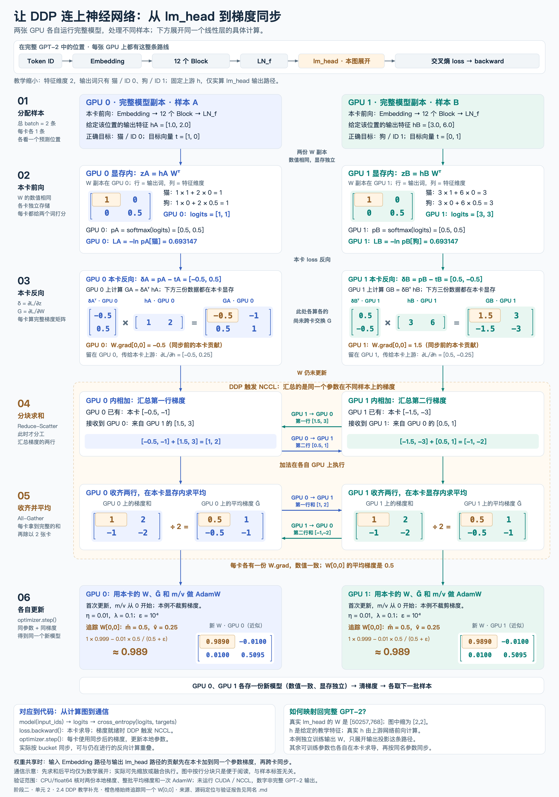
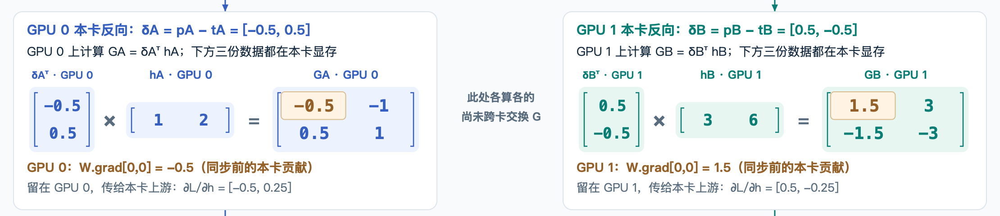

# GPT-2 多卡训练：DDP、平均损失与梯度同步

> 一批样本共享同一套参数。平均损失定义这次更新的共同目标；反向传播把它变成每个参数的梯度。DDP 把不同 GPU 上对应参数的梯度合并，使各卡继续使用一致的参数训练。

归档日期：2026-10-23。学习位置：**阶段二 · 单元 2 · 2.4「多卡与数据」的 DDP 原理讨论，理解中。** 本篇记录已讨论的内容与答疑，不表示整个 2.4 已完成；多进程工程运行、后续数据与验证集内容另行学习。

[Notion 归档版本](https://app.notion.com/p/402eaea31414814c80bad0fa8f02bdd7)。

项目：[guqun/GPT-2-124M](https://github.com/guqun/GPT-2-124M)。前篇：[AdamW、梯度裁剪、学习率与梯度累积](adamw-bias-correction-notes.md)（[Notion](https://app.notion.com/p/400eaea3141481a39db3f37c52896a35)）。

**来源与范围**：主线接续 [Karpathy 原视频 2:46:52 起的 DDP 内容](https://www.youtube.com/watch?v=l8pRSuU81PU&t=10012s)，承接此前已核对的自动字幕与作者 [ba2554a 历史提交](https://github.com/karpathy/build-nanogpt/commit/ba2554acce54487f07c13563247f2cce683e0d5e)。两张 GPU、两条样本、2×2 输出头和平均损失的完整矩阵推导属于本次答疑补充。下文区分数学等价、PyTorch 默认 DDP 行为与本机已有的 CPU 数值核验；没有把示意图当成 CUDA/NCCL 实测。

## 一、多张 GPU 各自负责什么

本篇采用常见的一进程一张 GPU 的 DDP 方式。每张 GPU 都有完整模型副本，负责不同样本的完整前向和反向计算。

```text
GPU 0：样本 A → Embedding → 所有 Block → LN_f → lm_head → 本卡 loss → 本卡梯度
GPU 1：样本 B → Embedding → 所有 Block → LN_f → lm_head → 本卡 loss → 本卡梯度
                                                         ↓
                                             跨卡同步对应参数的梯度
                                                         ↓
                                        每卡用相同梯度更新自己的模型副本
```

两卡参数起始数值相同，但分别保存在各卡显存中。GPU 0、GPU 1 不共用一块参数内存；`W[0,0]` 的两个 0 表示矩阵行列，GPU 编号才表示设备。

| 对象 | GPU 0 | GPU 1 |
| --- | --- | --- |
| 模型参数 | 一份完整模型副本 | 另一份完整模型副本 |
| 本卡输入 | 本次分配给 GPU 0 的样本 | 本次分配给 GPU 1 的样本 |
| 中间结果 | 本卡的隐藏向量、logits、loss | 本卡的隐藏向量、logits、loss |
| 同步前的参数梯度 | 本卡数据产生的梯度 | 本卡数据产生的梯度 |
| 同步后的参数梯度 | 一份汇总结果 | 相同数值的另一份汇总结果 |
| AdamW 状态 | 本卡的 m、v、更新次数 | 本卡的 m、v、更新次数 |

实际的数据划分由数据加载代码负责，DDP 不会自动把输入 batch 切给各卡。[PyTorch DDP 文档](https://docs.pytorch.org/docs/2.2/generated/torch.nn.parallel.DistributedDataParallel.html)

## 二、DDP、NCCL、All-Reduce 分别是什么

| 名称 | 含义 | 本课中的职责 |
| --- | --- | --- |
| DDP | Distributed Data Parallel，分布式数据并行 | 管理模型副本之间的梯度同步 |
| NCCL | NVIDIA Collective Communications Library | 为 NVIDIA GPU 提供集合通信及归约操作 |
| All-Reduce | 所有参与者共同归约，所有参与者都得到结果 | 合并各卡同一参数位置的梯度 |

All-Reduce 的 SUM 表示逐元素求和：同一个参数位置跨卡相加，不把一张梯度矩阵的所有元素加成一个标量。SUM 本身只是求和；DDP 默认梯度平均还包含按参与进程数缩放。

CPU 负责 Python 流程、进程管理和发起操作；本例采用 CUDA/NCCL 时，张量计算和梯度加法在 GPU 侧执行，通信搬运跨卡所需的数据。并不是默认把整份梯度搬到 CPU 上相加。实际传输路径由硬件拓扑和通信实现决定。[NCCL 集合通信定义](https://docs.nvidia.com/deeplearning/nccl/user-guide/docs/usage/collectives.html)

## 三、全流程图与各张卡的数据位置

先看通信概念图：


[概念图 SVG](diagrams/gpt2-ddp-allreduce-flow.svg) · [概念图阅读说明](diagrams/gpt2-ddp-allreduce-flow.md)

再看对应到神经网络计算的完整例子：



[完整图 SVG](diagrams/gpt2-ddp-lm-head-example.svg) · [数值图阅读说明](diagrams/gpt2-ddp-lm-head-example.md)

反向计算局部图重复标明每个操作数和结果的设备归属，截图也可以独立阅读：



图中的通信顺序为教学展开。真实 DDP 可以在某个梯度 bucket 就绪时启动同步，与其他梯度的反向计算重叠；不要求先等整个模型反向结束再开始所有通信。[DDP 设计说明](https://docs.pytorch.org/docs/2.2/notes/ddp.html)

## 四、具体例子：从哪一层开始，输入和输出是什么

观察 GPT 的 `lm_head`：输入是最终隐藏向量 h，输出是对每个候选 Token 的 logits。为了能手算，词表缩成两个候选词：猫为 ID 0，狗为 ID 1；隐藏维度缩成 2。

权重按 `[输出维度, 输入维度]` 保存，给定：

$$
W=\begin{bmatrix}1&0\\0&0.5\end{bmatrix},\qquad z=hW^T
$$

| 数据 | GPU 0：样本 A | GPU 1：样本 B |
| --- | --- | --- |
| 给定的隐藏向量 h | `[1,2]` | `[3,6]` |
| 本卡 W | `[[1,0],[0,0.5]]` | `[[1,0],[0,0.5]]` |
| 正确类别 | 0：猫 | 1：狗 |
| one-hot 目标 y | `[1,0]` | `[0,1]` |
| logits = hWᵀ | `[1,1]` | `[3,3]` |
| p = softmax(logits) | `[0.5,0.5]` | `[0.5,0.5]` |
| 本卡交叉熵 −ln p[目标] | `0.693147…` | `0.693147…` |

这些 h 是教学给定值，不是此次运行完整 GPT 得到的向量。图中两卡的相同概率和损失来自专门选择的数值，不是 DDP 的要求。

本例固定上游特征，单独观察不共享的输出权重 W。真实 GPT-2 的输出权重与 Token Embedding 共享时，同一个 Parameter 的梯度还包括本卡输入 Embedding 路径的贡献；这些本地贡献先合到同一个参数梯度中，再参与跨卡同步。

## 五、本卡反向：δ、G 与传回上游的梯度

先对一个样本、一个预测位置推导，采用无类别加权、无标签平滑的 softmax 交叉熵。

$$
\delta=\frac{\partial L}{\partial z}=p-y
$$

δ 是对 logits 的梯度，和 logits 有相同长度。它尚未是对 W 的梯度。

以第 j 个输出为例：

$$
z_j=\sum_k W_{j,k}h_k
$$

链式法则给出每个权重元素的梯度：

$$
G[j,k]=\frac{\partial L}{\partial W_{j,k}}
=\frac{\partial L}{\partial z_j}\frac{\partial z_j}{\partial W_{j,k}}
=\delta_jh_k,\qquad G=\delta^Th
$$

因此，GPU 0 在本卡计算：

$$
G_A=\begin{bmatrix}-0.5\\0.5\end{bmatrix}
\begin{bmatrix}1&2\end{bmatrix}
=\begin{bmatrix}-0.5&-1\\0.5&1\end{bmatrix}
$$

GPU 1 在本卡计算：

$$
G_B=\begin{bmatrix}0.5\\-0.5\end{bmatrix}
\begin{bmatrix}3&6\end{bmatrix}
=\begin{bmatrix}1.5&3\\-1.5&-3\end{bmatrix}
$$

持续追踪同一个 `W[0,0]`：GPU 0 的 `W.grad[0,0]` 是 −0.5，GPU 1 的 `W.grad[0,0]` 是 1.5。两张卡此时各有一个数，来自不同样本。

本卡还会计算传回输入特征的梯度：

$$
\frac{\partial L}{\partial h}=\delta W
$$

| 结果 | GPU 0 | GPU 1 |
| --- | --- | --- |
| δ | `[-0.5,0.5]` | `[0.5,-0.5]` |
| G | `[[-0.5,-1],[0.5,1]]` | `[[1.5,3],[-1.5,-3]]` |
| ∂L/∂h | `[-0.5,0.25]` | `[0.5,-0.25]` |

完整网络中，∂L/∂h 留在本卡，继续沿计算图传给 LN_f 和更前面的层；每一层再求自己的参数梯度。这里没有执行参数更新。

## 六、分块求和为什么必须交换数据

求和的对象是不同卡对同一个参数的贡献。GPU 0 只知道自己的 G_A，要算 G_A+G_B，就必须取得 GPU 1 对应位置的数据。

教学上把 All-Reduce（SUM）展开成 Reduce-Scatter 和 All-Gather：

| 阶段 | GPU 0 做什么 | GPU 1 做什么 |
| --- | --- | --- |
| 原始本地梯度 | 已有 G_A 的全部两行 | 已有 G_B 的全部两行 |
| Reduce-Scatter | 接收 GPU 1 第一行 `[1.5,3]`，与本卡 `[-0.5,-1]` 相加，得到 `[1,2]` | 接收 GPU 0 第二行 `[0.5,1]`，与本卡 `[-1.5,-3]` 相加，得到 `[-1,-2]` |
| All-Gather | 将 `[1,2]` 发给 GPU 1，并接收 `[-1,-2]` | 将 `[-1,-2]` 发给 GPU 0，并接收 `[1,2]` |
| 结果 | 保存完整的梯度和 | 保存相同数值的完整梯度和 |

加法在负责该块的 GPU 上执行。分块表示分配汇总任务：每张卡之前已经计算了完整的本地权重梯度，并没有只计算 W 的一半。

结果为：

$$
G_A+G_B=\begin{bmatrix}1&2\\-1&-2\end{bmatrix},\qquad
\bar G=\frac{G_A+G_B}{2}=\begin{bmatrix}0.5&1\\-0.5&-1\end{bmatrix}
$$

按行分块以及先 SUM 后除以 2，是帮助理解的等价分解；实际 NCCL 不保证固定按图中的行、先后顺序或单独两个 API 调用实现。[NCCL 集合通信定义](https://docs.nvidia.com/deeplearning/nccl/user-guide/docs/usage/collectives.html)

## 七、为什么要取平均：对应整批平均损失

本例每张卡各处理一个样本，目标是让两卡训练得到与单卡处理这两个样本的平均损失相同的梯度：

$$
L_{\mathrm{global}}=\frac{L_A+L_B}{2}
$$

对任意一个参数 θ 求导：

$$
\frac{\partial L_{\mathrm{global}}}{\partial\theta}
=\frac12\frac{\partial L_A}{\partial\theta}
+\frac12\frac{\partial L_B}{\partial\theta}
$$

因此，跨卡平均梯度直接来自平均损失这个目标。对 `W[0,0]`：

$$
\bar g=\frac{-0.5+1.5}{2}=0.5
$$

如果只求和，得到 1，对应总损失 L_A+L_B 的梯度。采用平均值，使梯度尺度不会只因为样本数量增加就成比例扩大。它仍可能随样本内容改变。

这里说的是梯度尺度，不能进一步断言“AdamW 的最终参数更新也一定扩大同样倍数”：AdamW 还会使用 m/v、ε、学习率和权重衰减。

一般地，R 张卡、每卡同样有 n 个有效损失项时：

$$
L_r=\frac1n\sum_{i=1}^{n}\ell_{r,i},\qquad
L_{\mathrm{global}}=\frac1R\sum_{r=0}^{R-1}L_r
=\frac1{Rn}\sum_{r=0}^{R-1}\sum_{i=1}^{n}\ell_{r,i}
$$

各卡若有不同数量 n_r 的有效项，匹配全局逐项平均需要按数量加权：

$$
L_{\mathrm{global}}=
\frac{\sum_r n_rL_r}{\sum_r n_r}
$$

默认 DDP 不会替训练代码自动识别并修正这种目标权重差异。本篇的双卡手算限定每卡一个有效项。[PyTorch DDP 文档](https://docs.pytorch.org/docs/2.2/generated/torch.nn.parallel.DistributedDataParallel.html)

## 八、一个 batch 针对某个参数，不是只有一个梯度吗

是的。**对一个标量参数 `W[0,0]`，一个 batch 反向传播后，最终梯度就是一个数。** 对整个 2×2 的参数矩阵 W，梯度 G 同样是 2×2，每个元素对应一个参数数值。

| 计算范围 | `W[0,0]` 最终得到的梯度 |
| --- | --- |
| 单卡一次处理 A、B，使用平均损失 | 一个数：0.5 |
| GPU 0 只处理 A，同步前 | 一个数：−0.5 |
| GPU 1 只处理 B，同步前 | 一个数：1.5 |
| 同步完成后 | 每张卡各保存一个数：0.5 |

“一个 batch”在多卡语境里必须说明是每卡本地 batch，还是所有卡合起来的全局 batch。默认梯度存储也没有额外保留一个样本维度：各样本对参数的贡献已经合在梯度结果里。

把样本 A、B 的梯度分别列出来，是为了说明数学来源，不意味着单卡批量执行时必须先逐个样本反向，再手工合并。

## 九、直接矩阵计算时，求和与平均究竟藏在哪里

现在把 A、B 放到**同一张 GPU 的同一个 batch** 中，使用与前面相同的 W、h 和标签。样本沿矩阵的行排列：

$$
H=\begin{bmatrix}1&2\\3&6\end{bmatrix},\qquad
W=\begin{bmatrix}1&0\\0&0.5\end{bmatrix},\qquad
Y=\begin{bmatrix}1&0\\0&1\end{bmatrix}
$$

一次矩阵乘法同时得到两条样本的 logits：

$$
Z=HW^T=\begin{bmatrix}1&1\\3&3\end{bmatrix},\qquad
P=\operatorname{softmax}_{\mathrm{row}}(Z)
=\begin{bmatrix}0.5&0.5\\0.5&0.5\end{bmatrix}
$$

批量计算依然保留两条样本。每个样本取正确类别的负对数概率，得到损失向量，再对它取平均：

$$
\ell=\begin{bmatrix}-\ln P_{A,0}\\-\ln P_{B,1}\end{bmatrix}
=\begin{bmatrix}\ln2\\\ln2\end{bmatrix},\qquad
L_{\mathrm{batch}}=\frac{\ell_A+\ell_B}{2}=\ln2\approx0.693147
$$

| 环节 | 输入 | 输出 | 目的 |
| --- | --- | --- | --- |
| 输出线性层 | H `[2,2]`、W `[2,2]` | Z `[2,2]` | 每个样本对两个候选类别打分 |
| softmax（数学展开） | 每行 logits | P `[2,2]` | 得到每个样本的类别概率 |
| 逐项交叉熵 | P、两个目标类别 | 两个损失 `[2]` | 衡量每个样本的预测 |
| mean | 两个损失 | 一个标量 loss `[]` | 定义本批次共同优化目标 |

实际交叉熵函数可融合或直接通过稳定的 log-softmax 计算，不必真的创建并保存这里展示的全部中间张量。

整批反向同样可以直接用矩阵乘法表示：

$$
\frac{\partial L_{\mathrm{batch}}}{\partial Z}=\frac{P-Y}{2},\qquad
G=\frac{\partial L_{\mathrm{batch}}}{\partial W}
=\frac{(P-Y)^TH}{2}
$$

代入数值：

$$
G=\frac12
\begin{bmatrix}-0.5&0.5\\0.5&-0.5\end{bmatrix}
\begin{bmatrix}1&2\\3&6\end{bmatrix}
=\begin{bmatrix}0.5&1\\-0.5&-1\end{bmatrix}
$$

其中一个元素就是：

$$
G[0,0]=\frac{(-0.5)\times1+0.5\times3}{2}=0.5
$$

**沿样本维求和已经包含在矩阵乘法的“对应相乘再相加”中；除以 2 来自平均损失。** 第五节每卡只有一条样本，其本地 δ 是 p−y；本节把两条放一起，平均 loss 对整批 logits 的梯度是 (P−Y)/2。不要把两种范围混用或重复除以 2。

## 十、有每个样本的 loss，为什么还需要 batch loss

每个样本的 loss 衡量该样本当前预测得怎么样。整批样本共享参数，一次 batch 更新要决定如何综合它们的影响。

选择平均损失，就是规定每个有效损失项在这次更新中同等重要，优化目标是降低它们的平均损失。也可以按任务需要定义加权目标；这是目标的选择，不是数学上只能求平均。

同一个参数可能受到不同样本的相反影响：本例样本 A 的梯度为 −0.5，样本 B 的为 1.5。采用平均目标后，它们的贡献合成 0.5，再交给优化器计算具体更新。

本例两个 loss 都是 ln 2，却有不同梯度。**损失数值回答“现在表现如何”，梯度回答“参数微小变化时，损失如何变化”。** 数值相同不能推导出导数相同。

可以在同一套参数下分别求各样本梯度，再平均；也可以直接对 batch 平均损失求导。两种计算在数学上等价。后者能直接利用批量矩阵运算。逐个样本更新参数则改变了后续求导时的参数位置，不能直接视为同一件事。

## 十一、求平均之后，后续求导都基于这个平均损失吗

是。一次这样的反向传播中，参数梯度与中间激活梯度都表示所定义的平均损失对它们的导数。反向传播沿产生 loss 的完整计算图进行，不是把打印出的 `0.693147` 当作孤立常数再求导。

对两条样本：

$$
L=\frac{L_A+L_B}{2},\qquad
\frac{\partial L}{\partial L_A}=\frac12,\qquad
\frac{\partial L}{\partial L_B}=\frac12
$$

链式法则继续传播：

$$
\frac{\partial L}{\partial\theta}
=\frac12\frac{\partial L_A}{\partial\theta}
+\frac12\frac{\partial L_B}{\partial\theta}
$$

这个 θ 可以是 lm_head、MLP、Q/K/V 投影、LayerNorm 或 Embedding 中参与本次计算的任一参数元素。

**1/2 在平均运算处引入一次，随后沿链式法则传播；不是每经过一层就再除以 2。** AdamW 的独立权重衰减属于之后的优化器更新，不是沿平均损失计算图产生的另一条梯度。

在 DDP 中，每卡先对本卡平均损失反向，再合并对应参数的梯度；并不要求先把各卡 loss 数值收集到一张卡，拼出一个跨设备计算图。为了日志统计而平均 loss，和为了训练而同步参数梯度，是两个用途。

## 十二、接回 GPT 的 B、T、参数更新和已有代码

GPT 的输入一般是 `[B,T]`，logits 是 `[B,T,V]`。B 表示序列条数，T 表示每条序列参与预测的位置数。项目当前训练没有 padding 或忽略位置，交叉熵对 B×T 个位置取平均：

$$
L_{\mathrm{local}}=\frac1{BT}\sum_{b=1}^{B}\sum_{t=1}^{T}\ell_{b,t}
$$

`V` 是每个位置的候选类别数，softmax 在这一维归一化；最终 loss 的平均除数是有效预测位置数，不是词表大小。若使用忽略标签或掩码，分母应按有效位置计算。

| 项目位置 | 实际做什么 | 对应本篇 |
| --- | --- | --- |
| `gpt2_model.py` 的 `GPT.forward` | LN_f 后调用 `self.lm_head(x)` | 隐藏向量变成各位置 logits |
| `train_step.py` 的 `next_token_loss` | `[B,T,V]` 展成 `[B*T,V]`，标签展成 `[B*T]`，调用交叉熵 | 逐位置损失合成一个平均 loss |
| `train_mixed_precision.py` 的 `forward_and_loss` | autocast 内完成模型前向和同样的平均交叉熵 | 当前训练入口的前向/损失 |
| `train_mixed_precision.py` 的 `train_amp_steps` | 清梯度、前向、`loss.backward()`、`optimizer.step()` | 反向产生梯度，优化器才更新参数 |

下面只是已有平均损失调用的解释，不是新增的 DDP 训练入口：

```python
# logits: [B, T, V]；targets: [B, T]
scores = logits.reshape(-1, logits.size(-1))  # [B*T, V]
labels = targets.reshape(-1)                 # [B*T]

# mean 是默认行为，显式写出方便理解。
# 传入 logits，函数内部稳定地计算交叉熵；不用先手动做 softmax。
loss = F.cross_entropy(scores, labels, reduction="mean")
loss.backward()  # 对这个平均损失求导，累加到各参数的 .grad
```

[CrossEntropyLoss 文档](https://docs.pytorch.org/docs/stable/generated/torch.nn.CrossEntropyLoss.html)说明了无归约损失与 mean/sum 的关系。项目实际依赖版本为 PyTorch 2.2.2；本文没有升级依赖。

多卡一次更新的逻辑顺序是：取各卡数据 → 各卡前向/平均损失 → 反向并同步梯度 → 如需裁剪则统一裁剪最终梯度 → 各卡 AdamW 更新 → 为下一次更新清梯度。清梯度也可放在下一轮起点，前提是不能在需要累积时清掉已有贡献。

两卡从一致的参数和优化器状态开始，使用相同的最终梯度与超参数，因此各自执行 AdamW 后仍能保持参数一致。同步的是参数梯度；不需要每次先各自更新成不同参数，再平均参数。

本例不裁剪，AdamW 使用 lr=0.01、β₁=0.9、β₂=0.95、ε=10⁻⁸、weight_decay=0.1，m/v 初始为零。追踪的 `W[0,0]` 从 1 更新到约 0.989；两卡都得到：

$$
W'\approx\begin{bmatrix}0.9890&-0.0100\\0.0100&0.5095\end{bmatrix}
$$

已有训练入口仍是单设备教学实现。这里说明它们与 DDP 原理的衔接，没有在本次笔记整理中接入或启动多卡训练。

## 十三、与梯度累积的联系：不要把几个除数混在一起

回顾前篇：每卡每个微批次有 B×T 个有效位置，一次更新累积 K 个同等大小的微批次，有 R 张卡。

| 归一化位置 | 除数 | 目的 |
| --- | --- | --- |
| 微批次交叉熵取 mean | B×T | 得到这个微批次的平均损失 |
| 累积前对 loss 缩放 | K | 多次 backward 相加后对应 K 个微批次的平均 |
| DDP 默认跨卡梯度平均 | R | 合并各卡贡献，得到所有卡的平均 |

在有效项数一致且目标可按这些项相加的条件下，整体对应 R×K×B×T 个位置的平均梯度。默认 DDP 已经做跨卡平均，不能再无理由手工除一次 R。各微批次或各卡有效项数不同时，需要按实际有效项数量统一权重。

这张表用于区分已讨论概念。DDP 与梯度累积如何减少同步次数等工程细节，留在对应实现环节学习。

## 十四、复习问答、验证记录与来源

<details>
<summary>1. 一个参数为什么能在两张卡上看到两个梯度值？</summary>

每张卡都有这个参数的副本，并处理不同数据。同一个标量参数在每张卡本地各有一个梯度。同步之后，每卡各保存相同的汇总梯度值。

</details>

<details>
<summary>2. batch 直接用矩阵计算，为什么还会出现逐样本 loss 和平均？</summary>

矩阵计算保留样本维，输出每行仍属于一个样本。交叉熵先在数学上定义逐项损失，再进行 mean 归约。一个函数调用可以把这些操作一起完成；反向矩阵乘法则把沿样本维的求和包含在乘加中。

</details>

<details>
<summary>3. 有每个样本的 loss，为什么要定义 L_batch？</summary>

样本共享参数，一次更新需要共同目标。平均损失规定各有效项等权，其梯度就是各项梯度的平均；也可以在同一套参数下分别求梯度后平均，数学等价。

</details>

<details>
<summary>4. 平均损失的 1/B 是每层都再乘一次吗？</summary>

不是。1/B 只在平均算子的导数中引入一次，之后沿计算图传播。反向依据整个计算过程，不是依据打印出来的 loss 数字独立求导。

</details>

<details>
<summary>5. Reduce-Scatter 的加法在本卡做，为什么仍需要通信？</summary>

加法要合并不同卡对同一参数的贡献。本卡没有另一张卡的数据，先接收相应部分，才能在本卡完成加法。随后 All-Gather 让每卡拿到完整汇总结果。

</details>

<details>
<summary>6. 两张卡的 loss 一样，梯度也一样吗？DDP 会同步 loss 吗？</summary>

loss 相同不意味着梯度相同，本例就是反例。默认 DDP 训练同步参数梯度；日志中的 loss 汇总需要训练代码另行安排。

</details>

已有 [CPU 数值报告](../artifacts/ddp-lm-head-diagram-check.json)使用 PyTorch 2.2.2、float64，验证两个独立 2×2 线性层的 logits、交叉熵、δ、权重梯度和输入特征梯度。CPU 手动平均两份梯度与单卡联合 batch 的平均损失求导，最大差为 0；两份模型各自一次 AdamW 更新与整批更新的最大差也均为 0。报告同时检查 backward 后权重未更新。

本次整理复用已有报告与图片，不重训完整 GPT。图中的数值精确相同来自这个可控小例子；真实大规模并行中，浮点归约顺序、随机算子等可能产生数值差异。它不改变这里的数学目标关系。

来源与关联材料：

- [Karpathy 原视频 DDP 段落](https://www.youtube.com/watch?v=l8pRSuU81PU&t=10012s)与 [ba2554a 历史实现](https://github.com/karpathy/build-nanogpt/commit/ba2554acce54487f07c13563247f2cce683e0d5e)：课程衔接；矩阵推导属于本次补充。
- [PyTorch 2.2 DDP 文档](https://docs.pytorch.org/docs/2.2/generated/torch.nn.parallel.DistributedDataParallel.html)：模型副本、输入划分与梯度同步。
- [DDP 设计说明](https://docs.pytorch.org/docs/2.2/notes/ddp.html)：反向 hook、bucket 和通信重叠的机制；页面内部设计说明注明按 v1.4 状态撰写，本文仅用于解释基本机制。
- [NCCL 集合通信定义](https://docs.nvidia.com/deeplearning/nccl/user-guide/docs/usage/collectives.html)：All-Reduce、Reduce-Scatter、All-Gather。
- [交叉熵文档](https://docs.pytorch.org/docs/stable/generated/torch.nn.CrossEntropyLoss.html)：逐项损失及归约。
- [数值图说明与重绘入口](diagrams/gpt2-ddp-lm-head-example.md)、[前篇梯度累积笔记](adamw-bias-correction-notes.md)：回看计算和单设备累积流程。

当前掌握记录为“理解中”。本篇不变更 Notion 总计划和课程完成计数，不把 CPU 小例子验证记为用户已独立完成多卡实验。
