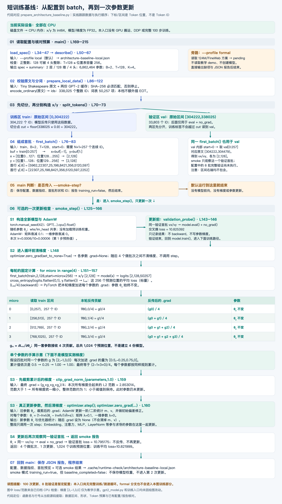

# 短训练基线：配置、数据与一次参数更新

[打开 SVG 放大阅读](architecture-baseline-code-flow.svg) · [打开 PNG](architecture-baseline-code-flow.png) · [本节讲义](../../lesson16-architecture-baseline.md)

## 如何对照代码

对应入口是 [prepare_architecture_baseline.py](../../prepare_architecture_baseline.py)。图中函数名与行号从源码提取，顺序按实际调用展开。

| 图中环节 | 对应代码 | 输入 → 输出 |
| --- | --- | --- |
| 配置读取、预算检查 | `main → load_spec → describe` | local JSON → 模型配置、参数量和训练预算 |
| 校验原文、分词 | `prepare_local_data` | 本地原文及 GPT-2 分词资产 → 338,025 个整数 ID |
| 数据切分 | `split_tokens` | 全部 ID → 独立的 train / val 两段 |
| 组成 batch | `first_batch` | 当前段的连续 257 个 ID → x/y，均为 `[2,128]` |
| 可选更新检查 | `smoke_step` | 随机新模型、train / val → 一次更新及检查指标 |
| 微批次累积 | `for micro in range(k)` | 四批不同 x/y → 同一套参数的累计 `.grad` |
| 裁剪和更新 | `clip_grad_norm_ → optimizer.step` | 累计梯度、旧参数 → 新参数与 AdamW 统计量 |
| 收尾 | `validation_probe → main` | 同一验证首批、新参数 → 指标及 JSON 报告 |

## 看清 batch 的数据来源

图中的区间表示 **Token 在数组中的位置，不是 Token ID 的大小范围**；右端均不包含。

先切出 `train=[0,304222)` 与 `val=[304222,338025)`，再在各自内部构造 x/y。这样训练标签不会跨入验证区。

本机 B=2、T=128，每微批次有 256 个预测位置。取 257 个 ID，`x=buf[:-1].view(2,128)`，`y=buf[1:].view(2,128)`。每个 x 位置的监督目标是紧随其后的真实 ID。

四个微批次分别取 `[0,257)`、`[256,513)`、`[512,769)`、`[768,1025)`。相邻区间共用一个边界 ID：它是上一批最后一个标签，又是下一批第一个输入；预测位置没有重复。总共取用 1,025 个连续 ID，形成 1,024 个预测位置。

## 梯度在哪里累积

先清梯度，然后每轮前向得到 logits `[2,128,50257]`；交叉熵对本轮 256 个预测位置取平均，得到标量 `L_m`。执行 `(L_m/4).backward()`，PyTorch 将本轮梯度加进各参数的 `.grad`。

设 `g_m` 是未除以 4 的本轮平均损失对参数的梯度。四轮后 `.grad=(g_0+g_1+g_2+g_3)/4`。因为四轮预测位置数相同，这也是全部 1,024 个预测位置的平均损失对应的梯度。四轮中参数不变，也不清梯度；不是每轮都更新参数。

图中 `[2,-1,3,0]` 是为说明单个参数如何累积而选取的教学梯度，不是模型实测值。它依次贡献 `[0.5,-0.25,0.75,0]`，最终累积为 1。

随后对所有累计梯度一起进行全局范数裁剪，再调用一次 AdamW `step()`。这时参数才改变。最后 `zero_grad(set_to_none=True)` 清除梯度，保留 AdamW 的一阶、二阶统计量。

## 当前入口的实际范围

- 默认 local：检查配置和数据，展示首批，输出报告；不创建模型、不训练。
- local 加 `--smoke-step`：CPU/FP32、随机初始化小模型，四个微批次累计一次参数更新；更新前后各观察同一个验证首批。
- formal：输出 124M/FineWeb 方案的待准备项，不读取教学 demo 代替正式数据，也不创建模型。

图中的验证 loss 与梯度范数来自 [已归档检查报告](../../artifacts/architecture-baseline-local-check.json)。验证只做 `eval + no_grad`，不参与反传。这里的单批验证不等于配置中规划的 8 批完整验证；一次更新也不等于完成规划中的 100 次短训练。

当前流程全部在 CPU，ID 为 int64，参数与梯度为 FP32；没有 GPU 搬运、DDP、完整训练循环或权重保存。本图描述现有入口，不将后续计划画成已经实现。

## 重绘与核验

项目根目录执行 `python3 docs/diagrams/render_architecture_baseline_flow.py`，生成 PNG/SVG 和 [核对记录](../../artifacts/architecture-baseline-diagram-check.json)。重绘读取配置、源码与既有报告，不运行模型训练。
