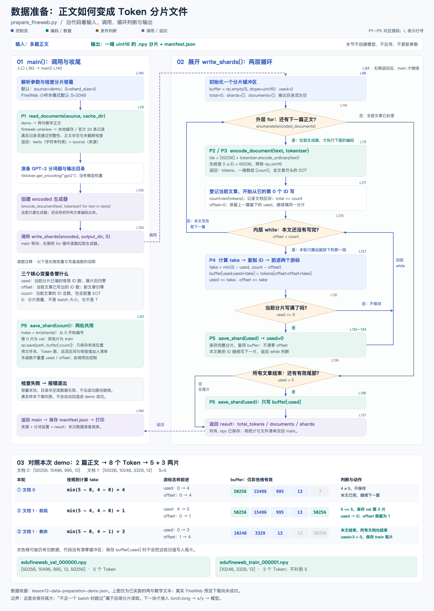

# 数据准备：代码流转图

配套 [prepare_fineweb.py](../../prepare_fineweb.py) 与 [数据准备讲义](../../lesson12-data-preparation.md)。

[打开 PNG](gpt2-data-preparation-flow.png) · [打开可缩放 SVG](gpt2-data-preparation-flow.svg)



## 阅读顺序

1. 左侧 `main()` 先读取正文，再创建分词器与生成器，随后调用右侧 `write_shards()`。
2. 紫色虚线表示调用与返回；右侧不是另一个并行任务。左侧的变量说明、写盘函数说明是读图注释，不是 main 中额外执行的步骤。
3. 右侧的外层 `for` 拉取生成器，每次才调用 `encode_document()` 编码一篇；内层 `while` 把当前文章写完。一篇文章可以跨多个分片。
4. `used == S` 时调用 `save_shard(used)`，再只把 used 清零；offset 保留，回到内层判断。`offset == count` 时换下一篇，offset 重置为 0，used 保留。
5. 全部文章处理完才判断 `used > 0`，保存有效尾部，返回 main 写 manifest。恰好写满时 used=0，不多保存一个空文件。
6. 底部按既有 demo 报告展开实际 8 个 ID，三轮 take 为 4、1、3，最终为 5+3 两片。灰色缓冲区位置可能含旧值，只是当前无效，不代表代码真的清零了它们。

## 源码对应

| 图中节点 | prepare_fineweb.py 行号 | 输入 → 输出 |
| --- | --- | --- |
| 主入口 | L182 → L140 | 命令行参数 → 准备与调用 |
| P1 读取正文 | L29 | 来源选择 → texts、source |
| 创建生成器 | L158 | texts、tokenizer → encoded；此时没有遍历编码 |
| 调用分片器 | L159 → L84 | 逐篇生成器、目录、容量 → 分片结果 |
| 分片初始化 | L96 | S → 一维 uint16 缓冲区；used=0 |
| 外层 for | L114 | 生成器 → 下一篇的 tokens，或耗尽 |
| P2/P3 编码 | L73 | 正文 → EOT+普通编码 ID → 范围检查 → uint16 |
| 新文章初始化 | L117—124 | tokens → count、文档区间、offset=0 |
| 内层 while | L125 | offset < count → 继续写本文，或取下一篇 |
| P4 取数与复制 | L127—130 | 两种剩余量 → take → 修改 buffer、used、offset |
| 完整片判断 | L131 | used == S → 保存并把 used 清零 |
| P5 写盘函数 | L101 | buffer[:count] → .npy、文件清单、校验值 |
| 最终尾片判断 | L135 | 全部文章结束后的 used → 是否保存短尾片 |
| 返回 / 保存清单 | L137 → L169 | result → manifest.json 与终端输出 |

行号由绘图脚本从当前源码提取；再次运行绘图脚本会重新定位。P1—P5 与源码说明字符串一致。

## 两个不同的边界

- 文档的边界由前置 EOT 标记；文件的边界由分片容量决定，不会因为换文件而再加一个 EOT。
- 本例第二篇的 EOT 被放在第 0 片，正文位于第 1 片。按照原课，第 0 片为 val，其余为 train；这不保证完整文档级别的 train/val 隔离。
- 准备阶段把短尾片保存下来。训练读取阶段“片内不足一个 batch 时跳过”尚未接入本脚本，不能把它画成这里丢掉剩余 ID。
- 文件存储类型是整数 uint16，不是 BF16 浮点计算；下一块读取后才转换 torch.long、构造 x/y、送入模型。

## 验证与重建

数值来自[既有 demo 报告](../../artifacts/lesson12-data-preparation-demo.json)，默认容量 5，合计 8 个 Token。绘图脚本读取 ID 后复算三次搬运并核对分片区间；不下载数据、不运行模型，也不把演示文本当作真实 FineWeb 实跑。源码与数值核验记录见[图示核对结果](../../artifacts/lesson12-data-preparation-diagram-check.json)。

```bash
python docs/diagrams/render_data_preparation_flow.py --png
```

复用项目既有 SVG 组件和 macOS AppKit PNG 导出方式。源码改动后应重建图片；课程与本地改编的来源见[讲义](../../lesson12-data-preparation.md)。
