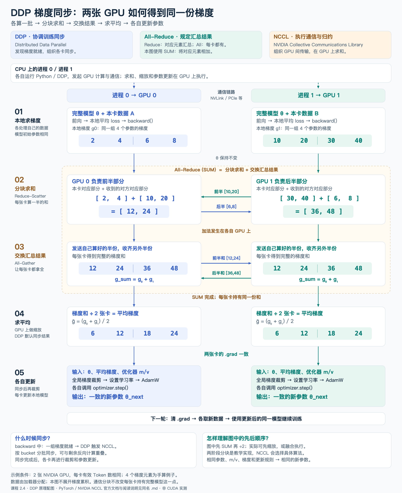

# DDP 梯度同步：两张 GPU 如何得到同一份梯度

阶段二 · 单元 2 · 2.4「多卡与数据」的 DDP 原理配图，承接单卡梯度累积和优化器更新。图中只展开一次双卡梯度同步，不同时展开微批次累积。



[原尺寸 PNG（2400×2940）](gpt2-ddp-allreduce-flow.png) · [可缩放 SVG](gpt2-ddp-allreduce-flow.svg)

想把通信接到具体神经网络计算，可以继续看 [lm_head 双卡数值全流程图](gpt2-ddp-lm-head-example.md)：从给定特征、词表分数和交叉熵推导两份权重梯度，再合并更新；同一个 W[0,0] 在全图持续高亮。

## 按两条 GPU 泳道阅读

1. **本地求梯度：** 每个进程驱动一张 GPU，持有完整模型和自己的优化器状态。加载器分配不同数据，模型分别前向、计算本地平均损失并反向。初始参数相同，本地梯度可以不同。
2. **分块求和（Reduce-Scatter）：** GPU 0 接收另一卡的前半梯度，在本卡算出前半的和；GPU 1 接收另一卡的后半梯度，在本卡算出后半的和。
3. **交换结果（All-Gather）：** 各卡发送自己已经求和的那一半，收集另一半。每张卡最终都有同一个完整梯度和。步骤 2、3 合起来是一种 `All-Reduce(SUM)` 的实现。
4. **求平均：** 两张卡都得到 `(g0 + g1) / 2`。图中“先求和、再除以 2”展示数学关系；实际 DDP 可以先缩放或融合执行，不保证是两个独立 GPU kernel。
5. **各自更新：** 同步之后，各卡按相同规则对所有参数的梯度统一裁剪、设置学习率，并执行本地 `optimizer.step()`。相同的参数、梯度、优化器状态和更新规则使模型保持一致。

蓝色代表 GPU 0，绿色代表 GPU 1；横向箭头表示跨卡传输，纵向箭头表示本卡处理的先后。CPU 上的两个进程分别发起 GPU 计算和集合通信；CUDA + NCCL 场景中的梯度加法与缩放通常在 GPU 上完成。

## 数字和范围

```text
本地梯度：GPU 0 [2,4 | 6,8]，GPU 1 [10,20 | 30,40]
分块求和：GPU 0 [12,24]，GPU 1 [36,48]
交换完成：两张卡各有 [12,24 | 36,48]
求平均：  两张卡各有 [6,12 | 18,24]
```

每个数组元素对应同一个参数，所有归约都按对应元素进行。观察四个元素是为了读清数值；完整模型有更多参数，DDP 通常把梯度组织为多个 bucket。每个 bucket 就绪即可启动通信，并与尚未完成的反向计算重叠，不要求等所有梯度都计算结束后才开始同步。

示例假设两张卡各自的有效 Token 数相同，本地 loss 均为平均值，使用默认 DDP 梯度同步，没有自定义通信 hook。此时跨卡平均对应合并数据后的平均损失梯度。有效 Token 数不同时，需要匹配全局目标的加权方式。

这是一种易读的通信分解。NCCL 根据硬件拓扑和消息大小等选择算法，不保证真实运行固定采用图示的分块、次序或内核数量。原视频的 8 卡训练在这里缩为 2 卡，四个梯度值为教学假设；本图不是 CUDA 实验输出。传输分块也不等于把模型参数分片，每张卡仍持有完整模型。

## 来源与重绘

- [Karpathy 原视频 DDP 段落，约 2:46:52–3:10](https://www.youtube.com/watch?v=l8pRSuU81PU&t=10012s)：多进程、每卡数据和模型副本、梯度平均及同步位置。课程承接依据此前核对的[非官方自动字幕副本](https://raw.githubusercontent.com/nolimitkun/ai-kol-wiki/main/sources/karpathy/20240609-l8pRSuU81PU/transcript.md)，不是直接观看视频画面。
- [作者加入 DDP 的历史提交 ba2554a](https://github.com/karpathy/build-nanogpt/commit/ba2554a)：课程代码位置参考；这里的分块数值图是额外教学说明。
- [PyTorch 2.2 DDP 文档](https://docs.pytorch.org/docs/2.2/generated/torch.nn.parallel.DistributedDataParallel.html)：梯度同步、各进程独立训练以及输入划分的责任。
- [PyTorch DDP 设计说明](https://docs.pytorch.org/docs/2.2/notes/ddp.html)：梯度 bucket、autograd hook、通信和反向计算重叠。
- [NCCL 总览](https://docs.nvidia.com/deeplearning/nccl/user-guide/docs/overview.html)：GPU 通信和归约计算。
- [NCCL 集合通信定义](https://docs.nvidia.com/deeplearning/nccl/user-guide/docs/usage/collectives.html)：All-Reduce、Reduce-Scatter、All-Gather 及其关系。

重绘入口：[render_ddp_allreduce_flow.py](render_ddp_allreduce_flow.py)。使用 Python 标准库生成 SVG；macOS 可通过 AppKit 导出 PNG。脚本会核对图中全部梯度数值，不执行分布式训练。

```bash
python docs/diagrams/render_ddp_allreduce_flow.py --png
```
