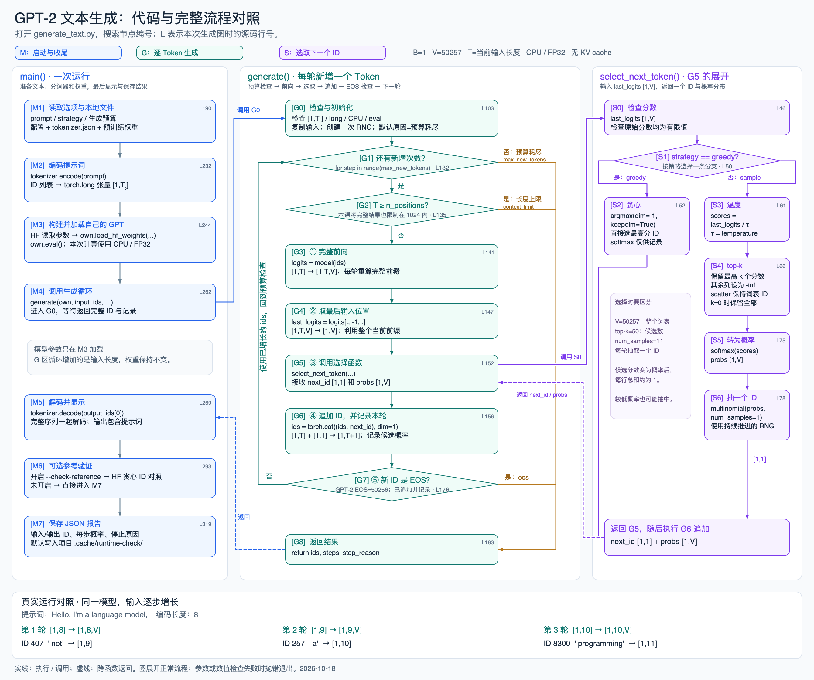

# GPT-2 文本生成：代码与完整流程对照

学习位置：**阶段二 · 单元 2「复现 GPT-2」· 2.1 · 知识块 3「文本生成」**。



[打开可放大的 SVG 原图](gpt2-generation-flow.svg)

图中每个编号对应 `generate_text.py` 的同名注释，可在 VS Code 中搜索 `[G3]` 等编号。`L` 是本次绘图时的行号；之后若继续增加注释，优先用稳定的编号定位。

## 按执行顺序读图

1. **M1～M4：准备一次运行。** 解析选项，加载本地配置与分词器，把提示词变成 `[1,T₀]` 的整数 ID，加载自己的模型，然后进入 `generate()`。
2. **G0～G2：准备并检查本轮。** 初始化一次随机数生成器。每次迭代先检查新增次数预算，再检查当前长度是否达到本教学实现的总长度上限。
3. **G3～G5：从前缀算出下一个 ID。** 自己的 `GPT.forward()` 输出 `[1,T,V]`，最后位置切片得到 `[1,V]`，将它交给右列 S 区选择。
4. **S0～S6：展开选取函数。** 贪心分支直接 argmax，softmax 仅供报告观察；采样分支依次进行温度缩放、top-k、softmax、multinomial。两条路径都返回 `[1,1]` 的 ID 和 `[1,V]` 的概率。
5. **G6～G8：反馈、停止与返回。** 先追加新 ID 并记录，再检查新 ID 是否为 EOS。未结束时用增长后的输入回到 G1。预算耗尽、达到长度上限或生成 EOS，都会通过 G8 返回调用者。
6. **M5～M7：解码与输出。** 完整序列一起解码；可选地做 Hugging Face 贪心对照；最后写出 JSON 报告。

实线表示执行或调用，虚线表示跨函数返回。跨线处的白色间隙表示两条线没有合并。错误检查失败会抛错退出；图中重点展开正常生成路径。

## 图与源码定位表

| 编号 | 观察内容 | 对应源码 |
| --- | --- | --- |
| `M1` | 选项、本地文件、配置与分词器 | [第 190 行](../../generate_text.py#L190) |
| `M2` | 提示词编码与 batch 维 | [第 232 行](../../generate_text.py#L232) |
| `M3` | 加载参考权重并复制到自己的模型 | [第 244 行](../../generate_text.py#L244) |
| `M4` | 进入生成循环 | [第 262 行](../../generate_text.py#L262) |
| `M5` | 解码完整 ID 并显示日志 | [第 269 行](../../generate_text.py#L269) |
| `M6` | 可选的参考生成对照 | [第 293 行](../../generate_text.py#L293) |
| `M7` | 保存实验报告 | [第 319 行](../../generate_text.py#L319) |
| `G0` | 前置检查、复制输入与初始化随机数 | [第 103 行](../../generate_text.py#L103) |
| `G1` | 新增次数预算 | [第 132 行](../../generate_text.py#L132) |
| `G2` | 总长度边界 | [第 135 行](../../generate_text.py#L135) |
| `G3` | 完整前缀前向计算 | [第 141 行](../../generate_text.py#L141) |
| `G4` | 取最后位置的词表分数 | [第 147 行](../../generate_text.py#L147) |
| `G5` | 调用 Token 选择函数 | [第 152 行](../../generate_text.py#L152) |
| `G6` | 追加 ID 与记录观察值 | [第 156 行](../../generate_text.py#L156) |
| `G7` | 新生成 EOS 检查 | [第 176 行](../../generate_text.py#L176) |
| `G8` | 返回 ID、记录与停止原因 | [第 183 行](../../generate_text.py#L183) |
| `S0` | 检查分数有效性 | [第 46 行](../../generate_text.py#L46) |
| `S1` | 选择策略 | [第 50 行](../../generate_text.py#L50) |
| `S2` | 贪心 argmax | [第 52 行](../../generate_text.py#L52) |
| `S3` | 温度缩放 | [第 61 行](../../generate_text.py#L61) |
| `S4` | top-k 与原词表 ID | [第 66 行](../../generate_text.py#L66) |
| `S5` | softmax 概率 | [第 75 行](../../generate_text.py#L75) |
| `S6` | 按概率抽样并返回 | [第 78 行](../../generate_text.py#L78) |

## 对照时抓住五件事

- **前向输出的 T 对应已有输入位置。** 最后位置经过因果注意力，已经可以利用完整前缀，因此用它预测接下来追加的 Token。
- **每轮真正反馈的是整数 ID。** `torch.cat(..., dim=1)` 把 `[1,T]` 扩展为 `[1,T+1]`，下一轮重新计算完整前缀；本课未使用 KV cache。
- **选择策略不改变模型权重。** 贪心和采样改变选中的 ID，随后不同前缀会影响之后的预测分布。
- **停止检查有先后顺序。** 预算在循环入口控制；长度在前向前检查；EOS 在追加后检查。因而返回序列包含新生成的 EOS，零预算时不调用前向。
- **展示与生成分开理解。** G6 中保存的前 5 个候选用于观察，与 top-k 的采样候选数量用途不同；最终文本由 M5 对完整 ID 序列解码。

图底部的三轮结果来自项目内保存的真实贪心运行报告。完整教学步骤、采样对比与自检见 [lesson03.md](../../lesson03.md)。前向模型内部结构可继续对照 [上一块的调用图](gpt2-forward-call-map.md)。

## 维护图与代码的对应关系

图由本目录的 `render_generation_flow.py` 生成，SVG 部分只使用 Python 标准库。脚本从源码读取编号和行号，从项目缓存读取已验证的实验前三步；输出在本目录，更新前应保留实验报告。

```bash
.venv/bin/python docs/diagrams/render_generation_flow.py
```

上面的命令更新 SVG 与本说明。macOS 可加 `--png` 同时通过系统 AppKit 导出 PNG，编译缓存和临时文件均放在本项目 `.cache/` 中：

```bash
.venv/bin/python docs/diagrams/render_generation_flow.py --png
```

生成图的本次依据：2026-10-18 本地注释版本；实验数据来自此前保存的 CPU / FP32 贪心报告。源码执行逻辑没有随注释调整而改变。
