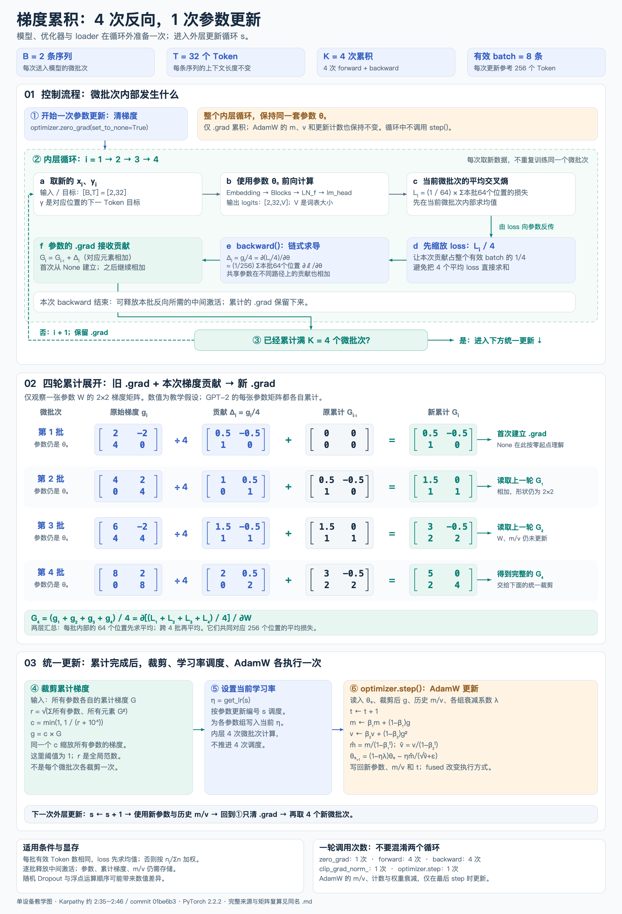

# 梯度累积：4 次反向，1 次参数更新

阶段二 · 单元 2 · 2.3「超参数与优化」。承接参数分组、fused AdamW 与 `optimizer.step()` 的讨论。

完整原理、四轮手算与两层循环已并入 [AdamW 笔记第十七节](../adamw-bias-correction-notes.md)；[原 Notion 笔记](https://app.notion.com/p/400eaea3141481a39db3f37c52896a35)同步嵌入本图。



[原尺寸 PNG（2400×3520）](gpt2-gradient-accumulation-flow.png) · [可缩放 SVG](gpt2-gradient-accumulation-flow.svg)

## 阅读顺序

1. **上半部：** 外层代表一次参数更新；内层依次处理四个新微批次。每次取数、前向、求平均交叉熵、loss 除以 4、反向并累计梯度。四次前向使用相同的参数。
2. **中间矩阵：** 观察同一张参数矩阵 W 的 `.grad`。从原始梯度 `g_i` 除以 4，得到本次贡献 `Δ_i`，再与上一轮累计值相加。所有相加都按对应元素进行，矩阵形状不变。
3. **下半部：** 满四次后，对所有参数的累计梯度统一裁剪，设置本次更新的学习率，然后执行一次 AdamW。下一次外层更新只清 `.grad`，继续使用更新后的参数与历史 m/v。

图中 `s` 表示外层参数更新编号；`t` 表示 AdamW 为每个参与更新的参数维护的计数，用于偏差修正。第一次 `step()` 前，AdamW 的 m/v 可能尚未建立；首次使用时初始化为零，之后持续保留。梯度为 `None` 的参数在当前 AdamW 实现中跳过。

## 两层汇总，各自在平均什么

本图是单设备缩小教学例：`B=2`、`T=32`、`K=4`，每批 64 个有效预测位置，每次参数更新使用 8 条序列、256 个预测位置。拆分 batch 的行数，保持各条序列的上下文不变；不把同一长序列任意切短来替代。

当前微批次先在自己的有效位置上求平均：

\[
L_i=\frac{1}{64}\sum_{b=1}^{2}\sum_{t=1}^{32}\ell_{i,b,t}.
\]

对这张参数矩阵，定义当前微批次未经跨批缩放的梯度：

\[
g_i=\frac{\partial L_i}{\partial W}.
\]

实际调用 `(loss / 4).backward()`，贡献是：

\[
\Delta_i=\frac{g_i}{4}
=\frac{1}{256}\sum_{b,t}\frac{\partial\ell_{i,b,t}}{\partial W}.
\]

每个位置对同一共享参数的所有计算路径，按链式法则汇总。上式是数学展开；实际 autograd 批量执行求导，不要求显式保存 64 张单位置参数梯度矩阵。

跨微批次累积：

\[
G_i=G_{i-1}+\Delta_i,
\qquad G_4=\frac{g_1+g_2+g_3+g_4}{4}.
\]

`zero_grad(set_to_none=True)` 后实际 `.grad` 为 `None`；图中零矩阵表示数学起点。第一次反向建立梯度，后面的反向继续相加。无需 `retain_graph=True`：每个微批次建立自己的前向图，反向后可以释放本次反向所需的中间激活，而参数梯度继续保留。

## 图中矩阵的复算

矩阵数字为独立教学例子，并非完整 GPT-2 训练输出：

```text
g1 = [[2, -2], [4, 0]]   → Δ1 = [[0.5, -0.5], [1, 0]]
g2 = [[4,  2], [0, 4]]   → Δ2 = [[1.0,  0.5], [0, 1]]
g3 = [[6, -2], [4, 4]]   → Δ3 = [[1.5, -0.5], [1, 1]]
g4 = [[8,  2], [0, 8]]   → Δ4 = [[2.0,  0.5], [0, 2]]

G1 = [[0.5, -0.5], [1, 0]]
G2 = [[1.5,  0.0], [1, 1]]
G3 = [[3.0, -0.5], [2, 2]]
G4 = [[5.0,  0.0], [2, 4]]
```

[复算记录](../../artifacts/gradient-accumulation-diagram-check.json)使用 CPU/float64、一个 2×2 参数和可构造这些梯度的二次损失，核对：

- 一次处理 8 条样本与分 4 次、每次 2 条样本，最终梯度相同。
- 四次反向之间参数不变，AdamW 历史状态没有推进。
- 两种方式统一裁剪后、再执行一次相同配置的 AdamW，结果相同。
- `zero_grad` 清梯度后，更新后的参数与历史 m/v 保留。

这个复算只验证示例与累积逻辑，不是 GPT-2 训练、CUDA 性能或 Dropout 完全复现实验。

## 统一裁剪与更新

图中阈值为 1，按 PyTorch 2.2.2 的实现：

\[
r=\sqrt{\sum_{p\in\text{所有参数}}\sum_j G_{p,j}^{2}},
\quad c=\min\left(1,\frac{1}{r+10^{-6}}\right),
\quad g_p=cG_p.
\]

必须从所有参与参数的梯度得到同一个全局缩放系数，不是只用图中那张 W 单独决定整套 GPT 的裁剪量。逐微批次裁剪再累加，通常与先累加再统一裁剪不同。

随后一次 `optimizer.step()` 更新 m、v、计数与参数。各组使用自己的 `weight_decay`；无衰减组令 λ=0。图中 AdamW 公式是数学形式，底层可以合并运算；fused 实现不会把四个微批次变成四次优化器更新。

## 适用边界

- `loss / K` 假设各微批次参与平均损失的有效位置数相同。若有不同的 padding、忽略目标或末尾短批，应按 `n_i / Σ n_i` 加权，或累计损失和后使用正确的总有效位置数归一化。
- 样本计算可按 batch 独立拆分、使用相同参数和匹配的随机选择时，数学目标与整批平均损失一致。Dropout 随机数和浮点求和顺序可能带来差异；跨样本统计的层另需分析。
- 主要节省中间激活的峰值显存。参数、累计梯度和优化器状态仍需存储，不代表总显存严格缩小到四分之一。
- 原视频单设备配置为 `B=16, T=1024, K=32`，有效 batch 为 `524288` Token；本图用 4 轮便于逐轮阅读。未扩展到后续 DDP。
- 本图及补充笔记用于解释和复算，现有训练入口未因此自动接入梯度累积；主线学习完成计数与 Notion 总计划不变。

## 来源与重绘

- [Karpathy 视频约 2:35—2:46](https://www.youtube.com/watch?v=l8pRSuU81PU&t=9313s)：显存约束、微批次、多次反向、平均损失缩放。
- [已核对的非官方自动字幕副本](https://raw.githubusercontent.com/nolimitkun/ai-kol-wiki/main/sources/karpathy/20240609-l8pRSuU81PU/transcript.md)：不是直接观看视频或官方逐字稿；与作者历史提交交叉核对。
- [作者加入梯度累积的历史提交 01be6b3](https://github.com/karpathy/build-nanogpt/commit/01be6b3)。
- [PyTorch 2.2 backward 文档](https://docs.pytorch.org/docs/2.2/generated/torch.Tensor.backward.html)：叶子梯度累加与图释放。
- [PyTorch 2.2 梯度累积示例](https://docs.pytorch.org/docs/2.2/notes/amp_examples.html#gradient-accumulation)：有效 batch、缩放与更新时机。当前图不引入 FP16 GradScaler。

重绘入口为 [render_gradient_accumulation_flow.py](render_gradient_accumulation_flow.py)。SVG 绘制仅需 Python 标准库，PNG 导出沿用本项目 macOS AppKit，数值核验使用课程环境中的 PyTorch：

```bash
python docs/diagrams/render_gradient_accumulation_flow.py --png --verify-torch
```
