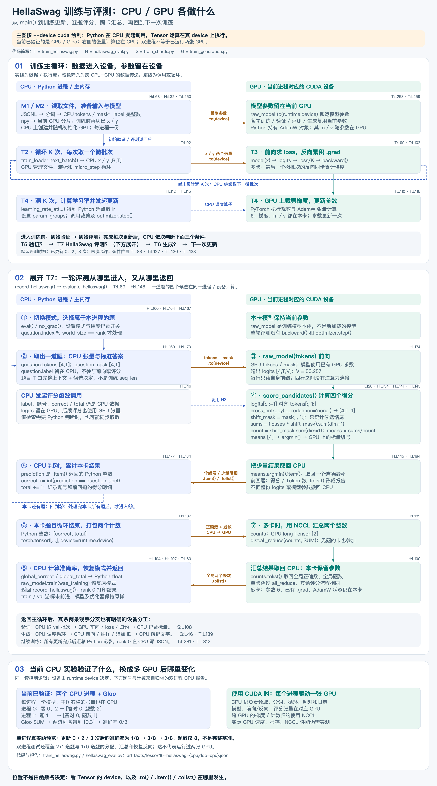

# HellaSwag 训练与评测：CPU / GPU 代码流程图

[PNG 原图](gpt2-hellaswag-cpu-gpu-flow.png) · [可缩放 SVG](gpt2-hellaswag-cpu-gpu-flow.svg) · [配套讲义](../../lesson15.md)



## 如何阅读

主图按 `--device cuda` 绘制：蓝色是 CPU 的 Python 控制及主内存数据，绿色是本进程 GPU 上的张量运算，橙色是跨设备数据传递。两个泳道不是两个并发执行的 worker；一个进程在 CPU 执行 Python，并向自己的 GPU 提交算子。

1. 上方是训练主循环：CPU 加载分片、准备题目、随机初始化模型，再把参数搬到设备；CPU 每次取 x/y，GPU 完成前向、反向和参数更新。循环、学习率计算和调用发起在 CPU。
2. 中间展开 `record_hellaswag → evaluate_hellaswag`：CPU 按题号选择本进程负责的题，把 tokens 和 mask 送到 GPU；label 一直是 CPU 数据。
3. GPU 前向与评分后，`argmin()` 仍是 GPU 算子；`.item()` 才取回 Python 整数。CPU 比较 prediction 和 label，累计本卡正确数、总题数；返回取下一题。
4. 本卡题目全部处理完后，CPU 把这两个计数建立为设备 Tensor。CUDA/NCCL 在 GPU 上 SUM；`counts.tolist()` 把最终计数取回，CPU 做准确率除法、恢复模式和记录结果。
5. 返回主循环，按条件生成，然后继续训练。整个循环结束后汇总记录，由 rank 0 写 JSON；模型没有因评测搬回 CPU，也没有重建优化器。

## 必须区分的设备细节

- `model.eval()` / `model.train()` 改变模块的模式标志；`no_grad()` 控制反向图记录。它们不会把模型移到其他设备。
- AdamW 对象与参数分组由 CPU Python 管理；CUDA 路径的参数、梯度和一阶/二阶矩张量驻留 GPU，PyTorch 在 GPU 执行更新算术。本图不把所有优化器元数据都笼统画成 GPU 数据。
- 交叉熵、乘 mask、sum、除以候选长度、argmin 都跟随输入张量的 device。原地切片通常是视图，不代表复制回 CPU。
- `.item()` / `.tolist()` 在 CUDA 路径需要让结果对 CPU 可见，可能等待 GPU；图中还省略了有限值、mask 等检查触发的其他标量同步。本图说明职责，不是 CUDA 时间线或性能优化结论。
- 只对本卡前四题保存得分明细时，候选得分及长度会 `.tolist()` 到 CPU；不搬回整个 logits，也不把整个模型来回移动。
- 评测 `all_reduce` 汇总两个计数，区别于训练最后一个微批次反向时的梯度同步。每张卡题数不等时仍须参加最终计数归约，没分到题的卡也一样。
- 评测用 raw_model，避免不等题数的 DDP 前向 buffer 广播。恢复后训练继续使用原 DDP 包装模型。
- 最终 `gather_records()` 管理的是 Python 记录对象，底层分布式后端仍可能做序列化和设备传输；图只把最终 JSON 写盘放在 CPU，不声称对象通信完全不使用 GPU。
- 当前 `--device cpu` 运行时，图中绿色区域的 Tensor 运算也在 CPU；Gloo 完成进程通信。双 CPU 进程能检查分题、归约和恢复训练，不能证明 CUDA/NCCL 性能。

## 代码定位

T/H/S/G 是图上的文件简写，不是新代码入口。下表行号由绘图程序自动提取。

| 图中操作 | 当前源码 |
|---|---|
| 主入口和模型准备 | [train_hellaswag.py L151](../../train_hellaswag.py#L151) |
| 读取 JSONL / CPU 分词 | [hellaswag_eval.py L68](../../hellaswag_eval.py#L68) |
| CPU 补齐和 mask | [hellaswag_eval.py L32](../../hellaswag_eval.py#L32) |
| 模型参数搬到 device | [train_hellaswag.py L253](../../train_hellaswag.py#L253) |
| 训练 x/y 搬到 device | [train_hellaswag.py L93](../../train_hellaswag.py#L93) |
| 训练前向 / loss | [train_hellaswag.py L99](../../train_hellaswag.py#L99) |
| 反向与梯度累积 | [train_hellaswag.py L102](../../train_hellaswag.py#L102) |
| CPU 学习率计算 | [train_hellaswag.py L112](../../train_hellaswag.py#L112) |
| 发起 AdamW 更新 | [train_hellaswag.py L115](../../train_hellaswag.py#L115) |
| CPU 判断评测时机 | [train_hellaswag.py L130](../../train_hellaswag.py#L130) |
| 调用和接收评测结果 | [train_hellaswag.py L69](../../train_hellaswag.py#L69) |
| 评测 tokens/mask 送往 device | [hellaswag_eval.py L169](../../hellaswag_eval.py#L169) |
| 评测前向 | [hellaswag_eval.py L174](../../hellaswag_eval.py#L174) |
| 候选逐位置损失和平均 | [hellaswag_eval.py L116](../../hellaswag_eval.py#L116) |
| GPU argmin / CPU 取标量 | [hellaswag_eval.py L145](../../hellaswag_eval.py#L145) |
| CPU 判对、累计计数 | [hellaswag_eval.py L177](../../hellaswag_eval.py#L177) |
| 把 CPU 计数打包为设备张量 | [hellaswag_eval.py L187](../../hellaswag_eval.py#L187) |
| 设备上的跨进程 SUM | [hellaswag_eval.py L189](../../hellaswag_eval.py#L189) |
| 全局计数回到 CPU | [hellaswag_eval.py L190](../../hellaswag_eval.py#L190) |
| 恢复模式 | [hellaswag_eval.py L197](../../hellaswag_eval.py#L197) |
| rank 0 写报告 | [train_hellaswag.py L312](../../train_hellaswag.py#L312) |

## 证据与范围

数字读取自已有 [单进程 CPU 报告](../../artifacts/lesson15-hellaswag-cpu.json)和[双进程 CPU/Gloo 报告](../../artifacts/lesson15-hellaswag-ddp-cpu.json)，本轮没有重新训练。单进程 8 道真实验证题在更新 0、2、3 次后分别是 1/8、3/8、3/8；双进程全局 3 题分为 [0,2] 和 [1]，对应本卡总题数为 2、1，全局正确数为 0。这些是小模型流程检查，不是完整基准或 CUDA 实测。

[制图核对记录](../../artifacts/lesson15-device-flow-diagram-check.json)保存源码行号、源码哈希、报告校验、版面检查和输出列表。这里只新增图片与说明，不修改训练/评测算法，不更新学习完成状态。

重建：

```bash
/Users/guqun/micrograd/venv/bin/python /Users/guqun/micrograd/gpt2_pretrain_lab/docs/diagrams/render_hellaswag_device_flow.py --png
```

SVG 与说明使用标准库和项目既有绘图组件；PNG 导出复用 macOS AppKit。
