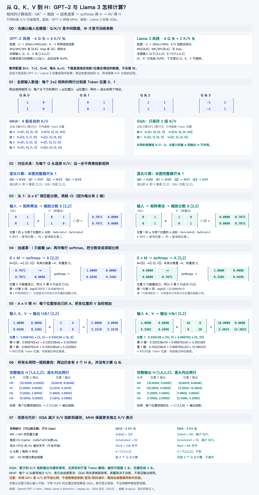

# QKV 到 H：GPT-2 MHA 与 Llama 3 GQA 数值对照

[可放大 SVG](gpt2-llama3-qkv-to-h-detailed.svg) · [PNG](gpt2-llama3-qkv-to-h-detailed.png) · [回到全流程](gpt2-vs-llama3-forward-flow.svg)

## 从哪里开始看

这是总览图步骤 06—09 的详细展开。输入是已经投影、拆头后的数据；Llama 一侧的 Q/K 已完成 RoPE。图中 Q/K/V 不是参数，W 才是参数。本例不从原始文本或归一化输入 U 重新计算投影；采用人工指定的注意力核心输入，隔离头对应和加权汇总的区别。没有加载预训练权重或运行模型训练。

教学配置为 B=1、T=2、D=8、4 个 Q 头、每头 2 维。MHA 有 4 组 K/V，GQA 有 2 组 K/V；并非真实模型的完整规模。矩阵行号是 Token 位置，头号与位置号独立。

1. 图中 01 列出所有 Q/K/V 输入；两边选相同 Q，仅为方便比较。
2. 02 标明每个 Q 头选择哪组 K/V，没有新的线性投影。
3. 03—05 完整展开头 1：`S=QKᵀ/√2 → S+M → A=softmax(S+M) → H=AV`。每一行 softmax 单独归一化；未来权重为零。H 的每一维都是同一行 A 对不同位置的 V 特征加权求和。
4. 06 列出两边全部四个 H 头、每头的两个位置输出；最终 H 均为 `[1,4,2,2]`，后续按位置拼接为 `[1,2,8]`，再交给输出投影。
5. 07 分开比较优势与代价。GQA 的 K/V 投影权重和缓存数量在本例减少一半；Q 头及 QK/AV 理论乘加规模不随之减半。MHA 有更多独立 K/V 表示，GQA 通过共享降低开销，数值相同或质量相同都不是必然保证。

省略 Dropout。示例用完整精度计算，图中显示值四舍五入；不要用显示的四位小数反算并要求末位完全一致。FP32 缓存字节示例不含分配开销，也不代表模型必须使用 FP32。

## 来源与核验

- [OpenAI GPT-2 官方实现](https://github.com/openai/gpt-2/blob/master/src/model.py)：`attn` / `multihead_attn` 的点积、缩放、遮罩、softmax、AV、拼接与投影。
- [Meta 原始 Llama 3 官方实现](https://github.com/meta-llama/llama3/blob/main/llama/model.py)：`Attention` 与 `repeat_kv`；分组共享不要求 KV Cache 本体扩成 Q 头数。
- [GQA 论文](https://arxiv.org/abs/2305.13245)：效率与质量的权衡；论文结果不等于本例的实测结果。
- [完整输入/输出及算术核验](../../artifacts/qkv-to-h-detailed-check.json)：各头 S、A、H；检查行归一化、因果遮罩及稳定/直接 softmax 的一致性。

重绘：`python3 docs/diagrams/render_qkv_to_h_comparison.py --png`。PNG 沿用本项目 macOS AppKit 导出方式，SVG 不依赖该导出过程。
