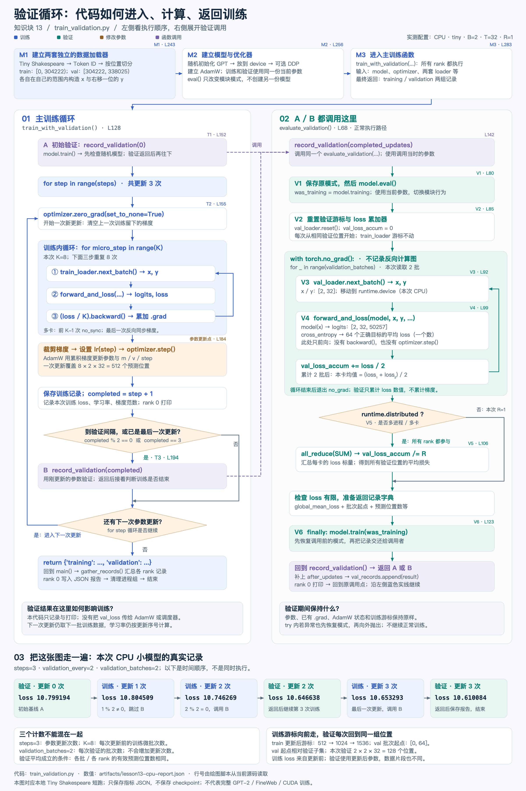

# 验证循环：代码流转图

配套 [知识块 13](../../lesson13.md) 与 [train_validation.py](../../train_validation.py)。

[打开 PNG](gpt2-validation-loop-flow.png) · [打开可缩放 SVG](gpt2-validation-loop-flow.svg)



## 怎么读

1. 顶部是 `main()` 的准备：切分数据、建立独立 loader、建立随机模型与 AdamW。
2. 左侧沿蓝色实线读：初始验证 A → 训练微批次累积 → 裁剪 / 学习率 / 参数更新 → 判断是否验证 B → 下一次更新或结束。
3. 紫色虚线表示函数调用：A 和 B 都调用右侧同一个函数。右侧完成后，返回各自的调用点，再沿左侧实线继续；两条泳道不是并行训练与验证。
4. 右侧 `evaluate_validation()`：eval → reset → no_grad 内取数、前向与 loss 累计 → 可选跨进程均值 → finally 恢复模式 → 返回。`record_validation()` 再加入标签、保存记录和打印。
5. 底部按时间排列归档的 CPU 实测记录，让循环条件对应到具体的第 0、2、3 次验证。

## 代码定位

| 图中节点 | 文件中的位置 | 输入 → 输出 |
|---|---|---|
| 主入口 M1—M3 | `train_validation.py`：L201；标记 M1 / M2 / M3 | 本地文本、配置 → loader / model / optimizer → 记录 |
| 左侧主循环 | L128 `train_with_validation()` | 模型、优化器、两套 loader 等 → training / validation 记录 |
| A / B 共用包装函数 | L142 `record_validation()` | 已完成更新数 → 调用验证、补标签、保存并打印 |
| 验证函数 V1—V6 | L68 `evaluate_validation()` | 当前模型、验证 loader、设备信息、批次数、精度 → 平均 loss 与取数信息 |
| 修改参数的位置 | L184 `optimizer.step()` | 参数、累计梯度、AdamW 历史状态 → 新参数与新状态 |

行号是生成本图时的定位；源码增删后可重新运行绘图脚本。代码中的 M / T / V 标记保持直接对应。

## 本次数字和判断

本图读取 [CPU 报告](../../artifacts/lesson13-cpu-report.json)，不把教学假设写成实测。配置为 `--device cpu --model-size tiny`，R=1、B=2、T=32、K=8，更新 3 次。

| 动作 | 已完成更新数 | loss | 为什么执行 |
|---|---:|---:|---|
| 验证 | 0 | 10.799194 | 初始基线 A |
| 训练 | 1 | 10.804509 | 参数更新一次 |
| 训练 | 2 | 10.746269 | 参数更新一次 |
| 验证 | 2 | 10.646638 | 间隔命中，调用 B |
| 训练 | 3 | 10.653293 | 参数更新一次 |
| 验证 | 3 | 10.610084 | 最后一次更新，调用 B |

训练 loss 来自该次更新之前的前向；同一更新号的验证 loss 使用该次更新之后的参数。两者的数据片段也不同，不能把相邻两个数视为同一批数据的更新前后损失。

一次训练更新先清梯度，再处理 K=8 个训练微批次；每批 `loss/K` 反向累计到 `.grad`，最后裁剪并更新一次。多进程时前 K−1 次使用 `no_sync()`，最后一次反向同步梯度。训练 loss 另有跨进程归约供日志使用，图中训练主干为突出更新/验证边界而合并展示。

一次验证从 `val_loader.reset()` 开始，读取 2 批。每批 x/y 都是 `[2,32]`，GPT 输出 `[2,32,50257]`；`forward_and_loss()` 在模型返回后计算交叉熵，得到本批 64 个预测位置的平均 loss。两批平均得到 128 个位置的均值。

多进程时各 rank 先算本地均值，再 `all_reduce(SUM)`、除以 R。**这次同步的是 loss 标量，不是参数或梯度。** 所有 rank 都必须参与，仅 rank 0 打印。本例每批、每 rank 的有效位置数相同，所以平均可以分两级计算；有效位置数不同时，应汇总损失之和与有效位置数后相除。

`finally` 会在返回记录交付调用者之前执行。图示正常路径；try 内若异常也先恢复调用前模式，然后向外抛出，不沿正常训练路径继续。

## 数据与状态边界

- Tiny Shakespeare 按 Token **位置**切分：train 为 `[0,304222)`，val 为 `[304222,338025)`；这不是文档划分或文本去重。两边当然可能包含相同 Token ID。
- 每次验证取的相对子集位置固定为 `[0,64]`；训练游标在三次更新后分别为 512、1024、1536。
- 验证使用同一模型的当前参数；没有复制模型，没有 `backward()` 或 `optimizer.step()`，不清除已有 `.grad`，也不推进训练游标或学习率的更新计数。
- `eval()` 改变模块行为；`no_grad()` 关闭该作用域内的反向图记录；两者职责不同。本例训练 Dropout 配置为 0，仍保留模式切换。
- 本代码把验证结果写入指标报告，没有自动早停、最佳 checkpoint 选择或根据 val_loss 调整学习率，也没有保存模型 checkpoint。
- 本图对应本地教学改编。原课程依据、FineWeb 与本地 Tiny Shakespeare 的差异见 [lesson13.md](../../lesson13.md)，CPU 结果不代表 CUDA 性能或完整预训练。

## 重新生成

使用安装好课程依赖的 Python；绘图脚本只读取本地源码和归档报告，不执行训练。SVG 不需要额外绘图库；PNG 导出复用项目现有 macOS AppKit 方法。

```bash
python docs/diagrams/render_validation_loop_flow.py --png
```

脚本会核对来源行号、实验配置、验证触发次数和游标，再输出 SVG、说明 Markdown，以及可选 PNG。
