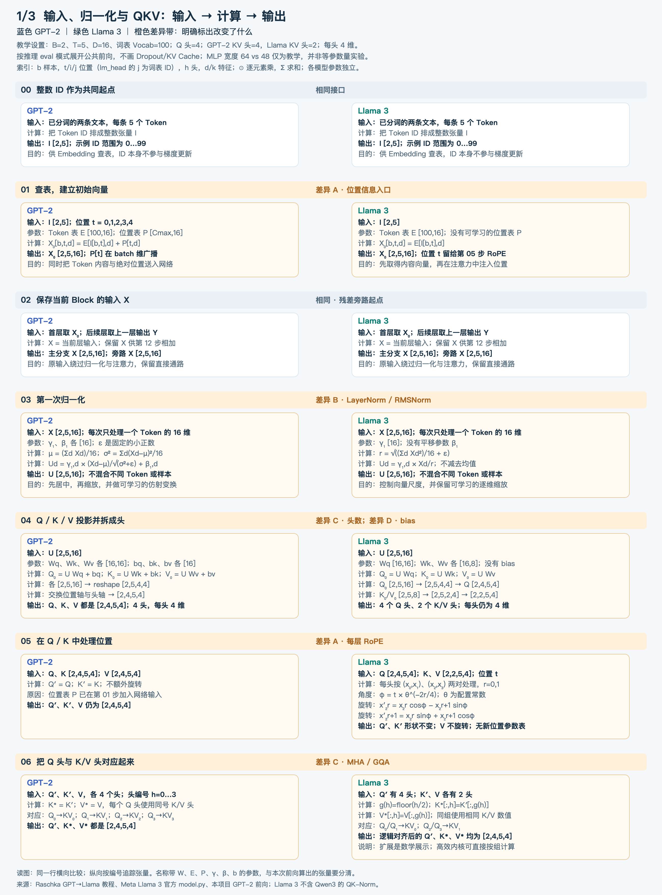
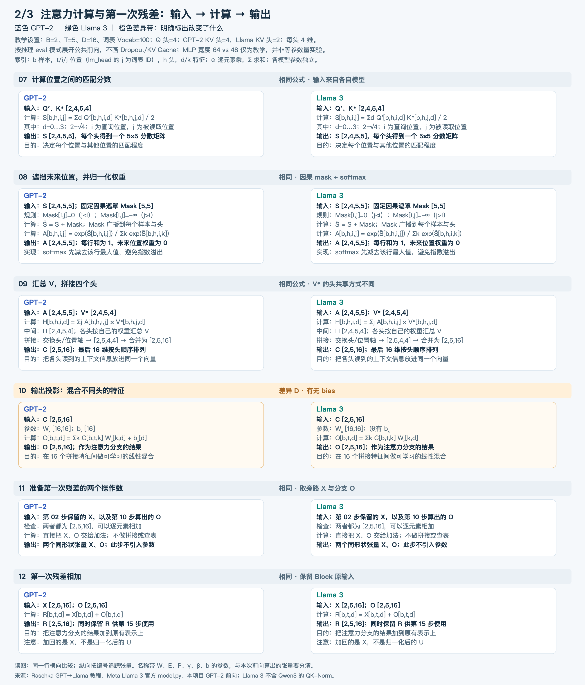
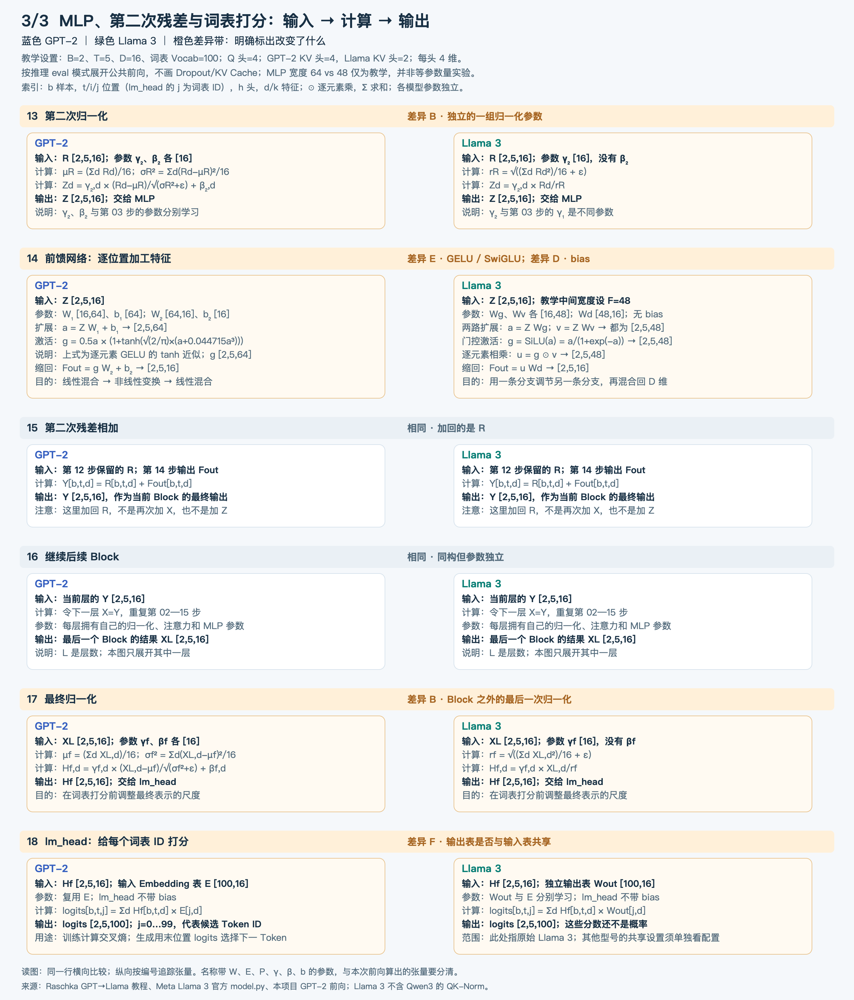

# GPT-2 与 Llama 3：前向流程对照

[完整 PNG](gpt2-vs-llama3-forward-flow.png) · [可缩放 SVG](gpt2-vs-llama3-forward-flow.svg)

完整图拆成三张细节图，编号连续；每步注明输入、参数、计算规则、输出及形状。

1. [步骤 00—06：输入、归一化与 QKV](gpt2-vs-llama3-part1.png)
2. [步骤 07—12：注意力计算与第一次残差](gpt2-vs-llama3-part2.png)
3. [步骤 13—18：MLP、第二次残差与词表打分](gpt2-vs-llama3-part3.png)

## 六类差异

步骤 06 的具体展开：[MHA / GQA 头对应与注意力数值图](gpt2-llama3-head-matching-flow.png) · [SVG](gpt2-llama3-head-matching-flow.svg)。区分已完成的投影、当前头分组与后续点积/softmax/汇总；用两个 Q 头在同一查询位置读取相同 K/V 的数值例子解释不同输出。复算记录：`artifacts/head-matching-example-check.json`。

差异 A 的逐项数值算例（建议先看）：[矩阵计算 PNG](gpt2-llama3-position-worked-example.png) · [可放大 SVG](gpt2-llama3-position-worked-example.svg)。展开位置向量的逐维加法，以及 RoPE 的角度、sin/cos、2×2 旋转矩阵和每一行乘加。固定原始 K 数值、改变位置，对比最终注意力分数；输入均为人工教学选值。复算记录：`artifacts/position-worked-example-check.json`。重绘：`python3 docs/diagrams/render_position_worked_example.py --png`。

差异 A 的计算流程：[GPT-2 位置表与 Llama 3 RoPE 对照 PNG](gpt2-llama3-rope-position-flow.png) · [SVG](gpt2-llama3-rope-position-flow.svg)。逐步列出入口、归一化/QKV、位置角度、旋转输出及点积打分，并区分可训练参数与固定配置。数值部分固定同一组 q/k，仅隔离旋转操作，不能作为两个完整模型的端到端结果比较；教学头维度为 4，θ=500000。复算记录在项目 `artifacts/rope-position-example-check.json`，检查旋转长度保持及固定 q/k 的相对位置平移不变性。

QKV 具体数值：[输入、权重、投影输出与拆头的数值图](gpt2-llama3-qkv-numerical-example.png)。该例已合并到 QKV 完整流程图下半部分；为便于复算，单独缩小为 D=4、2 个 Q 头，GQA 使用单组 K/V（MQA 特例）。参数为教学选值，不是预训练权重；六路投影结果已由脚本计算核对，数据见 `artifacts/qkv-projection-example-check.json`。

差异 C/D 的计算流程：[QKV 投影与拆头对照 PNG](gpt2-llama3-qkv-projection-flow.png) · [SVG](gpt2-llama3-qkv-projection-flow.svg)。展开三路投影、reshape、transpose、逐头特征分组，以及 MHA/GQA 的头对应关系；沿用本页教学配置。

差异 B 配套详解：[LayerNorm 与 RMSNorm 数学笔记](../layernorm-rmsnorm-notes.md)，含完整公式、数值例子与 RMS²=σ²+μ² 的推导。

| 图中编号 | GPT-2 | 原始 Llama 3 | 对应步骤 |
| --- | --- | --- | --- |
| A：位置 | 入口加可学习的位置向量 | 每层注意力对 Q/K 做 RoPE；V 不旋转 | 01、05 |
| B：归一化 | LayerNorm：减均值、除标准差、乘 γ、加 β | RMSNorm：除均方根、乘 γ，无 β | 03、13、17 |
| C：注意力头 | MHA，每个 Q 头对应自己的 K/V 头 | GQA，多个 Q 头共用一组 K/V | 04、06 |
| D：线性层偏置 | QKV、注意力输出投影、MLP 带 bias | 这些线性层不带 bias | 04、10、14 |
| E：MLP | 两个线性层，中间 GELU | 两路投影，经 SiLU 门控后相乘，再投影回来 | 14 |
| F：输出表 | lm_head 与 Token Embedding 共享 E | 原始 Llama 3 使用独立 Wout | 18 |

两边都有因果遮罩、softmax、对 V 加权汇总、拼接注意力头和两次残差；相同公式并不代表运行时数值相同。

## 阅读顺序

从上向下读每条泳道，再横向比较同一高度的环节。蓝色是 GPT-2，绿色是 Llama 3；橙底标出主要变化。每个模型拥有自己的参数，图中的对齐不表示两者共享权重。

1. 输入与位置：GPT-2 查 Token/Position 两张表并相加；Llama 3 入口查 Token 表，在每层注意力内对 Q/K 使用 RoPE，V 不旋转。
2. 一个 Block：输入 X 经归一化、注意力和输出投影得到 O；第一次残差是 R=X+O。R 经第二次归一化和 MLP 得到 Fout；第二次残差是 Y=R+Fout。
3. 外侧绕线：分别保存 X 和 R；第二次不重新使用 X，也不把归一化输出当成旁路输入。
4. 多层之后：最终归一化，再由 lm_head 输出词表 logits。训练和推理的后续用途不同，图中只展开公共前向。

## 形状与简化范围

- B=2、T=5、D=16、词表大小 100 是教学配置，不能用于推断官方模型的参数量或运行速度。Q 头均为 4，每头维度 4；GPT-2 有 4 个 K/V 头，对照 Llama 有 2 个 K/V 头。B 是样本数，T 是每条序列的 Token 数，D 是每个 Token 的特征维度。
- 图中 GQA 的 QK 转置与 AV 是按组对应后的数学表达：每 2 个 Q 头使用同一组 K/V。不能把原始头数不同的张量直接做不带分组的普通矩阵乘法。实现可扩展 K/V 头，也可使用原生分组内核。
- GPT-2 MLP 教学形状为 16→64→16。SwiGLU 两条投影分支扩展到中间宽度 F=48，逐元素相乘后投影回 16；两侧不是等参数量配置。真实 Llama 中间宽度还涉及配置倍率和取整。
- 公式采用行向量记法；PyTorch Linear.weight 按 [out_features,in_features] 存储，使用时注意转置。
- 按 eval 模式绘制前向，此时 Dropout 不生效；KV Cache 和训练反向未展开。实际 GPT-2 训练路径还包含 Dropout。这是结构示意，没有运行新的模型实验。
- W/E/P/γ/β 和偏置是模型参数；Q/K/V、注意力权重 A、X/R/Y 等是本次输入参与计算得到的张量。两类不要混淆。RoPE 的 θ 与归一化的 ε 是配置常数。
- 图中的矩阵乘法作用于每个位置的向量；LayerNorm/RMSNorm 只在同一位置的 D 维内部统计。只有注意力汇总这一步在允许的上下文位置间读取信息。
- 权重不共享的结论限于图中原始 Llama 3，不泛化到所有 Llama 型号；两侧 lm_head 都没有 bias。输出 logits 已经是分数，尚未做词表 softmax。
- 本图比较 Llama 3；Qwen3 的 QK-Norm 后续单独展开，不加入此图。

## 对照资料

- 主线：[Raschka GPT→Llama 教程](https://github.com/rasbt/LLMs-from-scratch/tree/main/ch05/07_gpt_to_llama)。
- [Llama 3 官方模型实现](https://github.com/meta-llama/llama3/blob/main/llama/model.py)：RMSNorm、apply_rotary_emb、Attention、FeedForward、TransformerBlock、Transformer。
- GPT-2 参考本项目既有独立前向模型与前序课程；本次不修改其实现。

重绘：`python3 docs/diagrams/render_gpt2_llama_comparison.py --png`。SVG 用标准库生成，PNG 复用项目现有 macOS AppKit 导出器。
