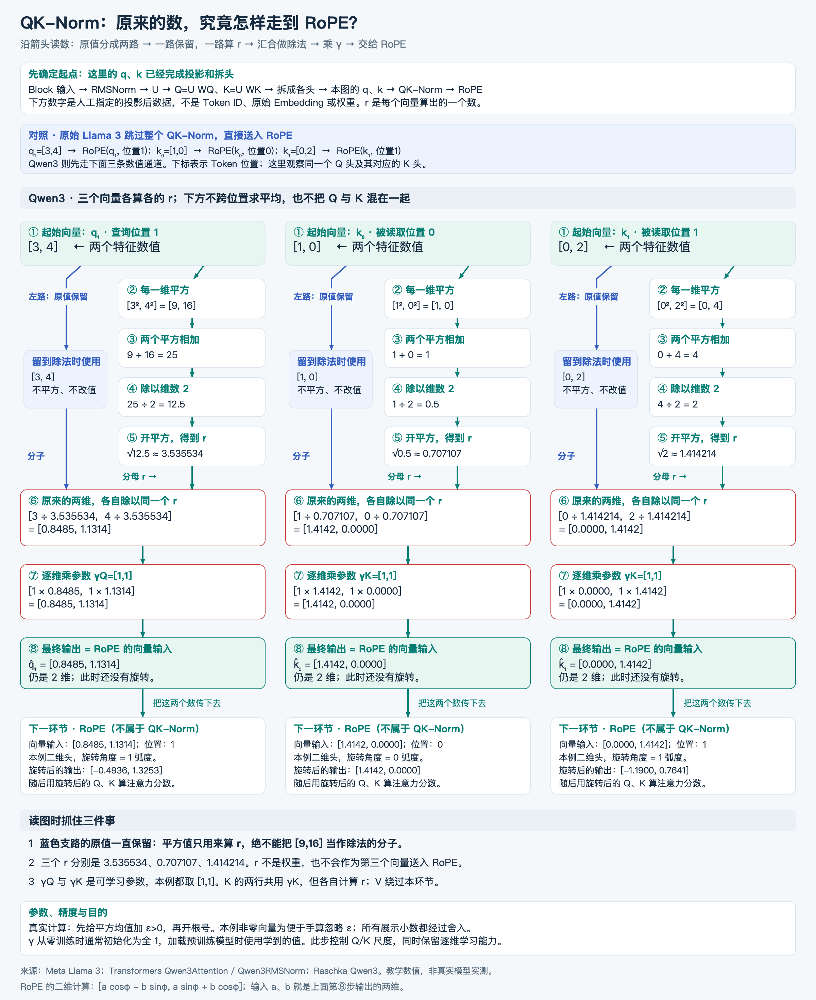

# 第 03 步：QK-Norm 的逐项输入、计算与输出

日期：2026-11-12。此图专门拆解[前向总览](llama3-vs-qwen3-forward-qknorm.md)中的第 03 步，保留原总览图。它对应 Qwen3 全景的概念讲解，不代表已完成模型替换或训练实验。

[可放大 SVG](llama3-qwen3-qknorm-step03-worked.svg) · [完整数值记录](../../artifacts/qknorm-step03-worked-check.json)

## 示例输入及阅读顺序

新版图片按 q₁、k₀、k₁ 三列展开。每列左侧蓝色支路保留原向量，右侧绿色支路依次平方、相加、除以维数、开根号，得到一个标量 r；两路在除法处汇合，再逐维乘 γ。第⑧步绿色框明确标为 RoPE 的向量输入，下方单独列出旋转后的输出。r 只参与归一化，不作为第三个向量传入 RoPE。

以 q₁ 为例：右路 `[3,4] → [9,16] → 25 → 12.5 → 3.535534`；左路保留 `[3,4]`，在汇合处得到 `[3/r,4/r] → [0.848528,1.131371]`。乘 `[1,1]` 后才交给 RoPE。

只追踪一个 Q 头在位置 1 的查询 q=[3,4]，以及对应 K/V 组的两个位置。K 的两行是 [1,0]、[0,2]；V 的两行是 [10,0]、[0,20]。这是已经投影、拆头的数据，不是 WQ/WK/WV 权重矩阵，也不是模型实际运行记录。

原始 Llama 3 不执行图中新增运算，原向量直接交给 RoPE。Qwen3 对 Q、K 分别执行以下流程；V 全程绕过 QK-Norm。

| 小步骤 | 输入 | 计算 | 输出 |
| --- | --- | --- | --- |
| 1 平方求均值 | q、k₀、k₁ 各自两个特征 | m(x)=(x₀²+x₁²)/2 | 12.5、0.5、2 |
| 2 求尺度 | 各自 m | r=√(m+ε) | 忽略 ε 时约为 3.535534、0.707107、1.414214 |
| 3 除以尺度 | 原向量 x 和对应 r | 每个特征除以该向量的 r | q→[0.848528,1.131371]；k₀→[1.414214,0]；k₁→[0,1.414214] |
| 4 逐维缩放 | x/r 和可训练 γ | γ⊙(x/r)，不加 bias | 本例 γQ=γK=[1,1]，故结果与上一步相同 |

实际使用正数 epsilon，本图为手算忽略它。计算保留完整精度，图中显示值有舍入，不能将显示的近似分母重新代入后要求末位完全一致。

γ 不全为 1 时仍然要乘。例如 γQ=[2,0.5]，输出 q̂≈[1.697056,0.565685]。这是本文的独立补充例子；图片及下文后续注意力仍沿用 γQ=γK=[1,1]，没有混用两个条件。

## 各自的统计量与共享参数

均方根在每个 batch、Token 位置、注意力头的头内特征维单独计算，不把不同位置或头合并。γQ、γK 各长 head_dim：同层各 Q 头使用同一组 γQ，各 K 头使用同一组 γK；两组分别学习，不同层的参数也不同。它们不复用 Block 入口 RMSNorm 的缩放参数。

注意第 3 步的除法用原始向量，不用平方后的向量。gamma 是可训练参数，均方根 r 是本次数据计算出的统计量。QK-Norm 保持形状、Token 位置及头对应关系；V 不变。前面的输入 U 已归一化，不保证经过 WQ/WK 投影后的 Q/K 尺度不变。

## 接回 RoPE、注意力权重与 H

二维头的 RoPE 角度按位置取 0、1 弧度。对查询位置 1，位置 0 和位置 1 均允许读取；按 q′k′/√2 得分后做 softmax，最后计算 H=AV。

| 结果 | Llama 3 路径 | Qwen3 路径 |
| --- | --- | --- |
| 分数 | [-1.233885,5.656854] | [-0.493554,1.131371] |
| A | [0.001016,0.998984] | [0.164527,0.835473] |
| H | [0.010161,19.979677] | [1.645268,16.709464] |

本例的权重变得更平缓不等于实际训练中永远如此；gamma 可学习，注意力仍可以集中。QK-Norm 是特征尺度调整，softmax 是对允许位置的分数归一化，两者职责不同。

## 来源与核对

- [Meta Llama 3 model.py](https://github.com/meta-llama/llama3/blob/main/llama/model.py)：原始 Attention 无 QK-Norm。
- [Transformers Qwen3 实现](https://github.com/huggingface/transformers/blob/main/src/transformers/models/qwen3/modeling_qwen3.py)：Qwen3Attention 中 q_norm/k_norm 的参数维度及其位于投影后、RoPE 前；Qwen3RMSNorm 的公式。
- [Raschka Qwen3 配套实现](https://github.com/rasbt/LLMs-from-scratch/blob/main/pkg/llms_from_scratch/qwen3.py)：本课程概念与代码对应。
- [Qwen3 Technical Report §2](https://arxiv.org/html/2505.09388v1#S2)：使用 QK-Norm 帮助稳定训练。

重绘脚本 `render_qknorm_step03.py` 核对各行平方均值、归一化后均方为 1（本例忽略 epsilon 且 gamma=1）、非单位 gamma 结果，以及下游注意力。下游复用已验证的旋转计算，并以相对旋转公式核对点积。未加载模型权重、未运行训练；用户理解状态和课程完成计数不因此变更。
