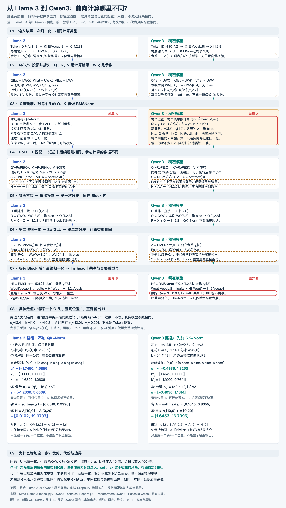

# Llama 3 与 Qwen3：前向流程及 QK-Norm 数值对照

日期：2026-11-11。承接 [GPT-2/Llama 3 总览](gpt2-vs-llama3-forward-flow.md)，对应规划 3.1 的 Qwen3 全景与 3.7 的概念预览。此图不代表已经完成实现替换、训练对照或整节学习。

[可放大 SVG](llama3-vs-qwen3-forward-qknorm.svg) · [数值核对结果](../../artifacts/llama3-qwen3-qknorm-check.json)

第 03 步逐项展开：[QK-Norm 输入→平方均值→均方根→相除→γ 缩放→输出](llama3-qwen3-qknorm-step03-worked.md)（[完整 PNG](llama3-qwen3-qknorm-step03-worked.png)）。

## 阅读顺序

圈注版：红色实线 A 标记新增 QK-Norm，红色实线 B 标记输出权重共享策略（依 Qwen3 型号而定）；棕色虚线标记须按型号核对的词表、隐藏维度、归一化 epsilon、头数/头维度、RoPE 配置、FFN 宽度及层数。虚线不是断言每个配置值都不同，而是提醒统一教学尺寸掩盖了真实规格差异。未圈部分只代表同类计算公式，不代表两种模型权重或输出相同。

1. 第 01—02 步：两边都先归一化输入，进行 Q/K/V 投影与拆头。
2. 第 03 步（金色）：Qwen3 对每个位置、每个头的 Q/K 分别做 RMSNorm，位置在 RoPE 前。原始 Llama 3 没有该步骤。V 不受此步骤修改。
3. 第 04—06 步：RoPE、GQA、注意力、输出投影、残差和 SwiGLU 的计算类型相同；这不表示实际权重、维度或输出相同。
4. 第 07 步：最终归一化后给词表打分。原始 Qwen3 是否共享输入/输出表取决于具体型号，不能把 Llama 3 的独立输出表结论套到所有 Qwen3。
5. 第 08 步：同一组人工 Q/K/V 分别经过两条路径，算到注意力头的 H，隔离新增归一化的作用。

## 数值示例及边界

完整流程采用教学尺寸 B=1、T=2、D=8、4 个 Q 头、2 个 K/V 头、每头 2 维、FFN 中间宽度 24。这不是实际模型配置。真实 Qwen3 的 head_dim 应从配置读取，不能总按 D/n_heads 推断。MLP 的 Wv 与注意力的 WV 是不同参数。

局部例子只追踪查询位置 1 的一个头，直接给定投影、拆头后的数据：q=[3,4]；K 的两行为 [1,0]、[0,2]；V 的两行为 [10,0]、[0,20]。这些向量是前向中间数据，非投影权重。没有声称两种真实模型用相同数据会产生这些 Q/K/V。

QK-Norm 示例令 γQ=γK=[1,1]，忽略 ε；实际模型保留 ε 并训练 γ。二维 RoPE 的唯一频率为 1，故位置 0、1 的角度为 0、1 弧度。两个路径都使用同样的位置处理，不能省掉一边的 RoPE 来比较。

| 数值 | Llama 3 路径 | Qwen3 路径 |
| --- | --- | --- |
| RoPE 前 q | [3,4] | [0.848528,1.131371] |
| RoPE 后 q | [-1.744977,4.685622] | [-0.493554,1.325294] |
| 缩放后注意力分数 | [-1.233885,5.656854] | [-0.493554,1.131371] |
| softmax 权重 A | [0.001016,0.998984] | [0.164527,0.835473] |
| H=A V | [0.010161,19.979677] | [1.645268,16.709464] |

查询位置 1 可以读取位置 0、1，故本行两个分数都不遮罩。若查询位置 0，则位置 1 要遮罩。展示值四舍五入，计算保留完整精度。

每层 γQ、γK 分别学习；同层各 Q 头共用 γQ、各 K 头共用 γK，但各向量的均方根单独计算。两者不复用 Block 入口的 γ₁。新增参数量为 2×head_dim，本教学例为 4。

QK-Norm 控制投影后向量的尺度，官方说明用于稳定训练。它不是降低 KV Cache 大小的措施，也不能据此保证推理更快或模型质量更好。可学习缩放仍允许注意力集中；本例的权重更平缓只是这组输入及参数下的结果。

## 来源与可复算性

- [Meta 原始 Llama 3 实现](https://github.com/meta-llama/llama3/blob/main/llama/model.py)：Attention、RMSNorm、FeedForward、输出层。
- [Qwen3 Technical Report §2](https://arxiv.org/html/2505.09388v1#S2)：RMSNorm/GQA/RoPE/SwiGLU、QK-Norm 的稳定训练目的与 Table 1 的共享设置。
- [Transformers Qwen3 实现](https://github.com/huggingface/transformers/blob/main/src/transformers/models/qwen3/modeling_qwen3.py)：q_norm/k_norm 的 head_dim 参数及投影→拆头→归一化→RoPE 顺序。
- [Raschka Qwen3 配套实现](https://github.com/rasbt/LLMs-from-scratch/blob/main/pkg/llms_from_scratch/qwen3.py)：对应 GroupedQueryAttention 与配置中的 head_dim。

本图由项目既有 SVG 绘图方式生成，可重绘文件为 `render_llama3_qwen3_comparison.py`。普通 Python 算术核对 softmax 归一化、H 的加权和，并用相对旋转恒等式独立核对分数；不加载真实权重、不进行模型训练。PNG 导出沿用项目的 macOS AppKit 工具。
