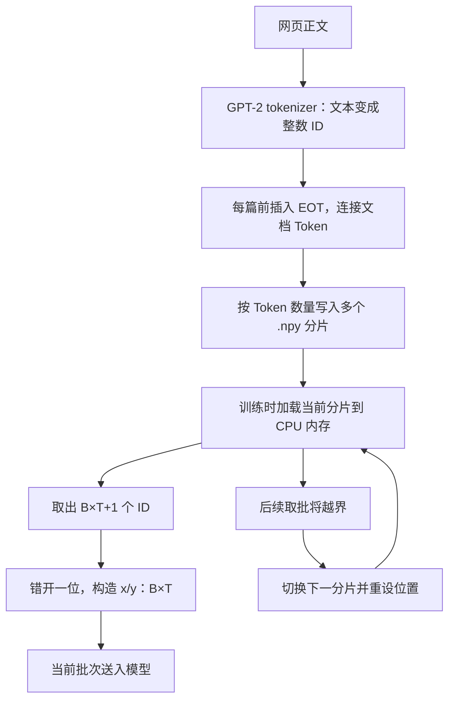

# GPT-2 大规模训练数据：FineWeb-Edu、分片与文档边界

> 模型仍然接收 `[B,T]` 的输入与错位答案；本块学习的是如何把大量网页正文提前编码、分片保存，并持续提供训练批次。

归档日期：2026-10-25。学习位置：**阶段二 → 单元 2「预训练工程：复现 GPT-2」→ 2.4「多卡与数据」→ 知识块 12「FineWeb-Edu 与数据分片」**。

[Notion 归档](https://app.notion.com/p/404eaea31414818b9df0c8ab083cdbe0) · [学习计划](https://app.notion.com/p/340eaea31414819197bde537d339d0fc)

**学习状态：核心知识已讲解并完成本轮答疑，理解中。** 用户选择先按原课方案继续。独立分片代码与实际运行待补；下一项是简短衔接训练 Token 总量与步数换算，再学习验证集与 validation loss。整个 2.4 尚未完成，完整段落计数仍为单元 2 的 1/5、阶段二的 5/32。

前篇：[DDP、平均损失与梯度同步](ddp-batch-gradient-notes.md)。既有代码配套：[知识块 11](../lesson11.md)；它仍使用 Tiny Shakespeare，本篇没有把其 CPU/Gloo 验证当成 FineWeb-Edu 实跑。

**来源与边界**：核对了 [Karpathy 视频约 3:09:48—3:18:58](https://www.youtube.com/watch?v=l8pRSuU81PU&t=11388s)的[非官方自动字幕副本](https://github.com/nolimitkun/ai-kol-wiki/blob/main/sources/karpathy/20240609-l8pRSuU81PU/transcript.md)，以及作者 [69cb21f：switch to FineWeb EDU](https://github.com/karpathy/build-nanogpt/commit/69cb21f0f9439a8804741912045b90879a573591) 的历史代码。未直接观看视频画面；字幕中的数字、术语以官方数据说明和代码交叉核对。文档级遮罩、内存估算和缩小的 Token 例子属于答疑补充，不替换原课主线。

## 一、为什么从 Tiny Shakespeare 转向更大的数据集

Tiny Shakespeare 适合验证训练链路：文本能否编码，加载器能否连续换批，模型是否能够前向、计算 loss、反向传播和更新参数。

当训练流程已经跑通，希望模型接触更丰富的语言表达和知识时，仅反复训练这一份戏剧文本，内容覆盖就有限。原课因此转向规模更大、题材更广的网页语料。

当前仍属于随机初始化的预训练主线，沿用“预测下一个 Token”的目标。换数据不会自动变成问答微调，也不会自动加载预训练参数。预期是让模型通过更丰富的文本学习语言和知识模式；真实效果要通过后续验证与评测判断，不能仅凭训练 loss 下降推断。

## 二、FineWeb-Edu 是什么

FineWeb-Edu 是 Hugging Face 从 FineWeb 进一步筛选出的、偏教育和知识讲解的英文网页文本集合。来源关系可以理解为：Common Crawl 网页 → 文本清洗与筛选 → FineWeb → 教育质量筛选 → FineWeb-Edu。

教育质量筛选使用了由大模型评分数据训练出的分类器。训练材料的正文仍来自网页；分类器帮助挑选材料。原课使用 `sample-10BT` 子集，约 100 亿个 GPT-2 Token，不要求我们把完整数据集全部用完。[官方数据说明](https://huggingface.co/datasets/HuggingFaceFW/fineweb-edu)

一条记录的 `text` 可以是一段普通网页正文。训练时用正文中实际出现的下一个 Token 作为答案，不必人工为每个位置填写标签。网页中可以出现问答，但本课没有要求统一改写成对话格式。

## 三、先区分文档、分片和批次

| 层次 | 含义 | 决定什么 |
| --- | --- | --- |
| 文档 document | 一篇网页的正文 | 原始内容边界 |
| 分片 shard | 磁盘上保存的一块 Token 数据 | 文件大小与读取单位 |
| 序列与批次 | 一条序列有 T 个输入 Token，一批有 B 条 | 一次前向处理的输入形状 |

一个 shard 可以包含很多篇文档，也能提供很多个 batch。文档边界、shard 边界、定长序列边界不必重合。原课的数据准备脚本允许把一篇文档的 Token 分到相邻的两个 shard 中。

## 四、从网页正文到训练批次的流程



数据准备阶段提前完成分词，语料和 tokenizer 不变时可复用结果。训练阶段读取已编码的整数数组，按批构造 `x/y`。提前分词避免每次训练都重做全文编码；分片让文件与内存工作集的大小更容易控制。

原课给每篇文档前面插入 GPT-2 的 `<|endoftext|>`，ID 为 50256，再将文档接成 Token 流。完整 shard 设为 1 亿个 Token，最后一片可能不足这个数量；保存格式为 NumPy `.npy`，Token ID 使用 `uint16`。第一个分片标记为 `val`，其余标记为 `train`。[作者的数据准备脚本](https://github.com/karpathy/build-nanogpt/blob/69cb21f0f9439a8804741912045b90879a573591/fineweb.py)

这里保存的是整数 ID。每个 Token 对应的 768 维向量由模型运行时的 Embedding 查表产生，无需提前保存到数据文件。

## 五、为什么分片：用存储量理解

GPT-2 的最大 Token ID 为 50256，能装入取值范围为 0—65535 的 `uint16`。磁盘上每个 ID 占 2 字节；原课加载器将当前分片转换为每个元素 8 字节的 `torch.long`。

| Token 数量 | uint16 数组 | torch.long 数组 |
| --- | --- | --- |
| 100 亿 | 约 20 GB | 约 80 GB |
| 1 亿，即一个完整 shard | 约 200 MB | 约 800 MB |

以上使用十进制 GB/MB，仅计算数组元素，不含文件头、临时转换副本、模型和其他内存开销。单个进程读取当前分片，当前批次再传到训练设备；并不是把整个数据集送到 GPU。多进程实现还可能各自持有 CPU 数据副本。

分片方便按块加载、检查与搬运，也让数据准备过程可以逐块写出。分片是存储与读取方案，不能直接等同于模型效果提升。

## 六、与之前 Tiny Shakespeare 加载器的区别

| 项目 | 项目之前的 Tiny Shakespeare 加载器 | 原课 FineWeb-Edu 加载器 |
| --- | --- | --- |
| 原始材料 | 一份戏剧文本 | 大量网页正文 |
| 分词时机 | 启动脚本时对整份文本分词 | 数据准备阶段提前完成 |
| 内存中保存什么 | 整份语料的 Token | 当前 shard 的 Token |
| 加载器状态 | 当前 Token 位置 | 当前 shard 和片内 Token 位置 |
| 当前数据不足以继续取批 | 回到整份语料开头 | 切到下一 shard；全部读完再循环 |
| x/y 的含义和形状 | 错开一位，均为 `[B,T]` | 保持相同 |

之前的代码是 [train_dataloader.py](../train_dataloader.py)。本篇核对的原课加载器在 [69cb21f 的 train_gpt2.py](https://github.com/karpathy/build-nanogpt/blob/69cb21f0f9439a8804741912045b90879a573591/train_gpt2.py)。目前未把 FineWeb-Edu 接入本地训练入口。

一个缩小的例子：令 B=2、T=4，从当前 shard 取 9 个示意 Token ID。

```text
buffer = [11, 12, 13, 14, 15, 16, 17, 18, 19]

x = [[11, 12, 13, 14],
     [15, 16, 17, 18]]

y = [[12, 13, 14, 15],
     [16, 17, 18, 19]]
```

形状变化：当前分片 `[N]` → buffer `[B*T+1]` → x/y `[B,T]`。分片方式改变了 ID 的来源与读取状态，没有改变下一 Token 训练目标。

## 七、跨两篇文章的样本：EOT 在训练什么

把文章内容写成示意 Token，E 表示 `<|endoftext|>`：

```text
Token 流：E  A1 A2  E  B1 B2  E  C1 C2 ...

取其中一段：A1 A2 E B1 B2
x：         A1 A2 E B1
y：         A2 E  B1 B2
```

| 当前输入位置 | 下一 Token 目标 | 学习含义 |
| --- | --- | --- |
| A1 | A2 | 文档 A 内的延续 |
| A2 | E | 文档结束 |
| E | B1 | 边界之后的新文档开头 |
| B1 | B2 | 文档 B 内的延续 |

因此，文档 A 的最后位置先学习预测边界，再在出现边界的条件下预测 B 的开头。E 本身也参与前向和训练；它的字符串名字不会让随机初始化的模型天然理解“结束”。含义来自数据中一致的用法与梯度更新。

在有大量不同文档的条件下，模型有机会学到边界后的主题可以变化，并减少对无关前文的依赖。这是训练目标提供的学习机会，不是保证：固定文档顺序和有限数据仍可能带来偶然关联。

## 八、EOT 不会自动切断注意力

普通因果遮罩仅要求被读取位置 j 不晚于当前位置 i。E 所在位置预测 B1 时仍可看到 A1、A2、E；B1 位置预测 B2 时仍可看到 A1、A2、E、B1。

EOT 提供可学习的边界信号；它不会自动清空上下文、重置位置编号，或让前文注意力严格为零。生成时遇到 EOT 后停止，需要生成程序设置相应停止条件；训练前向不会读到它就自动中断。[GPT-2 特殊 Token 与配置](https://huggingface.co/docs/transformers/model_doc/gpt2)

不同 batch 行之间本来就不互相做注意力。这里的跨文档问题指多篇文章出现在同一条长度为 T 的序列内。项目 [gpt2_model.py](../gpt2_model.py) 的下三角遮罩也只按位置决定可见范围。

## 九、答疑补充：为什么不直接使用文档级遮罩

文档级因果遮罩增加一个条件：j 不晚于 i，并且两者属于同一文档。规则可以由每个位置的文档编号表达，形成沿对角线排列的多个因果块。[PyTorch 文档遮罩说明](https://pytorch.org/blog/flexattention/)

| 方案 | 是否严格隔离 | 主要取舍 |
| --- | --- | --- |
| EOT + 普通因果注意力 | 否 | 数据取批与注意力调用简单；可能受跨文档内容影响 |
| 完整文档遮罩矩阵 | 是 | 要构造各样本的边界与遮罩；可能增加内存和运行开销 |
| 支持边界的高效变长注意力 | 是 | 可跳过跨文档计算，但需配套数据布局和接口 |

朴素布尔遮罩若有 `[B,1,T,T]` 个元素，在 B=16、T=1024 时约占 16 MiB；T 增大 8 倍，矩阵元素数增大 64 倍。这个代价属于显式矩阵实现，高效方案可以只传段边界。遮罩不必为每个头复制一份。

自定义遮罩能否继续使用高效融合内核，取决于框架版本、设备和输入限制，不能笼统断言“一定无法使用 FlashAttention”或“一定变慢”。[PyTorch 2.2 SDPA 文档](https://docs.pytorch.org/docs/2.2/generated/torch.nn.functional.scaled_dot_product_attention.html)

若内核真正跳过被遮住的区域，注意力计算规模可从整体长度的平方改为各段长度平方之和。两段各 512 Token 的示意例子中，有效因果注意力位置对大约减半；MLP、投影等仍需计算，不能据此声称整步训练速度翻倍。FlashAttention 的变长接口接收累计序列长度，用于定位各段序列。[FlashAttention v2.5.9 接口](https://github.com/Dao-AILab/flash-attention/blob/v2.5.9/flash_attn/flash_attn_interface.py#L957)

文档可以紧凑打包并在注意力中隔离，不必每篇独占一整行并补齐大量空位。若要求与各篇单独训练一致，还需检查位置编号和边界处预测目标。

**原课取舍的证据边界**：已核对的字幕没有明确回答作者为何未采用文档级遮罩。“实现更简单”是根据代码作出的工程分析，不是作者原话，也没有本项目的性能对照证明它更优。作者在 [3:49:35—3:50:36](https://www.youtube.com/watch?v=l8pRSuU81PU&t=13775s)指出固定文档顺序可能形成偶然关联，并建议后续打乱文档；打乱顺序与严格注意力隔离的作用不同。

用户的当前选择：**先按原课的 EOT + 普通因果注意力继续，不把文档级遮罩扩展成当前必做实验。**

## 十、shard 尾部不足一批时怎么办

原课不跨文件拼接来补齐 batch。单进程下，下一次取数需要 B*T+1 个 ID；不足时跳过尾部，加载下一个 shard，重新设置读取位置。

以 B=2、T=4、一个 shard 有 20 个 Token 为例，下面的数字是**数据位置下标**，不是实际 Token ID：

| 调用 | buffer 所用位置 | x 所用位置 | y 所用位置 | 随后的状态 |
| --- | --- | --- | --- | --- |
| 第 1 次 | 0—8 | 0—7 | 1—8 | 下一起点为 8 |
| 第 2 次 | 8—16 | 8—15 | 9—16 | 下一起点本应为 16；只剩 4 个位置，不够取 9 个，切换下一 shard |
| 第 3 次 | 新 shard 的 0—8 | 新 shard 的 0—7 | 新 shard 的 1—8 | 在新 shard 内继续 |

旧 shard 的位置 16 已经作为第 2 批的最后一个答案使用，位置 17—19 在这轮没有进入上述批次。不能把“从下一个起点看剩 4 个”全部算成从未用过的数据。

实际顺序是：取出当前完整 batch → 构造 x/y → 推进位置 → 判断后续取批是否越界并准备下一个 shard → 返回当前已构造好的 x/y。切片不会把本次 batch 的后半段替换掉。

原课多进程历史实现推进 B×T×R，其中 R 是进程数，随后按各进程游标检查 `current_position + B*T*R + 1 > len(tokens)`；切片后回到 `B*T*rank`。因此多卡可能更早切片，不能把单卡示例的尾部数量直接套到多卡，也不能从这个按 rank 的条件推断各进程必定在同一轮切片。后续配套实现需要专门核对边界。这里没有把本地知识块 11 的全局游标修正混称为原课代码。

尾部数据仍在文件中；相同配置和顺序下，下一轮通常仍会跳过同一部分。若要充分利用尾部，需要暂存余量、读下一片、拼接并推进游标，属于另一个实现方案。[原课历史加载器](https://github.com/karpathy/build-nanogpt/blob/69cb21f0f9439a8804741912045b90879a573591/train_gpt2.py)

## 十一、本次学习进度与下一项

| 范围 | 截至 2026-10-25 的状态 |
| --- | --- |
| 2.4 DDP 原理 | 前面已讨论，初步理解；无需重新从头讲 |
| 知识块 11 DDP 代码 | 已有独立入口及 CPU/Gloo 行为验证；用户实践与 CUDA/NCCL 实跑待继续 |
| 知识块 12 FineWeb-Edu 与分片 | 核心知识已讲解，本轮答疑已归档，掌握记录为理解中 |
| FineWeb-Edu 独立配套与运行 | 待补，本轮没有下载数据或运行分片训练 |
| 训练量换算 | 下一步简短衔接：总 Token 数、每次更新 Token 数、总步数和 warmup 步数 |
| 验证集与 validation loss | 尚未系统学习；原课留出 val 分片已提到，验证循环与结果解释待讲 |
| 2.5 评测与正式训练 | 尚未开始 |

本节完成的是知识讲解，不把整个 2.4 结算为完成；单元 2 的 1/5、阶段二的 5/32 保持。2.2 的工程/CUDA 性能对照、2.3 的用户实践待办继续保留。

下一次先应用已有有效 batch 知识做训练量换算，再讲验证集：为何保留、怎样只前向不更新、怎样汇总 loss、怎样结合训练 loss 观察泛化。已学的基础简要回顾。

## 十二、复习问题与答案

以下用于回顾，不新增完成门槛。

<details>
<summary>一个 shard 等于一篇文章或一个 batch 吗？</summary>

不等于。文档是内容单位，shard 是磁盘存储单位，batch 是一次前向使用的输入单位。一个 shard 可以容纳许多文档并提供许多批次，文档也可能跨 shard。

</details>

<details>
<summary>为什么保存 Token ID，而不是提前保存 768 维向量？</summary>

ID 是分词器的输出；Embedding 向量由模型参数查表得到，并会随训练更新。数据文件保存稳定的整数 ID，向量在模型运行时生成。

</details>

<details>
<summary>EOT 出现后，下一篇是否还能读取上一篇？</summary>

在原课普通因果注意力下，同一条序列中的后一篇仍可读取前文。EOT 的边界含义需要学习，不能保证跨文档注意力为零；严格隔离需要额外的文档级遮罩。

</details>

<details>
<summary>文档级遮罩一定更慢吗？</summary>

不一定。显式完整矩阵可能增加开销并影响内核选择；支持变长序列或块稀疏规则的高效实现可跳过跨文档计算。具体效果需在同条件下测量。

</details>

<details>
<summary>当前 shard 不足 B*T+1 个 Token，原课会跨片补齐吗？</summary>

不会。它准备好当前合法 batch 后检查后续读取，必要时跳过尾部、切换下一 shard；下次直接从新片取批。多卡的实际判断还涉及 R 与 rank。

</details>

<details>
<summary>这一块讲完，是否意味着 2.4 整节完成？</summary>

不是。FineWeb-Edu 与分片的核心知识已讲解；训练量换算、验证集专题和相应实践继续推进。笔记归档不等于运行验证或独立掌握。

</details>
