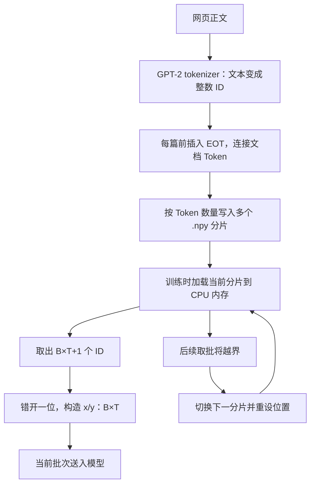

# GPT-2 数据处理全流程：从原始文本、分片到模型训练

> 原始正文经固定分词器变成整数 ID，按容量写入磁盘分片；训练时加载当前片到 CPU，切出错位的 x/y，再将当前微批次交给模型。文件和 ID 提供数据，反向传播与 AdamW 更新模型参数。

初次归档：2026-10-25；补全代码串联与答疑：2026-10-30。学习位置：**阶段二 → 单元 2「预训练工程：复现 GPT-2」→ 2.4「多卡与数据」→ 知识块 12 及数据准备、读取、训练串联实践**。

[Notion 归档](https://app.notion.com/p/404eaea31414818b9df0c8ab083cdbe0) · [学习计划](https://app.notion.com/p/340eaea31414819197bde537d339d0fc)

**当前笔记已覆盖：原始正文 → EOT 与 Token ID → `.npy` 分片 → CPU 加载 → x/y 与预测位置 → 设备搬运 → 模型前向与 loss → 微批次累积 → 参数更新，以及验证、生成的返回路径。** 前十节保留概念与文档边界讨论；第十一节是首次归档的历史状态；第十三节将目前的项目代码完整串起来，并附最新全流程图。

掌握程度保留“理解中”。两句教学数据的准备、读取与 tiny CPU / 双进程 Gloo 流程已由助手核对；用户尚未报告运行新的分片训练入口。真实 FineWeb 和 CUDA/NCCL 待实践，2.4 不结算完成，2.5 尚未开始。本文归档不修改总计划的完成计数。

前篇：[DDP、平均损失与梯度同步](ddp-batch-gradient-notes.md)。既有代码配套：[知识块 11](../lesson11.md)；它仍使用 Tiny Shakespeare，本篇没有把其 CPU/Gloo 验证当成 FineWeb-Edu 实跑。

**来源与边界**：核对了 [Karpathy 视频约 3:09:48—3:18:58](https://www.youtube.com/watch?v=l8pRSuU81PU&t=11388s)的[非官方自动字幕副本](https://github.com/nolimitkun/ai-kol-wiki/blob/main/sources/karpathy/20240609-l8pRSuU81PU/transcript.md)，以及作者 [69cb21f：switch to FineWeb EDU](https://github.com/karpathy/build-nanogpt/commit/69cb21f0f9439a8804741912045b90879a573591) 的历史代码。未直接观看视频画面；字幕中的数字、术语以官方数据说明和代码交叉核对。文档级遮罩、内存估算和缩小的 Token 例子属于答疑补充，不替换原课主线。

## 一、为什么从 Tiny Shakespeare 转向更大的数据集

Tiny Shakespeare 适合验证训练链路：文本能否编码，加载器能否连续换批，模型是否能够前向、计算 loss、反向传播和更新参数。

当训练流程已经跑通，希望模型接触更丰富的语言表达和知识时，仅反复训练这一份戏剧文本，内容覆盖就有限。原课因此转向规模更大、题材更广的网页语料。

当前仍属于随机初始化的预训练主线，沿用“预测下一个 Token”的目标。换数据不会自动变成问答微调，也不会自动加载预训练参数。预期是让模型通过更丰富的文本学习语言和知识模式；真实效果要通过后续验证与评测判断，不能仅凭训练 loss 下降推断。

## 二、FineWeb-Edu 是什么

FineWeb-Edu 是 Hugging Face 从 FineWeb 进一步筛选出的、偏教育和知识讲解的英文网页文本集合。来源关系可以理解为：Common Crawl 网页 → 文本清洗与筛选 → FineWeb → 教育质量筛选 → FineWeb-Edu。

教育质量筛选使用了由大模型评分数据训练出的分类器。训练材料的正文仍来自网页；分类器帮助挑选材料。原课使用 `sample-10BT` 子集，约 100 亿个 GPT-2 Token，不要求我们把完整数据集全部用完。[官方数据说明](https://huggingface.co/datasets/HuggingFaceFW/fineweb-edu)

一条记录的 `text` 可以是一段普通网页正文。训练时用正文中实际出现的下一个 Token 作为答案，不必人工为每个位置填写标签。网页中可以出现问答，但本课没有要求统一改写成对话格式。

## 三、先区分文档、分片和批次

| 层次 | 含义 | 决定什么 |
| --- | --- | --- |
| 文档 document | 一篇网页的正文 | 原始内容边界 |
| 分片 shard | 磁盘上保存的一块 Token 数据 | 文件大小与读取单位 |
| 序列与批次 | 一条序列有 T 个输入 Token，一批有 B 条 | 一次前向处理的输入形状 |

一个 shard 可以包含很多篇文档，也能提供很多个 batch。文档边界、shard 边界、定长序列边界不必重合。原课的数据准备脚本允许把一篇文档的 Token 分到相邻的两个 shard 中。

## 四、从网页正文到训练批次的流程



数据准备阶段提前完成分词，语料和 tokenizer 不变时可复用结果。训练阶段读取已编码的整数数组，按批构造 `x/y`。提前分词避免每次训练都重做全文编码；分片让文件与内存工作集的大小更容易控制。

原课给每篇文档前面插入 GPT-2 的 `<|endoftext|>`，ID 为 50256，再将文档接成 Token 流。完整 shard 设为 1 亿个 Token，最后一片可能不足这个数量；保存格式为 NumPy `.npy`，Token ID 使用 `uint16`。第一个分片标记为 `val`，其余标记为 `train`。[作者的数据准备脚本](https://github.com/karpathy/build-nanogpt/blob/69cb21f0f9439a8804741912045b90879a573591/fineweb.py)

这里保存的是整数 ID。每个 Token 对应的 768 维向量由模型运行时的 Embedding 查表产生，无需提前保存到数据文件。

## 五、为什么分片：用存储量理解

GPT-2 的最大 Token ID 为 50256，能装入取值范围为 0—65535 的 `uint16`。磁盘上每个 ID 占 2 字节；原课加载器将当前分片转换为每个元素 8 字节的 `torch.long`。

| Token 数量 | uint16 数组 | torch.long 数组 |
| --- | --- | --- |
| 100 亿 | 约 20 GB | 约 80 GB |
| 1 亿，即一个完整 shard | 约 200 MB | 约 800 MB |

以上使用十进制 GB/MB，仅计算数组元素，不含文件头、临时转换副本、模型和其他内存开销。单个进程读取当前分片，当前批次再传到训练设备；并不是把整个数据集送到 GPU。多进程实现还可能各自持有 CPU 数据副本。

分片方便按块加载、检查与搬运，也让数据准备过程可以逐块写出。分片是存储与读取方案，不能直接等同于模型效果提升。

## 六、与之前 Tiny Shakespeare 加载器的区别

| 项目 | 项目之前的 Tiny Shakespeare 加载器 | 原课 FineWeb-Edu 加载器 |
| --- | --- | --- |
| 原始材料 | 一份戏剧文本 | 大量网页正文 |
| 分词时机 | 启动脚本时对整份文本分词 | 数据准备阶段提前完成 |
| 内存中保存什么 | 整份语料的 Token | 当前 shard 的 Token |
| 加载器状态 | 当前 Token 位置 | 当前 shard 和片内 Token 位置 |
| 当前数据不足以继续取批 | 回到整份语料开头 | 切到下一 shard；全部读完再循环 |
| x/y 的含义和形状 | 错开一位，均为 `[B,T]` | 保持相同 |

之前的代码是 [train_dataloader.py](../train_dataloader.py)。本篇核对的原课加载器在 [69cb21f 的 train_gpt2.py](https://github.com/karpathy/build-nanogpt/blob/69cb21f0f9439a8804741912045b90879a573591/train_gpt2.py)。目前已有独立的 [load_shards.py](../load_shards.py) 与 [train_shards.py](../train_shards.py)，能够读取兼容分片并接入训练；本地已跑的是教学数据，真实 FineWeb 数据尚未实跑。

一个缩小的例子：令 B=2、T=4，从当前 shard 取 9 个示意 Token ID。

```text
buffer = [11, 12, 13, 14, 15, 16, 17, 18, 19]

x = [[11, 12, 13, 14],
     [15, 16, 17, 18]]

y = [[12, 13, 14, 15],
     [16, 17, 18, 19]]
```

形状变化：当前分片 `[N]` → buffer `[B*T+1]` → x/y `[B,T]`。分片方式改变了 ID 的来源与读取状态，没有改变下一 Token 训练目标。

## 七、跨两篇文章的样本：EOT 在训练什么

把文章内容写成示意 Token，E 表示 `<|endoftext|>`：

```text
Token 流：E  A1 A2  E  B1 B2  E  C1 C2 ...

取其中一段：A1 A2 E B1 B2
x：         A1 A2 E B1
y：         A2 E  B1 B2
```

| 当前输入位置 | 下一 Token 目标 | 学习含义 |
| --- | --- | --- |
| A1 | A2 | 文档 A 内的延续 |
| A2 | E | 文档结束 |
| E | B1 | 边界之后的新文档开头 |
| B1 | B2 | 文档 B 内的延续 |

因此，文档 A 的最后位置先学习预测边界，再在出现边界的条件下预测 B 的开头。E 本身也参与前向和训练；它的字符串名字不会让随机初始化的模型天然理解“结束”。含义来自数据中一致的用法与梯度更新。

在有大量不同文档的条件下，模型有机会学到边界后的主题可以变化，并减少对无关前文的依赖。这是训练目标提供的学习机会，不是保证：固定文档顺序和有限数据仍可能带来偶然关联。

## 八、EOT 不会自动切断注意力

普通因果遮罩仅要求被读取位置 j 不晚于当前位置 i。E 所在位置预测 B1 时仍可看到 A1、A2、E；B1 位置预测 B2 时仍可看到 A1、A2、E、B1。

EOT 提供可学习的边界信号；它不会自动清空上下文、重置位置编号，或让前文注意力严格为零。生成时遇到 EOT 后停止，需要生成程序设置相应停止条件；训练前向不会读到它就自动中断。[GPT-2 特殊 Token 与配置](https://huggingface.co/docs/transformers/model_doc/gpt2)

不同 batch 行之间本来就不互相做注意力。这里的跨文档问题指多篇文章出现在同一条长度为 T 的序列内。项目 [gpt2_model.py](../gpt2_model.py) 的下三角遮罩也只按位置决定可见范围。

## 九、答疑补充：为什么不直接使用文档级遮罩

文档级因果遮罩增加一个条件：j 不晚于 i，并且两者属于同一文档。规则可以由每个位置的文档编号表达，形成沿对角线排列的多个因果块。[PyTorch 文档遮罩说明](https://pytorch.org/blog/flexattention/)

| 方案 | 是否严格隔离 | 主要取舍 |
| --- | --- | --- |
| EOT + 普通因果注意力 | 否 | 数据取批与注意力调用简单；可能受跨文档内容影响 |
| 完整文档遮罩矩阵 | 是 | 要构造各样本的边界与遮罩；可能增加内存和运行开销 |
| 支持边界的高效变长注意力 | 是 | 可跳过跨文档计算，但需配套数据布局和接口 |

朴素布尔遮罩若有 `[B,1,T,T]` 个元素，在 B=16、T=1024 时约占 16 MiB；T 增大 8 倍，矩阵元素数增大 64 倍。这个代价属于显式矩阵实现，高效方案可以只传段边界。遮罩不必为每个头复制一份。

自定义遮罩能否继续使用高效融合内核，取决于框架版本、设备和输入限制，不能笼统断言“一定无法使用 FlashAttention”或“一定变慢”。[PyTorch 2.2 SDPA 文档](https://docs.pytorch.org/docs/2.2/generated/torch.nn.functional.scaled_dot_product_attention.html)

若内核真正跳过被遮住的区域，注意力计算规模可从整体长度的平方改为各段长度平方之和。两段各 512 Token 的示意例子中，有效因果注意力位置对大约减半；MLP、投影等仍需计算，不能据此声称整步训练速度翻倍。FlashAttention 的变长接口接收累计序列长度，用于定位各段序列。[FlashAttention v2.5.9 接口](https://github.com/Dao-AILab/flash-attention/blob/v2.5.9/flash_attn/flash_attn_interface.py#L957)

文档可以紧凑打包并在注意力中隔离，不必每篇独占一整行并补齐大量空位。若要求与各篇单独训练一致，还需检查位置编号和边界处预测目标。

**原课取舍的证据边界**：已核对的字幕没有明确回答作者为何未采用文档级遮罩。“实现更简单”是根据代码作出的工程分析，不是作者原话，也没有本项目的性能对照证明它更优。作者在 [3:49:35—3:50:36](https://www.youtube.com/watch?v=l8pRSuU81PU&t=13775s)指出固定文档顺序可能形成偶然关联，并建议后续打乱文档；打乱顺序与严格注意力隔离的作用不同。

用户的当前选择：**先按原课的 EOT + 普通因果注意力继续，不把文档级遮罩扩展成当前必做实验。**

## 十、shard 尾部不足一批时怎么办

原课不跨文件拼接来补齐 batch。单进程下，下一次取数需要 B*T+1 个 ID；不足时跳过尾部，加载下一个 shard，重新设置读取位置。

以 B=2、T=4、一个 shard 有 20 个 Token 为例，下面的数字是**数据位置下标**，不是实际 Token ID：

| 调用 | buffer 所用位置 | x 所用位置 | y 所用位置 | 随后的状态 |
| --- | --- | --- | --- | --- |
| 第 1 次 | 0—8 | 0—7 | 1—8 | 下一起点为 8 |
| 第 2 次 | 8—16 | 8—15 | 9—16 | 下一起点本应为 16；只剩 4 个位置，不够取 9 个，切换下一 shard |
| 第 3 次 | 新 shard 的 0—8 | 新 shard 的 0—7 | 新 shard 的 1—8 | 在新 shard 内继续 |

旧 shard 的位置 16 已经作为第 2 批的最后一个答案使用，位置 17—19 在这轮没有进入上述批次。不能把“从下一个起点看剩 4 个”全部算成从未用过的数据。

实际顺序是：取出当前完整 batch → 构造 x/y → 推进位置 → 判断后续取批是否越界并准备下一个 shard → 返回当前已构造好的 x/y。切片不会把本次 batch 的后半段替换掉。

原课多进程历史实现推进 B×T×R，其中 R 是进程数，随后按各进程游标检查 `current_position + B*T*R + 1 > len(tokens)`；切片后回到 `B*T*rank`。因此多卡可能更早切片，不能把单卡示例的尾部数量直接套到多卡，也不能从这个按 rank 的条件推断各进程必定在同一轮切片。后续配套实现需要专门核对边界。这里没有把本地知识块 11 的全局游标修正混称为原课代码。

尾部数据仍在文件中；相同配置和顺序下，下一轮通常仍会跳过同一部分。若要充分利用尾部，需要暂存余量、读下一片、拼接并推进游标，属于另一个实现方案。[原课历史加载器](https://github.com/karpathy/build-nanogpt/blob/69cb21f0f9439a8804741912045b90879a573591/train_gpt2.py)

## 十一、历史学习进度与当时的下一项（2026-10-25）

本节保留首次归档时的状态，不代表当前学习位置。后续已学习验证、定期生成，并补上数据准备、读取和训练串联；当前内容见第十三节。

| 范围 | 截至 2026-10-25 的状态 |
| --- | --- |
| 2.4 DDP 原理 | 前面已讨论，初步理解；无需重新从头讲 |
| 知识块 11 DDP 代码 | 已有独立入口及 CPU/Gloo 行为验证；用户实践与 CUDA/NCCL 实跑待继续 |
| 知识块 12 FineWeb-Edu 与分片 | 核心知识已讲解，本轮答疑已归档，掌握记录为理解中 |
| FineWeb-Edu 独立配套与运行 | 待补，本轮没有下载数据或运行分片训练 |
| 训练量换算 | 下一步简短衔接：总 Token 数、每次更新 Token 数、总步数和 warmup 步数 |
| 验证集与 validation loss | 尚未系统学习；原课留出 val 分片已提到，验证循环与结果解释待讲 |
| 2.5 评测与正式训练 | 尚未开始 |

本节完成的是知识讲解，不把整个 2.4 结算为完成；单元 2 的 1/5、阶段二的 5/32 保持。2.2 的工程/CUDA 性能对照、2.3 的用户实践待办继续保留。

当时安排的下一项是训练量换算和验证集；这些内容此后已经讲解。当前先巩固第十三节的数据处理与训练串联。

## 十二、复习问题与答案

以下用于回顾，不新增完成门槛。

<details>
<summary>一个 shard 等于一篇文章或一个 batch 吗？</summary>

不等于。文档是内容单位，shard 是磁盘存储单位，batch 是一次前向使用的输入单位。一个 shard 可以容纳许多文档并提供许多批次，文档也可能跨 shard。

</details>

<details>
<summary>为什么保存 Token ID，而不是提前保存 768 维向量？</summary>

ID 是分词器的输出；Embedding 向量由模型参数查表得到，并会随训练更新。数据文件保存稳定的整数 ID，向量在模型运行时生成。

</details>

<details>
<summary>EOT 出现后，下一篇是否还能读取上一篇？</summary>

在原课普通因果注意力下，同一条序列中的后一篇仍可读取前文。EOT 的边界含义需要学习，不能保证跨文档注意力为零；严格隔离需要额外的文档级遮罩。

</details>

<details>
<summary>文档级遮罩一定更慢吗？</summary>

不一定。显式完整矩阵可能增加开销并影响内核选择；支持变长序列或块稀疏规则的高效实现可跳过跨文档计算。具体效果需在同条件下测量。

</details>

<details>
<summary>当前 shard 不足 B*T+1 个 Token，原课会跨片补齐吗？</summary>

不会。它准备好当前合法 batch 后检查后续读取，必要时跳过尾部、切换下一 shard；下次直接从新片取批。多卡的实际判断还涉及 R 与 rank。

</details>

<details>
<summary>这一块讲完，是否意味着 2.4 整节完成？</summary>

不是。数据准备、读取、训练量换算、验证、生成与代码串联已经讲解；新分片入口的用户实践、真实 FineWeb 和多卡/GPU 项目仍需分别记录。笔记归档不等于完成整个 2.4 或独立掌握。

</details>

## 十三、代码串联：从原始数据到输入模型训练

本节把实践（一）到（三）连成一条完整路径，吸收关于 EOT、文件、微批次、梯度累积和预测位置的答疑。阅读主线是“每一步拿到什么、执行什么、交给下一步什么”。

[完整代码流程图 PNG](diagrams/gpt2-shard-training-flow.png) · [可缩放 SVG](diagrams/gpt2-shard-training-flow.svg) · [图中函数与行号](diagrams/gpt2-shard-training-flow.md)


图的左侧是训练主循环，右侧 A/B/C 分别展开读取、验证与生成。底部来自实际 CPU tiny 报告。数据准备阶段的逐篇写片过程另见[准备流程图](diagrams/gpt2-data-preparation-flow.md)。

### 13.1 先区分数据准备和模型训练

| 环节 | 输入 | 处理 | 输出 / 目的 |
| --- | --- | --- | --- |
| 读取正文 | 数据集记录里的 `text` | 取得一篇完整文本 | Python 字符串 |
| 编码一篇 | 字符串、固定 GPT-2 tokenizer | 正文编码，前置 EOT，检查 ID 范围 | 一维 `uint16` ID 数组 |
| 写分片 | 逐篇的 ID、分片容量 | 顺序填充缓冲区，满片写盘，保存末尾余量 | 多个 `.npy` 文件 |
| 加载当前片 | train/val 文件列表和当前文件 | `np.load` 后转成 CPU `torch.long` | 当前片 `tokens[N]` |
| 构造微批次 | 当前片、游标、B/T | 取 `B*T+1` 个 ID，错位并 reshape | `x/y`，各为 `[B,T]` |
| 进入模型 | 当前 `x/y`、当前参数 | 搬到设备，x 前向，logits 与 y 计算损失 | logits `[B,T,V]`、标量 loss |
| 累积与更新 | K 个微批次的平均损失 | 每次 `loss/K` 反向，最后裁剪并 AdamW | 一组更新后的参数 |

准备数据时不创建 GPT、不做 Embedding、不计算梯度。使用已经固定的 GPT-2 分词规则，而不是在这一步重新训练分词器。训练入口则从随机模型参数开始；有 GPT-2 tokenizer 不等于加载了 GPT-2 的预训练权重。

原课读取的是已经整理好的 FineWeb-Edu 文本记录，本项目没有从抓取 HTML 开始重新实现数据集清洗。它接手的是正文 `text`。本地 `prepare_fineweb.py` 默认使用两句教学文本；可选的 FineWeb 20 条预览此前连接失败，不能把 demo 当作真实 FineWeb 数据。

### 13.2 一篇正文怎样变成整数 ID

对应 `prepare_fineweb.py::encode_document()`：

```python
ids = [tokenizer.eot_token] + tokenizer.encode_ordinary(text)
tokens = np.asarray(ids, dtype=np.uint16)
```

已核对的教学编码是：

```text
"Hello world."   → [50256, 15496,  995, 13]
"Good morning."  → [50256, 10248, 3329, 13]
                    EOT    正文的 Token ID
```

`EOT` 来自 End Of Text，GPT-2 的特殊 ID 是 50256。本课把它放在每篇开头，连续拼接时也就为前一篇和后一篇提供边界。此处没有在每篇末尾再额外插一次。

这些数是词表索引。`uint16` 指 16 位无符号整数，每个 ID 占 2 字节；它不是 BF16 浮点数，更不是一个已经训练好的向量。训练更新 Embedding 后，文件里的 ID 仍然不变。

EOT 可以作为输入，也可以成为预测目标。它不会自动切断同一行内的注意力、清空上下文或停止训练；本课继续使用普通因果遮罩。文档边界的详细讨论保留在第七至九节。

### 13.3 怎样把逐篇 ID 写成分片文件

对应 `prepare_fineweb.py::write_shards()`。它接收逐篇的一维数组，用一个固定容量的缓冲区装数据，装满就保存，并继续处理当前文章剩余的 ID。

```python
# used：当前分片已写多少；offset：当前文章已取多少。
take = min(shard_size - used, len(tokens) - offset)
buffer[used:used + take] = tokens[offset:offset + take]
used += take
offset += take

if used == shard_size:
    save_shard(used)
    used = 0
```

循环结束后，如果 `used > 0`，只保存 `buffer[:used]`，不把缓冲区未填入的空位写成 Token。长文章可以跨多个文件；文件边界按容量决定，不必等于文章边界。

**分片 shard 在这里就是磁盘文件。** `.npy` 是 NumPy 的数组文件格式，保存数组的类型、形状等头信息和数组数据，可以用 `np.save` 写入、`np.load` 读回。它保存的是一维 Token ID 数组，不是模型参数、Python 源码或 Embedding 表。

准备脚本把第 0 片标为 `val`，后面的片标为 `train`。仅靠按文件划分不保证文档去重或整篇隔离；按容量切片可能切在文章内部。本地完整训练 demo 特意先放验证句再放训练句，使两句话分开。

三个入口各有自己的教学数据，不能混为同一批文件：

| 入口 | 默认教学文件 | 用途 |
| --- | --- | --- |
| `prepare_fineweb.py` | 两句共 8 个 ID，容量 5，写为 val 5 / train 3 | 看清一篇文章跨文件；唯一 train 片不足本节的 7 个 ID |
| `load_shards.py` | 两句交替重复，另建 val 16 / train 16+8 | 只观察读取、错位和换片 |
| `train_shards.py` | 验证句重复 4 次，训练句重复 6 次，另建 val 16 / train 16+8 | 完整训练、验证和生成流转；以下统一用这个例子 |

训练例子的实际文件为：

```text
edufineweb_val_000000.npy     16 个 ID：Good morning. × 4（含 EOT）
edufineweb_train_000001.npy   16 个 ID：Hello world. × 4（含 EOT）
edufineweb_train_000002.npy    8 个 ID：Hello world. × 2（含 EOT）
```

这组小文件用于看清流程，重复两句话不构成真实语言质量评测。正式数据已经准备好时，通过 `train_shards.py --data-dir ...` 指定兼容分片目录。

### 13.4 从磁盘到 CPU，再到计算设备

对应 `load_shards.py::load_tokens()`：

```python
array = np.load(filename, allow_pickle=False)  # 当前一片：uint16
tokens = torch.from_numpy(array.astype(np.int64))  # CPU long
```

当前实现把**整个当前分片**加载到 CPU 内存，然后转换成整数 Tensor。只有当前取得的 `x/y` 才执行 `.to(device)`。它不是把全体分片一次性送入 GPU；单个分片也不会因为模型使用 CUDA 就自动变成 GPU Tensor。

| 时点 | 数据形状与类型 | 所在位置 |
| --- | --- | --- |
| 保存后 | `.npy` 内的一维 `uint16[N]` | 磁盘 |
| 当前片加载后 | `torch.long[N]` | CPU 内存 |
| `next_batch()` 返回 | x、y 各 `torch.long[B,T]` | CPU 内存 |
| `x.to(device)` / `y.to(device)` 后 | 形状和 ID 数值不变 | 指定的计算设备；本例仍是 CPU，CUDA 配置时是对应 GPU |
| 模型查 Embedding 后 | 浮点特征 `[B,T,C]` | 模型所在设备 |

`device` 表示张量计算和存储所在的设备。ID 从 `uint16` 转为 `int64` 不会把 50256 变成别的编号，改变的只是存储类型和每个元素占用的字节数。模型和输入必须位于兼容的设备上才能一起运算。

### 13.5 一个微批次怎样取得 x 和 y

本例 `B=2`、`T=3`。B 是一次前向处理的序列条数；T 是每条输入序列的 Token 数。对应 `ShardDataLoaderLite.next_batch()`：

```python
buf = tokens[start:start + B*T + 1]  # 取 7 个 ID
x = buf[:-1].view(B, T)              # 前 6 个：输入
y = buf[1:].view(B, T)               # 后 6 个：正确的下一个 ID
```

第一片起点为 0 时，实际得到：

```text
buf = [50256, 15496, 995, 13, 50256, 15496, 995]

x = [[50256, 15496,   995],
     [   13, 50256, 15496]]

y = [[15496,   995,  13],
     [50256, 15496, 995]]
```

先在一维 Token 流上整体错开一位，再排成两行三列。y 已经由加载器错位；当前项目的 `forward_and_loss()` 直接逐格对齐 logits 和 y，不再额外错一位。

每行是独立的上下文，行与行之间不做注意力。第二行即使从句号开始，也仍按这一行的三个位置进行训练；本课按连续 Token 流取固定长度序列，不要求每一行恰好是一整句话。

### 13.6 “6 个预测位置”究竟是哪六个

一个预测位置就是一个 `(b,t)` 格子：模型利用该行当前位置及其之前的输入，为“下一个 Token 应该是谁”给出一份词表分数，再与 `y[b,t]` 比较。

| 行 b / 位置 t | 该位置能使用的输入 ID | 正确目标 y[b,t] |
| --- | --- | --- |
| 0 / 0 | `[50256]` | 15496 |
| 0 / 1 | `[50256,15496]` | 995 |
| 0 / 2 | `[50256,15496,995]` | 13 |
| 1 / 0 | `[13]` | 50256 |
| 1 / 1 | `[13,50256]` | 15496 |
| 1 / 2 | `[13,50256,15496]` | 995 |

因此本次共有 `2×3=6` 个预测任务，训练前向一次并行计算这些位置，不是只计算每行最后一格。因果遮罩阻止当前位置读取行内后面的输入，从而不能直接偷看下一个 Token。

读取 7 个连续 ID，是为了让第 6 个输入位置也有下一个 ID 作为答案；得到的是 6 对输入/目标，**不是 7 个预测位置**。这里所有位置都参与 loss，没有 padding 或被忽略的标签。如果以后引入这些情况，实际有效位置数需另行统计。

### 13.7 下一批从哪里读，什么时候换片

加载器维护当前文件及片内游标。单进程本例的步长是 `B*T=6`，而不是读取缓冲区的长度 7。同一片中，上一批最后一个目标 ID 可以成为下一批的第一个输入。

先切出合法的当前 x/y，再推进游标，并检查**下一轮**：

```python
self.global_position += self.stride  # stride = B*T*R
if self.global_position + self.stride + 1 > len(self.tokens):
    self._load_usable_shard((self.current_shard + 1) % len(self.shards))
return x, y
```

R 是训练进程数，本例 R=1。不同 rank 的片内起点是 `global_position + rank*B*T`，使用相同的全局游标判定下一轮是否足够，这是本地对历史多卡边界的修正。

| 当前读取 | 返回 batch 使用的 buf 位置 | 推进后检查 | 为下一次准备的状态 |
| --- | --- | --- | --- |
| 第一片 N=16，p=0 | 0—6 | `6+6+1=13 ≤ 16` | 第一片 p=6 |
| 第一片 N=16，p=6 | 6—12 | `12+6+1=19 > 16` | 第二片 p=0 |
| 第二片 N=8，p=0 | 0—6 | `6+6+1=13 > 8` | 绕回第一片 p=0 |

判断是 `>`，恰好等于 N 时下一轮仍完整可读。换片时不把当前片尾部与下片开头拼成一个 batch；整片连一轮都不够则跳过，全部文件都太短就报错。

第一片的位置 12 已经作为第二批的最后一个目标用过；位置 13—15 在这一轮未使用。不要把“下一个起点看起来还剩四个位置”全算作从未用过的数据。尾部仍在磁盘文件里；固定顺序与配置下，重复读取通常仍跳过相同尾部。

换片可以发生在 `next_batch()` 返回前，但 x/y 仍引用刚切出的那一批旧片数据。换片只改变加载器的数据与游标，不清梯度、不重置模型或 AdamW。

### 13.8 整数 ID 进入模型后，才变成可训练的向量

`train_shards.py` 的 T2/T3 调用 `train_mixed_precision.py::forward_and_loss()`。关键部分是：

```python
x, y = x.to(runtime.device), y.to(runtime.device)
logits, loss = forward_and_loss(model, x, y, runtime.device, precision)

# forward_and_loss 内部的核心逻辑：
logits = model(x)
loss = F.cross_entropy(
    logits.reshape(-1, logits.size(-1)),  # [B*T,V]
    y.reshape(-1),                       # [B*T]
)
```

`model(x)` 经 `nn.Module` 调用我们实现的 `GPT.forward()`。x 是模型的特征输入；y 在输出 logits 之后用于计算损失，不作为该位置可偷看的答案向量输入模型。

```text
x [B,T]：整数 ID
  → wte(x) [B,T,C]：查 Token Embedding 参数表
  + wpe(0...T−1) [T,C]：每行使用相同位置编号，广播相加
  → Transformer Blocks → 最终 LayerNorm
  → lm_head → logits [B,T,V]
  → 与 y [B,T] 对齐计算交叉熵 → 一个标量 loss
```

本图 tiny 的 `C=64`、2 个 Block、`V=50257`，因此 logits 为 `[2,3,50257]`；完整 GPT-2 的 C=768、12 个 Block，词表大小相同。这里的序列位置每批从 0 到 T−1，和分片里的全局读取位置 p 是两个概念。

`F.cross_entropy` 默认对这 6 个目标位置求平均；无需先手工 softmax。公式为：

$$
L_{\text{micro}}=\frac{1}{BT}\sum_{b=0}^{B-1}\sum_{t=0}^{T-1}-\log p_\theta(y_{b,t}\mid x_{b,0:t})
$$

参数更新后，相同 ID 查到的 Embedding 数值可能改变；数据文件中的 ID、x/y 的定义和分词规则继续保持不变。

### 13.9 为什么用微批次，怎样累积到一次参数更新

**微批次**是一次前向和反向实际处理的一批数据。**有效 batch**是一次参数更新所汇总的数据；它可以由多个微批次、多个训练进程共同组成。

显存或内存可能无法一次放下希望用于一次更新的全部数据，所以分成 K 次计算，依次累计梯度。每微批次释放不再需要的计算图，但保留参数的 `.grad`；完成 K 次后统一更新。没有规定必须累积，能一次处理所需数据时设 K=1 即可。

本例目标每次更新覆盖 12 个预测位置：

$$
K=\frac{\text{每次更新的目标预测位置数}}{B\times T\times R}
=\frac{12}{2\times3\times1}=2
$$

`train_from_shards()` 的单进程核心顺序如下；这是省略日志与观察分支的结构摘录，完整实现保留在原文件：

```python
for step in range(steps):
    optimizer.zero_grad(set_to_none=True)  # 每次更新开始时清一次

    for micro_step in range(K):
        x, y = train_loader.next_batch()
        x, y = x.to(device), y.to(device)
        logits, loss = forward_and_loss(model, x, y, device, precision)
        (loss / K).backward()              # 累加到参数的 .grad

    clip_grad_norm_(model.parameters(), clip_norm)
    # 设置各参数组的 lr = learning_rate_at(step, ...)
    optimizer.step()                      # K 次反向后只更新一次
```

因为每个微批次的 loss 已经是 BT 个位置的平均值，等大小的 K 个微批次还需再除 K，才能得到全部 KBT 个位置的平均目标：

$$
L_{\text{update}}=\frac{L_1+L_2}{2},\qquad
\nabla_\theta L_{\text{update}}=\frac{\nabla_\theta L_1+\nabla_\theta L_2}{2}
$$

针对任意一个标量参数，第一次反向后 `.grad=g₁/2`；第二次变成 `(g₁+g₂)/2`。两次梯度都使用同一组未更新的参数。若每批都先 `optimizer.step()`，第二批就会用新参数，已是另一种训练过程。

多卡时本地先按 K 缩放，标准 DDP 同步时平均 R 个进程的梯度。前 K−1 次 `no_sync()` 包住前向和反向，最后一次反向同步；不是我们在模型输出处把各卡的特征向量拼起来。公式按每卡、每批相同有效位置数成立。

代码里的 `loss_accum += scaled_loss.detach()` 累加的是显示用指标；真正的梯度由 `backward()` 写入 `.grad`。这两个“累加”用途不同。

### 13.10 一次更新可以跨分片，单个微批次不会跨

以下直接来自 `artifacts/lesson12-shard-training-cpu.json`。省略文件名前缀，用“文件编号 : 片内起点”表示：

| 参数更新 | 微批次 1 | 微批次 2 | 更新完成后下一次训练读取位置 | 随后的观察 |
| --- | --- | --- | --- | --- |
| 第 1 次 | 000001 : 0 | 000001 : 6 | 000002 : 0 | 跳过验证与生成 |
| 第 2 次 | 000002 : 0 | 000001 : 0 | 000001 : 6 | 验证，然后生成 |
| 第 3 次 | 000001 : 6 | 000002 : 0 | 000001 : 0 | 最终验证、生成，然后结束 |

第 2 次更新的两次反向跨了文件，但不跨参数版本：两次都使用更新 1 次后的参数，累积结束才产生更新 2 次后的参数。分片只决定数据从哪里来；K 决定何时停止累积；`optimizer.step()` 决定何时更新参数。

三次更新合计 `3×2×2×3=36` 个训练预测位置。这里有重复读取，不代表看过 36 个互不相同的原始 Token 位置。

### 13.11 验证与生成结束后，训练怎样继续

`make_shard_loaders()` 在开始时创建两套独立对象，主循环一直复用它们。训练用 `train_loader`，验证用 `val_loader`，不在每次更新时重新建加载器。

| 分支 | 数据从哪里来 | 是否反向 / 更新参数 | 对训练游标的影响 |
| --- | --- | --- | --- |
| 训练 | train 分片的下一微批次 | 累积反向，K 次后更新一次 | 持续向后推进，必要时换片 |
| 验证 | 独立 val 分片；每次验证先 reset | eval + no_grad，只算固定批数的平均 loss | 不改变 |
| 生成 | 固定提示词 ID、当前模型参数 | eval + no_grad，逐 Token 抽样 | 不调用任何 loader，不改变 |

训练开始先验证一次。默认更新间隔均为 2，更新 2 次后观察一次，最后第 3 次也观察；两项触发条件分别判断。验证与生成返回时恢复原训练模式，然后外层循环继续，从 train 的原游标读下一批。

验证结果在当前入口只记录，不自动改变学习率、早停或执行反向。生成使用独立 RNG，不把生成文字追加进训练数据。图中第 2 次观察后，训练仍从 `000001:6` 开始第 3 次更新。

本例生成 4 条序列，每条提示词是 8 个 ID，循环 24 轮后成为 32 个 ID。这里的 4 条生成序列与训练 B=2 是独立配置。最终输出 JSON 是实验记录，不是模型 checkpoint。

### 13.12 代码定位与已有验证范围

| 需要回顾的环节 | 项目入口 |
| --- | --- |
| 读取正文、编码与写片 | [prepare_fineweb.py](../prepare_fineweb.py)：`read_documents` → `encode_document` → `write_shards` |
| 文件与读取状态 | [load_shards.py](../load_shards.py)：`load_tokens`、`ShardDataLoaderLite.next_batch` |
| 组装完整训练 | [train_shards.py](../train_shards.py)：M1—M4、`make_shard_loaders`、`train_from_shards` T1—T6 |
| 输入模型与交叉熵 | [train_mixed_precision.py](../train_mixed_precision.py)：`forward_and_loss` |
| ID 到特征与 logits | [gpt2_model.py](../gpt2_model.py)：`GPT.forward` |
| 独立验证 | [train_shards.py](../train_shards.py)：`evaluate_shards` |
| 固定提示词生成 | [train_generation.py](../train_generation.py)：`sample_current_model` G1—G6 |

项目仓库：[guqun/GPT-2-124M](https://github.com/guqun/GPT-2-124M)。本节新增文件以当前本地项目为准，本次记笔记不执行提交或推送。

完整细节分别见[实践（一）](../lesson12-data-preparation.md)、[实践（二）](../lesson12-shard-batches.md)、[实践（三）](../lesson12-shard-training.md)。它们保留独立入口，旧代码没有被覆盖。

既有检查包括准备阶段的写满/尾片/跨片边界、加载器的错位/步长/回绕，以及完整训练对验证/生成状态的隔离。最新串联已有 13 项相关检查通过，tiny 单 CPU 与真实双 CPU/Gloo 进程的三次更新已核对，loss 最大差约 `9.54e-7`；这些是助手已运行的证据，不记为用户已运行新的入口，也不代表 CUDA/NCCL 或完整预训练。

本次归档复用[CPU 报告](../artifacts/lesson12-shard-training-cpu.json)、[双进程报告](../artifacts/lesson12-shard-training-ddp-cpu.json)与[源码核对记录](../artifacts/lesson12-shard-training-alignment.json)，不重新训练。新图的行号、取数和观察返回路径另有[制图核对记录](../artifacts/lesson12-shard-training-diagram-check.json)。

课程依据继续沿用文首的来源说明，新增串联对应视频约 [3:17:58—3:28:07](https://www.youtube.com/watch?v=l8pRSuU81PU&t=11878s)与作者 [4a63e6a 历史训练代码](https://github.com/karpathy/build-nanogpt/blob/4a63e6a599fea4f78d25e78a4970585ae5c6e27f/train_gpt2.py)。先前已核对字幕与代码，未直接观看视频；本轮整理学习记录，不扩展新的课程内容。
