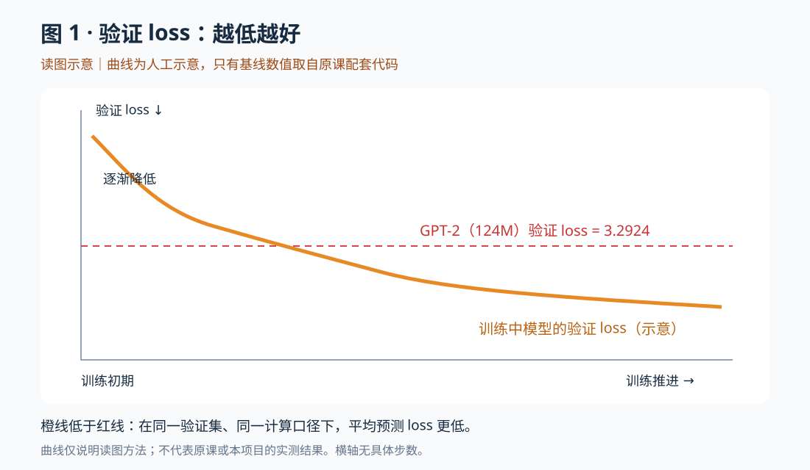
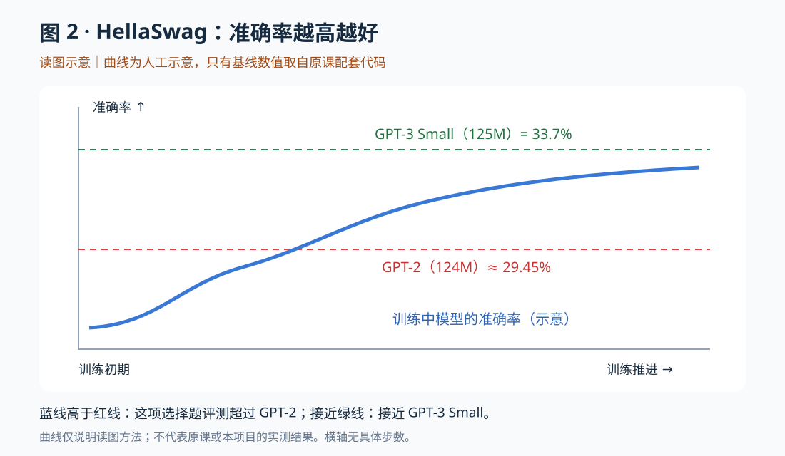

# 阶段二 · 单元 2 · 2.5：正式训练、结果对照与原课收尾

归档日期：2026-11-01。承接 [HellaSwag 训练接入](../lesson15.md)。用户反馈“大概懂了”，掌握程度记录为“理解中”。本篇整理已讨论内容，没有新增训练或评测结果。

[Notion 笔记](https://app.notion.com/p/40beaea314148160bf03dc6856495bb8) · [总学习计划](https://app.notion.com/p/340eaea31414819197bde537d339d0fc)。

## 1. 当前学到哪里，依据是什么

位置：**阶段二 → 单元 2「复现 GPT-2」→ 2.5「评测与正式训练」→ 正式配置、结果解读和视频收尾**。原视频的讲解主线已覆盖至结尾；完整工程实践尚未完成，不将理论走读等同于正式训练完成。

来源边界：核对了原视频对应时段的非官方字幕副本，以及作者历史源码；未直接观看全部视频画面。原课事实、解释用的教学例子、本项目实跑结果分别记录。

| 内容 | 原课位置与参考 |
| --- | --- |
| Token 预算、有效 batch、更新数 | [约 3:18:58 起](https://www.youtube.com/watch?v=l8pRSuU81PU&t=11938s) |
| 正式训练中的验证、生成和 HellaSwag | [作者历史训练代码 8018ed2](https://github.com/karpathy/build-nanogpt/blob/8018ed2c82c78a0600b2f7c66b1e606a93c60584/train_gpt2.py) |
| 训练曲线和基线 | [约 3:43:28 起](https://www.youtube.com/watch?v=l8pRSuU81PU&t=13408s)、[历史绘图笔记本 fb78c49](https://github.com/karpathy/build-nanogpt/blob/fb78c49698c0bfd44e5bf704b79fecdda440e6bf/play.ipynb) |
| 检查点 | [约 3:53:37](https://www.youtube.com/watch?v=l8pRSuU81PU&t=14017s)、[保存检查点的提交](https://github.com/karpathy/build-nanogpt/commit/efedfacd755a507dd1031e251dc0375e6a11d1cc) |
| 更多评测、SFT 与 llm.c | [约 3:54:37 至结尾](https://www.youtube.com/watch?v=l8pRSuU81PU&t=14077s) |

## 2. 训练 Token 总量、有效 batch 和更新次数

这里的“训练 Token 数”指参与训练的预测位置总数；同一份数据被重复训练，也会再次计数。它不等于独立文章数或唯一 Token 数。

设每卡微批次有 B 条长度 T 的序列、R 个训练进程、累积 K 次才更新一次参数：

```text
每次参数更新的有效 Token 数 = B × T × R × K
总训练 Token 数 = 更新次数 × 每次更新的有效 Token 数
```

原课正式配置的有效 batch 是 524,288 Token（2^19），不是 524,288 篇文章。B=64、T=1024、R=8 时，K=1；若改成 B=16、R=8，则 K=4，保持每次更新的有效 Token 数不变。

```text
10,000,000,000 ÷ 524,288 ≈ 19,073.486
取 19,073 次更新 → 9,999,745,024 个训练预测位置
```

所以原课把它称为约 10B Token 的训练。不要把“循环里读一个微批次”和“optimizer.step() 更新一次参数”混为一谈。

## 3. 原课正式运行的学习率与评测频率

| 设置 | 原课数值 | 含义 |
| --- | --- | --- |
| 最大学习率 | 6e-4 | warmup 后达到的学习率 |
| 最小学习率 | 6e-5 | 最大值的 1/10 |
| warmup | 715 次更新 | 约 374,865,920 个训练 Token |
| 总更新次数 | 19,073 | 约 10B 训练 Token |
| 验证 loss | 每 250 步，及初始/最后循环步 | 每卡固定取 20 个验证 batch，先 reset 验证加载器 |
| HellaSwag | 每 250 步，及初始/最后循环步 | 分题评测，汇总正确数和总题数 |
| 生成 | 非零的 250 步整数倍及最后循环步 | 每个 rank 生成 4 条，top-k=50，序列总长最多 32（含提示词） |

学习率先线性预热，再余弦衰减。原代码 step 从 0 开始：warmup 使用 max_lr × (step+1)/715；step=714 和 715 都在峰值。最后一个实际循环索引是 19072，学习率接近最小值；没有额外的最低学习率保持阶段。

每 250 次更新对应约 131,072,000 个训练 Token。B=64、T=1024、R=8 时，一次 20 批验证覆盖 10,485,760 个预测位置；这些验证位置不计入训练预算。

**执行时机要对应源码：**原课把验证、HellaSwag、生成放在循环顶部、当前更新之前。在 step=19072 测完后仍会执行最后一次更新。因此该检查并不是完成全部 19073 次更新之后的再次评测。本项目教学入口采用更新后计数，二者不能按日志数字直接混用。

原课该历史版本关闭了 torch.compile，并用条件限制 HellaSwag/生成；这是当时的兼容问题，不当作所有新版本 PyTorch 的通用限制。

## 4. 验证 loss 与 HellaSwag 分别说明什么

| 指标 | 在测什么 | 改善方向 | 不能单独推出什么 |
| --- | --- | --- | --- |
| 验证交叉熵 loss | 给定真实前缀，对真实下一 Token 的平均负对数概率 | 越低越好 | 所有任务更强，或自由生成一定正确 |
| HellaSwag 准确率 | 四个候选中，模型评分最好的候选是否为正确答案 | 越高越好 | 数学、代码、多语言和聊天能力都更强 |

loss 降低不要求每个位置的 argmax 都变成正确答案；它衡量连续的概率变化。HellaSwag 准确率只记候选最终是否排第一，是离散的对/错。

教学假设：错误候选 A 的平均 loss 从 2.0 降到 1.8，正确候选 B 从 2.1 降到 1.9。B 的概率评分改善了，但 A 仍胜出，这道题还是错。这不是原课实测数据。

### 基线应当怎样读

| 基线 | 历史绘图代码中的值 | 比较边界 |
| --- | --- | --- |
| GPT-2 124M 验证 loss | 3.2924 | 在课程验证数据上重测，不是 GPT-2 通用常数或原训练 loss |
| GPT-2 124M HellaSwag | 0.294463，约 29.45% | 视频口述较早出现约 29.55%；保留差异，正式实验应统一协议重测 |
| GPT-3 Small 125M HellaSwag | 0.337，即 33.7% | GPT-3 论文 zero-shot / dev 的参考值，不是 175B GPT-3 |

GPT-3 Small 的型号与数值参见 [GPT-3 论文模型表及附录 H](https://arxiv.org/html/2005.14165v4)。历史绘图脚本用 124M 作字典键，并不意味着论文模型精确参数量也是 124M。

原课约 10B 的运行超过 GPT-2 的相关基线；延长至约 40B 后，HellaSwag 接近但尚未达到展示中的 GPT-3 Small 参考线。没有取得原训练完整日志，不填造精确最终值，也不把原课结果当作本项目结果。

公平对照需明确模型、数据集版本与 split、提示格式、zero/few-shot 设置、候选长度归一化和评测范围。FineWeb-Edu 与 GPT-2 原训练数据分布不同，验证 loss 的优势只限于所测分布。数据质量、分布差异、潜在评测污染是需要排查的因素，不是已证实的结果成因。

本项目只有 8 道真实题的教学预览：3/8=37.5%，多对一道就增加 12.5 个百分点，不能拿这个数宣称超过完整评测的 GPT-3 基线。

### 两张图的来源边界

下面是本次对话制作的**人工读图示意**。基线值来自历史代码，曲线没有原日志支撑，横轴无具体步数；它们不是视频截图或本项目训练结果。原课画面见上方视频时间链接。





## 5. 保存模型与恢复训练是两件事

日志记录表现，不能恢复参数。原课检查点保存 model.state_dict()、config、step、val_loss，由主进程在验证后、非零的 5000 步整数倍或最后循环步写文件。

- **以后做生成/评测：**需要对应模型实现和配置、训练后状态、匹配的分词器。state_dict 不等于模型实现源码。
- **尽量接上中断前训练：**除模型外，还要处理优化器状态、更新进度/学习率、数据 shard 与游标、相关随机数生成器状态等。

AdamW 的一阶/二阶矩和计数影响下次更新。只恢复参数而新建空优化器，可以继续训练，但不等于恢复原训练轨迹。重设最初种子也不等于恢复已经消耗了一部分随机序列的 RNG 状态。

原课实现了用于保留模型的检查点，提醒恢复训练要额外考虑状态；本节没有交付完整断点恢复系统。恢复数据游标等属于为解释该区别而补充的工程说明。

## 6. 保存后进一步评测，以及 llm.c 的意义

检查点固定被评测的模型，评测配置固定测试规则。可以把训练期间的定期观察与训练后的多任务深入评测分开。原课提及 [lm-evaluation-harness](https://github.com/EleutherAI/lm-evaluation-harness)，没有在结尾展开完整接入教程。

[llm.c](https://github.com/karpathy/llm.c) 用 C/CUDA 实现 GPT 训练，保留 PyTorch 参考实现。原课并排展示 loss/梯度范数对照与运行速度，说明优化实现需要同时核对计算正确性和性能。日志小数相同不证明所有张量逐位相同；当时展示的提速不构成所有硬件/软件版本上的通用结论。

这与阶段一 micrograd 有衔接：先理解自动求导，再理解完整模型训练，最后看到底层计算和内存组织的工程实现。此处为原课概览，没有新增 CUDA 编程或 llm.c 实跑要求。

## 7. 本次重点答疑：问答时为什么会更新梯度？

**日常使用聊天模型不更新参数。需要更新参数的是“用问答示范训练模型”的过程。**此前讲解把两个场景放在一起造成歧义，此处明确更正。

### 用问答数据做 SFT：训练

数据事先包含问题和示范答案，例如“法国的首都是哪里？”与“法国的首都是巴黎。”。在预训练参数基础上，模型预测 Token，与真实标签计算 loss，再反向和更新。模型学习按助手角色回答、遵守指令和衔接上下文。

仍沿用文本 → Token → x/y → 前向 → loss → backward → optimizer.step 的基本过程。实际聊天 SFT 常对助手答案部分计算训练 loss，具体模板和 mask 要在后续课程里学习；当前只做概念衔接。

### 用户向模型提问：推理

```text
问题 → 编码 → 使用已有参数前向 → 选下一 Token
                  ↑                         ↓
                  └──── 新 Token 加入上下文 ──┘
```

循环改变的是上下文，参数保持不变；没有训练用 loss.backward() 和 optimizer.step()。model(x) 本身不更新参数；no_grad 阻止为这次前向记录反向图，eval 切换模块的训练/评估行为，二者用途不同。

| 场景 | 参数起点 | 数据与目的 | 参数更新 |
| --- | --- | --- | --- |
| 本课程预训练 | 随机初始化 | 普通文档，学习下一 Token 预测 | 有 |
| 聊天 SFT | 已预训练的参数 | 高质量指令/对话示范，学习助手行为 | 有 |
| 日常聊天推理 | 已训练好的参数 | 根据用户输入生成回答 | 无 |

用户问“聊天大模型是不是需要大量问答对训练”：方向正确，但数据不限于知识问答，还包括改写、摘要、代码、格式约束、多轮对话等。质量、正确性、覆盖范围和一致性都重要，数量越多不保证越好。预训练已经提供基础，SFT 并非从零记住全部知识。完整聊天模型还可能有其他后训练步骤；当前视频到预训练为止，不因此跳过既定计划去开 SFT 新课。

## 8. 进度、实践和后续衔接

- **已学习、初步理解：**正式训练 Token/batch/步数换算，学习率与验证/生成/HellaSwag 频率，GPT-2/GPT-3 Small 基线与指标边界，检查点与恢复训练的区别，更多评测、预训练/SFT/推理、llm.c 概览。原视频讲解主线已到结尾。
- **既有用户实践保留：**完整 GPT-2 的 CPU 训练/验证/生成三次更新短跑；不扩写为正式预训练。
- **既有助手验证保留：**教学分片、tiny CPU/Gloo、8 道真实 HellaSwag 预览；不扩写为用户完整评测或 CUDA/NCCL。
- **待补：**2.2 独立 SDPA/词表对齐入口及统一 CUDA 对照；2.3 独立配置及多卡/GPU；2.4 真实 FineWeb、用户新入口/多进程；2.5 完整 HellaSwag、正式训练和同口径基线对照。
- **下一次衔接：**先回顾单元 2 的已学与待实践，再按既定计划进入阶段二单元 3「现代模型结构」。单元 3 来源为原书补充材料、论文与官方实现，不称作这支视频的下一章。本次未开始单元 3。

完整工程段落计数保留单元 2 的 **1/5**、阶段二 **5/32**；另明确记录本次理论主线收尾，不能只用旧计数描述学习位置。自检仅供复习，不新增完成门槛，也不要求先完成大规模 GPU 运行才能继续理论学习。
