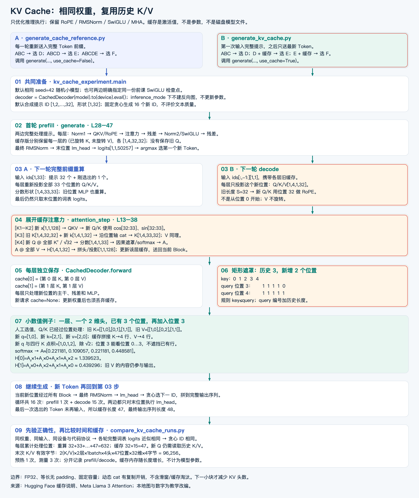

# KV Cache：从逐 Token 生成到历史 K/V 的工程复用

Notion：[KV Cache 学习笔记](https://app.notion.com/p/416eaea3141481a99dfacfe3abc0eca3)。正文与完整流程图已保存并回读核对。

记录日期：2026-11-12。学习位置：阶段二 → 单元 3 → 3.6 KV Cache/GQA 的缓存部分。当前反馈为“大概理解”，掌握程度记录为理解中。本篇集中整理本次原理、代码与答疑；GQA 实现仍留到下一小块。

## 1. 先看全流程



图中红框标出缓存路径的改动，包含 prefill/decode、每层 K/V、RoPE 偏移、长方形因果遮罩和具体数值例子。缓存改变的是执行方式，不是增加一套模型权重。

## 2. 输入 100 个 Token，模型会生成几个

常规自回归生成先把 100 个 Token 一起送入模型；取最后一个位置的最终表示，预测第 101 个 Token。单条序列的形状为：

```text
Token ID [1,100]
  → Embedding [1,100,D]
  → 多个 Transformer Block [1,100,D]
  → 最终归一化 [1,100,D]
  → 取最后一个位置 [1,1,D]
  → lm_head [1,1,V]
  → 贪心或采样，选出 1 个新 Token ID
```

D 为隐藏维度，V 为词表大小。V 个分数是同一个预测位置的 V 个候选，不是生成 V 个 Token。

若对全部 100 个位置都执行 lm_head，会得到 [1,100,V]：位置 1 预测位置 2，位置 2 预测位置 3，依此类推，位置 100 预测位置 101。这不是一次预测未来 100 个新 Token。当前输入前 100 个 Token 已知，续写只需要末位置的分数；本项目两条推理路径都只对末位置执行 lm_head。

最后位置的表示已经能够通过因果注意力读取前面的上下文，所以“使用最后位置输出”不等于“只看最后一个输入 Token”。

## 3. 选出了 D，不等于已经算过 D 的 QKV

令 A、B、C 表示三个 Token ID，而不是固定的字符切分规则：

```text
输入 ABC
  → 计算 ABC 各位置的表示
  → C 的最终表示经 lm_head 得到分数
  → 选择 D 的 Token ID
```

此时 D 刚被选出，还没有查 Embedding，也没有经过 Block，因此还没有 D 自己在各层的 Q/K/V。要预测 E，下一轮必须把 D 输入模型。

| 轮次 | 完整前缀重算 | KV Cache 路径 | 计算后的缓存 | 本轮选择 |
| --- | --- | --- | --- | --- |
| 1 | 输入 ABC | 输入 ABC，建立缓存 | 各层 ABC 的 K/V | D |
| 2 | 输入 ABCD | 输入 D，并携带历史缓存 | 各层 ABCD 的 K/V | E |
| 3 | 输入 ABCDE | 输入 E，并携带历史缓存 | 各层 ABCDE 的 K/V | F |

第一轮处理完整提示叫 prefill；后续只处理新增 Token 叫 decode。生成 N 个 Token，常规流程执行一次 prefill 和 N−1 次 decode。末次选出的 Token 若不继续生成，就没有必要再输入模型，因此不会进入本轮缓存。

## 4. QKV 是参数，还是计算结果

必须区分投影权重与投影输出：

| 对象 | 含义 |
| --- | --- |
| WQ、WK、WV | 模型可训练的投影参数；同一层各位置共用 |
| xA、xB | 该层归一化后、准备投影的位置向量 |
| qA、kA、vA | xA 通过三套权重得到的数据 |
| Q、K、V | 把各位置对应结果堆在一起形成的张量 |

$$
q_A=x_AW_Q,\quad k_A=x_AW_K,\quad v_A=x_AW_V
$$

$$
q_B=x_BW_Q,\quad k_B=x_BW_K,\quad v_B=x_BW_V
$$

“每个 Token 有自己的 QKV”准确说是每个位置有对应的计算结果，不是每个 Token 拥有一套独立权重。

手算例子：设 xA=[1,2]、xB=[3,4]，共享参数如下，采用行向量右乘写法：

$$
W_Q=\begin{bmatrix}1&0\\0&2\end{bmatrix},\quad
W_K=\begin{bmatrix}0&1\\1&0\end{bmatrix},\quad
W_V=\begin{bmatrix}1&1\\0&1\end{bmatrix}
$$

| 位置 | 输入 | Q 输出 | K 输出 | V 输出 |
| --- | --- | --- | --- | --- |
| A | [1,2] | [1,4] | [2,1] | [1,3] |
| B | [3,4] | [3,8] | [4,3] | [3,7] |

一次矩阵乘法 XWQ 就同时得到各位置的 q；qA 是 Q 中 A 位置对应的一行。拆头则把输出特征进一步分组。以上是人为教学值，不是模型实测激活。

这些结果属于“某一层、某个上下文中的位置”，不是词表中某个 Token 永久固定的向量。相同 Token 出现在不同上下文中，在后续层的 Q/K/V 可以不同。

## 5. 为什么新增 Token 不会改变旧 K/V

旧位置确实受上下文影响，但因果语言模型只允许它读取自身和前面的内容。追加 D 后，各旧位置允许读取的内容没有改变：

| 位置 | 追加 D 前 | 追加 D 后 |
| --- | --- | --- |
| A | A | A |
| B | AB | AB |
| C | ABC | ABC |
| D | 不存在 | ABCD |

以 C 的注意力分数为例，原来为 [sCA,sCB,sCC]；新增 D 后是 [sCA,sCB,sCC,−∞]。softmax 分母只多了 exp(−∞)=0，因此原来三个权重不变，D 的权重为零：

$$
H_C=a_{CA}v_A+a_{CB}v_B+a_{CC}v_C+0\times v_D
$$

这个性质可逐层传递：旧 Token 和位置编号没变 → 第一层输入没变 → 因果遮罩阻止读取 D → 第一层旧位置输出没变 → 第二层旧位置输入和投影 K/V 没变 → 后续层同理。LayerNorm/RMSNorm 与 MLP 沿每个位置的特征处理，不会把新增位置混进旧位置的计算；本例 RoPE 对旧位置使用的角度也不变。

前提是模型权重固定、eval 模式关闭 Dropout、位置处理规则固定，而且只是追加后缀。修改前缀或更新权重后，相关缓存不可原样复用。本项目新请求直接清空缓存。浮点实现因矩阵形状不同允许很小的数值误差，不要求逐 bit 相同。

## 6. 只输入 D，如何继续读取 ABC

“只输入 D”指本轮新增的 Token 输入只有 D；历史 K/V 还作为另一份输入传给模型。

同一层、同一头的旧缓存为 K旧=[kA;kB;kC]、V旧=[vA;vB;vC]。本轮从 D 在该层的输入投影得到 qD、kD、vD，把新 K/V 追加后计算：

$$
A_D=\operatorname{softmax}\left(\frac{q_D[k_A;k_B;k_C;k_D]^\top}{\sqrt{d_{head}}}\right)
$$

$$
H_D=a_{DA}v_A+a_{DB}v_B+a_{DC}v_C+a_{DD}v_D
$$

这里 Q/K 按模型要求已经完成位置处理；D 的新 Q 仍与所有可见 K 比较，所有对应 V 仍参与加权汇总。缓存没有丢弃历史信息。

| 计算 | 完整重算 ABCD | 缓存版处理 D |
| --- | --- | --- |
| 本轮新算 Q | 4 行 | 1 行 |
| 本轮新算 K/V | 各 4 行 | 各 1 行 |
| 注意力使用的全部 K/V | 各 4 行 | 各 4 行，包括历史缓存 |
| 分数矩阵（每头） | 4×4 | 1×4 |
| 本轮执行 MLP 的位置 | ABCD | D |

旧 Q 用于为旧位置读取信息，已完成任务；生成新位置只需要新的 Q，所以标准 KV Cache 保存 K/V 而不保存旧 Q。D 仍然经过所有 Block，每层使用自己的一份历史 K/V，不能把第一层缓存当作后续层缓存。

## 7. 工程上怎么存、怎么传、怎么追加

本项目用 tuple 组织各层缓存，真正的数值存在 PyTorch Tensor 中：

```python
cache = (
    (第0层的K, 第0层的V),
    (第1层的K, 第1层的V),
)
```

每个张量形状为 [B,Hkv,S,d]：batch 数、KV 头数、已处理位置数、每头维度。本课是 MHA，Hkv 与 Q 头数相同。GPU 推理时通常放在显存，CPU 推理时放在内存；本项目不做卸载。这不是磁盘上的模型权重缓存，不需要 Redis 或数据库。

生成循环的教学简化版本：

```python
cache = None
ids = prompt_ids
for _ in range(new_tokens):
    current = ids if cache is None else ids[:, -1:]
    logits, cache = decoder(current, cache)
    token = logits[:, -1, :].argmax(dim=-1, keepdim=True)
    ids = torch.cat((ids, token), dim=1)
```

ids 保存完整的 Token ID 输出序列；cache 保存每层已经处理位置的 K/V。模型返回更新后的缓存，外层变量持续引用它，下一轮再传回。变量引用 Tensor 就能保留数据，不需要写文件。

每层内部计算新增 QKV 后，沿位置轴拼接：

```python
k = torch.cat((past[0], k), dim=2)
v = torch.cat((past[1], v), dim=2)
```

例如旧 K[1,4,3,32] 与新 k[1,4,1,32] 拼成 [1,4,4,32]。torch.cat 会生成新的拼接张量，有分配和复制开销；不是旧张量自动原地扩容。高效缓存可预分配容量后按游标写入，本课保留动态拼接便于理解。

新请求将 cache 设为 None。旧 Tensor 没有引用后，存储可被 PyTorch 回收复用；GPU 分配器可能保留已申请显存，因此监控占用不一定马上下降。

## 8. RoPE 位置偏移和遮罩为什么需要特别处理

缓存已包含 S=100 个位置时，下一个新 Token 的位置是 100（从 0 编号）。不能因为本轮只输入一个 Token，就从位置 0 重新做 RoPE。

```python
start = 0 if past is None else past[0].shape[2]
cos = attn.rope.cos[start:start + length]
sin = attn.rope.sin[start:start + length]
```

缓存保存旋转后的 K 和未旋转的 V；旧 K 不能再次旋转。新增 q/k 用自己的位置旋转，再追加新 k。

如果已有 3 个旧位置，一次输入位置 3、4，允许读取的矩阵必须为：

```text
                 key 位置
                 0 1 2 3 4
query 位置 3     1 1 1 1 0
query 位置 4     1 1 1 1 1
```

规则为 key_position ≤ query_position，其中 query_position 要加上历史长度。不能对这个 2×5 的矩阵直接套忽略偏移的左上角三角遮罩。

## 9. 上下文长度不是本轮新输入长度

当前预测真正使用的上下文长度为：

$$
S_{context}=S_{cache}+T_{new}
$$

缓存有 100 个位置、本轮新输入 1 个位置，当前上下文就是 101，而不是 1。KV Cache 减少重复计算，不绕过模型上下文上限。

假设上限为 1024，原提示为 100 个 Token：生成并送回 200 个新 Token 后，当前上下文是 300；生成并送回 900 个后，是 1000。提示包含实际编码进入模型的系统内容、历史对话、当前输入及模板等，不能只数最新用户输入。

常规预算保守安排为“提示 Token 数 + 计划生成 Token 数 ≤ 上下文上限”。严格区分已生成与已输入：生成 N 个 Token 的最后一次前向实际处理前缀 P+N−1，最后新选出的 Token 尚未进入缓存。这是计数边界，不表示可以无限超限续写。本项目检查每次实际送入与缓存的总长度，超过固定容量就报错，不自动裁剪或重置位置。

## 10. 项目入口、实验结果与范围

项目：[GPT-2-124M](https://github.com/guqun/GPT-2-124M)。本课文件：

- kv_cache_model.py：attention_step / CachedDecoder，缓存追加与逐层传递。
- kv_cache_experiment.py：generate，prefill/decode 循环和报告。
- generate_cache_reference.py：完整前缀重算入口。
- generate_kv_cache.py：KV Cache 入口。
- compare_kv_cache_runs.py：相同协议下先比较 logits/贪心 ID，再比较时间。
- lesson20-kv-cache.md：运行说明与边界；docs/diagrams/kv-cache-code-flow.svg / .png 为配套图。

使用已配置的解释器，依次执行：

```bash
/Users/guqun/micrograd/venv/bin/python /Users/guqun/micrograd/gpt2_pretrain_lab/generate_cache_reference.py
/Users/guqun/micrograd/venv/bin/python /Users/guqun/micrograd/gpt2_pretrain_lab/generate_kv_cache.py
/Users/guqun/micrograd/venv/bin/python /Users/guqun/micrograd/gpt2_pretrain_lab/compare_kv_cache_runs.py
```

默认相同随机小模型、合成合法 ID，目的是核对缓存而非文本质量；两边也可明确加载同一份前课 SwiGLU 检查点。不反传、不更新参数。默认目录为 .cache/kv-cache-comparison/reference 与 cached；已有结果拒绝覆盖，重跑用 --output，并向比较工具传相应报告路径。

助手已验证 CPU/FP32：

| 条件 | 重算/缓存处理位置（每层） | logits 最大绝对差 | 贪心 ID | 重算/缓存中位时间 |
| --- | --- | --- | --- | --- |
| 随机权重，提示32，生成16 | 632 / 47 | 2.38×10⁻⁷ | 一致 | 43.51 / 49.60 ms |
| 前课短训权重，提示128，生成32 | 4592 / 159 | 1.91×10⁻⁶ | 一致 | 111.58 / 65.23 ms |

两行同时改变长度与权重，不是隔离长度的严格实验。短输入没有提速，较长例子本次约快 1.71 倍；不推广为任何场景或 GPU 结论。动态拼接和调用开销会影响实际收益。

缓存有效字节为 2×层数×B×Hkv×S×d×每元素字节。本课默认末次 S=47，FP32、2层、B=1、4头、每头32维，总计 96,256 字节，仅包括存活 K/V，不含权重、工作区或分配器保留内存。

5 项专项检查覆盖原模型前向、单步/分块、RoPE 偏移、矩形遮罩、缓存重置、边界及参数不变。核验记录为 artifacts/kv-cache-verification.json。助手验证不替代用户亲自运行记录。本次用户初步理解原理及答疑；不据此标记整个 3.6 或 GQA 已完成。

## 11. 参考与后续

- [Hugging Face：How caching works](https://huggingface.co/docs/transformers/cache_explanation)：历史 K/V 复用与推理缓存。
- [Meta Llama 3 model.py](https://github.com/meta-llama/llama3/blob/main/llama/model.py)：逐层 K/V、位置偏移与缓存读取的官方实现参考。
- 本项目 lesson20-kv-cache.md、kv_cache_model.py 与本次问答：教学改编及工程对应。

后续 GQA 将减少 KV 头数，从而减少缓存公式中的 Hkv；它与“把已有 K/V 保存复用”是两项不同的改动。
