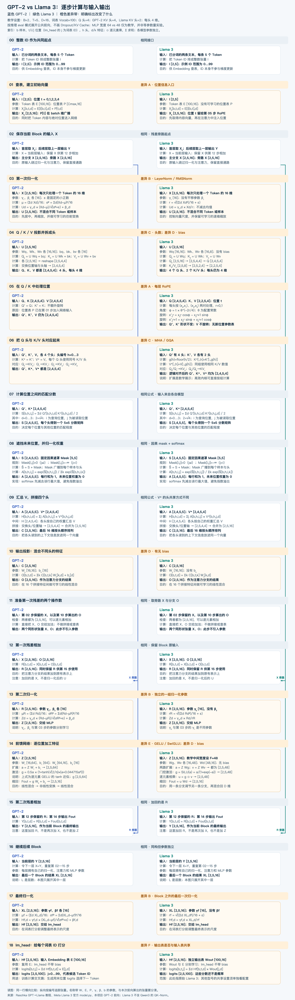
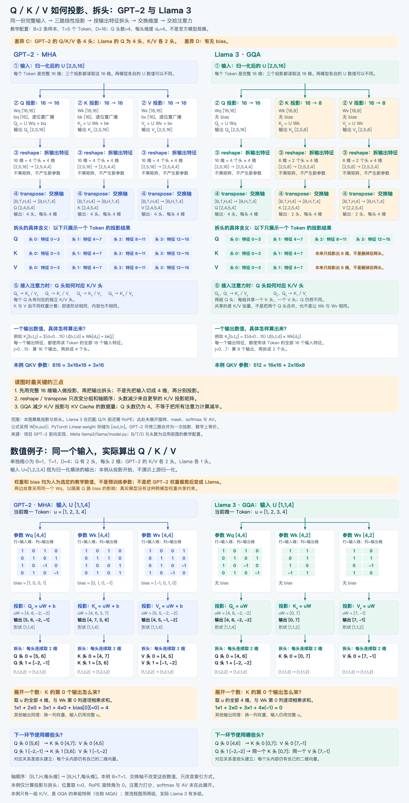
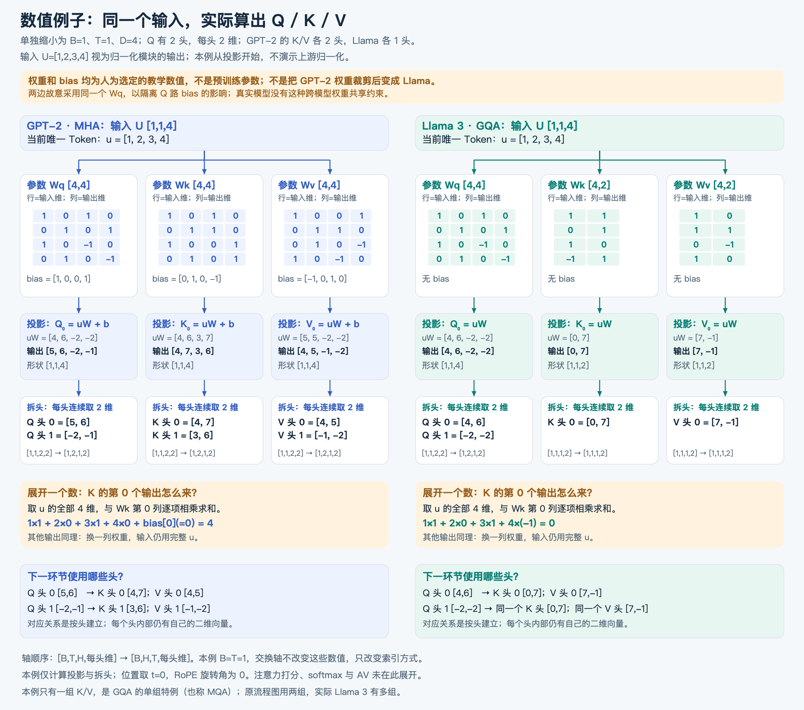
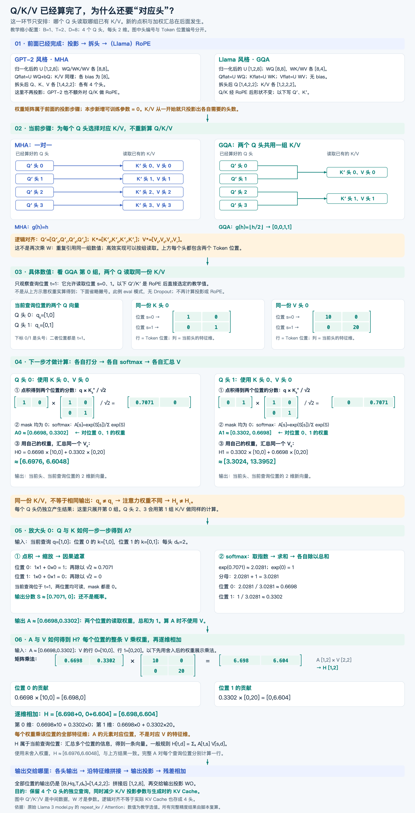
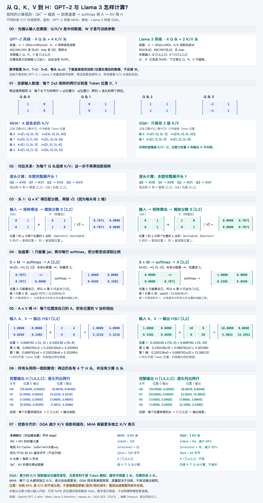

# LayerNorm 与 RMSNorm：计算差异、数学推导与设计取舍

记录日期：2026-11-06。学习位置：阶段二 · 单元 3「现代模型结构」，GPT-2 与 Llama 3 前向对照中的差异 B。用户反馈“大概理解了”，掌握程度为理解中；本篇是概念与数学补充，不代表完成整个单元或工程实验。

## 全流程对照图：GPT-2 与 Llama 3

先从全图定位归一化、QKV 投影、RoPE、注意力和 MLP，再阅读后续细节。

[原始 SVG：可放大查看](diagrams/gpt2-vs-llama3-forward-flow.svg)

## 1. 这一部分解决什么问题

LayerNorm 与 RMSNorm 都调整一个 Token 的特征向量的数值尺度，输出形状保持不变。GPT-2 使用 LayerNorm；原始 Llama 3 使用 RMSNorm。

若输入 X 的形状为 [B,T,D]=[2,5,16]，就分别对 10 个 Token 各自的 16 个特征做归一化，输出仍为 [2,5,16]。不跨 batch 或不同 Token 统计，也不是把每个数限制在 0～1。

归一化出现在注意力前、MLP 前，以及最后一个 Block 之后。各处有独立的可训练参数；同一处的参数则供各样本、各位置共享。

## 2. 数学补充：均值、方差、标准差与均方根

这里使用“均值、方差、标准差”三个明确名称。“均差”可能指平均绝对偏差等其他量，不是下面方差的名称。

对于一个 Token 的向量 x=[x₁,…,x_D]：

| 量 | 数学意义 | 注意 |
| --- | --- | --- |
| 均值 μ | 数值中心在哪里 | 不是衡量分散程度 |
| 偏差 x_d−μ | 某一维比均值高或低多少 | 有符号，所有偏差之和为 0 |
| 方差 σ² | 偏差平方的平均值 | 平方避免正负抵消，并增大大偏差的贡献 |
| 标准差 σ | 偏差的均方根，描述典型波动尺度 | 单位与原数值相同，不是绝对偏差的算术平均 |
| RMS | 原数值相对于 0 的整体大小 | Root Mean Square，先平方、再平均、最后开根号 |

定义：

$$
\mu=\frac1D\sum_{d=1}^D x_d
$$

$$
\sigma^2=\frac1D\sum_{d=1}^D(x_d-\mu)^2,\qquad \sigma=\sqrt{\sigma^2}
$$

$$
\mathrm{RMS}(x)=\sqrt{\frac1D\sum_{d=1}^D x_d^2}
$$

LayerNorm 使用分母 D；不要套用统计学中无偏样本方差的 D−1。这些统计量每次根据当前输入重新计算，不是可训练参数，也不是跨 batch 的历史平均。

例子 x=[1,1,3,3]：均值为 2，偏差为 [-1,-1,1,1]，方差为 1，标准差为 1，RMS 为 √5≈2.236068。

| 向量 | 均值 | 方差 | 标准差 | RMS² |
| --- | --- | --- | --- | --- |
| [1,1,3,3] | 2 | 1 | 1 | 5 |
| [101,101,103,103] | 102 | 1 | 1 | 10405 |
| [10,10,30,30] | 20 | 100 | 10 | 500 |

整体平移会改变均值，不改变方差；整体乘以 10，标准差乘以 10，方差乘以 100。

## 3. LayerNorm：先居中，再调整波动尺度

输入：一个 Token 的 D 维向量 x。参数：每维 γ、β，各有 D 个数；ε 为固定的小正数。

$$
y_d=\gamma_d\frac{x_d-\mu}{\sqrt{\sigma^2+\epsilon}}+\beta_d
$$

计算顺序：

1. 对 D 维求均值 μ。
2. 每维减 μ，再对偏差平方取平均得到方差 σ²。
3. 用中心化后的每一维除以 √(σ²+ε)。
4. 每维乘可训练的 γ_d，再加 β_d。
5. 输出仍是 D 维，交给 QKV 投影或 MLP 等后续计算。

γ 决定逐维缩放，β 决定逐维平移。它们由反向传播学习；均值、方差则随输入变化。

为什么可以统一尺度？忽略 ε，且 σ>0，设 z=(x−μ)/σ：

$$
\mathrm{Mean}(z)=\frac{\mathrm{Mean}(x)-\mu}{\sigma}=0
$$

$$
\mathrm{Var}(z)=\frac{\mathrm{Var}(x)}{\sigma^2}=1
$$

加入 ε 后，中心化输出的方差实际为 σ²/(σ²+ε)，一般接近 1，不严格等于 1。再乘 γ、加 β 后，最终输出也不要求均值为 0 或方差为 1。

## 4. RMSNorm：按相对于 0 的整体大小缩放

输入：同样的 D 维向量 x。原始 Llama 3 中的参数：每维 γ，共 D 个数，没有 β。

$$
r_\epsilon=\sqrt{\frac1D\sum_d x_d^2+\epsilon}
$$

$$
y_d=\gamma_d\frac{x_d}{r_\epsilon}
$$

计算顺序：原数值平方 → 对 D 维取平均 → 加 ε → 开根号 → 每维除以该数 → 乘 γ。

不减均值，不要求均值为 0。忽略 ε、γ 且 x 非零，设 z=x/RMS(x)：

$$
\frac1D\sum_d z_d^2
=\frac{\frac1D\sum_d x_d^2}{\mathrm{RMS}(x)^2}=1
$$

因此统一的是“均方根为 1”，不是“方差为 1”。加入 ε 后其平方均值为 RMS(x)²/(RMS(x)²+ε)；γ 还会进一步改变结果。

ε 可避免全零向量等情况下除以 0，也影响非常小尺度输入的归一化行为。

### 4.1 “控制尺度”和“可学习的逐维缩放”分别在哪里

两句话分别对应公式中的除法和乘法：

$$
y_d=
\underbrace{\frac{x_d}{\sqrt{\frac1D\sum_{k=1}^D x_k^2+\epsilon}}}_{\text{控制向量尺度}}
\times
\underbrace{\gamma_d}_{\text{可学习的逐维缩放}}
$$

第一步：每个 Token 的所有维度除以同一个、根据当前输入算出的均方根分母。它控制输入的整体尺度。

第二步：每个维度乘自己的 γ_d。它允许模型通过训练决定各特征交给后续网络时的尺度。

### 4.2 具体计算：x=[3,4]，γ=[2,0.5]

以下忽略 ε，并将 γ 设为教学示例值，不表示实际训练结果。

输入：

$$
x=[3,4],\qquad r=\sqrt{\frac{3^2+4^2}{2}}=\sqrt{12.5}\approx3.535534
$$

先控制尺度：

$$
z=\frac{x}{r}\approx[0.848528,1.131371]
$$

如果输入变为 [30,40]，均方根也放大 10 倍，所以除完仍得到同样的 z。这里说明的是正倍数整体缩放；实际 ε 使这种不变性一般近似成立。

再逐维缩放：

$$
y=\gamma\odot z
=[2\times0.848528,\;0.5\times1.131371]
\approx[1.697056,\;0.565685]
$$

⊙ 表示对应位置相乘，不是矩阵乘法。第 1 维乘 2，第 2 维乘 0.5。

### 4.3 均方根分母与 γ 的区别

| 对比 | 均方根分母 rε | 缩放参数 γ |
| --- | --- | --- |
| 从哪里来 | 根据本次输入计算 | 通过训练学习，原始 Llama 3 初始化为全 1 |
| 有几个 | 每个 Token 一个数 | 每个归一化模块有 D 个参数 |
| 如何使用 | 该 Token 所有维度除以同一个数 | 每一维乘对应的 γ_d |
| 是否随输入直接变化 | 是 | 否；推理时固定 |
| 如何更新 | 下次前向根据新输入重新计算 | 反向传播得到梯度，优化器更新 |
| 共享范围 | 当前 Token 的特征维 | 同一模块中的不同样本与 Token 共用 |

对于输入 [B,T,D]，分母可保留为 [B,T,1]，沿特征维广播；γ 的形状是 [D]，沿 batch 和位置维广播。输出仍为 [B,T,D]。不同 Block、注意力前与 MLP 前的归一化模块各有自己的 γ。

rε 不是可训练参数，但其计算仍在计算图中，对输入 x 求导时不能忽略分母对 x 的依赖。

### 4.4 为什么统一尺度之后，又允许缩放

统一尺度先减少输入整体大小的影响；随后可训练的 γ 让模型学习各个特征合适的尺度。它并不是恢复每个输入原来的均方根，因为 γ 在同一模块的不同输入之间共享。

忽略 ε 时，乘 γ 之前 z 的 RMS 为 1；乘 γ 后最终 y 的 RMS 不要求仍为 1。逐维 γ 还可能改变方向和各维比例；γ 本身没有必须为正的约束。

## 5. 同一组输入，两种方法分别算出什么

手算约定：γ 全为 1，LayerNorm 的 β 全为 0，忽略 ε。这是教学例子，不是模型实测输出。

输入 x=[1,1,3,3]。

LayerNorm：μ=2，σ=1。

$$
\mathrm{LN}_{core}(x)=[-1,-1,1,1]
$$

RMSNorm：RMS(x)=√5。

$$
\mathrm{RMSNorm}_{core}(x)
=\frac{[1,1,3,3]}{\sqrt5}
\approx[0.447214,0.447214,1.341641,1.341641]
$$

前者以均值为中心表达偏差；后者对原向量统一缩放。在乘逐维 γ 之前，RMSNorm 保留非零向量的方向和各维比例，LayerNorm 则去除了共同偏移。

## 6. 重点推导：RMS(x)² = σ² + μ²

公式的含义：原数值相对于 0 的平均平方，可以拆成“围绕均值的波动平方”和“均值自身的平方”。

从方差定义出发：

$$
\sigma^2=\frac1D\sum_d(x_d-\mu)^2
$$

展开括号：

$$
\sigma^2=\frac1D\sum_d(x_d^2-2\mu x_d+\mu^2)
$$

分别求和，再除以 D：

$$
\sigma^2=
\frac1D\sum_d x_d^2
-2\mu\left(\frac1D\sum_d x_d\right)
+\frac1D\sum_d\mu^2
$$

逐项解释：

- 第一项是 RMS(x)²，因为均方根平方后消去了根号。
- 第二项括号内就是均值 μ，因此该项为 −2μ²。
- 第三项有 D 个相同的 μ²，相加再除以 D，仍是 μ²。μ 对当前这组求和是同一个数，不随 d 改变。

所以：

$$
\sigma^2=\mathrm{RMS}(x)^2-2\mu^2+\mu^2
=\mathrm{RMS}(x)^2-\mu^2
$$

移项：

$$
\boxed{\mathrm{RMS}(x)^2=\sigma^2+\mu^2}
$$

代入 x=[1,1,3,3] 验证：

$$
\mathrm{RMS}(x)^2=\frac{1+1+9+9}{4}=5
$$

$$
\sigma^2+\mu^2=1+2^2=5
$$

这是定义之间的恒等式，不要求 x 服从正态分布。这里的 RMS 定义不含 ε；若使用带 ε 的实际分母，则分母平方为 σ²+μ²+ε。

把恒等式代入归一化公式：

$$
\mathrm{LN}_{core}(x_d)=\frac{x_d-\mu}{\sqrt{\sigma^2+\epsilon}}
$$

$$
\mathrm{RMSNorm}_{core}(x_d)=\frac{x_d}{\sqrt{\sigma^2+\mu^2+\epsilon}}
$$

当 μ=0 且 ε 相同，两者的归一化核心完全相同。整个模块是否输出相同，还要看 γ 和 β。

## 7. 为什么神经网络需要归一化

接到之前的前向流程：

~~~text
当前 Token 向量 → 归一化 → QKV 投影 → 注意力
第一次残差结果 → 归一化 → MLP → 第二次残差
~~~

不带偏置的线性投影中，输入整体放大 10 倍，Q、K 也放大 10 倍，QKᵀ 可能放大 100 倍。内容相对关系相同，但 softmax 会因尺度改变而更尖锐：

$$
\mathrm{softmax}([1,2])\approx[0.268941,0.731059]
$$

$$
\mathrm{softmax}([10,20])\approx[0.0000454,0.9999546]
$$

归一化有助于减小后续计算对输入整体尺度的敏感性，改善优化行为。它不等于梯度裁剪，不保证梯度永远不会爆炸，也不把输出变成概率。

统计量的计算属于计算图。反向时必须考虑 μ、σ²或 RMS 对 x 的依赖，不能将它们当成与输入无关的常数。原始输入仍通过 Pre-Norm 的残差旁路传递，因此不要把归一化分支去掉均值，说成整个 Block 已丢弃了原输入。

## 8. 优势与取舍：缩放和平移是两件事

以下讨论核心归一化，忽略 ε；向量满足对应分母非零；整体缩放倍数 c>0。

| 对比 | LayerNorm | RMSNorm |
| --- | --- | --- |
| 输入整体乘正数 c | 结果不变 | 结果不变 |
| 每一维都加同一个 a | 结果不变 | 一般改变 |
| 统一的统计标准 | 中心化后的方差 | 原数值的平方均值 |
| 归一化分支去掉什么 | 共同偏移与整体尺度 | 整体尺度 |
| 核心操作保留方向/比例 | 减均值会改变原方向 | 统一除以正数，保留原方向 |
| GPT-2/原始 Llama 3 的参数 | γ、β | γ |
| 运算 | 均值、中心化、方差、缩放和平移 | 平方均值、缩放 |

两者都不保留原向量的绝对尺度；RMSNorm 并不保留输入的原始均值，只是不强制将它变为 0。

例子：给 [1,1,3,3] 的各维加 100，得到 [101,101,103,103]。

- LayerNorm 核心仍为 [-1,-1,1,1]，消除了共同偏移。
- RMSNorm 的分母为 √10405≈102.004902，输出约 [0.990148,0.990148,1.009755,1.009755]。共同均值较大，围绕均值的差异在输出中较小。

LayerNorm 有平移不变性的好处，但归一化分支失去每次输入的共同偏移信息。β 是学到的参数，不能自动恢复每次输入各自不同的均值。

RMSNorm 更简单，但没有这种平移不变性。两种信息处理方式不构成“谁在所有任务中更准确”的证明。实际 ε 使缩放不变性通常只是近似成立；负倍数缩放会涉及符号变化。

## 9. Llama 3 为什么采用 RMSNorm

事实：Meta 的原始 Llama 3 官方实现使用 RMSNorm，有可训练 weight（即 γ），没有 β。核心代码是对 x 的平方在最后一维取平均，加 ε，再乘倒数平方根；统计计算先转为 FP32，之后转回输入类型并乘 weight。

研究依据：RMSNorm 论文提出，去中心化不变性并非在其考察任务中必不可少；保留尺度控制、简化运算，可以取得与 LayerNorm 相近的实验表现。[RMSNorm 原论文](https://arxiv.org/abs/1910.07467)

工程解释：选择 RMSNorm 可以保留尺度控制，同时省去中心化等操作。归一化在模型多层中重复出现，简化它有潜在效率收益；具体收益取决于硬件、融合内核和整体瓶颈。少一个 β 会减少少量参数，但不是大模型参数量减少的主要来源。

边界：上述是依据算法性质和论文解释设计取舍，不是 Meta 公布的“仅替换 LayerNorm”完整消融结论。不能把 Llama 3 的能力提升全部归因于 RMSNorm，也不能把论文其他模型的提速比例直接套到 Llama 3。[官方实现](https://github.com/meta-llama/llama3/blob/main/llama/model.py)

## 10. 复习问答

- 为什么不直接把偏差取平均？正负抵消，均值恒为 0，无法衡量分散。
- 为什么标准差需要开根号？把平方尺度恢复到原单位，得到偏差的典型尺度。
- RMSNorm 的输出方差一定为 1 吗？不一定；忽略 ε、γ 时统一的是平方均值。
- LayerNorm 的最终输出均值一定为 0 吗？不一定；加 β、乘逐维 γ 后没有此保证。
- RMSNorm 完全没有参数吗？有逐维 γ；没有的是原始 Llama 3 中的 β。
- 两者什么时候核心相同？输入均值为 0，且 ε 一致。
- 是所有 Token 一起求均值吗？不是；本例逐 Token 在最后的 D 维统计。
- 把 LayerNorm 直接替换为 RMSNorm，就能沿用原权重且保证效果吗？不能；计算改变，必须另行验证或训练，本次未做这种替换实验。

## 11. 资料与范围

- [RMSNorm：Zhang 与 Sennrich，NeurIPS 2019](https://arxiv.org/abs/1910.07467)：方法性质与原论文实验。
- [Meta Llama 3 官方 model.py](https://github.com/meta-llama/llama3/blob/main/llama/model.py)：RMSNorm 及其在模型中的实际使用。
- [Raschka 的 GPT→Llama 教程](https://github.com/rasbt/LLMs-from-scratch/tree/main/ch05/07_gpt_to_llama)：现代结构学习的配套材料，不是 Karpathy GPT-2 视频的后续段落。
- [项目仓库](https://github.com/guqun/GPT-2-124M)。

本篇手算向量与 softmax 数值属于数学教学例子，不是训练输出。记录概念已初步理解，不结算单元 3 完成状态。

本地配图：[GPT-2 与 Llama 3 完整前向对照](diagrams/gpt2-vs-llama3-forward-flow.md)，重点看步骤 03、13、17 的差异 B。

## 12. QKV 拆头补充：reshape、transpose 与多头注意力

本节接在归一化之后，解释前向对照图的“Q/K/V 投影并拆头”。拆头本身不做新的线性投影，不新增参数，也不改变已经算出的元素值；它把输出特征分组，并调整轴顺序。

**配图：QKV 投影、拆头，以及 GPT-2 / Llama 风格结构对比。** 上半部分看流程，下半部分看具体计算。

### 12.1 输入是什么：已经完成投影的 Q、K、V

以数值图的 GPT-2 教学例为例：B=1、T=1、D=4，2 个注意力头，每头 2 维。完整输入 u=[1,2,3,4] 先分别乘 Wq、Wk、Wv，并加各自 bias，得到：

$$
Q_{\mathrm{flat}}=[5,6,-2,-1],\quad
K_{\mathrm{flat}}=[4,7,3,6],\quad
V_{\mathrm{flat}}=[4,5,-1,-2]
$$

三者形状均为 [1,1,4]。这些数是投影的输出，不是权重。每个输出特征由完整的四维输入参与乘加；不是先切输入，再只用一小段输入投影。矩阵与偏置为教学选值，不是预训练模型实测值。

**数值图：输入、权重矩阵、偏置、投影结果与拆头后的向量。** 可放大逐项对照本节公式。

### 12.2 reshape：将输出特征维拆成“头数 × 每头维度”

对 Q：

$$
[5,6,-2,-1]\ \longrightarrow\
\begin{bmatrix}5&6\\-2&-1\end{bmatrix}
$$

第一行属于头 0，第二行属于头 1。K、V 以同样方式分组：

| 头编号 | Q 向量 | K 向量 | V 向量 |
| --- | --- | --- | --- |
| 头 0 | [5,6] | [4,7] | [4,5] |
| 头 1 | [-2,-1] | [3,6] | [-1,-2] |

张量形状从 [B,T,D] 变为 [B,T,H,dₕ]，其中 D=H×dₕ：

~~~text
[1,1,4] → [1,1,2,2]
~~~

这一步只是将连续的四个输出特征解释成两组，每组两个元素。

### 12.3 transpose：交换“位置”和“头”两个轴

拆头后排列是 [B,T,H,dₕ]。为方便每个头处理整个序列，交换中间两个轴：

~~~text
[B,T,H,dₕ] → [B,H,T,dₕ]
[1,1,2,2] → [1,2,1,2]
~~~

索引对应关系是：

$$
Q_{\mathrm{after}}[b,h,t,d]
=Q_{\mathrm{before}}[b,t,h,d]
$$

每个元素的值不变。这里 B=T=1，所以仅看数值不容易发现差别；序列长度大于 1 时，交换后按头组织每个位置的向量。reshape 负责拆分特征轴，transpose 负责交换轴，不能把两步混为一次矩阵乘法。

示意代码（q_flat 已经是投影结果）：

~~~python
# q_flat: [B, T, H * head_dim]
q = q_flat.reshape(B, T, H, head_dim)
q = q.transpose(1, 2)  # [B, H, T, head_dim]
~~~

reshape/transpose 在实现中可能涉及视图或内存布局变化；这里强调的是数学元素值和参数没有改变。

### 12.4 拆头之后做什么

对于每一个头 h，都使用它自己的 Q_h、K_h、V_h 计算：

$$
A_h=\mathrm{softmax}\left(
\frac{Q_hK_h^\top}{\sqrt{d_h}}+\mathrm{Mask}
\right)
$$

$$
H_h=A_hV_h
$$

softmax 沿被读取的上下文位置归一化。本例每头维度为 2，分母就是 √2；一般情况使用 √dₕ，不是除以头数的平方根。

多个头可以通过训练形成不同的注意力模式，但不保证每个头都有明确、固定的人类语义分工。各头输出最后沿特征维拼接：

~~~text
每头结果 [B,H,T,dₕ]
    → 交换头轴与位置轴 [B,T,H,dₕ]
    → 合并最后两轴 [B,T,H*dₕ]
    → 输出投影
~~~

### 12.5 GPT-2 与 GQA 的对应关系

上表是 MHA：头 0 使用 Q₀/K₀/V₀，头 1 使用 Q₁/K₁/V₁。

同一数值图的 Llama 风格缩小例中：

| Q 头 | 对应的 K | 对应的 V |
| --- | --- | --- |
| Q₀=[4,6] | 同一个 K₀=[0,7] | 同一个 V₀=[7,-1] |
| Q₁=[-2,-2] | 同一个 K₀=[0,7] | 同一个 V₀=[7,-1] |

其 K/V 投影各只输出两维，所以各只有一个头；不是先算四维再删掉一半。两个 Q 头保持独立，分别计算自己的匹配分数和注意力权重，只是使用同一组 K/V。

这个极小例只有一组 K/V，是 GQA 的单组特例，也称 MQA；实际原始 Llama 3 使用多组。完整结构图使用 4 个 Q 头、2 组 K/V：Q₀/Q₁ 用第 0 组，Q₂/Q₃ 用第 1 组。

### 12.6 容易混淆的地方

- 拆的是每个 Token 的投影特征维，不是把 Token 分给不同头。
- 每个头都保留整个序列的位置轴，可以关注因果遮罩允许的全部位置。
- 同一头的 Q/K/V 是不同投影产生的张量，形状相同不代表数值相同。
- 数值图只有一个 Token，不能展示多个上下文位置之间不同的关注比例：只有一个允许位置时，softmax 权重为 1。
- Llama 的 Q/K 在注意力匹配之前还需 RoPE；数值图取位置 t=0，旋转角为 0，未展开位置旋转。
- 本节只归档已讨论内容，不代表已完成 GQA、RoPE 的全部学习或训练实验。

本节配图：[QKV 完整流程与数值例子](diagrams/gpt2-llama3-qkv-projection-flow.png) · [单独数值图](diagrams/gpt2-llama3-qkv-numerical-example.png)。

### 12.7 已经投影之后，为什么还要对应 Q/K/V 头

投影和拆头在前面已经完成。本步只确定每个 Q 头读取哪组已有 K/V，不再次投影，不新增参数。MHA 一对一；图中的 GQA 则是 Q 头 0、1 共用 K/V 头 0，Q 头 2、3 共用 K/V 头 1。

数值图使用两位置示例：同一查询位置的 q₀=[1,0]、q₁=[0,1]，共用 K₀=[[1,0],[0,1]] 和 V₀=[[10,0],[0,20]]。两头得到不同注意力权重，输出分别约为 [6.6976,6.6048] 与 [3.3024,13.3952]。数值是人为选择的 RoPE 后中间结果，目的是隔离头共享效果。

[SVG 原图](diagrams/gpt2-llama3-head-matching-flow.svg)

### 12.8 Q、K 如何计算注意力权重 A

先区分数据来源：U 是当前层归一化后的输入；W_Q、W_K、W_V 是可训练投影参数；Q=UW_Q、K=UW_K、V=UW_V 是投影后的中间数据。拆头后，每个 Q 头按对应关系读取 K/V。Llama 的 Q/K 还先经过 RoPE，下面直接从这些步骤已完成的位置开始。

本例只看一个头、查询位置 t=1。当前 q=[1,0]，可读取位置 0 和 1。K 的每一行代表一个被读取位置：

$$
K=\begin{bmatrix}1&0\\0&1\end{bmatrix},\qquad d_h=2
$$

**第一步：当前 q 分别与各位置的 k 做点积，再除以每头维度的平方根。**

$$
q\cdot k_0=1\times1+0\times0=1
$$

$$
q\cdot k_1=1\times0+0\times1=0
$$

$$
S=\frac{qK^\top}{\sqrt2}
=\left[\frac1{\sqrt2},0\right]\approx[0.7071,0]
$$

S 是匹配分数，还不是注意力权重。

**第二步：加因果遮罩。** 查询在位置 1，可以读取位置 0、1，因此本行 mask=[0,0]，分数保持不变。如果有未来位置，则将其分数设为负无穷，softmax 后权重为 0。

**第三步：softmax，先取指数，再求和，最后各自除以总和。**

$$
e^{0.7071}\approx2.0281,\qquad e^0=1
$$

$$
\text{分母}\approx2.0281+1=3.0281
$$

$$
A_{\text{位置0}}\approx\frac{2.0281}{3.0281}\approx0.6698
$$

$$
A_{\text{位置1}}\approx\frac1{3.0281}\approx0.3302
$$

$$
A\approx[0.6698,0.3302],\qquad \sum_s A_s=1
$$

输出的 A 是当前查询位置对各上下文位置的读取权重，计算时没有使用 V。这里的数是位置权重，不是词表中 Token ID 的生成概率。

完整矩阵规则：

$$
A=\operatorname{softmax}_{\text{每一行}}
\left(\frac{QK^\top}{\sqrt{d_h}}+M\right)
$$

每个查询位置各占一行；每一列对应一个被读取的位置。单头、序列长度 T 时，完整 A 的形状是 [T,T]。上例只展开其中一行 [1,2]。为便于教学展示直接取指数，实际实现通常先减行最大值以提高数值稳定性，结果在数学上相同。

### 12.9 A 与 V 如何计算输出 H

沿用同一组数据：

$$
A\approx[0.6698,0.3302],\qquad
V=\begin{bmatrix}10&0\\0&20\end{bmatrix}
$$

V 的行 0=[10,0] 来自位置 0，行 1=[0,20] 来自位置 1。V 已经在前面投影计算完成。

**第一步：每个位置的权重乘该位置的整条 V 向量。** 以下先使用四位小数的 A 手算：

$$
0.6698[10,0]=[6.698,0]
$$

$$
0.3302[0,20]=[0,6.604]
$$

0.6698 同时乘位置 0 的全部特征维度，不是只乘第一维。A 的两个数对应两个位置，不是对应两个特征维度。

**第二步：把各位置的贡献逐维相加。**

$$
H=[6.698,0]+[0,6.604]=[6.698,6.604]
$$

同样的运算写成矩阵乘法：

$$
H=
\underbrace{\begin{bmatrix}0.6698&0.3302\end{bmatrix}}_{A:\,1\times2}
\underbrace{\begin{bmatrix}10&0\\0&20\end{bmatrix}}_{V:\,2\times2}
$$

$$
H=
\begin{bmatrix}
0.6698\times10+0.3302\times0&
0.6698\times0+0.3302\times20
\end{bmatrix}
$$

使用未舍入的权重计算时，H≈[6.6976,6.6048]，与 12.7 的结果一致；与手算 [6.698,6.604] 的差别仅来自中途舍入。

**输出 H 属于当前查询位置**：它融合了多个上下文位置的信息，仍是一条 2 维向量。对当前头所有查询位置都计算后：

$$
H=AV,\qquad H_{t,d}=\sum_s A_{t,s}V_{s,d}
$$

t 是查询位置，s 是被读取位置，d 是输出特征维度。若完整 A 为 [T,T]、V 为 [T,d_h]，则完整 H 为 [T,d_h]。

本例为 eval 模式，没有 Dropout；训练中若启用注意力 Dropout，实际汇总 V 的是 Dropout 处理后的权重。多个头的 H 最后沿特征维拼接，经过输出投影，再做残差相加。

**串联记忆：U 投影得到 Q/K/V → Q 与 K 得到分数 → 遮罩和 softmax 得到 A → A 对 V 加权求和得到 H。**

学习反馈：用户对这一段表示“大概理解了”，继续保留“理解中”。

### 12.10 “头”是什么意思：头编号与 Token 位置是两条轴

上图已同步嵌入 Notion。数字为教学选值，覆盖逐头对应、QK→A→H 与输出。

补充日期：2026-11-11。注意力头（Attention Head）是一路注意力计算：使用该头的 Q 和对应的 K/V，计算自己的权重 A 与输出 H。GQA 中多个 Q 头可以共用 K/V，因此“一路计算”不等于“一定独占一套 K/V”。

以 D=8、4 个 Q 头、每头 2 维为例，一个 Token 投影后的完整 Q 向量可以是：

$$
q_{\mathrm{flat}}=[1,0,\;0,1,\;1,1,\;-1,1]
$$

拆头后：

| Q 头编号 | 当前 Token 分到的 Q 向量 |
| --- | --- |
| 0 | [1,0] |
| 1 | [0,1] |
| 2 | [1,1] |
| 3 | [-1,1] |

先用完整输入参与投影，再将投影输出按特征分组；不是把原输入先切成四份，让每个头只看原输入的一小段。每个 Token 位置都有上述四个头。同一个头收集所有位置的向量后，得到一个 [T,2] 矩阵。

“Q 头 1”指第 1 路查询；“矩阵第 1 行”指 Token 位置 1；“第 1 列”指这个头的特征维度 1。三种编号不能混在一起。多个头可以学习不同的上下文读取方式，具体分工由训练形成，没有预设某个头必须负责语法或语义。

### 12.11 Q 与一组 K/V 的关系：先决定读取比例，再读取内容

忽略偏置及位置处理时，投影关系是：

$$
Q=UW_Q,\qquad K=UW_K,\qquad V=UW_V
$$

Q、K、V 是随输入变化的中间数据；W 是模型参数。“KV”仅表示 K 和 V 的合称，不是 K 乘 V，也不是一种新的矩阵。

| 数据 | 本次计算的作用 |
| --- | --- |
| Q | 当前查询位置用来比较上下文的特征 |
| K | 各个位置用于与 Q 匹配的特征 |
| V | 各个位置实际提供、被加权汇总的内容 |
| A | Q/K 比较并经过缩放、遮罩和 softmax 得到的位置权重 |
| H | A 对 V 加权汇总得到的输出 |

例如一组 K/V 是两个矩阵：

$$
K^{(0)}=\begin{bmatrix}1&0\\0&1\end{bmatrix},
\qquad
V^{(0)}=\begin{bmatrix}10&0\\0&20\end{bmatrix}
$$

| Token 位置 | K 组 0 中该位置的向量 | V 组 0 中该位置的向量 |
| --- | --- | --- |
| 0 | [1,0] | [10,0] |
| 1 | [0,1] | [0,20] |

一组包含所有位置的数据；不是“一组对应一个 Token”。同一组 K、V 的第 j 行都对应同一个 Token 位置 j：先用该位置的 K 确定权重，再用该权重乘该位置的 V。

### 12.12 四组与两组分别如何使用：对应关系固定，位置权重动态计算

以下上标表示头/组编号，不是 Token 位置。教学配置为 4 个 Q 头；MHA 有 4 组 K/V，GQA 有 2 组 K/V。

| Q 头 | MHA 使用的 K/V | GQA 使用的 K/V | 两种方案各自产生 |
| --- | --- | --- | --- |
| 0 | K 组 0、V 组 0 | K 组 0、V 组 0 | A 头 0、H 头 0 |
| 1 | K 组 1、V 组 1 | K 组 0、V 组 0 | A 头 1、H 头 1 |
| 2 | K 组 2、V 组 2 | K 组 1、V 组 1 | A 头 2、H 头 2 |
| 3 | K 组 3、V 组 3 | K 组 1、V 组 1 | A 头 3、H 头 3 |

令 g(h) 为 Q 头 h 对应的 K/V 组。MHA 中 g(h)=h；本例 GQA 中 g(h)=floor(h/2)。统一计算：

$$
A^{(h)}=\operatorname{softmax}_{\mathrm{row}}
\left(\frac{Q^{(h)}(K^{(g(h))})^\top}{\sqrt{d_h}}+M\right),
\qquad
H^{(h)}=A^{(h)}V^{(g(h))}
$$

头与 K/V 组的对应由结构规定，不是先比较分数再挑组。注意力分数选择的是：在这组 K/V 的各个允许 Token 位置中，分别读取多少信息。

共用 K/V 不会将 Q 合并，也不将 A 或 H 合并。两个不同 Q 可以对相同 K 得到不同 A，再用不同 A 汇总同一个 V。不同 Q 并不保证输出一定不同，但输出始终分别计算。最终仍有 4 个 H 头，按每个位置拼接，再交给输出投影。

### 12.13 共享 K/V 会不会导致有数据没用上

正常分组下，每组 K/V 都有对应的 Q 头使用。本例组 0 被 Q 头 0、1 使用，组 1 被 Q 头 2、3 使用。

关键：GQA 从投影开始就只生成 2 组 K/V，并非先生成 4 组，再丢掉 2 组。用行向量记法，省略 batch、偏置及位置处理：

$$
\text{MHA:}\quad
\underbrace{U}_{T\times8}\underbrace{W_K}_{8\times8}
\longrightarrow K_{\mathrm{flat}}:[T,8]
\longrightarrow 4\text{ 个 K 头，每头 2 维}
$$

$$
\text{GQA:}\quad
\underbrace{U}_{T\times8}\underbrace{W_K}_{8\times4}
\longrightarrow K_{\mathrm{flat}}:[T,4]
\longrightarrow 2\text{ 个 K 头，每头 2 维}
$$

V 同理。输入的 8 维全部参与投影，只是输出维度较少。因此减少的是独立 K/V 表示的数量，不是跳过部分输入维度。

需要区分三种情况：

| 情况 | 是否属于“共享造成遗漏” |
| --- | --- |
| GQA 只产生较少 K/V 头 | 不是；这些头按规定分组被使用 |
| 未来 Token 被因果遮罩挡住 | 不是；当前查询本来就禁止读取未来 |
| 某个允许位置的 A 很小，V 对 H 贡献很小 | 不是；这是注意力分配结果，MHA 中也存在 |

读图澄清：对照数值图为了便于比较，将 GQA 两组的数值选成了 MHA 组 0、组 2 的数值。这只是人工教学选值，不表示实际模型直接丢弃 MHA 的组 1、组 3；实际 GQA 使用自己的投影参数生成 K/V。

### 12.14 H=AV 中的 V，就是前面 K/V 组中的 V

同一个 Q 头先用对应组的 K，再用对应组的 V：

~~~text
Q头 h + 对应组的 K → 点积/缩放/遮罩/softmax → A头 h
A头 h × 对应组的 V → H头 h
~~~

第一段计算 A 只用 Q 和 K，V 尚未参与这段匹配运算；第二段 H=AV 才用 V 作为被汇总的内容。没有重新生成 V，也不是已经用 V 算出 A 后“又用一次 V”。

例如 GQA 的 Q 头 0、1 都用组 0：

$$
A^{(0)}=\operatorname{softmax}_{\mathrm{row}}
\left(\frac{Q^{(0)}(K^{(0)})^\top}{\sqrt2}+M\right),
\qquad H^{(0)}=A^{(0)}V^{(0)}
$$

$$
A^{(1)}=\operatorname{softmax}_{\mathrm{row}}
\left(\frac{Q^{(1)}(K^{(0)})^\top}{\sqrt2}+M\right),
\qquad H^{(1)}=A^{(1)}V^{(0)}
$$

仅观察查询位置 1，取 q 头 0=[1,0]、q 头 1=[0,1]，共用 12.11 的 K/V。沿用 12.8—12.9 的计算：

| 查询头 | 缩放分数（对应位置 0、1） | A（显示四舍五入） | H（使用完整精度 A 计算） |
| --- | --- | --- | --- |
| 0 | [0.707107,0] | [0.669762,0.330238] | [6.697615,6.604769] |
| 1 | [0,0.707107] | [0.330238,0.669762] | [3.302385,13.395231] |

两次 H 使用的都是同一个 V 组 0：第 0 行 [10,0]、第 1 行 [0,20]。变化的是读取比例 A。

**记忆句：头是一路注意力计算；K 帮助确定读取比例，V 提供被读取的内容。GQA 共用 K/V，各 Q 头仍分别得到自己的 A 和 H。**

本轮反馈：“我懂了”。记为本轮答疑已理解；整篇仍保留“理解中”，不据此结算整个单元或工程实验。

补充日期：2026-11-11。

## 13. 多头结果拼接与输出投影：从 H 到 O

本节接在第 12 节的 H=AV 之后。H 是各注意力头汇总上下文的结果；输出投影将不同头的特征混合，随后才做第一次残差相加。

### 13.1 输入、计算与输出

沿用总览图的教学尺寸：B=2、T=5、D=16，4 个 Q 头，每头 4 维。MHA 和 GQA 都输出 4 个 H 头；GQA 减少的是 K/V 头数。

~~~text
各头 H：[2,4,5,4]（batch、头、位置、头内特征）
    ↓ transpose：交换头轴与位置轴
[2,5,4,4]
    ↓ reshape：每个位置按头顺序拼接
C：[2,5,16]
    ↓ 输出投影
O：[2,5,16]
~~~

拼接只重排数据，不引入参数。输出投影才是新的可学习计算：

$$
O_{\mathrm{GPT2}}=CW_O+b_O,\qquad
O_{\mathrm{Llama3}}=CW_O
$$

这里采用行向量记法，W_O 的形状为 [16,16]，b_O 为 [16]。W_O 与前面的 Q/K/V 投影参数、后面的 lm_head 参数分别独立。同一层的所有位置使用同一个 W_O；这一步混合当前位置的特征，不在不同 Token 位置之间求和。

### 13.2 具体数值

缩小为 2 个头、每头 2 维，只观察一个位置：

$$
H^{(0)}=[1,2],\quad H^{(1)}=[3,4],\quad C=[1,2,3,4]
$$

人为选定教学权重、暂不加偏置：

$$
W_O=
\begin{bmatrix}
1&0&1&0\\
0&1&0&1\\
1&0&-1&0\\
0&1&0&-1
\end{bmatrix}
$$

$$
O=CW_O=[1+3,\;2+4,\;1-3,\;2-4]=[4,6,-2,-2]
$$

第一个输出同时用了头 0 的第一维和头 1 的第一维，体现“混合不同头的特征”。实际权重通过训练得到，通常不采用这个手工矩阵。

## 14. 两次残差相加，以及完整 Block 的边界

### 14.1 “残差”是什么意思

这里的术语是“残差连接”，不是“残值”。结构写成 y=x+F(x)：保留原输入 x，同时让计算分支给出对原表示的调整量 F(x)。它不是损失、预测误差，也不是剩余未使用的数据。

这种结构使网络可以在已有表示上逐层调整，并提供直接的梯度传播路径。若分支输出接近零，输出就接近输入。

### 14.2 第一次相加：原 Block 输入加注意力分支输出

令 X 为进入本 Block、尚未经过第一次归一化的向量；O 是上节的输出投影结果：

$$
R=X+O,\qquad R[b,t,d]=X[b,t,d]+O[b,t,d]
$$

两者形状均为 [B,T,D]，按相同位置、相同特征维逐元素相加。不是拼接，也不是矩阵乘法。例如：

$$
[10,20,30,40]+[4,6,-2,-2]=[14,26,28,38]
$$

这里加回的是 X，不是 Norm1(X)。GPT-2 训练时注意力输出投影之后还可有 Dropout，此时写成 R=X+Dropout(O)；推理时该 Dropout 不丢弃元素。

### 14.3 第二次相加：R 加 MLP 分支输出

$$
Z=\operatorname{Norm2}(R),\qquad
F_{\mathrm{out}}=\operatorname{MLP}(Z),\qquad
Y=R+F_{\mathrm{out}}
$$

第二次保留的是第一次相加后的 R，不是再次加最初的 X，也不是加归一化后的 Z。MLP 输出是本分支的调整量，Y 才是相加后的完整 Block 输出。GPT-2 训练时也可在 MLP 输出之后加 Dropout，再与 R 相加。

~~~text
X ─────────────────────────────────────────────┐
└→ Norm1 → QKV → 位置处理 → 注意力 → 拼接 → 输出投影 O
                                               ↓ 相加
                                               R
R ────────────────────────────────┐
└→ Norm2 → MLP → Fout             ↓ 相加
                                  Y → 下一个 Block
~~~

位置处理指 Llama 3 对 Q/K 使用 RoPE；GPT-2 的绝对位置向量已在模型入口加入。上述箭头省略训练 Dropout。两条分支和两次残差都在同一个 Block 里面；下一层有自己的参数，并以 Y 为输入。

## 15. 第二次归一化、MLP 与最终归一化分别在哪里

### 15.1 三个归一化位置不要混淆

| 归一化 | 所在位置 | 输入 | 输出交给谁 | 参数 |
| --- | --- | --- | --- | --- |
| Norm1 | 每个 Block 内，注意力前 | 本 Block 的 X | Q/K/V 投影 | 本层第一组 |
| Norm2 | 每个 Block 内，MLP 前 | 第一次残差结果 R | MLP | 本层独立的第二组 |
| Norm_f | 所有 Block 结束后 | 最后一个 Block 的 X_L | lm_head | Block 外独立一组 |

总览图第 13 步的“第二次归一化”指 Norm2，不是所有 Block 结束后的归一化。γ₂ 的“2”表示该 Block 内第二组归一化参数，不是第二个 Block。

### 15.2 MLP 的位置与两种计算

MLP 对每个 Token 位置单独加工特征，输入和输出形状均为 [B,T,D]；同一层各位置共用 MLP 参数。

GPT-2：

$$
F_{\mathrm{out}}=\operatorname{GELU}(ZW_1+b_1)W_2+b_2
$$

教学尺寸为 16→64→16：先扩展特征、施加非线性，再混合回原维度。

原始 Llama 3 使用 SwiGLU：

$$
a=ZW_g,\quad v=ZW_v,\quad
F_{\mathrm{out}}=(\operatorname{SiLU}(a)\odot v)W_d
$$

教学尺寸为两路 16→48，逐元素门控后 48→16。两条分支都读取完整 Z，使用不同参数；此处 MLP 的 v 不是注意力中的 V。两种 MLP 的输出都还要与 R 相加。

SiLU 的定义、为何采用双分支、完整数值计算与参数量比较，单独保存在《SiLU 与 SwiGLU：双分支门控如何加工特征》中，保持独立文章，方便补充复习。

关联：[本地补充文章](silu-swiglu-notes.md) · [Notion 补充文章](https://app.notion.com/p/415eaea3141481b19085e49d9c5d50b9)。

### 15.3 最终归一化：计算规则与 Block 内相同，参数独立

所有 Block 结束后，取某个位置的向量 x=X_L[b,t,:]。GPT-2 使用 LayerNorm：

$$
H_{f,d}=\gamma_{f,d}\frac{x_d-\mu}{\sqrt{\sigma^2+\epsilon}}+\beta_{f,d}
$$

原始 Llama 3 使用 RMSNorm：

$$
H_{f,d}=\gamma_{f,d}\frac{x_d}{\sqrt{\frac{1}{D}\sum_{k=0}^{D-1}x_k^2+\epsilon}}
$$

两者输入、输出均为 [2,5,16]。差异仍是：LayerNorm 减均值、除标准差并可学习缩放和平移；这里的 RMSNorm 不减均值，按均方根缩放，只学习逐维缩放。γ_f、β_f 不复用任何 Block 的归一化参数。

例如 x=[1,1,3,3]，γ 全为 1，β 全为 0，忽略 ε：

$$
\mu=2,\quad \sigma^2=1,\quad \mathrm{RMS}(x)=\sqrt5
$$

$$
\operatorname{LN}(x)=[-1,-1,1,1],\qquad
\operatorname{RMSNorm}(x)\approx[0.447214,0.447214,1.341641,1.341641]
$$

目的都是在词表打分前调整最终表示的尺度。H_f 是最终归一化输出，不要与某个注意力头的 H 混为一谈。

## 16. lm_head：计算相同，输入表与输出表的共享策略不同

### 16.1 输入是什么，输出是什么

输入是 H_f：[B,T,D]。输出 logits：[B,T,V]，每个位置为词表中的每个 Token ID 得到一个分数。此处 V 表示词表大小，不是注意力的 Value 矩阵。

总览教学尺寸是 [2,5,16]→[2,5,100]。100 是教学词表大小，不是实际模型词表大小。两种方案的输出层在这里都没有偏置。

### 16.2 GPT-2：同一张 E 同时用于输入和输出

输入阶段：根据 Token ID i，读取输入 Embedding 表 E 的第 i 行。

输出阶段：

$$
\mathrm{logits}=H_fE^\top,\qquad
\mathrm{logits}[b,t,j]=\sum_d H_f[b,t,d]E[j,d]
$$

E 的形状是 [V,D]。权重共享指同一个可训练参数被两条计算路径使用，不是复制两份初始值相同的矩阵。反向时两条路径对该参数的梯度贡献相加，再更新同一份 E。

### 16.3 原始 Llama 3：输入 E 与输出 W_out 分别学习

输入仍从 E 查表，输出换成独立参数 W_out：

$$
\mathrm{logits}=H_fW_{\mathrm{out}}^\top
$$

E 与 W_out 形状均为 [V,D]，但数值不要求相同，各自学习。第 j 行仍对应同一个词表 Token ID j；不共享参数不意味着使用不同词表。

这里限定原始 Llama 3。其他型号、衍生模型应查看实际配置与实现，不能仅凭名称判断是否共享。

### 16.4 一个小例子

只观察一个位置，最终向量 h=[1,2]，词表只有 3 个 Token：

$$
E=\begin{bmatrix}1&0\\0&1\\1&1\end{bmatrix}
\quad\Rightarrow\quad
hE^\top=[1,2,3]
$$

若采用独立输出表：

$$
W_{\mathrm{out}}=\begin{bmatrix}2&0\\0&3\\-1&1\end{bmatrix}
\quad\Rightarrow\quad
hW_{\mathrm{out}}^\top=[2,6,1]
$$

每个分数都是 h 与对应行的点积。差异在用哪一组权重，不在点积计算方法。这些是人为教学数值，不表示某个真实模型的输出。

### 16.5 为什么两种设计都可以

| 方案 | 好处 | 代价或约束 |
| --- | --- | --- |
| 共享 E | 少一张 V×D 参数表；输入表示与输出打分共同训练 | 同一参数必须兼顾两种用途 |
| 独立 W_out | 两张表可分别适应输入表示和输出打分 | 增加 V×D 参数，以及相应训练状态存储 |

例如 V=100、D=16，只计算这两张表：共享时共 1,600 个参数，独立时共 3,200 个参数；不是整个模型的参数量。独立参数提供更大自由度，但不能据此断言效果必然更好。

logits 就是打分结果，还不是概率。训练时用它计算交叉熵；生成时通常取最后一个位置的 logits，按贪心或采样规则选择下一个 Token。

## 17. 本次复习的完整衔接

~~~text
每个 Block 内：
X → Norm1 → QKV →（Llama 3：RoPE）
  → 按头匹配 Q 与 K/V → QKᵀ / √d + 遮罩
  → softmax 得 A → AV 得各头 H
  → 拼接 C → 输出投影 O
  → X + O 得 R
  → Norm2(R) → MLP 得 Fout
  → R + Fout 得 Y

所有 Block 结束后：
X_L → 最终归一化 H_f
    → lm_head 得 logits
    → 训练：交叉熵、反向与更新
      生成：选择下一个 Token
~~~

本次补充对应总览图的输出投影、Block 内两次残差、第二次归一化、MLP、最终归一化与 lm_head。图示主线省略训练 Dropout；已训练模型推理时不做梯度更新。

复习时检查三个区别：参数与本次前向数据、Block 内与 Block 外、注意力头的 H 与最终特征 H_f。用户反馈为“大概理解”；本次记录概念学习，不据此标记整个单元或代码实验完成。

参考实现与教学来源沿用本篇前文：GPT-2 / 本项目的前向实现，以及 Meta 原始 Llama 3 model.py。SwiGLU 的推导和独立数值例子见关联补充文章。
