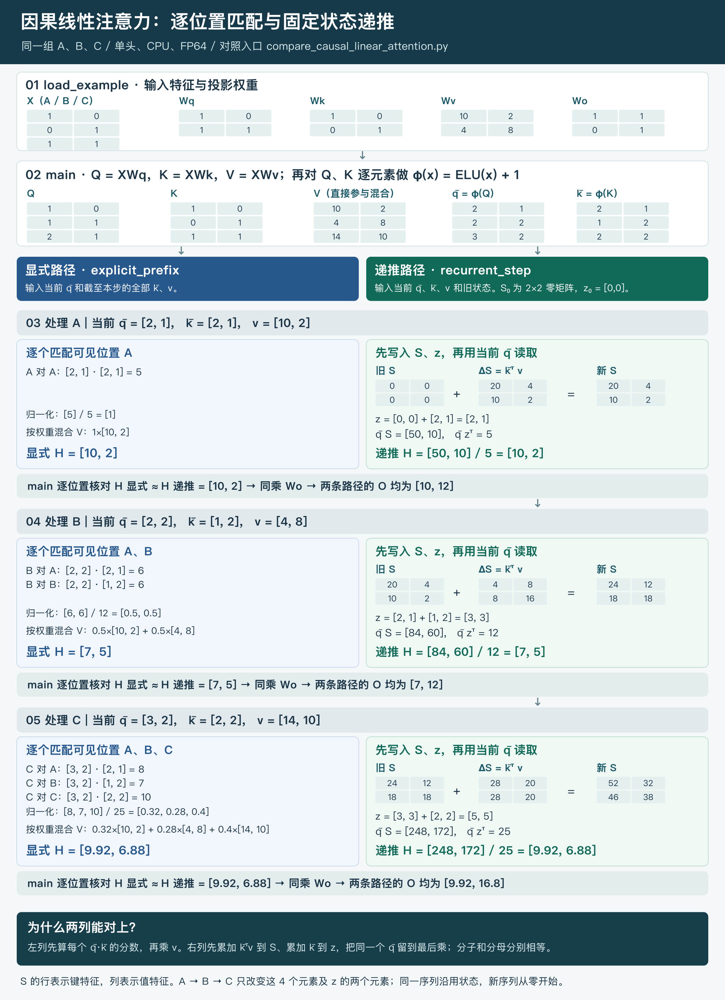
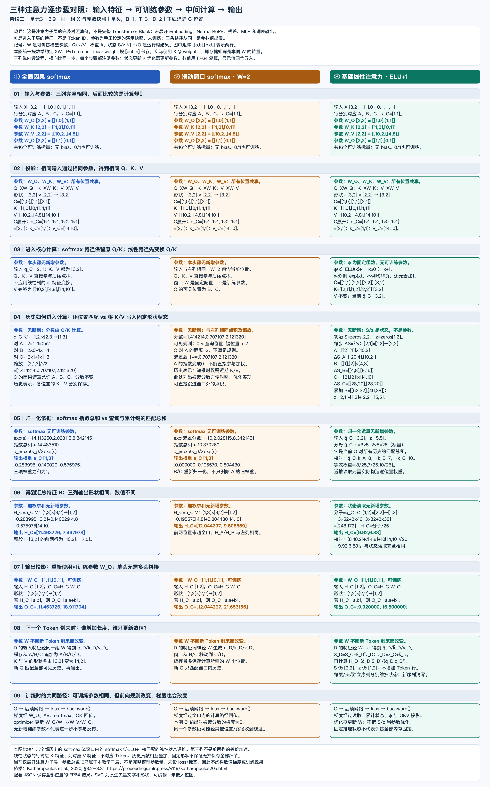
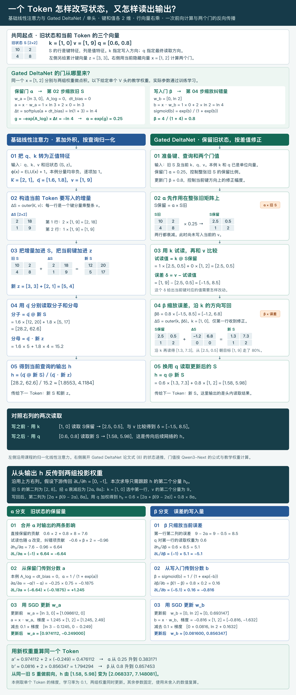
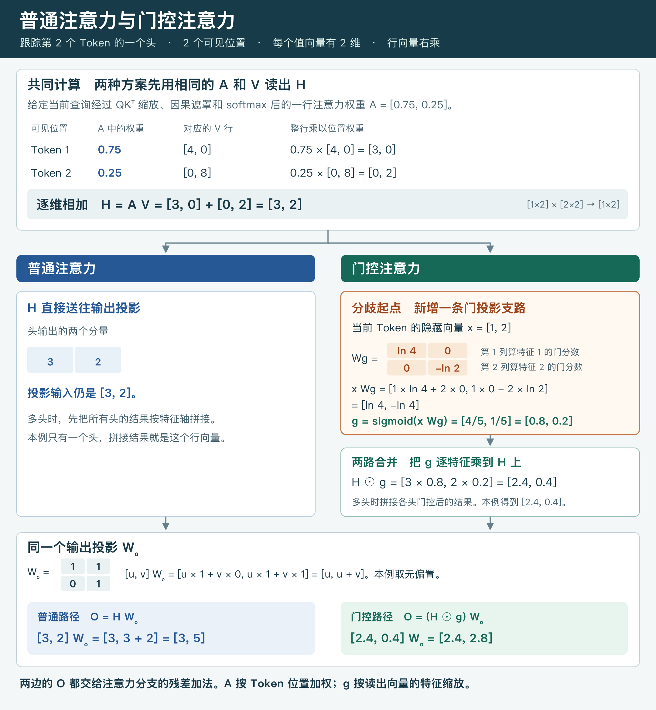
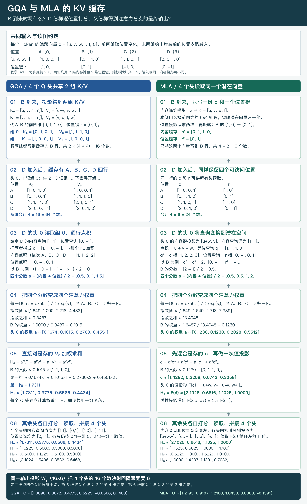

# 3.9 线性注意力：固定状态、参数与三种机制逐步对照

[Notion同步笔记](https://app.notion.com/p/420eaea314148177b3b8cec4061c3d60)

学习日期：2026-11-22。位置：**阶段二 → 单元3「现代模型结构」→ 3.9 混合注意力**。本轮讲解和答疑已归档，掌握程度记录为“理解中”，不等于独立实现或整节验收完成。

前置实践：用户已运行 `compare_attention_windows.py`，提供全局/窗口对照成功输出，并反馈“大概了解了”。本轮线性部分为原理与手算学习；绘图脚本的算术验证由助手完成，不计为用户线性模型训练实践。

## 1. 为什么设计线性注意力

全局因果注意力让当前 Q 逐个匹配可见历史的 K，再按权重混合 V。它能直接按位置查询历史，但整段长度为 T 时，匹配对数为 T(T+1)/2，固定维度后计算量为 O(T²)。KV Cache 避免重复计算过去的 K/V，却没有消除缓存随 T 增长，以及每个新 Q 要读取、匹配越来越多历史的问题。

滑动窗口把直接可见范围限制为最近 W 个位置；优化实现的匹配计算量为 O(TW)，固定 W 后也随 T 线性增长。但它仍是对窗口内各位置做 softmax，不是本节所指的核形式线性注意力。当前窗口教学脚本构造完整分数矩阵再遮罩，不能因此宣称已经实现稀疏计算加速。

基础线性注意力换一种可分解的匹配规则，把历史 K/V 的贡献持续汇总到固定形状的状态中。后续 Q 读取状态，不必逐个读取全部历史 K/V。“线性”主要描述在特征维度固定时，计算量随序列长度的增长方式，不表示整个模型只有线性函数，也不保证任意长度、硬件上都更快。

收益是长序列计算和递推推理缓存成本更可控；代价是许多位置的信息写入同一个状态，可能干扰，不能保证无损恢复任意位置的细节。

## 2. 先区分参数、特征、运行状态

| 对象 | 来源与用途 | 优化器直接更新的模型参数？ |
| --- | --- | --- |
| X | 进入注意力子层的特征，不是 Token ID | 否；可向上游网络反传 |
| W_Q / W_K / W_V | 将 X 投影为 Q/K/V | 是 |
| Q / K / V | X 与投影参数计算的结果 | 否 |
| 匹配分数、注意力权重 | 由当前输入计算 | 否 |
| S / z | 每层、每头、每条序列的历史汇总状态 | 否 |
| W_O | 将汇总后的 H 做输出投影 | 是 |
| H / O | 注意力汇总特征与子层输出 | 否 |

不是模型参数，不代表不参与反向传播。训练时梯度可以经过 Q/K/V、状态更新和读取，回到投影参数；推理时也会更新 S/z，但没有参数梯度更新。

## 3. 固定大小状态怎样写入和读取

采用行向量记法，q̄=φ(q)、k̄=φ(k)。基础形式选 φ(x)=ELU(x)+1：x≥0 时为 x+1，x<0 时为 exp(x)。这是固定函数，本节不含额外可训练参数。

```text
S_0 = zeros[d_k, d_v]
z_0 = zeros[1, d_k]

ΔS_t = k̄_tᵀ v_t                   # 外积 [d_k,1]×[1,d_v]
S_t = S_(t-1) + ΔS_t
z_t = z_(t-1) + k̄_t

h_t = (q̄_t S_t) / (q̄_t z_tᵀ)     # 向量 / 标量
```

先写入当前位置，再读取，因此能看自己和过去。S 的行对应键特征维度，列对应值特征维度，不对应 Token 位置；新 Token 到来只更新已有元素，不增加行。普通多头情况下，S 为 `[B,H,d_k,d_v]`，z 为 `[B,H,d_k]`，没有随历史增长的 T 轴。

同一序列继续输入就沿用状态；独立新序列重置为零；batch 中不同序列、不同层和头分别维护状态。基础累加形式不按窗口删除最早 Token。逐 Token 推理通常只需保留最新状态；训练可能保存中间结果或采用重算，不能把“固定推理状态”说成“整个训练内存固定”。真实实现还需考虑分母的数值稳定性。

## 4. 为什么汇总后还能按当前查询读取

本节规则中，位置 j 对当前查询的非负匹配分数为 q̄k̄_jᵀ。归一化后混合 V：

```text
h_t = Σ(j≤t) [(q̄_t k̄_jᵀ) v_j] / Σ(j≤t) (q̄_t k̄_jᵀ)
    = q̄_t [Σ(j≤t) k̄_jᵀv_j] / [q̄_t (Σ(j≤t) k̄_j)ᵀ]
    = q̄_t S_t / (q̄_t z_tᵀ)
```

利用结合律与分配律，查询出现前就能把历史汇总为 S/z。z 记录累计键，用来计算当前查询的总匹配分数，不是简单的 Token 计数。

等价关系只在本节这套线性注意力规则内部成立：逐位置匹配后混合，与状态递推后读取相同。它不等于 softmax(QKᵀ/√d)V；不能直接把普通 softmax 挪开、声称只是换了计算顺序。

### 4.1 用 C 手算：把同一组乘法按两种顺序相加

取特征映射后的查询 `q̄_C = [3,2]`。A、B、C 的键分别是 `[2,1]、[1,2]、[2,2]`，值分别是 `[10,2]、[4,8]、[14,10]`。先盯住输出的第一个分量，只看三个值的第一列 10、4、14。

**显式路径按 Token 求和。** C 与三个键的匹配分数为 8、7、10。分子第一项等于：

```text
(3×2 + 2×1)×10 + (3×1 + 2×2)×4 + (3×2 + 2×2)×14
= 8×10 + 7×4 + 10×14 = 248
```

**递推路径按键的特征维度求和。** 把上式中乘 3 的项收在一起，把乘 2 的项收在一起：

```text
3×(2×10 + 1×4 + 2×14) + 2×(1×10 + 2×4 + 2×14)
= 3×52 + 2×46 = 248
```

52 和 46 就是 S 的第一列。把值换成第二列 2、8、10，同样算出 S 的第二列：`[32,38]`。这两列的系数只依赖已经看到的键和值，所以每来一个 Token，就可以把它的外积加进 S。等到 C 用自己的查询读取时，乘上同样的 3 和 2：

```text
S_C = [[52,32],[46,38]]
q̄_C S_C = [3×52 + 2×46, 3×32 + 2×38] = [248,172]
```

**分母也能交换顺序。** 按 Token 求和是 `8+7+10=25`。先合并键则得到 `z_C=[2,1]+[1,2]+[2,2]=[5,5]`，再算 `q̄_C·z_C=3×5+2×5=25`。分子、分母分别相等，两种算法自然都得到 **H_C = [248,172]/25 = [9.92,6.88]**。

S 和 z 保存了回答这类加权和所需的系数，通常无法从中单独取回 B 的原始值。这里显式遍历全部可见位置时，使用的也是同一个正值核。普通 softmax 注意力会对每个点积先取指数；查询在指数函数内部，上面提取公因子的推导便不再适用。

### 4.2 对照代码看状态怎样累积

[compare_causal_linear_attention.py](../compare_causal_linear_attention.py) 中，`explicit_prefix()` 从当前查询与可见键算分数、归一化并混合 V；`recurrent_step()` 先将当前键和值写入 S、z，再用当前查询读取。沿图从 A 读到 C：A 的 H 为 [10,2]，B 为 [7,5]，C 为 [9.92,6.88]。C 再乘输出矩阵 Wo，得到子层输出 O = [9.92,16.8]。



[放大查看 SVG](diagrams/causal-linear-attention-code-flow.svg)

## 5. 三种机制的九步横向对照图

[SVG 原生矢量图](diagrams/attention-three-way-parameters-detailed.svg) · [PNG 高清图](diagrams/attention-three-way-parameters-detailed.png)



横向比较同一步，纵向追踪一种机制：①输入与参数；②QKV 投影；③特征处理；④匹配/遮罩/写状态；⑤归一化；⑥H；⑦输出投影；⑧下一 Token 的缓存；⑨训练梯度路径。

本图只展开简化的注意力子层：单头、B=1、T=3、D=2，无 bias，不展开 Embedding、Norm、RoPE、残差、MLP 和词表输出。不是完整 Transformer Block，也不是对实际模型质量的比较。参数为教学快照，未训练。下面统一 XW；PyTorch Linear.weight 按 [out,in] 存储，相当于保存此处 W 的转置并使用 X@weight.T。

## 6. 同一组输入如何通过参数生成 QKV

```text
X   = [[1,0], [0,1], [1,1]]       # [3,2]，三行对应 A/B/C
W_Q = [[1,0], [1,1]]              # [2,2]，可训练
W_K = [[1,0], [0,1]]              # [2,2]，可训练
W_V = [[10,2], [4,8]]             # [2,2]，可训练
W_O = [[1,1], [0,1]]              # [2,2]，可训练

Q = XW_Q = [[1,0], [1,1], [2,1]]
K = XW_K = [[1,0], [0,1], [1,1]]
V = XW_V = [[10,2], [4,8], [14,10]]
```

四个矩阵共16个可训练标量；0/1也是参数值，不表示冻结。C 的展开：q_C=[1×1+1×1,1×0+1×1]=[2,1]；k_C=[1,1]；v_C=[1×10+1×4,1×2+1×8]=[14,10]。

这组数值与早期直接指定 V_C=[6,6]、或用恒等特征变换的口头算例不同。正式归档以本节由 X/W 生成的算例为准，不混用两套结果。

## 7. 全局与窗口：相同分数，不同可见范围

```text
q_C Kᵀ = [2,1,3]                  # [1,2]×[2,3]→[1,3]
除以 √2 → [1.414214,0.707107,2.121320]

全局 C 可以看 A/B/C：
softmax → [0.283995,0.140029,0.575975]
H_C = 0.283995[10,2] + 0.140029[4,8] + 0.575975[14,10]
    ≈ [11.463726,7.447978]

窗口 W=2（包括自己），C 可以看 B/C：
遮罩后 → [-∞,0.707107,2.121320]
softmax → [0,0.195570,0.804430]
H_C = 0.195570[4,8] + 0.804430[14,10]
    ≈ [12.044297,9.608859]
```

指数归一化为 exp(s_j)/Σexp(s)。窗口不只是把 A 的旧权重删掉；B/C 重新归一化。点积、固定缩放、遮罩与 softmax 不新增训练参数，但梯度仍经过可微路径。优化实现可以跳过窗口外分数，图中展开它们是为了对照。

## 8. 线性：特征变换、三个位置写入、当前 Q 读取

本例 Q/K 非负，ELU+1 即逐元素加1，V不变：

```text
Q̄ = [[2,1], [2,2], [3,2]]
K̄ = [[2,1], [1,2], [2,2]]
```

| 位置 | 当前 k̄、v | 外积增量 ΔS=k̄ᵀv | 累积 S | 累积 z |
| --- | --- | --- | --- | --- |
| A | [2,1]、[10,2] | [[20,4],[10,2]] | [[20,4],[10,2]] | [2,1] |
| B | [1,2]、[4,8] | [[4,8],[8,16]] | [[24,12],[18,18]] | [3,3] |
| C | [2,2]、[14,10] | [[28,20],[28,20]] | [[52,32],[46,38]] | [5,5] |

例如 C 的外积：第一行 2×[14,10]=[28,20]，第二行也为 2×[14,10]=[28,20]，再加到旧 S。没有为 C 增加第三行。

```text
q̄_C=[3,2]
分子 q̄_C S = [3×52+2×46, 3×32+2×38] = [248,172]
分母 q̄_C zᵀ = 3×5+2×5 = 25
H_C = [248,172]/25 = [9.92,6.88]

逐位置核对：对 A/B/C 的匹配分数分别为 8、7、10。
(8[10,2] + 7[4,8] + 10[14,10])/25 = [9.92,6.88]
```

S/z 依赖前缀输入和模型参数，但不是跨所有输入共用的可训练参数；新序列需重置。状态融合不保证无限记忆；Gated DeltaNet 等更复杂形式使用不同状态更新规则，不能等同于本节简单累加。

## 9. 输出投影与训练路径对照

三组 H 都乘同一个 W_O。由于 [a,b]W_O=[a,a+b]：

| 机制 | H_C | O_C=H_CW_O |
| --- | --- | --- |
| 全局因果 | [11.463726,7.447978] | [11.463726,18.911704] |
| 窗口 W=2 | [12.044297,9.608859] | [12.044297,21.653156] |
| 基础线性 | [9.92,6.88] | [9.92,16.8] |

训练时是 O→后续网络→loss→反传→优化器更新四个 W。窗口 C 对被遮住原始分数的直接梯度为0，但共享参数可能通过其他位置/路径收到梯度；线性路径的梯度经过状态读取、累计和 φ 回到投影参数。本例没有设定标签和 loss，不虚构梯度数值或训练效果。

## 10. 后续 Token、混合模型和行业例子

| 方式 | D 到来后的历史表示 | 直接读取方式 |
| --- | --- | --- |
| 全局 | K/V 追加 D；[3,2]→[4,2] | 新 Q 匹配 A/B/C/D |
| 窗口 W=2 | 从 B/C 移到 C/D | 新 Q 匹配 C/D |
| 基础线性 | S_D=S_C+k̄_Dᵀv_D，z_D=z_C+k̄_D | 读更新后状态；S/z形状不变 |

不同机制可按层混合。Gemma 3 官方说明的布局是5层窗口接1层全局；Qwen3-Next-80B-A3B和所查的Qwen3.5-35B-A3B-Base是3层Gated DeltaNet接1层Gated Attention。这里是具体型号的例子，不是全行业占比统计，更不是所有同系列型号的无条件结论。

“窗口+全局”和“线性+全局”是不同组合；此前举例不等于“窗口+线性”。各层有自己的参数和缓存/状态。混合模型中全局层的 KV Cache 仍可随上下文增长，不能宣称整模型缓存固定。GQA改变头共享方式，与这里改变历史组织方式是不同维度的设计。

## 11. 本轮实践证据与下一步

11 月 24 日补记：最简因果线性注意力的独立脚本已完成，已用 CPU/FP64 逐位置核对分母、H 和 O。下列条目记录 11 月 22 日的进度。

- 用户窗口对照实跑：CPU/FP32、W=3，U=[1,5,16]、Q=[1,4,5,4]、K/V=[1,2,5,4]。原始分数相同、全局对齐旧层、覆盖全序列窗口等于全局、参数未变的检查通过；O最大差0.236368。独立单头算例D为5.6对4.5。这与本笔记W=2/2维三位置例子分开记录。
- 助手已完成本图FP64复算；A/B/C各位置的线性状态读取与显式归一化核匹配一致。SVG为原生矢量文本和形状，PNG为3000×4815。
- 本轮原理已讲解，掌握程度为理解中；尚未完成独立线性模型实现、用户运行、梯度对照、长序列速度/验证损失E7或真实混合模型配置验收。
- 下一步：用独立新文件实现最简因果线性注意力，对照“显式逐位置核匹配”和“固定状态递推”，观察每步S/z，再接Gated DeltaNet/门控注意力/MLA及原计划Qwen3.5-0.8B配置核对。窗口滚动缓存代码与绝对位置处理保留工程待办，不替换主线。
- 完整验收计数不变：单元2为1/5、单元3为0/9、阶段二为5/32；它们不表示上述理论和本机窗口实践未学。

配套：[复算与绘图脚本](diagrams/render_attention_three_way_detailed.py) · [全部数值JSON](../artifacts/attention-three-way-parameters-detailed.json) · [窗口讲义](../lesson24-sliding-window-attention.md) · [学习进度](learning-plan-review.md)。

## 12. 原始来源与教学边界

- [Katharopoulos et al., Transformers are RNNs, ICML 2020](https://proceedings.mlr.press/v119/katharopoulos20a.html)，重点§3.2–3.3：特征映射、因果状态递推；本笔记数值与图为本地教学构造。
- [Gemma 3官方架构说明](https://developers.googleblog.com/en/gemma-explained-whats-new-in-gemma-3/)：窗口/全局的层组合。
- [Qwen3-Next-80B-A3B-Instruct官方模型卡](https://huggingface.co/Qwen/Qwen3-Next-80B-A3B-Instruct)：Gated DeltaNet与Gated Attention混合布局。
- [Qwen3.5-35B-A3B-Base官方模型卡](https://huggingface.co/Qwen/Qwen3.5-35B-A3B-Base/blob/main/README.md)：所讨论具体型号的布局。

阶段二单元3依据论文、原书补充材料与官方实现，不称为Karpathy《复现GPT-2》视频的连续章节。模型例子截至本次核对，不自动推广到闭源模型或所有新型号。

## 13. Gated DeltaNet 如何改写状态，两个门如何学会取值

基础线性注意力把当前键值的外积累加到 S，并用累计键向量 z 归一化读数。Gated DeltaNet 先用 α 保留部分旧状态，再用当前键 k 试读。试读值与目标 v 相差多少，决定本次要修正什么；β 决定写入多少修正。最后用查询 q 读取更新后的状态，得到当前头的输出 h。下图左列复习基础线性注意力，右列跟踪一次状态更新，底部把损失梯度一直传回门的投影权重。



[打开可放大的矢量图](diagrams/linear-vs-gated-deltanet-state-flow.svg)

### 13.1 从一个 Token 的隐藏向量算出两个门

取一个 V 头，当前隐藏向量 x = [1, 2]。这个头的教学权重为 w_a = [ln 3, 0]、w_b = [0, ln 2]，另取 A_log = 0、dt_bias = 0。Qwen3-Next 的实现用一次线性投影并行算出各头的 a、b。每层的投影权重在各位置共用，每个位置、每个 V 头分别得到一对门值。

| 门 | 用 x 投影 | 从分数得到门值 |
| --- | --- | --- |
| 保留门 α | a = 1 × ln 3 + 2 × 0 = ln 3 | Δt = softplus(a + dt_bias) = ln 4；g = −exp(A_log) × Δt = −ln 4；α = exp(g) = 0.25 |
| 写入门 β | b = 1 × 0 + 2 × ln 2 = ln 4 | β = sigmoid(b) = 4 / (1 + 4) = 0.8 |

α 作用于整张旧状态，β 作用于本次误差，两者独立取值。下一 Token 使用同一组权重，将自己的隐藏向量代入投影。

### 13.2 先用 k 试读，再用 q 读出当前输出

沿用图中的单步输入。旧 S = [[10, 2], [4, 8]]，k = [1, 0]，v = [1, 9]，q = [0.6, 0.8]。S 的行对应键特征，列对应值特征。这里的 q、k 已经是单位向量。

| 步骤 | 计算 | 输出 |
| --- | --- | --- |
| 保留旧状态 | S保留 = 0.25 × S旧 | [[2.5, 0.5], [1, 2]] |
| 用 k 试读 | k @ S保留 = 1 × 第一行 + 0 × 第二行 | [2.5, 0.5] |
| 计算当前键上的误差 | δ = v − 试读值 = [1, 9] − [2.5, 0.5] | [−1.5, 8.5] |
| 沿 k 写回 | βδ = [−1.2, 6.8]；ΔS = outer(k, βδ) | ΔS = [[−1.2, 6.8], [0, 0]] |
| 更新状态 | S新 = S保留 + ΔS | [[1.3, 7.3], [1, 2]] |
| 用 q 读出 | h = q @ S新 = 0.6 × [1.3, 7.3] + 0.8 × [1, 2] | [1.58, 5.98] |

k 选择修正方向。本例 k = [1, 0]，所以只有第一行收到修正。沿 k 再读会得到 [1.3, 7.3]，从试读值朝目标 v 走了 80%。q 决定这次输出如何混合两行。S新 随序列传给下一 Token，这一步在训练和推理的前向计算中都会发生。

### 13.3 梯度如何经过两个门传回投影权重

假设下游损失传回 ∂L/∂h = [0, −1]，于是只需跟踪 h 的第二个分量。S旧 的第二列为 [2, 8]，v 的第二个分量为 9。保留后两行是 2α 和 8α；写回时，第一行再加上 β(9 − 2α)。因此

$$
h_2=0.6[2\alpha+\beta(9-2\alpha)]+0.8(8\alpha).
$$

**α 有两条梯度路径。** 保留旧状态使 h₂ 随 α 增大，贡献 0.6 × 2 + 0.8 × 8 = 7.6。同时，k 试读到的 2α 随之增大，所需误差变小，纠错项贡献 −0.6 × 0.8 × 2 = −0.96。合起来 ∂h₂/∂α = 6.64，乘上游梯度 −1，得 ∂L/∂α = −6.64。

**β 直接缩放纠错量。** 第一行第二列的误差是 9 − 2 × 0.25 = 8.5，q 对这一行的读取权重为 0.6，所以 ∂h₂/∂β = 0.6 × 8.5 = 5.1，得 ∂L/∂β = −5.1。

只更新两组门投影权重，以普通 SGD、学习率 0.1 演示同一次更新。由 a = x · w_a、b = x · w_b，分数的梯度乘上 x 就得到对应的权重梯度。

| 从门值到权重 | α 分支 | β 分支 |
| --- | --- | --- |
| 更新前 | w_a = [ln 3, 0] | w_b = [0, ln 2] |
| 门值对分数的导数 | 本例 α = 1/(1 + exp(a))，导数 −α(1 − α) = −0.1875 | 导数 β(1 − β) = 0.16 |
| 损失对分数的梯度 | ∂L/∂a = (−6.64)(−0.1875) = 1.245 | ∂L/∂b = (−5.1)(0.16) = −0.816 |
| 损失对权重的梯度 | 1.245 × [1, 2] = [1.245, 2.49] | −0.816 × [1, 2] = [−0.816, −1.632] |
| 更新后，w新 = w旧 − 0.1 × 梯度 | w_a ≈ [0.974112, −0.249000] | w_b ≈ [0.081600, 0.856347] |

用新权重、同一 x 和同一旧 S 复算，a 从 ln 3 降到 0.476112，α 从 0.25 升到 0.383171；b 从 ln 4 升到 1.794294，β 从 0.8 升到 0.857453。头输出从 [1.58, 5.98] 变为 [2.068337, 7.148081]。这里的上游梯度是教学给定值。真实训练中，预测损失通过后续层和状态递推传回梯度，优化器汇总这些贡献后更新共享的门投影权重。单看某一次门值，只能读出保留或写入的比例；判断它与某种语义变化的关系还需要对照实验。

状态递推见 [Gated Delta Networks 论文](https://arxiv.org/abs/2412.06464)，门投影与参数化见 [Qwen3-Next 实现](https://github.com/huggingface/transformers/blob/main/src/transformers/models/qwen3_next/modeling_qwen3_next.py#L550-L656)。

## 14. 注意力输出门控为什么值得单独学

普通注意力已经能完成从历史位置读取信息的任务。Qwen3-Next 的全注意力层在读出 H 与输出投影之间加入一道门，让当前 Token 的隐藏向量 x 决定每个输出特征传出多少。上一节 Gated DeltaNet 的 α、β 调节递推状态 S 的保留和修正；本节的门 g 作用于当前头已经读出的 H。



[查看可放大的矢量图](diagrams/standard-vs-gated-attention-output-flow.svg)

### 14.1 从 A、V 到最终输出

只看第二个 Token 的一个头。注意力权重 A = [0.75, 0.25]，两条值向量分别为 [4, 0] 和 [0, 8]。A 的下标对应两个 Token 位置，每个位置的权重乘它的整条值向量。两种方案共同算出 H = 0.75 × [4, 0] + 0.25 × [0, 8] = [3, 2]。

门控支路读取当前 Token 的 x = [1, 2]。给定教学权重 W_g = [[ln 4, 0], [0, −ln 2]]，按行向量右乘：

1. 线性投影得到 xW_g = [ln 4, −2 ln 2] = [ln 4, −ln 4]。
2. 每个分数分别经过 sigmoid，得到 g = [4/5, 1/5] = [0.8, 0.2]。g 的下标对应两个输出特征。两个门值独立，本例恰好相加为 1。
3. 逐特征相乘得到 H ⊙ g = [3 × 0.8, 2 × 0.2] = [2.4, 0.4]。

两边沿用第 9 节的教学矩阵 W_O = [[1, 1], [0, 1]]，它把 [u, v] 映射为 [u, u + v]。

| 路径 | 送入输出投影的向量 | 输出 O |
| --- | --- | --- |
| 普通注意力 | H = [3, 2] | [3, 5] |
| 门控注意力 | H ⊙ g = [2.4, 0.4] | [2.4, 2.8] |

多头模型先拼接各头的结果，再做输出投影，随后接入残差加法。可以从维度上区分两次加权：A 沿位置维混合各条 V，g 沿特征维缩放已混合的 H。

### 14.2 W_g 从哪里来，每个 Token 又算什么？

W_g 是本层的可训练投影参数。从零训练时，按模型实现的初始化方案给它赋初值；训练时，预测损失沿 O → H ⊙ g → g → xW_g 传回梯度，优化器在更新步骤调整 W_g。一个 batch 中的各个位置共用本层的权重，但各自用自己的 x 计算门值。加载预训练检查点推理时，W_g 固定，g 仍随输入变化。这里的对数权重专为手算选定。

### 14.3 为什么再加一个固定矩阵不能代替门控？

如果 H 后面只是串联两个固定线性变换，根据矩阵乘法结合律，(H W) W_O = H (W W_O)，可以预先合并权重。门控多出的能力来自 H 与另一条输入相关分支的逐元素乘法，即 (H ⊙ sigmoid(xW_g)) W_O。

用一维例子验证。假设只有一个可见 Token，注意力权重为 1，取 W_v = W_g = 1，因而 H = x。观察输出投影前的结果：

| x | H | g = sigmoid(x) | H × g |
| --- | --- | --- | --- |
| 1 | 1 | 0.7311 | 0.7311 |
| 2 | 2 | 0.8808 | 1.7616 |

若用同一个固定系数 w 替代门，第一行要求 w ≈ 0.7311。代入第二行却只能得到 2 × 0.7311 ≈ 1.4622。这说明随输入变化的缩放通常无法折叠成同一个固定线性变换。如果所有输入都使用同一组门值，就可以把这组固定缩放合并进 W_O。门控是一项可选设计，其额外计算是否划算，要由同等条件下的模型实验判断。

该门的位置与设计动机见 [Gated Attention for Large Language Models](https://proceedings.neurips.cc/paper_files/paper/2025/hash/904e89bb4e632e75fb47f093b620b257-Abstract-Conference.html)。

## 15. GQA 与 MLA 怎样缓存和读取历史 Token

生成 D 后，把 D 输入模型以预测下一个 Token。在当前层，D 的查询可以分别给 A、B、C、D 打分。GQA（分组查询注意力）和 MLA（多头潜在注意力）都为每个历史位置保留一条记录，区别在于每条记录存什么。与第 13 节 Gated DeltaNet 将整个前缀写入固定大小的状态 S 相比，这两种方案的缓存都随序列长度增长。



[查看可放大的矢量图](diagrams/gqa-vs-mla-kv-cache-flow.svg)

### 15.1 跟踪 B 留在缓存中的一行

图中有 4 个 Q 头。B 的隐藏向量是 [0, 1, 1, 0, 1, 0]，位置键经过教学用的 RoPE 旋转得到 [0, 1]。下表均按单层、单条序列、相同存储精度计数。

| | GQA，2 个 KV 头 | MLA，压缩缓存路径 |
| --- | --- | --- |
| B 写入的数据 | 组 0 的 K=[0,1,0,1]、V=[1,1,1,0]；组 1 的 K=[1,0,0,1]、V=[1,0,0,1] | 内容潜在向量 c=[0,1,1,0]，以及旋转后的位置键 r=[0,1] |
| 各头怎样读 | Q₀、Q₁ 读组 0；Q₂、Q₃ 读组 1。每个 Q 头自己算注意力权重 | 所有头都读 B 的这份 c 和 r；各头使用自己的查询和投影 |
| B 占多少空间 | 2 × (4 + 4) = 16 个标量 | 4 + 2 = 6 个标量 |
| A 到 D 都写入后 | 4 行，共 64 个标量 | 4 行，共 24 个标量 |

实际 MLA 用学到的投影从当前隐藏向量得到内容表示。图里为便于复算，直接取前四维作为 c，并省略内容归一化。位置键单独缓存，让当前查询打分时仍能利用相对位置。DeepSeek 官方推理代码的 absorb 分支分别写入 kv_cache 和 pe_cache。[DeepSeek-V2 论文 §2.1](https://arxiv.org/html/2405.04434v5#S2.SS1) · [官方推理实现](https://github.com/deepseek-ai/DeepSeek-V3/blob/main/inference/model.py#L434-L461)

### 15.2 D 怎样打分并读出结果

只展开 D 的头 0。它的内容查询是 [1,1]，位置查询是 [0,−1]。四个可见位置都参与 softmax；点积分数都除以 √4 = 2。

| 步骤 | GQA | MLA |
| --- | --- | --- |
| 给 B 打分 | 查询与组 0 的 K 点积，内容项为 1，位置项为 −1，分数 (1−1)/2 = 0 | 把内容查询变换成 [1,1,1,0]，与 B 的 c 点积得 2，加上位置项 −1，分数 (2−1)/2 = 0.5 |
| 给 A、B、C、D 打分 | [0.5, 0, 1, 1.5] | [0.5, 0.5, 1, 2] |
| softmax 后的权重 | [0.1674, 0.1015, 0.2760, 0.4551] | [0.1230, 0.1230, 0.2028, 0.5512] |
| 头 0 的读出 | 用权重直接混合组 0 的四条 V，得 [1.7311, 0.3775, 0.5566, 0.4434] | 用权重先混合四条 c，得 [1.4282, 0.3258, 0.6742, 0.3258]，再做该头的值投影，得 [2.1025, 0.6516, 1.1025, 1.0000] |

MLA 可以把值投影放到最后，因为同一个头在各位置共享同一个线性映射 F。设 aⱼ 是 D 分配给位置 j 的权重，则 Σ aⱼ F(cⱼ) = F(Σ aⱼ cⱼ)。这样，在解码时可以直接读取压缩缓存。这个等式核对的是同一个 MLA 头的两种计算顺序。图中 GQA 与 MLA 采用不同的内容投影，得到不同的注意力权重和头输出。四个头拼接并经过同一个 W_O 后，本例的最终输出分别为 GQA [1.0090, 0.8872, 0.4775, 0.5225, −0.0566, 0.1468] 和 MLA [1.2193, 0.9107, 1.2160, 1.0433, 0, −0.1391]。

### 15.3 实际效果怎样看

**缓存容量。** DeepSeek 报告 V2 相比 DeepSeek 67B，KV 缓存减少 93.3%。若直接与 GQA 比，在论文采用的维度下，V2 的 MLA 每层每 Token 的缓存相当于 GQA 的 2.25 个 KV 头。这是容量的等效换算：8 个 KV 头的 GQA 占用更多，2 个 KV 头的 GQA 略少。图里的 16 对 6 只属于教学配置。[DeepSeek-V2 论文表 1](https://arxiv.org/html/2405.04434v5#S2.SS1.SSS4)

**解码吞吐。** DeepSeek-V2 的最大发电吞吐达到 DeepSeek 67B 的 5.76 倍。较小的缓存让相同显存容纳更多并发序列，有助于提高服务每秒生成的 Token 总数。5.76 倍衡量的是两套完整系统的峰值吞吐；单请求延迟和单独更换注意力结构的收益需要各自测量。[DeepSeek-V2 推理效率评测](https://arxiv.org/html/2405.04434v5#S3.SS2.SSS3)

**模型质量。** 一项 2.9B 规模的研究同时评测了 GQA 和 MLA。MLA 的平均困惑度更低，HellaSwag 得分略高，六项下游任务的平均分则略低。低维缓存仍能支持有竞争力的预测质量，具体收益取决于任务和配置。[《Multi-Head Low-Rank Attention》表 3、表 4](https://openreview.net/pdf/0bb4ccde5f3248626ed3bde6bcca3d3034586ab5.pdf)

| 指标 | GQA | MLA |
| --- | --- | --- |
| 六个文本数据集的平均验证困惑度（越低越好） | 13.399 | 13.115 |
| HellaSwag 准确率 | 61.83% | 62.20% |
| 六项下游任务平均准确率 | 55.68% | 55.46% |
