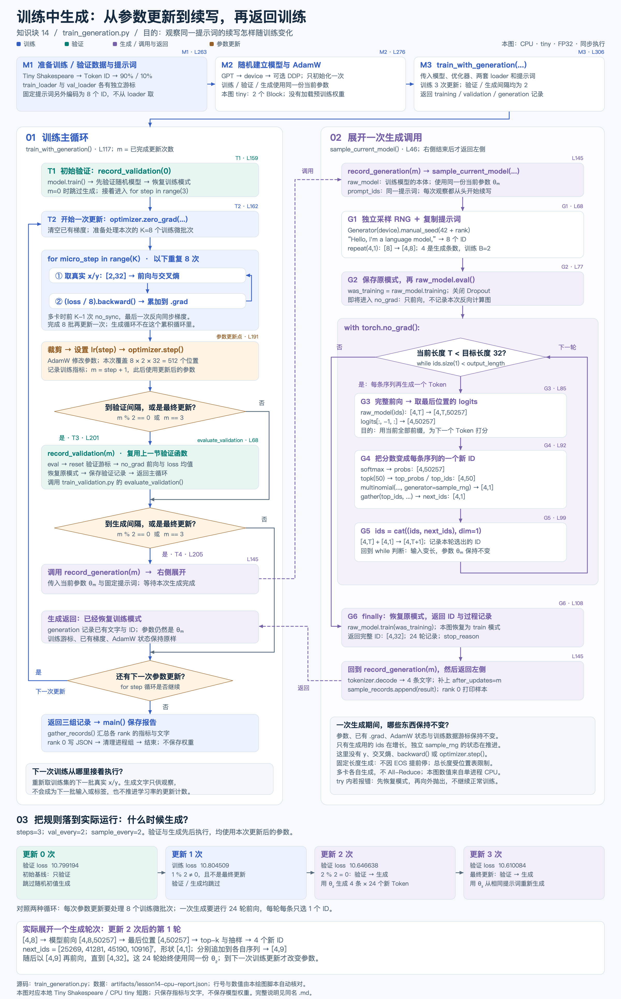

# GPT-2 训练中定期生成：当前参数采样、代码流转与结果解读

学习归档：2026-10-27。位置：阶段二 → 单元 2「预训练工程：复现 GPT-2」→ 2.4「多卡与数据」→ 知识块 14。

本块已学习，用户反馈“大概了解了”，掌握程度记录为“理解中”。用户已亲自运行随机初始化的完整 GPT-2，完成单进程 CPU/FP32 的三次训练更新、验证和两次生成观察。

配套：[train_generation.py](../train_generation.py)、[lesson14.md](../lesson14.md)、[项目仓库](https://github.com/guqun/GPT-2-124M)。承接[验证循环笔记](validation-loop-notes.md)；先前的训练与独立生成代码均保留。

## 1. 为什么训练中还要生成文本

训练 loss 和验证 loss 告诉我们：模型给真实目标 Token 分配的概率总体如何。但只看数字，无法直接看到模型会怎样续写、是否重复、是否开始形成句子。

因此，隔一段训练时间，暂停更新，用**此刻的同一份模型参数**续写固定提示词，保存文字供人观察。生成提供直观的补充证据，一段看似流畅的文字不能代替验证指标。

| 环节 | 输入是什么 | 计算与输出 | 是否改变参数 |
| --- | --- | --- | --- |
| 训练 | 训练集真实前缀 x 和右移目标 y | 前向 → loss → 反向/累积 → 裁剪 → AdamW；得到新参数 | 是 |
| 验证 | 留出的真实 x/y | 当前参数前向 → 平均交叉熵；得到 val loss | 否 |
| 生成观察 | 固定提示词，以及本次逐步选出的 Token | 当前参数前向 → 选下一个 ID → 追加；最后解码成文字 | 否 |

本节的验证与生成都只记录结果。学习率仍按更新次数调度；没有把生成文本作为训练样本，没有根据文字自动调整参数、学习率或触发早停。

## 2. 生成在训练循环的什么位置

本地代码先完成一次 `optimizer.step()`，再检查验证和生成的触发条件。生成返回后，继续读取下一批真实训练数据。

```text
初始参数 → 验证一次（已更新 0 次），不生成
    ↓
每次参数更新：
  清梯度 → K 个微批次的前向/反向/累积
  → 必要的跨卡梯度同步 → 全局梯度裁剪 → 设置学习率 → AdamW 更新
    ↓
到验证间隔或最终更新？→ 验证 → 恢复原模式
    ↓
到生成间隔或最终更新？→ 当前参数生成 → 恢复原模式
    ↓
还有更新次数：回到下一批训练；否则保存指标与文字报告
```

默认 `--steps 3 --sample-every 2` 的具体判断：

| 已完成参数更新次数 | 验证 | 生成 | 生成判断依据 |
| --- | --- | --- | --- |
| 0 | 是，建立基线 | 否 | 生成条件在训练循环内部，跳过初始随机参数 |
| 1 | 否 | 否 | 1 不是 2 的倍数，也不是最后一次更新 |
| 2 | 是 | 是 | `2 % 2 == 0` |
| 3 | 是 | 是 | 虽然不是 2 的倍数，但满足最终更新条件 |

每次观察都从原提示词重新开始。第二次使用更新三次后的参数，重新续写提示词；不会接着第一次观察的长句继续写。

## 3. 把调用关系对应到代码

| 函数 / 标记 | 做什么 | 返回到哪里 |
| --- | --- | --- |
| `main()` | 加载配置与分词器；随机初始化 GPT；建立优化器、数据加载器和提示 ID | 调用 `train_with_generation()` |
| `train_with_generation()` · T1—T2 | 初始验证，然后进行训练更新 | 进入 T3、T4 的判断 |
| T3 → `record_validation()` | 复用上一块的验证函数 | 返回训练循环，继续检查 T4 |
| T4 → `record_generation()` | 传入当前 `raw_model`、提示 ID 和采样配置 | 调用 `sample_current_model()` |
| `sample_current_model()` · G1—G6 | 逐 Token 生成，恢复调用前模式，返回 ID 和过程记录 | 返回 `record_generation()` |
| `record_generation()` | 解码、打印文本、追加本次观察记录 | 返回主循环，继续下一次训练更新 |
| `main()` 收尾 | 汇集报告，写 JSON | 程序结束；本例没有保存模型 checkpoint |

`raw_model` 是正在训练的模型本体。DDP 下它对应 `model.module`，各 rank 在自己的模型副本上独立生成，不需要平均生成的 Token 或文本。此处的多卡行为来自代码设计；本次用户实跑只有一个 CPU 进程。

下面的完整图沿用此前已归档的 **tiny 模型示例**：底部 loss 和抽样 ID 来自 `lesson14-cpu-report.json`。第 8 节单独记录用户运行的完整 124M 模型结果，两组数字不可混用。



[可缩放 SVG](diagrams/gpt2-periodic-generation-flow.svg) · [图的阅读说明与代码行号](diagrams/gpt2-periodic-generation-flow.md)

## 4. 一次生成内部：输入如何变成输出

本例固定提示词为 `Hello, I'm a language model,`，分词后为 8 个 ID：

```text
[15496, 11, 314, 1101, 257, 3303, 2746, 11]
```

生成条数 `S=4`；训练微批次大小 `B=2`。这两个数属于不同环节，不必相等。

| 步骤 | 输入 → 输出 | 目的与规则 |
| --- | --- | --- |
| G1 复制提示词 | `[8] → [4,8]` | 同一提示词创建 4 条待续写序列；建立独立采样 Generator |
| G2 切换模式 | 当前训练模型 → `eval()`，进入 `no_grad()` | 关闭 Dropout，停止为本次前向记录反向图 |
| G3 前向 | `[4,T] → [4,T,50257] → [4,50257]` | 用完整前缀计算，只取最后位置的词表 logits 来预测下一 Token |
| G4 选择 ID | softmax → top-k=50 → 按权重抽样 → `[4,1]` | 每条序列本轮选一个原词表 ID |
| G5 追加 | `[4,T]` 与 `[4,1]` 拼接成 `[4,T+1]` | 用包含新 Token 的前缀继续下一轮 |
| G6 返回 | 达到总长度 32 后返回 `[4,32]` | 恢复原模式；外层解码与保存文字 |

第一次输入 `[4,8]`，下一轮变为 `[4,9]`，直到最后一次前向输入 `[4,31]`，追加后得到 `[4,32]`。所以每条续写新增 24 个 Token。

**4 条序列可以在 batch 维并行计算；每条序列内部仍然一次生成一个 Token。** 这里没有 KV cache，每轮重算完整前缀；追加的是 ID 张量，不需要每轮先解码成文字再重新分词。停止依据是长度限制，不因 EOS 提前终止；总长度也不能超过位置表范围。

## 5. softmax、top-k、抽样和 gather 各做什么

设最后位置的第 j 个 logit 为 z_j，先计算整个词表的概率：

$$
p_j = \frac{\exp(z_j)}{\sum_{v=0}^{V-1}\exp(z_v)}
$$

再保留概率最大的 k 个候选。只在候选集合 C 中抽样，相当于使用：

$$
q_j = \frac{p_j}{\sum_{v\in C}p_v},\quad j\in C
$$

`torch.multinomial` 接受非负权重，因此截取后的 `top_probs` 不必手工再次归一化。本例温度是 1，未额外缩放 logits。

下面节选生成循环中的实际计算，外层已经进入 `eval()` / `no_grad()`：

```python
logits = raw_model(ids)                     # [S,T,V]，本项目只返回 logits
last_logits = logits[:, -1, :]              # [S,V]，只选最后位置
probs = F.softmax(last_logits, dim=-1)       # 对词表维归一化
top_probs, top_ids = torch.topk(probs, top_k, dim=-1)
selected = torch.multinomial(top_probs, 1, generator=sample_rng)
next_ids = torch.gather(top_ids, -1, selected)
ids = torch.cat((ids, next_ids), dim=1)      # [S,T+1]，参数仍不变
```

`selected` 是候选列表内部的下标，`next_ids` 才是词表 ID。例如某一行 `top_ids=[198,11,262]`，抽到内部下标 1，`gather` 取出的 ID 是 11。这个三项列表只是解释索引关系的例子，实际代码默认 k=50。

## 6. 为什么生成不能打乱后面的训练

| 需要保护的状态 | 本例如何处理 |
| --- | --- |
| 参数与优化器状态 | 生成中不调用 `backward()` 或 `optimizer.step()`，沿用当前权重和 AdamW 的 m/v |
| 已有梯度 | 不调用 `zero_grad()`；`no_grad()` 不会清除之前已有的 `.grad` |
| 模型模式 | 先保存 `was_training`，进入 `eval()`；`finally` 中调用 `train(was_training)` 恢复，即使报错也恢复 |
| 训练/验证数据游标 | 生成只使用提示 ID，不调用两个数据加载器 |
| 训练随机数序列 | 抽样使用独立的 `torch.Generator`，不消耗全局训练 RNG |

```python
sample_rng = torch.Generator(device=device).manual_seed(42 + rank)
```

这里重置的是局部 `sample_rng`。如果生成与训练共用全局 RNG，抽样可能消耗下一轮 Dropout 本应使用的随机数，导致后续训练轨迹改变，即使生成期间没有更新参数。

每次观察用同一提示词、采样设置和同一 rank 的种子，有利于比较参数变化带来的影响。参数不同，概率不同，相同种子仍可以生成不同结果。种子也不保证跨硬件、版本完全复现。

当前课程训练 Dropout 为 0；此前的行为测试另用了非零 Dropout，检查插入生成后训练轨迹、参数、已有梯度、AdamW、游标与 RNG 保持一致。该结论限定于已检查的实现和配置。

## 7. 两层循环、两种 Token 数

外层训练循环数的是**参数更新次数**；内层生成循环数的是**本次续写新增的 Token 数**。

本次用户配置 B=2、T=32、R=1、K=8：

$$
N_{\text{train/update}}=B\times T\times R\times K
=2\times32\times1\times8=512
$$

三次更新总共处理 1,536 个训练预测位置；这不是 1,536 篇文档。每次生成另外产生 `4 × 24 = 96` 个新 Token，两次合计 192 个。生成 Token 不算入训练量，不推进优化器或学习率调度。

每次验证使用两个微批次，即 `2 × 2 × 32 = 128` 个预测位置，是固定的验证片段，并非完整验证集。

## 8. 用户此次完整 GPT-2 运行记录

已从缓存报告原样归档到 [lesson14-user-gpt2-cpu-report.json](../artifacts/lesson14-user-gpt2-cpu-report.json)，避免后续运行覆盖。SHA-256：`6a3cf2402772a337f86c473d98186d67fde45678b1929ef88e01ac4f9b33c62a`。

| 配置 | 实际值 |
| --- | --- |
| 模型 | 完整 GPT-2，12 层、768 维、12 头，124,439,808 参数 |
| 参数起点 | 随机初始化；读取缓存的配置和分词器，没有导入预训练权重 |
| 数据 | Tiny Shakespeare；Token 原始位置 train=[0,304222)，val=[304222,338025) |
| 设备/精度 | 单进程 CPU / FP32 / eager |
| 更新与累积 | B=2、T=32、R=1、K=8，共 3 次参数更新 |
| 生成设置 | 每 2 次更新及最后一次；S=4、top-k=50、种子 42、每条新增 24 个 Token |
| 保存内容 | 指标、生成文本、ID 与过程记录；没有保存模型权重 |

| 已完成更新次数 | 本次训练 loss | 验证 loss | 学习率 | 生成结果 |
| --- | --- | --- | --- | --- |
| 0 | — | 11.036055 | — | 不生成 |
| 1 | 10.958789 | — | 0.000600 | 不生成 |
| 2 | 9.674578 | 9.143974 | 0.000600 | 4 条续写；96 个新 Token 中 94 个为换行 ID 198 |
| 3 | 8.898489 | 9.071917 | 0.000330 | 4 条续写；96 个新 Token 中 64 个为逗号 ID 11，12 个为换行 ID 198 |

各次训练 loss 来自相应更新前的前向，验证与生成使用该次更新完成后的参数。表中统计只统计新生成部分，未把提示词中的逗号算入。

对照上一块的[用户完整模型报告](../artifacts/lesson13-user-gpt2-cpu-report.json)，本次所有训练记录与验证记录完全相同：不仅显示的小数相同，报告中的取数位置、梯度范数、学习率和 loss 等记录也相同。它支持“本次插入生成观察没有扰动训练记录”的结论；不能据此声称所有配置、设备都已验证。

## 9. 为什么都是换行和逗号，仍然符合本节预期

这里的“符合预期”指流程正确执行：生成用当前参数、按条件触发、逐 Token 追加，并回到训练。**它不表示生成质量已经合格。**

一个随机初始化的 124M 模型只更新三次、学习 1,536 个预测位置，没有足够训练来形成稳定语言能力。当前模型在生成路径上强烈偏向少数 Token，top-k 随机采样也不会保证多样或流畅，因而出现大量重复。日志可确认这种偏好；仅凭该短跑不能精确归因于某个层、某个超参数，或承诺继续训练一定就好。

终端里的 `\n` 是换行的可见写法。代码用 `text!r` 打印字符串表示，便于看清空白；不是生成代码报错。完整内容保存在报告中。

验证 loss 下降与续写很差可以同时发生：

- 验证每个位置都给真实语料前缀，衡量真实下一个 Token 的概率；哪怕只改善了部分常见模式，平均 loss 也可能下降。
- 生成从提示词开始，把自己抽到的 Token 接回输入。前面连续选中换行或逗号，后面的上下文就变成这段重复序列，与验证中的真实前缀不同。
- 本次验证仅固定 128 个位置，三次短跑足以观察程序流程，不足以证明整体泛化能力、文本质量或长期训练效果。

同一次运行出现的 urllib3 / LibreSSL 警告没有阻止这次离线实验完成，报告也成功写出。不能把这条兼容性警告当成生成重复的原因。

## 10. 原课程、本地改编和验证范围

课程依据为 [Karpathy 视频约 3:25:06—3:28:07](https://www.youtube.com/watch?v=l8pRSuU81PU&t=12306s)、已核对的[非官方自动字幕](https://github.com/nolimitkun/ai-kol-wiki/blob/main/sources/karpathy/20240609-l8pRSuU81PU/transcript.md)和作者 [4a63e6a 历史源码](https://github.com/karpathy/build-nanogpt/blob/4a63e6a599fea4f78d25e78a4970585ae5c6e27f/train_gpt2.py)。本块核对过字幕与代码，没有直接观看视频画面。

| 项目 | 原课这一段 | 本地实现 |
| --- | --- | --- |
| 数据与执行 | FineWeb-Edu、CUDA、对齐词表 50304 | Tiny Shakespeare 90%/10%、词表 50257、eager；本次实跑 CPU |
| 生成时机 | 设计为每 100 次更新观察，跳过初始模型；该历史提交因当时 compile 错误以 `and False` 临时禁用 | 实际启用；每 2 次更新及最终更新观察，便于三次短跑 |
| 采样主干 | 固定提示词、每 rank 4 条、top-k=50、独立 seed=42+rank、总长度 32 | 保留；另外检查位置表上限 |
| 当前参数 | 在训练过程中续写 | 同一模型本体；每次启动脚本仍从随机参数重新训练 |

历史 compile 问题不能推广为当前所有版本均不支持生成。本节未增加 KV cache、EOS 停止、自动打分或文字反馈训练，这些不属于本次实现。

此前协作检查使用 tiny 模型（3,324,736 参数），有独立的[CPU 报告](../artifacts/lesson14-cpu-report.json)和 4 项行为测试。它与用户这次完整 GPT-2 运行分别归档；没有新增 CUDA/NCCL 或 FineWeb-Edu 实测。

## 11. 学习状态与后续衔接

知识块 14：已学习、初步理解；完整 GPT-2 单进程 CPU 运行已完成，笔记与全流程图已归档。理解程度保留“理解中”，不把运行成功自动等同于独立掌握所有工程配置。

下一步进入 **2.5「评测与正式训练」的 HellaSwag 评测**，2.5 当前尚未开始。2.4 的 FineWeb-Edu 独立分片代码/实跑、用户 DDP 多进程实践及 CUDA/NCCL 仍待补；2.2 的独立 SDPA/词表对齐入口与统一 CUDA 提速表、2.3 的独立配置及多卡/GPU 对照继续保留。

因此本块结项不把 2.4 整节记为完成；完整段落计数维持单元 2 的 1/5、阶段二的 5/32。2.1、阶段一和阶段二单元 1 的完成状态保持。
