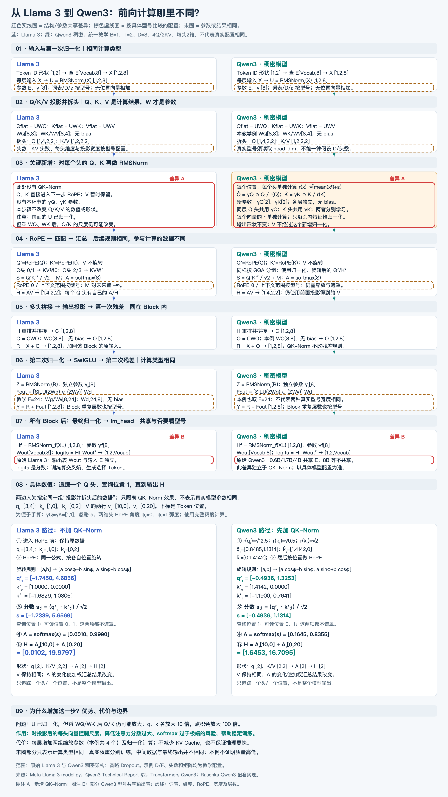
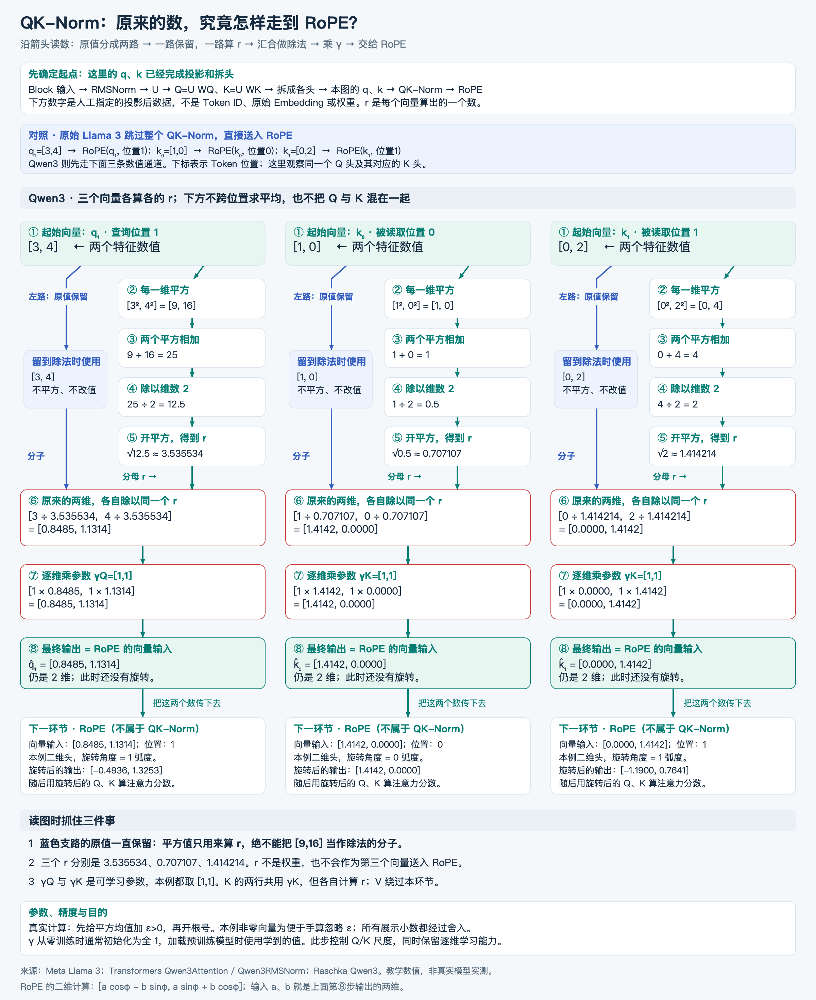

# 千问 Qwen3 学习：与 Llama 3 的结构对照及数值流转

Notion：[千问 Qwen3 学习](https://app.notion.com/p/416eaea314148195aa7ecb40ce4ea5ef)

记录日期：2026-11-12。本文整理本次 Qwen3 稠密模型学习，承接此前的 GPT-2 / Llama 3 前向流程。当前已初步理解结构对照、稠密模型概念，以及 QK-Norm 的目的和计算；不代表已经完成模型实现替换或训练对照。

## 1. 本次学习在解决什么问题

已经掌握 Llama 3 的主流程后，学习 Qwen3 不必从头重学注意力。重点是识别哪些计算沿用已有知识、哪里增加了处理、哪些配置必须按型号核对，并能从具体输入数值跟踪到输出。

本文限定原始 Qwen3 稠密模型与原始 Llama 3 的对照，不把所有千问版本、MoE 型号或后续版本统一当作同一种结构。

## 2. “稠密模型”是什么意思

这里的稠密（Dense）主要与混合专家 MoE 对比：每个 Token 经过每一层时，都使用该层同一套完整的前馈网络。MoE 则引入路由，让 Token 选择部分专家参与计算。本次只需了解这个区分，MoE 的路由和训练留待后续学习。

“稠密”不是说注意力可以看未来，也不是说所有数值必定非零；因果遮罩仍然存在。GQA 共享 K/V 头也不意味着模型变成 MoE。

## 3. 全流程：哪些相同，哪些不同



红色实线标出 QK-Norm 与输出权重共享策略差异；棕色虚线提醒需要逐型号核对配置。未圈部分表示计算类型相同，不表示权重、尺寸或结果相同。

| 环节 | 原始 Llama 3 | 本次讨论的 Qwen3 稠密模型 |
| --- | --- | --- |
| Token Embedding | 按 ID 查向量表 | 同类操作；词表大小和隐藏维度按型号确定 |
| Block 入口归一化 | RMSNorm | RMSNorm；epsilon 等配置需核对 |
| Q/K/V 投影、拆头 | 分别投影，使用 GQA | 同类操作；头数、KV 头数和 head_dim 按配置确定 |
| 投影后的 Q/K | 直接进入 RoPE | 先做头内 RMSNorm，即 QK-Norm，再进入 RoPE |
| 位置处理 | 对 Q/K 做 RoPE | 对归一化后的 Q/K 做 RoPE；频率、上下文配置需核对 |
| 注意力 | QK 点积、缩放、因果遮罩、softmax、乘 V | 同类操作 |
| 注意力输出 | 拼接、输出投影、第一次残差 | 同类操作 |
| MLP | RMSNorm → SwiGLU → 第二次残差 | 同类操作；中间宽度与层数按型号确定 |
| 最终输出 | 最终 RMSNorm → 独立 lm_head 权重 | 最终 RMSNorm → lm_head；是否与输入表共享依型号而定 |

原始 Qwen3 发布系列中，0.6B、1.7B、4B 使用输入/输出权重共享，8B、14B、32B 不共享。因此不能说“只有第 03 步不同”，也不能把 Llama 3 的独立输出表结论套到每个千问模型。

图中 B=1、T=2、D=8、4 个 Q 头、2 个 K/V 头、每头 2 维是统一教学尺寸，不是真实模型规格。实际 Qwen3 的 head_dim 要读配置，不能一概用 D/头数推算。

## 4. QK-Norm 是什么，放在哪里

Q 是 Query（查询），K 是 Key（键），Norm 是 Normalization（归一化）。QK-Norm 表示分别归一化 Q、K；在本次 Qwen3 中，具体采用 RMSNorm。

```text
Block 输入 X
  → 第一次 RMSNorm，得到 U
  → Q=U WQ，K=U WK，V=U WV
  → 拆成各个头
  → 分别对每个头的 Q、K 做 RMSNorm；V 不处理
  → Q、K 做 RoPE；V 不旋转
  → QK 点积 / √head_dim → 因果遮罩 → softmax，得到 A
  → H = A V
  → 多头拼接、输出投影、第一次残差
  → 第二次 RMSNorm、SwiGLU、第二次残差
```

这里的 q、k 是训练或推理输入经过当前投影权重计算、再拆头后的中间向量。它们不是 WQ、WK 参数本身，也不是直接拿 Token ID 做归一化。

## 5. 为什么入口已经归一化，还要再做一次

入口 RMSNorm 调整的是 U。随后乘 WQ、WK，投影后的 Q、K 尺度仍可能变化。

注意力分数来自 q 与 k 的点积。若二者同时放大 10 倍，点积会放大 100 倍，可能让 softmax 权重过度集中。QK-Norm 在点积之前控制 Q/K 尺度，有助于训练稳定；可学习的 γ 保留逐维缩放能力。

这不是减少 KV Cache 的方法，也不保证推理更快或所有任务效果更好。注意力仍然可以集中，本例的权重更平缓只是这组输入及参数下的结果。

## 6. 公式里的 x、r、γ 各是什么

对一个位置、一个头的 d 维向量：

$$
r(x)=\sqrt{\frac{1}{d}\sum_{i=0}^{d-1}x_i^2+\epsilon},\qquad y_i=\gamma_i\frac{x_i}{r(x)}
$$

| 符号 | 本次含义 | 从哪里来 |
| --- | --- | --- |
| x | 当前正在处理的一条 q 或 k 向量 | 投影和拆头的输出；不是额外的一种输入 |
| r(x) | 这一条向量的均方根尺度，一个标量 | 当前向量平方、求平均、加 epsilon、开根号得到 |
| γQ | Q 归一化的逐维缩放参数 | 从零训练时初始化为全 1，之后参与训练 |
| γK | K 归一化的另一组逐维缩放参数 | 与 γQ 分别学习 |
| ε | 防止分母为零、改善数值稳定性的小正数 | 模型配置常数，不是训练参数 |
| y | 归一化和缩放后的向量 | 下一步 RoPE 的向量输入 |

每个 batch、Token 位置、注意力头各算自己的 r，只在头内特征维求平均。同层各 Q 头共用 γQ，各 K 头共用 γK，但统计量 r 不共用；不同层的 γ 独立，也不复用 Block 入口的归一化参数。

两组 γ 各有 head_dim 个元素，每层此处新增 2×head_dim 个参数。若加载预训练模型，应使用已经学到的 γ，不能重新覆盖成 1。

## 7. 详细数值图：原值与计算 r 的支路如何汇合



图中直接给定投影、拆头后的教学向量：查询位置 1 的 q₁=[3,4]；对应 K 头的位置 0 为 k₀=[1,0]，位置 1 为 k₁=[0,2]。下标表示位置，不是头编号。γQ=γK=[1,1]。

为方便手算，非零向量示例暂忽略 epsilon；真实实现保留它。表中小数为近似值，复算使用未舍入的中间数。

| 小步骤 | q₁ 通道 | k₀ 通道 | k₁ 通道 |
| --- | --- | --- | --- |
| 原始输入，另一路保留 | [3,4] | [1,0] | [0,2] |
| 每维平方 | [9,16] | [1,0] | [0,4] |
| 平方求和 | 9+16=25 | 1+0=1 | 0+4=4 |
| 除以头内维数 2 | 12.5 | 0.5 | 2 |
| 开根号，得到自己的 r | 3.535534 | 0.707107 | 1.414214 |
| 原值分别除以 r | [3/r,4/r] | [1/r,0/r] | [0/r,2/r] |
| 除法输出 | [0.848528,1.131371] | [1.414214,0] | [0,1.414214] |
| 逐维乘对应 γ=[1,1] | [0.848528,1.131371] | [1.414214,0] | [0,1.414214] |
| 交给 RoPE 的位置 | 1 | 0 | 1 |

蓝色支路保留原始向量，作为除法的分子；绿色支路计算一个 r，作为所有维度的分母。平方值只用于计算 r，不能用 [9,16] 替代原来的 [3,4] 去除。

r 在这里完成作用，不作为第三组向量传给 RoPE。乘 γ 后向量形状不变，本例仍为 2 维；还没有加入位置旋转。

γ=1 时乘完数值不变，不代表该层没有参数。例如单独改为 γQ=[2,0.5]，q 的输出约为 [1.697056,0.565685]。这是补充例子，后面的主流程继续使用 γQ=γK=[1,1]。

## 8. 从 RoPE 输入接回注意力输出 H

QK-Norm 调整尺度；RoPE 加入位置信息。它们是两个先后执行的操作。

二维教学头的位置 0、1 分别旋转 0、1 弧度。对输入 [a,b]：

$$
\operatorname{RoPE}([a,b],\varphi)=[a\cos\varphi-b\sin\varphi,\ a\sin\varphi+b\cos\varphi]
$$

Qwen3 主例的旋转输出为 q′₁≈[-0.493554,1.325294]，k′₀≈[1.414214,0]，k′₁≈[-1.190020,0.764103]。V 一直保持两行 [10,0]、[0,20]。

接着分别计算 q′₁ 与两个 k′ 的点积，除以 √2。查询位置 1 可以读位置 0、1，所以这两个位置均不遮挡。softmax 后得到读取比例 A，再加权汇总同一组 V：

$$
H=A_0[10,0]+A_1[0,20]
$$

| 结果 | 原始 Llama 3 路径 | Qwen3 路径 |
| --- | --- | --- |
| RoPE 前 q | [3,4] | [0.848528,1.131371] |
| 缩放后的注意力分数 | [-1.233885,5.656854] | [-0.493554,1.131371] |
| softmax 权重 A | [0.001016,0.998984] | [0.164527,0.835473] |
| H | [0.010161,19.979677] | [1.645268,16.709464] |

两边特意使用相同的人工 Q/K/V 来隔离 QK-Norm 的影响，不代表两个真实模型会产生相同的投影输出。V 没有变，但读取它的权重 A 改变，所以 H 改变。

## 9. 本次易混点与学习边界

- QK-Norm 不是 Q 与 K 相乘，而是分别处理两者。
- q、k 是中间数据；WQ、WK 和 γ 才是此处讨论的可训练参数。
- r 是由本次输入计算的标量，不是查表取出的参数，也不是另一组头。
- QK-Norm 沿头内特征归一化；softmax 沿允许读取的 Token 位置归一化，二者不同。
- 前向过程里新增一个环节，不意味着其他配置都与 Llama 3 相同。
- 本次已初步理解概念及手算流转；MoE、真实模型替换和训练对照并未因此完成。

## 10. 参考与前置学习

- [Qwen3 Technical Report §2](https://arxiv.org/html/2505.09388v1#S2)：架构、QK-Norm 的训练稳定性目的和型号共享配置。
- [Transformers Qwen3 实现](https://github.com/huggingface/transformers/blob/main/src/transformers/models/qwen3/modeling_qwen3.py)：q_norm/k_norm、gamma 初始化、投影后到 RoPE 前的数据流。
- [Raschka Qwen3 配套实现](https://github.com/rasbt/LLMs-from-scratch/blob/main/pkg/llms_from_scratch/qwen3.py)：本学习路线的代码参考。
- [Meta 原始 Llama 3](https://github.com/meta-llama/llama3/blob/main/llama/model.py)：没有此处的 QK-Norm，对照 Attention、RMSNorm 和输出层。
- [此前的归一化与 GPT-2/Llama 3 对照笔记](https://app.notion.com/p/410eaea3141481458aa2da19a284df9f)。
- [SiLU 与 SwiGLU 补充笔记](https://app.notion.com/p/415eaea3141481b19085e49d9c5d50b9)。

项目保留总览与详细图的 SVG、PNG、重绘脚本及数值核对报告。示例计算已核对；没有加载真实权重或运行模型训练。
