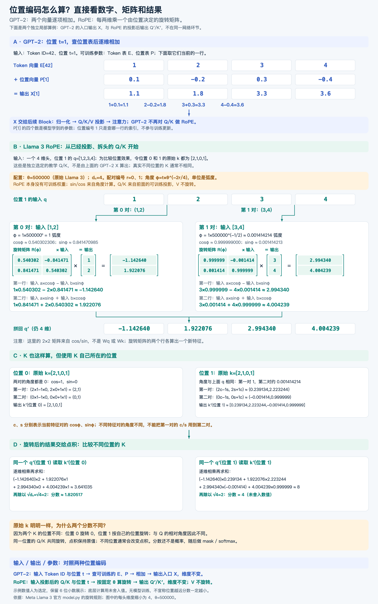

# 二维旋转：从平面坐标到 RoPE 的数学基础

这是学习 RoPE 时补充的数学基础。先理解平面上的旋转，再把同样的计算用于 Q、K 的特征维度。数值为教学选值，不是预训练模型的真实权重。

## 1. 二维向量是什么

向量 [3,4] 可以看作从原点 (0,0) 指向点 (3,4) 的箭头：向右 3，向上 4。“二维”表示用两个坐标描述它，不是两个 Token，也不是两个注意力头。

箭头的长度由勾股定理得到：

$$
\|v\|=\sqrt{3^2+4^2}=5
$$

在神经网络中，这两个数可以是特征值，不要求它们原本表示真实空间坐标；我们仍然可以对它们使用同样的数学运算。

## 2. 旋转改变什么

固定原点，把箭头转过一个角度。方向改变，坐标数值随之改变，长度保持不变。这里约定横轴向右、纵轴向上，正角度表示逆时针旋转；坐标轴本身不动。

| 旋转角度 | 输入 | 输出 | 长度 |
| --- | --- | --- | --- |
| 0° | [3,4] | [3,4] | 5 |
| 90° | [3,4] | [-4,3] | 5 |
| 180° | [3,4] | [-3,-4] | 5 |
| 360° | [3,4] | [3,4] | 5 |

旋转不等于两个数交换位置，也不等于给每个数加上一个位置编号。

## 3. sin、cos 与角度

单位圆是半径为 1、圆心在原点的圆。从横轴正方向转过角度 φ 后，圆上点的坐标为 (cos φ, sin φ)。因此它们描述方向在横轴和纵轴上的分量。

| 角度 | cos φ | sin φ |
| --- | --- | --- |
| 0° | 1 | 0 |
| 90° | 0 | 1 |
| 180° | -1 | 0 |

角度可以使用“度”或“弧度”表示。程序里的 sin/cos 通常接收弧度，不能直接把 90 当成 90° 输入。

$$
180^\circ=\pi\ \mathrm{rad},\qquad
90^\circ=\frac{\pi}{2}\ \mathrm{rad}
$$

$$
\text{弧度}=\text{角度数}\times\frac{\pi}{180}
$$

所以 RoPE 示例里的 φ=1，是 1 弧度，约 57.3°，不是 1°。

## 4. 旋转公式从哪里来

将输入向量拆成沿两条坐标轴的分量：

$$
\begin{bmatrix}a\\b\end{bmatrix}
=a\begin{bmatrix}1\\0\end{bmatrix}
+b\begin{bmatrix}0\\1\end{bmatrix}
$$

旋转 φ 后，横轴单位箭头 [1,0] 变为 [cos φ, sin φ]；纵轴单位箭头 [0,1] 变为 [-sin φ, cos φ]。

将旋转后的两个分量相加：

$$
\begin{bmatrix}a'\\b'\end{bmatrix}
=a\begin{bmatrix}\cos\varphi\\\sin\varphi\end{bmatrix}
+b\begin{bmatrix}-\sin\varphi\\\cos\varphi\end{bmatrix}
$$

于是得到：

$$
a'=a\cos\varphi-b\sin\varphi
$$

$$
b'=a\sin\varphi+b\cos\varphi
$$

写成矩阵就是：

$$
\begin{bmatrix}a'\\b'\end{bmatrix}
=
\underbrace{\begin{bmatrix}
\cos\varphi&-\sin\varphi\\
\sin\varphi&\cos\varphi
\end{bmatrix}}_{R(\varphi)}
\begin{bmatrix}a\\b\end{bmatrix}
$$

输入：两个数 a、b 和角度 φ。计算：根据 φ 求 sin/cos，再执行两行乘加。输出：两个新数 a′、b′，维度不变。

这里用列向量书写。若代码使用行向量，等价计算是 v′=vR(φ)ᵀ，需要注意转置方向。

## 5. 完整数值例子

### 例子 A：[3,4] 逆时针旋转 90°

cos 90°=0，sin 90°=1，代入：

$$
a'=3\times0-4\times1=-4
$$

$$
b'=3\times1+4\times0=3
$$

所以输出 [-4,3]。它的长度仍为 √(16+9)=5。

### 例子 B：[1,2] 旋转 1 弧度

$$
\cos1\approx0.540302306,\qquad
\sin1\approx0.841470985
$$

$$
a'=1\times0.540302306-2\times0.841470985
\approx-1.142640
$$

$$
b'=1\times0.841470985+2\times0.540302306
\approx1.922076
$$

输出约为 [-1.142640,1.922076]。计算使用未舍入的 sin/cos，展示时才保留小数。

## 6. 为什么长度不变

把旋转后的两个数平方并相加：

$$
(a')^2+(b')^2
=(a\cos\varphi-b\sin\varphi)^2
+(a\sin\varphi+b\cos\varphi)^2
$$

展开后，交叉项 -2ab cosφ sinφ 与 +2ab sinφ cosφ 抵消。再利用 sin²φ+cos²φ=1：

$$
(a')^2+(b')^2
=a^2(\cos^2\varphi+\sin^2\varphi)
+b^2(\sin^2\varphi+\cos^2\varphi)
=a^2+b^2
$$

这保证长度保持不变，但不代表每个坐标的数值保持不变。

## 7. 它如何接入 RoPE

在当前学习的流程里，先将归一化后的输入乘以可训练的 W_Q、W_K，再拆头，得到每个位置、每个头的 q、k。它们是中间计算结果，不是权重矩阵本身。

假设某一个头的 q=[1,2,3,4]，按当前示例的相邻维度配对：

1. 第 0 对 (1,2) 使用角度 φ₀ 做二维旋转。
2. 第 1 对 (3,4) 使用角度 φ₁ 做二维旋转。
3. 将两对结果按原顺序放回，仍得到一个 4 维头。

| 操作 | 处理什么 | 目的 |
| --- | --- | --- |
| 拆头 | 完整投影结果的特征维度 | 分成多个注意力头 |
| 头内分对 | 同一个头内部，每两个维度一组 | 执行二维旋转 |
| 旋转 | 每一对数值 | 根据位置改变向量方向 |

K 使用它自己所在位置对应的角度，不是统一使用查询 Q 的位置。当前学习的 RoPE 对 Q、K 旋转，V 不旋转。

RoPE 的角度由 Token 位置及维度对编号决定，不同维度对有不同旋转速度。旋转矩阵里的 sin/cos 按角度算出，不是 W_Q、W_K，也不是额外学习的位置向量表。

## 8. 为什么这能表达相对位置

同一个二维平面内，Q 和 K 若共同旋转相同角度，它们的夹角不变，点积也不变；若分别旋转不同角度，夹角会受到旋转角度差的影响。

对于同一维度对，以列向量表示：

$$
(R(\alpha)q)^\top(R(\beta)k)
=q^\top R(\beta-\alpha)k
$$

RoPE 令 α=mω、β=nω，因此旋转带来的角度差为 (n−m)ω，与两个位置的相对距离有关。这里说的是位置旋转部分；q、k 自身仍包含输入内容信息。

位置不同不保证分数一定不同，距离更远也不保证分数一定更低。长度保持不变同样不意味着对所有 K 的匹配分数都不变。

## 9. 与本次疑问对应的记忆点

- q、k 是投影并拆头后的数据；W_Q、W_K 才是可训练参数。
- “原始 k”指 RoPE 之前的 k，不是原始文本。
- 示例让两个位置的原始 k 都为 [2,1,0,1]，只是控制变量，单独观察位置改变的效果。
- 分对发生在同一个头内部，不会新增注意力头，也不会改变总维度。
- 二维旋转：两个数输入，按角度做两行乘加，得到两个新数；方向变化、长度不变。

## 10. 关联与学习范围

本篇是本次答疑整理出的独立数学补充，配套 RoPE 学习，不代表 RoPE 整节已完成。理解状态保留“理解中”。

相关笔记：[LayerNorm 与 RMSNorm：计算差异、数学推导与设计取舍（含 QKV 拆头补充）](layernorm-rmsnorm-notes.md)

## 11. RoPE 的角度公式为什么这样设计

通用形式为：

$$
\varphi(t,r)=t\,\theta^{-2r/d_h}=t\,\omega_r
$$

它分两步工作：先给每对维度安排旋转速度，再根据 Token 位置计算旋转角度。角度公式决定“转多少”，二维旋转矩阵决定“转完后两个数变成什么”。

| 符号 | 含义 |
| --- | --- |
| t | Token 位置编号，从 0 开始 |
| r | 当前头内部的维度对编号，从 0 开始，不是头编号 |
| d_h | 每个头的维度；本例取 4，所以有两对 |
| θ | 控制频率分布的固定基数，不是本次旋转角度 |
| ω_r | 第 r 对每前进一个位置所增加的角度，单位为弧度/位置 |
| φ(t,r) | 最终旋转角度，单位为弧度 |

### 11.1 为什么要乘位置 t

对同一维度对，位置 m 的 Q 旋转 mω，位置 n 的 K 旋转 nω。角度差为：

$$
n\omega-m\omega=(n-m)\omega
$$

例如 ω=0.1 时，位置 2 与 5 的角度差是 0.3；位置 7 与 10 的角度差也是 0.3。相对距离相同，旋转带来的相对角度相同。这里保持原始 q、k 不变来观察位置效果；真实内容变化也会影响点积。

更一般地：

$$
(R(m\omega)q)^\top(R(n\omega)k)
=q^\top R((n-m)\omega)k
$$

这是把绝对位置编号转换成相对位置作用的关键。RoPE 原论文从让 Q/K 内积包含相对位置的目标出发，提出旋转构造，见 [RoFormer §3.1–3.2，公式 11–16](https://arxiv.org/html/2104.09864v5)。

### 11.2 为什么不同维度对使用不同速度

可以把它想成同一个头内几根转速不同的指针：快的指针对小的位置变化反应明显；慢的指针在较大位置变化范围内缓慢改变方向。这样提供多种位置变化尺度，而不是所有对都重复使用同一种频率。

这并不强制某一对只处理近距离、另一对只处理远距离，也不保证距离越远分数越低。

### 11.3 为什么写成负指数

$$
\omega_r=\theta^{-2r/d_h}=\frac{1}{\theta^{2r/d_h}}
$$

当 θ>1 时，r 越大，速度越慢。相邻速度的比值为：

$$
\frac{\omega_{r+1}}{\omega_r}=\theta^{-2/d_h}
$$

因此这是等比排列的一组频率。指数也可以写成：

$$
\frac{2r}{d_h}=\frac{r}{d_h/2}
$$

d_h/2 是维度对的数量；2 与每两个维度组成一对有关，不表示旋转两次。

这是一种设计选择，不是二维旋转数学唯一强制出来的公式。线性位置角度负责相对位置性质；几何频率分布负责安排多种尺度。原始 RoPE 使用 10000 为基数，沿用正弦位置编码的频率安排，见 [RoFormer §3.2.2–3.3](https://arxiv.org/html/2104.09864v5)。

### 11.4 代入本次教学数值

原始 Llama 3 的模型配置使用 θ=500000。官方实现先计算各对频率，再与位置编号做外积；该值是配置，不是由训练自动求出的权重。[Llama 3 官方 model.py](https://github.com/meta-llama/llama3/blob/main/llama/model.py)

本例将头维度缩小为 d_h=4：

$$
\omega_0=500000^0=1
$$

$$
\omega_1=500000^{-1/2}=\frac{1}{\sqrt{500000}}
\approx0.001414214
$$

| 位置 t | 第 0 对：φ=t×1 | 第 1 对：φ≈t×0.001414214 |
| --- | --- | --- |
| 0 | 0 | 0 |
| 1 | 1 弧度 | 0.001414214 弧度 |
| 2 | 2 弧度 | 0.002828427 弧度 |
| 3 | 3 弧度 | 0.004242641 弧度 |

随后，每一对独立使用自己的角度：

$$
a'=a\cos\varphi-b\sin\varphi,\qquad
b'=a\sin\varphi+b\cos\varphi
$$

对于位置 1 的 q=[1,2,3,4]，第 0 对 (1,2) 转 1 弧度，第 1 对 (3,4) 转约 0.001414214 弧度，最后拼回约 [-1.142640,1.922076,2.994340,4.004239]。

学习反馈：用户表示旋转内容“大概了解了”。记录为初步理解，掌握程度保留“理解中”，不据此标记整个单元完成。

## 12. 配套理解图片

### 12.1 GPT-2 与 Llama 3：位置编码的计算流程

先看位置处理发生在哪个环节，以及输入、输出、可训练参数和固定配置的区别。

### 12.2 逐项数值计算：角度、矩阵与点积分数

这张新版图展开每一行乘加。先看 GPT-2 的逐维加法，再看 RoPE 的两组旋转，最后比较同一原始 K 在不同位置的注意力分数。数值是教学选值。

