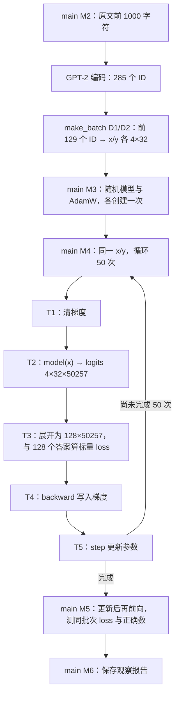

# 阶段二 · 单元 2 · 2.1 · 知识块 4：Tiny Shakespeare 单批次过拟合

本块属于阶段二的单元 2，接在 2.1 的文本生成知识块之后，对应视频约 45:50—1:02。先理解数据与预期，再沿 `main()` → `make_batch()` → `GPT()` → `training_step()` → `next_token_loss()` 读代码。整体层级与已学内容核对见[学习计划核对](docs/learning-plan-review.md)。当前状态是实验已准备并验证，用户对本块的理解仍在学习中，阶段二 · 单元 2 · 2.1 整节未完成。

## 0. 课程依据：为什么这里切换为随机参数

来源是 Karpathy 的 [Let's reproduce GPT-2 (124M)](https://www.youtube.com/watch?v=l8pRSuU81PU)，具体实现对齐作者 [7822fce 历史版本](https://github.com/karpathy/build-nanogpt/blob/7822fce8ebf46ba3907ee8f7cf0356f8ec1c63fa/train_gpt2.py)。前向与生成阶段加载预训练参数是为了验证模型实现；约 [40:35](https://www.youtube.com/watch?v=l8pRSuU81PU&t=2435s) 后转到随机参数，随后用数据训练。作者 [ce84eb3](https://github.com/karpathy/build-nanogpt/commit/ce84eb34ea813ec463a2587ddd8147f158df4c82) 也记录了这次切换。

相关视频讲解用[带时间戳的非官方自动字幕副本](https://github.com/nolimitkun/ai-kol-wiki/blob/main/sources/karpathy/20240609-l8pRSuU81PU/transcript.md)与作者源码交叉核对。字幕可能有识别误差，时间仅用于导航；这不等于直接观看了全部视频或取得官方字幕。

这里复用已写好的 GPT 网络，创建随机参数，没有调用 `load_hf_weights()`。之前的反向传播知识用于理解这次完整训练链路；后面的主线是数据加载、训练提速、优化策略、多卡、正式训练与评测。微调在 Notion 的后续单元。

| 项目 | 原视频该阶段 | 当前脚本 |
| --- | --- | --- |
| 数据 | Tiny Shakespeare `input.txt` 前 1000 字符 | 同一历史版本的原始文件，校验 SHA-256 |
| 批次与步数 | B=4、T=32，同一批 50 次更新 | 相同 |
| 参数起点 | `GPT(GPTConfig())` 的随机参数 | 相同的网络尺寸；PyTorch 模块默认初始化 |
| 输出表 | 此时尚未与输入嵌入共享 | `tie_embeddings=False`；共享在后面学习 |
| 优化器 | AdamW，lr=3e-4，其余默认 | 相同；包含默认 weight_decay=0.01 |
| 分词实现 | tiktoken 的 `gpt2` | 复用项目已有的 GPT-2 `tokenizer.json` 与 HF tokenizer；实现库不同 |
| 设备和随机种子 | 自动选设备，训练段未固定 seed | CPU / FP32，seed=42；这是本地复现实验设置 |
| 观察方式 | 打印每步 loss | 增加形状、预测正确数、梯度与参数观察值、最终测量报告 |

原来的手写短文本、B=1/T=8、只更新一次的演示已由本实验替换。不同设备、分词实现和浮点运算路径的数值不要求与视频逐位相同。

## 1. 先弄清楚：用什么数据，期待学到什么

数据在 [data/tiny_shakespeare/input.txt](data/tiny_shakespeare/input.txt)，开头是：

```text
First Citizen:
Before we proceed any further, hear me speak.

All:
Speak, speak.
```

它是连续的戏剧文本。这里无需整理成“问题—回答”；原文中每个位置的下一 Token 本身就是监督答案。人物名、冒号和换行也会参与编码与预测。

默认实验的数据量已经实测：

| 层次 | 数量 | 当前用途 |
| --- | ---: | --- |
| 完整文件 | 1,115,394 字符 | 保存课程原始数据 |
| 读取给分词器的片段 | 开头 1000 字符 | 编码为 285 个 GPT-2 Token |
| 当前批次的原始 ID | 前 129 个 | 额外 1 个供最后位置取答案 |
| 输入序列 | 4 条，每条 32 个 Token | `x.shape=[4,32]` |
| 本批监督位置 | 128 个 | `y.shape=[4,32]`，每个位置一个正确 ID |
| 参数更新 | 50 次 | 反复用同一批，数据不换 |

因此这里是 **4 条固定输入序列、128 个预测位置**。50 次更新不产生新样本；也不是用完整的莎士比亚语料训练了 50 遍。

期待的现象是：初始 loss 较高，反复更新后同一批数据上的 loss 明显下降。这样可以先验证数据、loss、反向传播和优化器能连起来工作。当前只检查这一小批能否学好；它不能说明模型会自由续写莎士比亚、回答问题，或对新文本表现良好。

## 2. 从 main() 开始：原文怎样成为 x 和 y

打开 [train_step.py](train_step.py)，先读 `[M1]` 默认选项，再读 `[M2]`：读取文件 → 验证数据版本 → 截取前 1000 字符 → 编码。`config.json` 只描述网络尺寸，`tokenizer.json` 只负责切分和 ID 映射，此时没有读取模型权重。

随后进入 `make_batch()` 的 `[D1]`、`[D2]`：

```python
buffer = torch.tensor(token_ids[:4 * 32 + 1], dtype=torch.long)  # [129]
x = buffer[:-1].reshape(4, 32)                                # [4,32]
y = buffer[1:].reshape(4, 32)                                 # [4,32]
```

用 `a0…a128` 代表这些 Token ID，位置关系为：

```text
x 第 0 行：a0   a1   ... a31      y 第 0 行：a1   a2   ... a32
x 第 1 行：a32  a33  ... a63      y 第 1 行：a33  a34  ... a64
x 第 2 行：a64  a65  ... a95      y 第 2 行：a65  a66  ... a96
x 第 3 行：a96  a97  ... a127     y 第 3 行：a97  a98  ... a128
```

每行有自己的因果上下文，注意力不会跨 batch 行读取。第 0 行最后的目标是 `a32`，第 1 行开头输入也恰好是 `a32`；这不表示第 1 行会自动继承第 0 行的前缀。

第一条样本的前 8 个位置来自实际编码：

| t | x 的 ID / 单 Token 显示值 | y 的 ID / 单 Token 显示值 |
| ---: | --- | --- |
| 0 | 5962 / `'First'` | 22307 / `' Citizen'` |
| 1 | 22307 / `' Citizen'` | 25 / `':'` |
| 2 | 25 / `':'` | 198 / `'\n'` |
| 3 | 198 / `'\n'` | 8421 / `'Before'` |
| 4 | 8421 / `'Before'` | 356 / `' we'` |
| 5 | 356 / `' we'` | 5120 / `' proceed'` |
| 6 | 5120 / `' proceed'` | 597 / `' any'` |
| 7 | 597 / `' any'` | 2252 / `' further'` |

例如 `t=4` 的问题是“看到 `First Citizen:\nBefore` 后，下一个 Token 是什么”，答案为 `' we'`。预测会使用本行 0 到 4 的输入，因果遮罩阻止它读取后面的答案。

`x` 的一行是一个完整的 32 Token 输入样本，但每个位置都贡献一个训练目标；不必另把每个越来越长的前缀单独放进模型。这正是上一课生成与本课训练使用 logits 位置的区别：生成取最后位置，这里利用全部有答案的位置。

## 3. 回到 main()：建立模型和优化器

`[M3]` 执行：

```python
torch.set_num_threads(min(4, torch.get_num_threads()))
torch.manual_seed(args.seed)
model = GPT(config, tie_embeddings=False, gpt2_init=False).cpu().float()
optimizer = torch.optim.AdamW(model.parameters(), lr=3e-4)
```

第一行限制 PyTorch 的 CPU 运算线程数。第二行设置随后参数初始化使用的随机数序列；本次数据固定从开头取，没有随机抽样，Dropout 也为 0。初始化时随机数的具体用途是填写 Embedding 和 Linear 的参数初值；优化器再根据数据产生的梯度逐步改变这些值。

`GPT(...)` 复用现有网络代码，保留模块构造时的默认初值。网络仍是 12 层、12 头、宽度 768、词表 50257。此刻输入嵌入和输出表各自独立，所以参数量为：

```text
124,439,808 + 50,257 × 768 = 163,037,184
```

课程仍叫“复现 GPT-2 124M”；约 1:06 引入共享权重后，才回到 124,439,808 个独立参数。此前的生成入口已经使用共享权重并载入预训练值；这两个入口对应同一节视频中的不同环节，都属于阶段二。两个开关用于表达环节设置的差异，具体共享与初始化推导按视频留到后面。

模型和优化器都在循环外建立一次。否则每步重新创建模型会丢失已经学到的参数，重新创建 AdamW 会丢失优化器积累的状态。

## 4. training_step()：一次更新实际做什么

`[M4]` 反复调用 `training_step(model, optimizer, x, y)`，每轮依次执行：

1. `[T0] model.train()` 设置训练模式，本身不修改参数。
2. `[T1] optimizer.zero_grad(set_to_none=True)` 清理上一轮 `.grad`。
3. `[T2] logits = model(x)` 对所有输入位置计算分数，并保留计算图。
4. `[T3] next_token_loss(logits, y)` 计算本批平均交叉熵。
5. `[T4] loss.backward()` 将梯度写入各个参数的 `.grad`，此时参数值还没更新。
6. `[T5] optimizer.step()` 根据梯度和优化器状态更新参数。

对应的主要形状如下。网络内部的详细 Attention / MLP 流程沿用前向课。

| 操作 | 形状变化 |
| --- | --- |
| 输入 x / 正确答案 y | 各为 `[4,32]`，整数 ID |
| Token embedding | `[4,32] → [4,32,768]` |
| Position embedding | 位置 `[32] → [32,768]`，沿 batch 广播相加 |
| 12 个 Transformer Block、最终 LN | `[4,32,768] → [4,32,768]` |
| lm_head | `[4,32,768] → [4,32,50257]` |
| logits 展开 | `[4,32,50257] → [128,50257]` |
| y 展开 | `[4,32] → [128]` |
| 交叉熵取平均 | 128 个预测位置 → 标量 `[]` |
| backward | 每份 `.grad` 与对应参数同形状，例如嵌入梯度 `[50257,768]` |
| optimizer.step | 参数形状不变，浮点数值改变 |

```python
loss = F.cross_entropy(logits.reshape(-1, 50257), y.reshape(-1))
```

输入是原始 logits，不能先 `argmax`，也不需要先 `softmax`。函数内部计算正确类别的负对数概率，默认对 128 个位置求平均。`y` 已经错开一位，不应再次移动。

公式为 `loss = mean(-log p(正确下一 Token | 本行截至当前位置的真实前缀))`。若所有类别都等概率，loss 为 `ln(50257) ≈ 10.824905`；随机模型不一定恰好均匀，本次实测初值约为 `10.927578`。



## 5. 50 次更新后期待看到什么：实际结果

在项目根目录运行：

```bash
.venv/bin/python train_step.py
```

2026-10-18，CPU / FP32、PyTorch 2.2.2、seed=42 的[完整实跑报告](artifacts/lesson04-overfit-report.json)：

| 已完成的参数更新次数 | 同一 batch 的 loss | 给定真实前缀，下一 Token 预测正确数 |
| ---: | ---: | ---: |
| 0 | 10.927578 | 0/128 |
| 1 | 6.563739 | 28/128 |
| 10 | 0.073592 | 128/128 |
| 25 | 0.008747 | 128/128 |
| 50 | 0.002746 | 128/128 |

这是固定小批次被学好的证据。128/128 只统计这批有真实前缀的位置；不是让模型自由生成 128 个 Token 后全对，也不是新数据的准确率。正确 ID 得分最高时准确率已可到 100%，但正确概率仍可能继续提高，所以 loss 还能下降。

日志第 N 步打印的是**该步更新之前**的前向值。50 次更新完成后，`[M5]` 再跑一次前向，才得到表中最后一行。旧的 loss 张量不会随着参数改变而自动刷新。

第一步报告也验证：`backward()` 后观察参数未变，`step()` 后观察分量最大变化约 `0.00030446`。AdamW 包含自适应更新和默认权重衰减，变化不必恰好等于学习率。报告中的梯度范数仅供观察，本块尚未引入梯度裁剪。

默认报告保存到 `.cache/runtime-check/lesson04-report.json`。归档文件保存本次测量，重新运行不会覆盖归档；没有保存模型检查点。`--steps 1` 可用于观察单步，但原视频本块的完整实验仍是默认 50 步。

另用作者历史模型类与本地模型做了[小配置数值核对](artifacts/lesson04-course-alignment.json)：保留 GPT-2 单头宽度 64 的 FP32 用例中，初值、logits、loss、全部参数梯度与一次 AdamW 更新一致。额外非默认头宽度的比较及浮点差异边界也保存在报告中；这不是对完整训练轨迹或两个 tokenizer 的等价性证明。7 个训练行为测试与 5 个生成测试通过，原有 45 个前向对照和因果性检查也通过。

## 6. 本块完成后往哪里走

学习顺序是：先能解释数据与预期 → 跟着一次更新读完 → 观察重复 50 次的结果 → 再进入约 1:02 的数据加载器。下一块把“固定这一个 batch”改为“连续提供新 batch”；之后按视频学习共享权重与初始化，再进入 2.2 提速。

本块的自检是：能从原文画出 x/y 的错位关系，解释 4 条样本为何有 128 个监督位置，指出参数究竟在哪一行改变，并说明同批次低 loss 为什么不能代替泛化评测。程序运行成功和用户能独立解释这四点分别记录。
