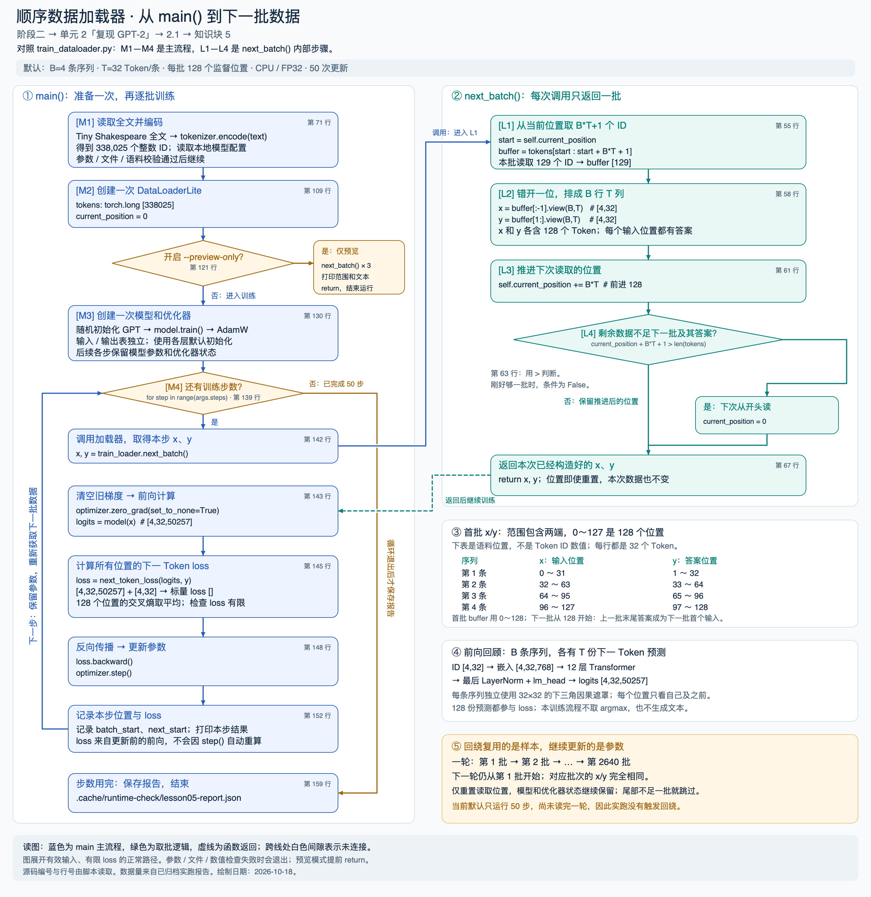

# 阶段二 · 单元 2 · 2.1 · 知识块 5：顺序数据加载器

新代码：[train_dataloader.py](train_dataloader.py)，本学习单是它的配套讲义。上一块的 [train_step.py](train_step.py) 与 [lesson04.md](lesson04.md) 保留，继续对应“同批次过拟合”。已有基础简要复习，重点看取数据方式的变化。

**学习记录（2026-10-18）：已学习、初步理解。** 用户反馈“这块我大概懂了”。已讨论 x/y 的错位与数量、下三角因果遮罩、每个位置的下一 Token 预测、batch 维、末尾回绕及每轮相同样本配合持续更新的参数。下一块为知识块 6「权重共享」，待开始；2.1 整节仍未完成，初步理解不等同于独立掌握。

配合[代码流程图与源码定位表](docs/diagrams/gpt2-dataloader-flow.md)阅读：左列按 `main()` 执行，右列展开 `next_batch()`；图中的 M1—M4、L1—L4 与代码注释一致。图中还标出 x/y 的形状、首批位置范围、末尾回绕及训练步数的区别。



[打开可放大的 SVG 原图](docs/diagrams/gpt2-dataloader-flow.svg)。先沿蓝线看一次训练，再沿右列绿线看这一步的数据从哪里来；绿虚线表示返回已经构造好的 x/y。

## 0. 来源、承接与本次预期

对应 [GPT-2 视频约 1:01:52—1:05:55](https://www.youtube.com/watch?v=l8pRSuU81PU&t=3712s)，实现依据作者 [631f7d6：add a DataLoaderLite](https://github.com/karpathy/build-nanogpt/blob/631f7d6f080effc4342b5e2f2f41879642c76fd1/train_gpt2.py)。本次核对了相关讲解的[非官方自动字幕副本](https://github.com/nolimitkun/ai-kol-wiki/blob/main/sources/karpathy/20240609-l8pRSuU81PU/transcript.md)，并与历史源码交叉检查；字幕并非官方转录，时间用于导航。

阶段一对照的是 Karpathy V7 的[官方 gpt.py / get_batch](https://github.com/karpathy/ng-video-lecture/blob/master/gpt.py)，结合 Notion 中已完成的字符级 GPT 记录；本次没有读取项目外的阶段一文件。

当前继续用 Tiny Shakespeare、随机参数的同一套 GPT 结构、B=4/T=32、AdamW lr=3e-4、50 次更新。每次启动新脚本都会新建随机模型；上一块没有保存权重，本次不接续它训练后的参数。权重共享和专用初始化仍留到知识块 6、7。

本次期待：每步读取新的语料区间，x/y 对齐正确，读到末尾能回到开头，模型可以连续更新。每步 batch 不同，loss 可以波动；不以像上一块那样逼近零作为验收标准。当前尚未设置验证集，不能据此衡量泛化。

本地改编保持明示：作者在加载器构造函数内读文件并调用 tiktoken；这里在 main 中读文件、使用已有 HF GPT-2 tokenizer，再传入 ID。CPU / FP32 和 seed=42 沿用上一块。读取、前进和回绕规则保持作者这一版的逻辑；没有提前引入多进程、数据分片或打乱。

## 1. 与阶段一、上一知识块分别有什么不同

| 对比项 | 阶段一 V7 get_batch | 阶段二 · 2.1 · 知识块 4 | 当前知识块 5 |
| --- | --- | --- | --- |
| 数据表示 | 字符 ID，原文词表 65 | GPT-2 Token ID | 沿用 GPT-2 Token ID，不重讲分词 |
| 每步怎样取样 | 每条序列分别随机选择一个起点 | 永远使用开头的同一个 batch | 从 current_position 开始顺序取下一块 |
| 样本组织 | B 个随机窗口堆成 [B,T] | 一个连续片段排成 [B,T] | 每次取新的连续片段，再排成 [B,T] |
| 需要保存什么状态 | 每次重新抽位置，无顺序读取指针 | 固定的 x/y | 全部 tokens + 当前读取位置 |
| 重复出现 | 随机抽样允许窗口重复或重叠 | 每一步都重复 | 回到开头后才重复同一批的位置；文字本身仍可能重复 |
| 数据量 | 全文切分 train/val | 前 1000 字符中的首批 | 整篇文本先编码，再分批；本节暂不划验证集 |
| 相同部分 | 下一 Token 目标、[B,T]、loss、反传与更新 | 相同 | 相同 |

顺序加载是本视频当前采用的组织方式，并不意味着随机窗口采样是错误的。训练/验证分开这件事阶段一已经学过；当前按视频逐步接线，后面正式训练仍要补验证集。

## 2. 新代码只需要抓住一个状态和四个动作

先读 `DataLoaderLite.__init__()`：

```python
self.tokens = torch.tensor(token_ids, dtype=torch.long)
self.current_position = 0
```

`self.tokens` 是完整语料的 ID 张量，形状 `[338025]`。`current_position` 表示下次从这个张量的哪个下标开始读。它不是 Token ID，也不是送给模型的位置编码。`DataLoaderLite` 是普通 Python 类，不是 PyTorch 的 `DataLoader` 组件。

`next_batch()` 的四个动作对应代码 `[L1]`—`[L4]`：

```python
# L1：取出当前位置开始的 B*T+1 个 ID。
start = self.current_position
buffer = self.tokens[start:start + B*T + 1]

# L2：沿用上一块的错位标签和形状。
x = buffer[:-1].view(B, T)
y = buffer[1:].view(B, T)

# L3：记住下一次从哪里读。
self.current_position += B*T

# L4：下一批不够长时，从头开始下一轮。
if self.current_position + B*T + 1 > len(self.tokens):
    self.current_position = 0
```

默认 B=4、T=32，每次读 129 个 ID，前进 128 个位置：

| 调用 | 本次读取 buffer 的位置（含两端） | x 展平后的语料位置 | y 展平后的语料位置 | 下一起点 |
| --- | --- | --- | --- | ---: |
| 第 1 次 | 0—128 | 0—127 | 1—128 | 128 |
| 第 2 次 | 128—256 | 128—255 | 129—256 | 256 |
| 第 3 次 | 256—384 | 256—383 | 257—384 | 384 |

前一批最后一个目标 Token，要成为后一批第一个输入 Token，所以指针前进 B*T，不能前进 B*T+1。两批 buffer 交叠一个位置，输入位置仍连续且不重叠。

各批、各行之间不传递模型的隐藏状态。即使语料读取位置连续，下一批的每行仍独立做因果注意力，模型位置编号重新从 0 开始；不等于上下文长度不断增长。

末尾策略也要明确：只取完整 batch，不补 padding，不把尾部与开头拼成一个 batch。假设 B=2/T=3，13 个 ID 可以提供两批，12 个 ID 只能提供一批，因为第二批还缺一个答案。条件中的 `>` 要保留，刚好够一批时仍应读取。

## 3. 在 main 中，关键改动是把取数据放进训练循环

先创建加载器、模型和优化器，再进入循环：

```python
train_loader = DataLoaderLite(token_ids, batch_size=4, seq_len=32)
# 模型和优化器也只创建一次。

for step in range(50):
    x, y = train_loader.next_batch()  # 每步调用，返回下一批。
    optimizer.zero_grad(set_to_none=True)
    logits = model(x)
    loss = next_token_loss(logits, y)
    loss.backward()
    optimizer.step()
```

若把 `next_batch()` 放在循环外，就会再次变成单批次过拟合。若把 `DataLoaderLite(...)` 放进循环内，每次都将位置重置为 0，也会反复拿到第一批。模型和优化器同样留在循环外，参数和优化器状态才能延续。

训练主干与前一块相同。当前脚本直接呈现它，没有加入 `probe_row`、参数快照等观察代码。`train_step.py` 只提供已学过的 loss 函数和公共路径常量，导入它不会启动上一块的训练。

## 4. 运行并核对数据位置

只看前三批，不创建模型：

```bash
.venv/bin/python train_dataloader.py --preview-only
```

默认执行 50 次训练，每次获取下一批：

```bash
.venv/bin/python train_dataloader.py
```

当前语料实测为 1,115,394 个字符、338,025 个 GPT-2 Token。每轮完整批数是 `(338025-1)//128 = 2640`，还有 104 个不足一批的目标位置不参与这一轮；回到开头时读取顺序相同。本地计数显式减去最后答案所需的 1；作者显示计数使用 `N//(B*T)`，在这份数据上结果相同，在恰好整除的短数据上可能多算一批，读取规则本身未改。

50 步只使用前 50 个不同起点的 batch，共处理 6400 个输入/监督位置，不是 50 遍全文，也不代表 6400 个不同的词表 ID。记录的 loss 来自各步更新前的当前训练 batch；不能把相邻两步的差异完全归因于参数改善，因为输入也变了。

运行报告默认保存到 `.cache/runtime-check/lesson05-report.json`；本次实跑另存为 [lesson05-dataloader-report.json](artifacts/lesson05-dataloader-report.json)。这里只记录训练指标，不保存模型检查点。

本次默认设置已完整运行 50 步：第 1 步 loss 为 `10.927578`，第 50 步为 `6.575397`；两者分别来自第 1 批和第 50 批的更新前计算。第 3、4 步为 `8.628612 → 9.049093`，说明换数据时确实会波动。这不是在同一个评估集上测出的前后改善，也不是第 50 次更新后的最终评估。

5 项加载器测试、7 项已有训练测试和 5 项生成测试全部通过。另将作者历史版加载器与本地实现喂入相同 ID：四种短数据边界各比较 5 次，完整语料比较 2642 次（含读完一轮后回绕），x/y 与读取位置均一致，见[加载器对齐报告](artifacts/lesson05-loader-alignment.json)。这个检查只比较取批行为，不声称不同分词库或整条训练轨迹逐位一致。

这一块只需能解释三点：指针为什么前进 128、加载器为什么只创建一次、换 batch 后为什么不能要求 loss 像上一块那样接近零。下一块按视频进入**阶段二 · 单元 2 · 2.1 · 知识块 6：权重共享**。
