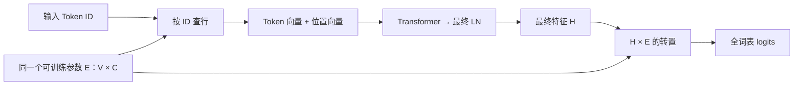

# 阶段二 · 单元 2 · 2.1 · 知识块 6：权重共享

配套代码：[train_weight_tying.py](train_weight_tying.py)。本块沿用上一块的顺序加载器，新增输入词向量表与输出评分表之间的共享连接。上一块的 `train_dataloader.py` / `lesson05.md` 保留。

**学习状态（2026-10-19）：开始学习，理解程度待讨论。** 知识块 5 的记录仍为“已学习、初步理解”。实验通过只说明代码核验结果，不代表用户已经独立掌握。本块之后学习 7「初始化」；2.1 整节仍在进行中。

## 0. 依据、起点与学习目标

对应 [Karpathy 视频约 1:05:55—1:13:03](https://www.youtube.com/watch?v=l8pRSuU81PU&t=3955s)，以作者 [ec39245：weight tie the embedding and unembedding matrix](https://github.com/karpathy/build-nanogpt/commit/ec39245425b2c82a38c0787f27e5f9d7082c973b) 为实现基准。本次核对了该段的[非官方自动字幕副本](https://github.com/nolimitkun/ai-kol-wiki/blob/main/sources/karpathy/20240609-l8pRSuU81PU/transcript.md)，并与作者历史源码交叉检查；未直接观看视频画面，时间用于导航。作者这一提交只在模型构造中新增了权重共享。

视频先观察 Hugging Face 模型中两处权重的形状、数值与存储关系，随后解释共享的作用、梯度累加，再在自建模型中连接。约 1:13 后进入下一块初始化。本地沿用 CPU / FP32、seed=42、HF GPT-2 tokenizer；数据仍是完整 Tiny Shakespeare，B=4、T=32，AdamW lr=3e-4，默认 50 步。其他模块仍采用上一块的默认初始化，Dropout=0。

**参数起点仍是新建的随机模型。** 配置与 tokenizer 可以复用缓存，本脚本没有加载预训练权重，也没有接着上一块的训练结果继续训练。前面检查预训练模型时已经见过共享关系；现在要在从随机参数训练的模型中亲手建立它。

学完本块，应能解释：哪两张表共享；为何形状相同；一行赋值如何让两处引用同一个参数；参数减少多少；两处计算产生的梯度怎样参与同一次更新。

## 1. 先把已经学过的两个环节接起来

设词表大小为 V=50,257，隐藏维度为 C=768。先只看一个 Token 位置。

| 环节 | 输入 | 使用的参数 | 计算 | 输出 |
| --- | --- | --- | --- | --- |
| 输入 Token Embedding | 整数 ID，例如 i | 输入词向量表 E，形状 [V,C] | 取第 i 行 E[i,:] | 一个 C 维向量 |
| Transformer + 最终 LN | 加上位置向量后的特征 | 各层独立参数 | 已学习的多层前向 | 当前位置的最终向量 h，C 维 |
| 输出 lm_head | h | 输出权重表 W，形状 [V,C] | z = h Wᵀ | V 个分数，即 logits |

`nn.Linear(C,V)` 存储的 weight 是 `[V,C]`。乘法时使用其转置，所以 `[1,C] × [C,V] → [1,V]`。两张表形状相同，操作却不同：输入查一行，输出与每一行做点积。

把一批数据写全：

```text
输入 ID                 [B,T]          本例 [4,32]
    ↓ E[IDs] 查表
Token 向量              [B,T,C]        本例 [4,32,768]
    ↓ 加位置向量 → 12 个 Block → 最终 LN
最终特征 H              [B,T,C]        本例 [4,32,768]
    ↓ H @ W.T
logits                  [B,T,V]        本例 [4,32,50257]
```

## 2. 权重共享到底改了什么

上一块用两份独立的参数 E 和 W。本块让它们变成**同一个 Parameter 对象**。仍用 E 表示这张共同的表：

\[
\text{输入：}\quad x_i=E[i,:]
\]

\[
\text{输出：}\quad z_j=\sum_{d=0}^{C-1}h_d E[j,d]
\]

同一个词表 ID j，在输入端对应“把 j 表示成什么向量”，在输出端对应“用哪一个向量与 h 计算 j 的分数”。训练时两种用途共同约束这张表。



输入的 Token ID 与输出的候选 ID 使用同一套词表编号，但输出预测的是**下一个 Token**。h 已经过上下文计算，共享不会强迫模型把输入原样输出。查行与全词表打分也不是互相求逆。

位置表 `wpe`、各 Block 的 Q/K/V、MLP 等仍各自独立。本节只连接 `wte.weight` 和 `lm_head.weight`。

## 3. 为什么这样做

首先是减少独立参数。一张表的参数数量为：

\[
50,257\times768=38,597,376
\]

| 统计项 | 共享前 | 共享后 |
| --- | ---: | ---: |
| 两个用途所需的独立表 | 2 张 | 1 张 |
| 这部分的独立参数 | 77,194,752 | 38,597,376 |
| 整个模型的独立参数 | 163,037,184 | 124,439,808 |

输入输出形状、词表大小和 Transformer 层数均不变。省下的是一整张参数表，以及训练时相应的梯度和优化器状态存储。输出端仍需给整个词表打分，不能把参数减少理解成“少算了 38,597,376 次乘法”。

其次是模型约束：原本两张表可各学各的，现在同一份参数同时服务输入和输出。视频引用 [Press 与 Wolf 的论文](https://arxiv.org/abs/1608.05859)讨论这种方式；本块的短训练实验只核验机制，不用它证明所有任务上共享一定更好。

## 4. 在代码里怎样建立共享

阅读新脚本的 `[M2]` 和 `tie_weights_like_course()`：

```python
model = GPT(config, tie_embeddings=False, gpt2_init=False).cpu().float()

# 本节最核心的一行，方向与作者的历史提交相同。
model.transformer.wte.weight = model.lm_head.weight

# 一定在参数连接完成之后创建优化器。
optimizer = torch.optim.AdamW(model.parameters(), lr=3e-4)
```

第一行先建立独立表，使这次改动清楚可见；`tie_embeddings=False` 只是不执行公共 GPT 类内置的共享语句。随后第二行明确把共享接上。`gpt2_init=False` 表示保留各模块默认随机初值，专用初始化在下一知识块学习。

对于熟悉 Java/Dart 的读者，可以把核心赋值理解为让两个属性指向同一个对象。这里还由 PyTorch 的 Module 机制把它注册为参数：

```python
model.transformer.wte.weight is model.lm_head.weight  # True
```

赋值后保留原 `lm_head.weight` 对象；原来的独立 wte 参数不再属于模型。代码没有复制数据，也没有把两张表相加或平均。相反，下面的写法仅复制当前数值，仍保留两个独立参数：

```python
# 用于对比概念，不是本课的共享实现。
with torch.no_grad():
    model.transformer.wte.weight.copy_(model.lm_head.weight)
```

**为何特意保留赋值方向？** 当前 Embedding 与 Linear 使用各自不同的默认初始化规则。作者保留的是 Linear 的初值；反方向赋值会保留 Embedding 的初值。两种方向都能实现共享，但在尚未统一初始化的这一段中，训练起点不同。公共 `GPT` 类默认在相反方向连接，并另有初始化逻辑，因此本课显式连接，避免提前改变视频当前的实验条件。

## 5. 反向传播与更新如何处理同一张表

这张表在一次前向中被用到两处。反向传播会沿两条路径传回梯度：

\[
\nabla_E L = g_{\text{输入查表路径}} + g_{\text{输出打分路径}}
\]

输入路径的贡献来自被查到的词条，经过后续网络传回；输出路径的贡献来自全词表评分和交叉熵。这里相加的是两条路径对**同一份参数**的梯度贡献。

```python
optimizer.zero_grad(set_to_none=True)  # 清掉上一训练步的累计梯度。
logits = model(x)                     # 前向中在两处使用同一个 E。
loss = next_token_loss(logits, y)
loss.backward()                       # autograd 自动累加两条路径的贡献。
optimizer.step()                      # 使用合计梯度，更新这一份参数。
```

`model.parameters()` 默认按对象去重，因此共享表在优化器中只出现一次。无需手工把两个 `.grad` 再相加：它们已经属于同一个对象；手工重复相加反而会多算。更新之后，两处读取自然看到相同的新数值。

先建立共享，再创建优化器，避免优化器持有已被替换的旧参数。共享只在构造阶段连接一次，不放进每个训练步。

## 6. 本次怎样运行

当前机器经用户授权复用原有环境。先只检查结构与参数数量：

```bash
/Users/guqun/micrograd/venv/bin/python /Users/guqun/micrograd/gpt2_pretrain_lab/train_weight_tying.py --inspect-only
```

然后运行完整的 50 步顺序训练：

```bash
/Users/guqun/micrograd/venv/bin/python /Users/guqun/micrograd/gpt2_pretrain_lab/train_weight_tying.py
```

其他机器在项目中按 README 准备 `.venv` 后，使用 `.venv/bin/python train_weight_tying.py` 即可。脚本读取项目缓存中的 `config.json` 与 `tokenizer.json`，不会读取模型权重。`--inspect-only` 不读取训练语料，也不写训练报告。

默认训练报告写入 `.cache/runtime-check/lesson06-report.json`。50 次更新对应 50 个不同 batch 起点、6400 个监督位置；不是 50 遍全文。每一步记录的是当前 batch 更新前的 loss，batch 不同，loss 可以波动。

## 7. 核验范围与阅读顺序

[tests/test_weight_tying.py](tests/test_weight_tying.py) 用小配置核验两个关键行为：

1. 赋值保留原输出 Parameter，独立参数减少 V×C，优化器只包含共享对象一次。
2. 构造数值相同但不共享的对照模型，分别计算两条路径的梯度；两者之和与共享模型的梯度一致。再用显式 SGD 公式验证没有把参数更新两遍。主教学脚本仍用 AdamW。

本次这两项与已有 17 项行为测试全部通过。完整模型的 50 步实验结果另见 [lesson06-weight-tying-report.json](artifacts/lesson06-weight-tying-report.json)：50 个不同起点、6400 个监督位置，第 1 批与第 50 批的更新前 loss 分别为 `10.975255`、`6.863894`。这是不同训练 batch 上的记录，不能当作同一个验证集的前后对比。这些检查不等于逐位复现视频中的 GPU 训练轨迹，也不用于评估泛化能力。

第一次阅读先看第 1—4 节，再打开代码 `[M2]`；随后对照第 5 节看 `[M3]` 和 `[M4]`。检查自己能否回答：同样形状为何不等于共享？赋值后保留谁？为什么训练循环无需再同步两张表？减少的参数量怎样算？
