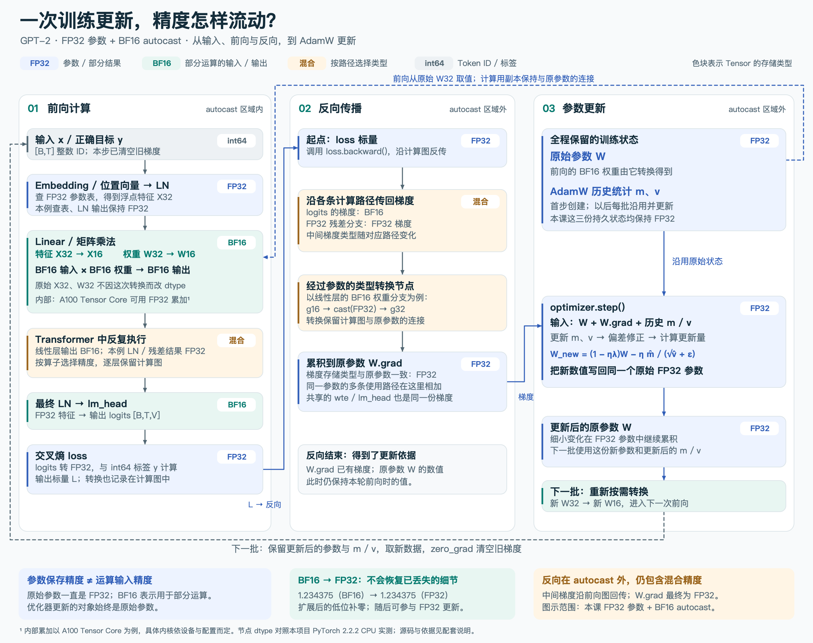

# 阶段二 · 单元 2 · 2.2 · 知识块 9：BF16 自动混合精度

配套：[train_mixed_precision.py](train_mixed_precision.py)。先读本页第 1—5 节，再看代码中的 `forward_and_loss()`；它是本块的核心改动。`main()` 负责准备，`train_amp_steps()` 继续执行上一块的训练和计时流程。

本次讨论的全流程图：[前向 → 梯度 → 参数更新的精度变化](docs/diagrams/gpt2-bf16-precision-flow.md)，包含 [PNG](docs/diagrams/gpt2-bf16-precision-flow.png) 与 [可缩放 SVG](docs/diagrams/gpt2-bf16-precision-flow.svg)。



**2026-10-19：开始学习。** 用户已对设备、预热、吞吐率与 TF32 反馈初步理解；实际 GPU 提速实验仍待运行。2.1 已完成，2.2 继续学习，单元 2 为 1/5、阶段二为 5/32。本块代码验证与用户掌握程度分别记录。

**同日学习跟进：** 用户反馈“BF16 这部分我大概理解了”。本轮讨论已归档到 [GPU 训练提速专题笔记](docs/gpu-training-notes.md)，包括混合输入的类型、内部累加、转换成本、梯度回传与 FP32 更新。知识块 9 记为已讨论、初步理解；下一块 torch.compile 尚未开始，2.2 与 GPU 实测仍待继续。

## 0. 课程依据、承接和目标

对应 Karpathy [Let's reproduce GPT-2 (124M)，约 1:39:28—1:47:34](https://www.youtube.com/watch?v=l8pRSuU81PU&t=5968s)。已核对[非官方自动字幕副本](https://github.com/nolimitkun/ai-kol-wiki/blob/main/sources/karpathy/20240609-l8pRSuU81PU/transcript.md)对应时间段及作者 [177e4cd：add bfloat16](https://github.com/karpathy/build-nanogpt/commit/177e4cd5b4cc05df4bb637ed1a9e55911d6f1e2c)，没有直接观看视频画面。字幕用于定位讲解顺序，API 与操作边界按历史代码及本机 PyTorch 2.2.2 核验。

原课从 TF32 转到 BF16：继续减少部分运算的计算成本，也减少部分中间张量的存储与搬运量。实现上，把前向和 loss 放进 `autocast`，反向和参数更新留在外面。原作者在 `model(x, y)` 内计算 loss；本项目在模型外调用交叉熵，两者都处于同一 autocast 区域。后续才是 `torch.compile`，本块暂不引入。

学完应能：

1. 区分 FP32、TF32 与 BF16 的存储和计算含义。
2. 解释为什么混合使用精度，以及参数仍用 FP32 的理由。
3. 找到 `autocast` 的作用范围，读懂各层实际 dtype。
4. 在相同硬件和训练条件下比较性能与数值变化。

仍使用完整 GPT-2 124M、共享权重、上一块的初始化规则和 Tiny Shakespeare。参数从随机初值开始，只读取 GPT-2 的配置与 tokenizer，不读取预训练权重，也不接续上一脚本的训练结果。

本地改编：脚本默认 B=4/T=32；本次 CPU 验证显式使用 B=1/T=8，方便检查真实完整模型的 dtype 和更新链路。原课 GPU B=16/T=1024 的性能对照命令保留在第 6 节。小 batch 的 CPU 检查不能代替 GPU 加速实验。

## 1. BF16 改变了什么

BF16 是 **Brain Floating Point 的 16 位格式**。它用 2 字节表示一个浮点数，FP32 用 4 字节。两者指数部分都是 8 位，所以数值范围相近；BF16 用于表示精细差别的位数少得多，舍入误差会更大。

| 格式 | 符号位 | 指数位 | 显式小数位 | 一个数的存储 |
| --- | ---: | ---: | ---: | ---: |
| FP32 | 1 | 8 | 23 | 4 字节 |
| BF16 | 1 | 8 | 7 | 2 字节 |
| FP16 | 1 | 5 | 10 | 2 字节 |

指数决定数量级，小数位决定同一数量级下能区分多细的差别。BF16 与 FP16 都是 16 位，但表示范围和精度的取舍不同。原始格式说明见 [Google 的 BF16 介绍](https://cloud.google.com/blog/products/ai-machine-learning/bfloat16-the-secret-to-high-performance-on-cloud-tpus)。

和上一块的 TF32 对照：

| 设置 | 本课参数存储 | 矩阵运算的变化 | 本课 lm_head 输出 |
| --- | --- | --- | --- |
| FP32 基线 | FP32 | 使用基线精度 | FP32 |
| 允许 TF32 | FP32 | 允许兼容 CUDA 硬件降低内部乘法精度 | FP32 |
| BF16 autocast | FP32 | 符合规则的运算自动使用 BF16 输入 | BF16 |

TF32 不会仅因开关就把 FP32 Tensor 的存储缩小；BF16 autocast 会让一部分输出实际成为 2 字节的 Tensor。具体选择按运算、设备和版本决定。上一块 `high` 的后端选择边界仍然适用。

## 2. 为什么可能更快、更省空间

先看熟悉的线性层：

\[
Y=XW^\top+b
\]

形状和数学目的不变；变化是计算这些数时使用的数值表示。支持 BF16 的硬件可以用对应的矩阵乘加单元执行这些运算。部分输入、输出以 BF16 保存时，需要读写的字节也减少。实际加速多少取决于硬件、算子、矩阵大小及数据转换成本。

例如同样有 1,000,000 个元素的一张中间张量：FP32 的逻辑大小为 4,000,000 字节，BF16 为 2,000,000 字节。这是单个张量的计算，不是整个训练过程的显存估计。

本节参数、参数梯度和 AdamW 的一阶/二阶状态仍是 FP32；一些中间结果也是 FP32，autocast 还可能创建转换缓存。因此**部分张量减半，不意味着总显存减半**。脚本分别记录 logits 的逻辑字节数与 CUDA 峰值已分配内存；二者口径不同。

CPU 即使支持执行这些 API，也不一定有高效的 BF16 硬件路径，可能比 FP32 更慢。本机的任务是观察类型与正确更新，CUDA 对照用于验证 GPU 性能。

## 3. 为什么叫“混合精度”

我们给不同运算使用适合它的精度，而不是先把整个模型改成 BF16。

本机 PyTorch 2.2.2、CPU、完整模型的实际观察如下，详见 [dtype 报告](artifacts/lesson09-cpu-dtypes.json)：

| 位置或数据 | 本实验的 dtype | 用途 |
| --- | --- | --- |
| x / y | int64 | 输入与正确目标的 Token ID |
| wte / wpe 参数及查表输出 | FP32 | 保留可训练向量；查表不会自动变成 BF16 |
| LN1、LN2 输出 | FP32 | 调整当前位置的特征 |
| QKV 线性层输出 | BF16 | 形成 Query、Key、Value |
| 注意力输出投影、MLP 两个线性层输出 | BF16 | 计算特征变换分支 |
| 残差相加后的 Block 输出 | FP32 | 本例中 FP32 主分支与 BF16 分支相加，提升为 FP32 |
| 最终 LayerNorm 输出 | FP32 | 给输出层准备特征 |
| lm_head 输出 logits | BF16 | 每个位置对词表的分数 |
| 交叉熵 loss | FP32 | 得到用于反传的标量 |

这张表描述本次实现与运行，不表示所有模型、设备都具有相同的中间 dtype。特别是 softmax 的自动转换规则有设备差异，不能把 CUDA 的算子列表直接套到 CPU。规则见 [PyTorch 2.2.2 AMP 文档](https://github.com/pytorch/pytorch/blob/v2.2.2/docs/source/amp.rst)。

把当前模型的一小段连接起来：

```text
输入 ID（int64）
    ↓ 查 FP32 参数表
Embedding / 残差主分支（FP32）
    ↓ LayerNorm
QKV / MLP 等符合规则的运算（BF16）
    ↓ 与 FP32 残差主分支相加
Block 输出（FP32）
    ↓ 后续 Block、最终 LayerNorm
lm_head 输出 logits（BF16）
    ↓ autocast 区域内的交叉熵
loss（FP32）
    ↓ 反向传播
FP32 参数的 .grad（FP32）
    ↓ AdamW 更新
FP32 参数的新数值 → 下一个 batch
```

## 4. 代码怎么做，分别由谁负责

本节核心可以概括为以下代码，模型和 x/y 已经放在同一设备：

```python
# model 的参数仍是 FP32；x/y 仍是整数 ID。
optimizer.zero_grad(set_to_none=True)

with torch.autocast(device_type=device.type, dtype=torch.bfloat16):
    logits = model(x)  # [B,T,V]，本例输出 BF16
    loss = F.cross_entropy(
        logits.reshape(-1, logits.size(-1)),
        y.reshape(-1),
    )  # 标量，本例为 FP32

loss.backward()
optimizer.step()
```

`with` 临时打开自动混合精度环境，离开后恢复先前设置。区域内的算子按规则处理输入和输出；已产生的 BF16 logits 离开区域后仍是 BF16，不会因为缩进结束自动变回 FP32。

| 内容 | 谁负责 |
| --- | --- |
| 选择前向和 loss 进入 autocast | 我们编写的训练流程 |
| 为支持的算子选 dtype、转换输入、调度计算 | PyTorch 和设备后端 |
| 自动求导、把梯度累积到参数 | PyTorch autograd |
| 用梯度和历史状态更新参数 | PyTorch AdamW |
| 同条件对照、同步计时、读 dtype、保存报告 | 我们编写的实验工具 |

**不要为了使用 autocast 再调用 `model.bfloat16()`。** 那会改变参数本身的存储类型，成为另一个训练方案，不是本节的实现。[PyTorch 2.2.2 的 autocast 说明](https://github.com/pytorch/pytorch/blob/v2.2.2/torch/amp/autocast_mode.py)明确区分了这两种做法。

`backward()` 放在区域外，也不表示每一个反向中间运算都强制改成 FP32。反传会沿前向记录的运算和转换求导；本课叶子参数仍是 FP32，最终累积到它们的 `.grad` 也是 FP32。

## 5. 为什么参数与更新保留 FP32

我们之前已经学过，下一批数据使用的是更新后的参数。这里的更新可能很小，如果参数存储本身过于粗糙，小变化可能被舍入掉。

一个只用于理解舍入的数值例子：BF16 在 `[1,2)` 内相邻可表示数的间隔是 `1/128=0.0078125`。如果参数为 1.0，想把它改成 0.9999，再写回 BF16 时会舍入回 1.0；FP32 能保留这次差别。保留 FP32 参数及优化器状态，有利于累积细小更新。这不是说每个训练参数都等于 1，而是说明较低精度可能丢失小变化。

本实验采用的关系是：

```text
FP32 参数 → 计算时按需转换 → 部分 BF16 运算
    ↑                            ↓
FP32 更新 ← FP32 参数梯度 ← 反向传播
```

不要把“FP32 的梯度存储”理解为它能恢复前向中已经损失的精度。它保留的是这次混合精度计算所得到的梯度。

BF16 的指数范围较宽，原课这里直接使用 autocast，没有引入 `GradScaler`。FP16 更容易遇到小梯度下溢，因此常配合梯度缩放；本块先理解两者范围不同，不展开 FP16 配方。BF16 仍有舍入误差，也不能保证任何模型都不会出现 NaN 或 loss 变化。

## 6. 如何运行和观察

先在当前 Mac 只看 dtype，不训练、不测速：

```bash
/Users/guqun/micrograd/venv/bin/python /Users/guqun/micrograd/gpt2_pretrain_lab/train_mixed_precision.py --device cpu --probe-only --batch-size 1 --seq-len 8
```

它用**同一组未更新的参数、同一批输入**分别执行 FP32 和 BF16 前向，打印部分层的类型与两个 loss。观察函数临时使用 eval/no_grad，结束后移除 hook、恢复原来的 train/eval 状态；它只是辅助观察工具，不是训练主线。

再执行完整的前向、反向与更新：

```bash
/Users/guqun/micrograd/venv/bin/python /Users/guqun/micrograd/gpt2_pretrain_lab/train_mixed_precision.py --device cpu --precision bf16 --batch-size 1 --seq-len 8 --warmup-steps 1 --steps 2
```

重点看第一步打印的四个 dtype，以及更新后 AdamW 状态的报告。本机没有可用 CUDA/MPS；这条命令只验证 BF16 路径能完成训练更新，耗时不用于推断 GPU 效果。

GPU 机器在仓库下使用该机器的课程环境，做两次独立运行：

```bash
python train_mixed_precision.py --device cuda --precision fp32 --matmul-precision high --batch-size 16 --seq-len 1024 --warmup-steps 5 --steps 50 --report artifacts/lesson09-cuda-fp32-tf32.json
python train_mixed_precision.py --device cuda --precision bf16 --matmul-precision high --batch-size 16 --seq-len 1024 --warmup-steps 5 --steps 50 --report artifacts/lesson09-cuda-bf16.json
```

这里第一组保留上一块的 `high`，第二组仅增加 BF16 autocast，符合视频逐项改进的顺序。两组都固定 `high`、种子、B/T、数据顺序、初始化、预热与步数。如果装不下，两组一起减小 B。设备或当前安装不支持时会明确报错，不静默换成 FP16。

| 对照项 | FP32 + 允许 TF32 | BF16 autocast |
| --- | --- | --- |
| 平均 ms/步、总 Token/s | 待 GPU 实跑 | 待 GPU 实跑 |
| CUDA 峰值已分配字节 | 待 GPU 实跑 | 待 GPU 实跑 |
| loss 数值、是否有限 | 待记录 | 待记录 |

吞吐依旧是测量步的总 `B*T` 除以总耗时；预热也训练，但不计入汇总。短实验只能检查流程、性能和明显的数值问题，不能证明长期训练质量相同。不要要求两种精度的 loss 逐位一致。

## 7. 已验证到哪里

完整模型的两种前向已运行，报告在 [lesson09-cpu-dtypes.json](artifacts/lesson09-cpu-dtypes.json)：124,439,808 个参数，B=1/T=8，seed=42；FP32 loss 为 **10.530962**，BF16 loss 为 **10.526217**，没有更新参数。这是同一输入和参数的数值对照，不能把 BF16 这个稍低的 loss 解释为训练质量更好。

BF16 完整训练短跑记录在 [lesson09-cpu-bf16-smoke.json](artifacts/lesson09-cpu-bf16-smoke.json)：1 步预热和 2 步测量共完成 3 次更新，batch 起点为 0、8、16。每批更新前的 loss 为 10.526217、10.676401、7.261481；数据不同，不能用这个序列判断泛化改善。输入 ID 为 int64，参数、参数梯度、loss、AdamW 的 m/v 均为 FP32，logits 为 BF16。当前记录只代表本机 CPU 行为；GPU 加速和长训练质量仍未验证。

新增的 4 项行为测试与之前的 25 项合计 **29 项通过**。本块检查：FP32 分支与上一块训练轨迹一致；BF16 前向和 FP32 参数梯度可以完成真实更新；反向和优化器在 autocast 外执行；观察模式不改参数、移除 hook 并恢复模式；不支持的配置明确拒绝。自动化测试使用小模型验证这些行为，完整 124M 实验另外归档，不混为同一项验证。

读完后，先能解释这句话即可：**我们保留 FP32 参数，用 autocast 让部分运算及中间结果使用 BF16，再用反传得到的梯度更新原来的 FP32 参数。** 自检用于复习，不新增学习完成门槛。
