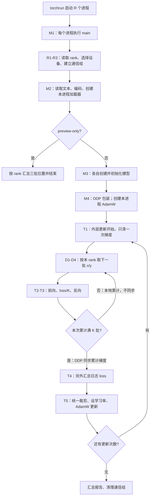

# 阶段二 · 单元 2 · 2.4 · 知识块 11：DDP 代码、数据分配与梯度累积

当前从 DDP 原理讨论进入代码走读，学习状态为**开始学习**。配套新文件是 [train_ddp.py](train_ddp.py)；前十块入口保留。本块接通已讨论的 2.3 更新策略与 2.4 多进程流程；FineWeb-Edu 分片与验证集留在后续。

## 1. 先说明来源、参数、数据和预期

本块依据 Karpathy [视频约 2:46:52—3:09:48](https://www.youtube.com/watch?v=l8pRSuU81PU&t=10012s)，核对了[非官方自动字幕副本](https://github.com/nolimitkun/ai-kol-wiki/blob/main/sources/karpathy/20240609-l8pRSuU81PU/transcript.md)和作者 [ba2554acce54487f07c13563247f2cce683e0d5e](https://github.com/karpathy/build-nanogpt/blob/ba2554acce54487f07c13563247f2cce683e0d5e/train_gpt2.py) 的历史代码。未直接观看视频画面，也不把字幕副本当成官方逐字稿。

字幕中的先后顺序：约 2:47—2:56 是启动进程、rank 与设备；2:56—2:59 是加载器分配数据；2:59—3:01 是 DDP 包装；3:01—3:06 是累积期间同步及日志 loss 汇总；3:07—3:09 是多卡运行与数据边界。约 3:09:48 后才转入更大的数据集。

| 项目 | 本次含义 |
|---|---|
| 参数从哪里来 | 随机新模型，沿用权重共享和专用初始化；不读取预训练权重，不承接上一脚本训练结果 |
| 数据是什么 | 项目内同一份完整 Tiny Shakespeare，GPT-2 tokenizer，338,025 个 Token |
| 样本怎样构造 | 每进程取 B*T+1 个 ID，得到错一位的 x/y，各为 `[B,T]` |
| 新增能力 | 多个进程取不同数据、累计本地梯度、最后同步，执行相同的更新 |
| 成功现象 | 各 rank 取数范围不同；有效 Token 数正确；对照检查梯度和更新接近单进程全局 batch |
| 不以什么作为目标 | 3 次更新得到流畅文本、训练 loss 接近零，或本机 CPU 实验能证明 CUDA 加速 |

默认仍是完整 GPT-2 124M。命令中的 `--model-size tiny` 使用同一个 GPT 类和 50,257 词表，只将网络缩为 2 层、64 维、2 个头、128 个位置，用来快速验证多进程控制流程。不要把它的结果当成完整 124M 模型的训练效果。

当前训练继续属于**预训练工程学习**，参数仍从随机值开始。

## 2. 与阶段一、前面单设备训练有什么不同

前向、交叉熵、backward、AdamW 都已经学过。本次变化集中在同一脚本被执行几份，以及这些进程如何协调：

| 已有单进程代码 | 本块 |
|---|---|
| 一个 Python 进程管理一个模型 | 每个进程各有完整模型副本、优化器状态和加载器 |
| 一个加载器按顺序前进 B*T | rank 决定偏移；每次跨过所有进程消费的 B*T*R |
| 每个 batch 反向后直接更新 | K 次反向共用同一版参数；窗口末尾更新一次 |
| 无跨进程同步 | 前 K-1 次本地累积，最后一次反向同步累计梯度 |
| 打印当前进程 loss | 所有进程汇总 loss，rank 0 打印全局平均 |

这里 B/T 是**每个进程、每个微批次**的形状。R 表示 `world_size`，K 表示累积次数。

## 3. 从 main() 开始的阅读地图



图中的每条控制流程都在各进程内执行；DDP 在相应的反向阶段协调它们。各进程执行速度不必完全相同，但必须参与匹配的通信操作。

## 4. 第一遍先看进程和数据，不创建模型

在本项目目录的终端执行：

```bash
.venv/bin/python -m torch.distributed.run \
  --nnodes=1 --nproc_per_node=2 \
  --master_addr=127.0.0.1 --master_port=29511 \
  train_ddp.py --device cpu --preview-only
```

`python -m torch.distributed.run` 与同一环境的 `torchrun` 是相同的启动入口；这样写可以明确使用项目解释器。这个命令让两个进程分别执行 `train_ddp.py`。`--preview-only` 在本次只读取数据、显示位置，随后退出，不创建模型。

本机 PyTorch 2.2.2 的 `--standalone` 实跑在通信初始化时出现了 `Connection reset by peer`，显式使用上面的单机回环地址后已通过。没有修改机器的 DNS、SSH 或系统网络配置。若端口已被其他任务占用，可换一个空闲端口。

`setup_runtime()` 的三个数分别是：

| 环境变量 | 进程 0 | 进程 1 | 用途 |
|---|---:|---:|---|
| `RANK` | 0 | 1 | 全部进程中的编号，决定读哪段数据、谁负责主日志 |
| `LOCAL_RANK` | 0 | 1 | 当前机器内的编号；在 CUDA 运行时选择 `cuda:0` / `cuda:1` |
| `WORLD_SIZE` | 2 | 2 | 两个进程都知道参与者总数是 2 |

普通 `python train_ddp.py` 只运行一个进程，R=1；增加 B 不会自动启动第二个进程。CPU/Gloo 路径是两个 CPU 进程，不是把 Mac GPU 当成两张 CUDA 卡。

## 5. 数据究竟怎样分开：先读 D1—D4

默认 B=2、T=32，所以每进程一批有 64 个输入位置。两进程本轮合计使用 128 个位置。

```python
current_position = global_position + rank * B * T
global_position += B * T * world_size
```

前三轮预览的真实范围如下。这里是**语料中的位置下标**，不是 Token ID，也不是模型的位置编码。

| 取批轮次 | rank 0 的 x | rank 0 的 y | rank 1 的 x | rank 1 的 y |
|---|---|---|---|---|
| 1 | 0..63 | 1..64 | 64..127 | 65..128 |
| 2 | 128..191 | 129..192 | 192..255 | 193..256 |
| 3 | 256..319 | 257..320 | 320..383 | 321..384 |

每个 x/y 都仍为 `[2,32]`；两个进程并不各自前进 64，而是各自前进 128。输入位置互不重叠，不意味着两边不能出现相同单词或相同 Token ID。相邻切片会共享作为边界标签的那个 ID，这是下一 Token 监督的正常错位关系。

`DDP(model)` 不会自动做这个数据分配，职责在加载器。文件也没有变成两份：当前每个进程都读完整 Token 序列，只通过游标选择不同区间。

**末尾回绕的小修正。** 作者此版本按各 rank 自己的游标判断下一块能否放下；某些短语料长度会导致各 rank 在不同轮次回绕。本地用共同的 `global_position` 检查能否容纳所有 rank 的下一批及最后标签，保证一起回绕，并保留刚好放得下的一轮。比如 B=2/T=3/R=2/N=25 时，两轮起点为 `[0,6] → [12,18]`，随后一起回到 `[0,6]`。不足一整轮的尾部跳过；不同 R 的尾部策略仍可能不同，比较单/多进程时须确保取到了相同样本。

## 6. 一次更新到底用了多少 Token

默认 `total_tokens=512`，表示一次 `optimizer.step()` 的全局预测位置数。

```text
K = total_tokens / (B * T * R)
  = 512 / (2 * 32 * 2)
  = 4
```

因此两进程分别做 4 次前向/反向，共同贡献 `2*4*2*32=512` 个位置；这相当于 16 条长度 32 的序列，随后各自更新一次模型副本。若单进程而保持相同 Token 预算，K 自动变为 8。

`--steps 3` 表示三个参数更新窗口。本例总计 1,536 个预测位置，每个进程有 12 次前向/反向和 3 次 AdamW 更新。

## 7. 训练循环里真正新增的部分：T1—T5

主干可以压缩为下面的顺序，实际实现有形状注释和日志记录：

```python
optimizer.zero_grad(set_to_none=True)       # 累积窗口只清一次
for micro_step in range(K):
    x, y = loader.next_batch()
    last = micro_step == K - 1
    context = model.no_sync() if ddp and not last else nullcontext()
    with context:                         # 包住前向，也包住反向
        logits, loss = forward_and_loss(...)
        (loss / K).backward()
# 最后一次反向返回后，DDP 已同步各 rank 累计的参数梯度。
clip_grad_norm_(raw_model.parameters(), 1.0)
set_this_updates_learning_rate(...)
optimizer.step()                          # 每个进程各更新自己的副本
```

上面是阅读提纲，省略了设备迁移和日志汇总；运行文件中提供完整代码。

`no_sync()` 只暂时关闭 DDP 的梯度同步；前向、反向和本地 `.grad` 累积照常执行。最后一次离开 `no_sync()` 的前向/反向会把这个窗口积累的梯度一起同步。公开 API 要求前向也在上下文内；本地按此实现，不照抄历史版本在前向之后切换内部标志的写法。[PyTorch 2.2 DDP 文档](https://docs.pytorch.org/docs/2.2/generated/torch.nn.parallel.DistributedDataParallel.html#torch.nn.parallel.DistributedDataParallel.no_sync)

一次更新中的形状没有因为 R 或 K 自动放大：

| 本进程的对象 | 默认完整模型 | `--model-size tiny` |
|---|---|---|
| x/y | `[2,32]` | `[2,32]` |
| Embedding / Block 隐藏向量 | `[2,32,768]` | `[2,32,64]` |
| logits | `[2,32,50257]` | `[2,32,50257]` |
| 展开后的交叉熵分数/标签 | `[64,50257]` / `[64]` | 相同 |
| loss 与 loss/K | 标量 `[]` | 标量 `[]` |
| 共享 Embedding 的 `.grad` | `[50257,768]` | `[50257,64]` |

R 是并行进程数，K 是循环次数；它们不在本次前向的 x 里增加一个新维度。每个进程持有自己的模型、梯度和 AdamW 状态，通信后对应梯度数值一致，内存仍各自独立。

需要区分两种通信：**DDP 的反向同步用于训练**；`all_reduce(loss_accum)` 用于打印全局平均 loss，不参与求导。所有进程都必须参加后者，只有打印和最终写报告放在 `rank == 0` 分支。

## 8. 把已讨论的 2.3 配置接到代码

`configure_optimizer()` 将矩阵参数与一维参数分组：矩阵权重含 Embedding 使用 weight decay=0.1，偏置和 LayerNorm 的一维参数不衰减。共享表按 Parameter 对象去重。AdamW 的 betas=(0.9,0.95)、eps=1e-8；CUDA 使用 fused，CPU 使用普通更新。

`learning_rate_at()` 仍是预热 → 余弦下降 → 下限保持。它读取**外层更新编号**，K 个微批次属于同一步。默认三次更新的学习率为 `0.0006、0.0006、0.00033`；默认只运行 step=0/1/2，未运行 step=3 的下限保持。裁剪在 K 次反向与跨进程同步完成后进行，返回值是裁剪前的梯度范数。

这一部分是已讨论原理的代码衔接；完整推导继续参考 [AdamW 与梯度累积笔记](docs/adamw-bias-correction-notes.md)。学习完成状态仍由你的反馈确认。

## 9. 运行完整流程

本机双 CPU 进程、小模型的短跑：

```bash
.venv/bin/python -m torch.distributed.run \
  --nnodes=1 --nproc_per_node=2 \
  --master_addr=127.0.0.1 --master_port=29511 \
  train_ddp.py --device cpu --model-size tiny
```

完整 GPT-2 124M 的单进程短跑，验证相同入口与真实配置相连：

```bash
.venv/bin/python train_ddp.py --device cpu --model-size gpt2 \
  --batch-size 1 --seq-len 8 --total-tokens 32 --steps 1
```

具备两张 CUDA GPU 的机器可使用：

```bash
.venv/bin/python -m torch.distributed.run --standalone --nnodes=1 --nproc_per_node=2 \
  train_ddp.py --device cuda --model-size gpt2
```

CUDA 的自动精度在支持 BF16 时选 BF16，否则 FP32；可以显式设置 `--precision fp32`。最后一个命令是待执行路径，本机没有 CUDA/NCCL，不能记为已经通过。

脚本不保存模型检查点，默认把位置、形状、loss、范数、配置写到 `.cache/runtime-check/lesson11-report.json`。不同实验使用 `--report` 指定不同文件即可保留各自结果。

## 10. 与原视频实现的差异

| 差异 | 原课此时 | 本地处理与用途 |
|---|---|---|
| 执行设备 | 8 张 CUDA GPU / NCCL | 保留 CUDA/NCCL；另外提供 CPU/Gloo 的真实多进程验证 |
| 模型与优化 | 124M、词表 50304、SDPA、compile | 默认 124M/词表50257，保留已有显式注意力、eager；本块集中核对同步，2.2 的提速组合仍待补 |
| 训练规模 | B16/T1024、524288 Token/更新、50 次更新 | 默认 B2/T32、512 Token/更新、3 次；可选 tiny 仅验证流程 |
| 累积同步 | 直接切换 `require_backward_grad_sync` 内部变量 | 用公开 `no_sync()`，包住前向与反向 |
| 日志平均 | ReduceOp.AVG | SUM 后除以 R，以兼容 Gloo；仅用于日志 |
| 数据回绕 | 按各 rank 自己的位置判断 | 用全局起点统一判断，修正短尾部错开轮次的问题 |
| 配套结构 | 单个文件持续演进 | 新建本节入口，保留前十块文件；复用已有模型、共享、初始化和 loss |

这些差异意味着本实验验证数据分配、同步和更新行为，不能声称逐位复现原视频的 GPU 训练轨迹或提速结果。

## 11. 本次验证与后续位置

6 项行为测试覆盖：单/多进程数据分配、精确边界与尾部、Token 预算、调度关键点、优化器分组与共享去重，以及真实双进程累计梯度对照。

小配置 GPT、CPU/Gloo、float64 的三个更新窗口中，默认 DDP 的裁剪前梯度与单进程联合 batch 最大差约 `2.26e-16`；更新后的参数最大差约 `1.50e-15`，AdamW 一阶/二阶状态也通过对照。另用通信 hook 观察 K=2 的两次更新，梯度通信只出现在第 2、4 次前向对应的反向阶段。数值相近的前提包括同一初值、同一组样本、Dropout=0、各微批次有效项数相同。

实际文本上的双进程小模型共有 3,324,736 个参数，三个更新窗口的全局平均 loss 分别为 `10.804510、10.746269、10.653293`；完整 124M 单进程短跑的该窗口 loss 为 `10.981556`。这些是更新前、不同训练批次上的损失；不是验证集指标，也不是两个不同模型之间的效果对比。

报告入口：

- [双进程小模型训练](artifacts/lesson11-ddp-cpu-report.json)
- [完整 124M 单进程短跑](artifacts/lesson11-gpt2-single-process-smoke.json)
- [双进程与联合 batch 梯度/参数对照](artifacts/lesson11-ddp-equivalence.json)
- [历史加载器对照与回绕差异](artifacts/lesson11-course-alignment.json)

本轮开始本节代码学习，未把“助手实跑通过”记为你独立完成多卡训练。2.4 的下一部分仍为 FineWeb-Edu 数据分片和验证 loss；CUDA/NCCL 实跑、2.2 的逐项性能对照继续保留。整段完成计数仍为单元 2 的 1/5、阶段二的 5/32。
