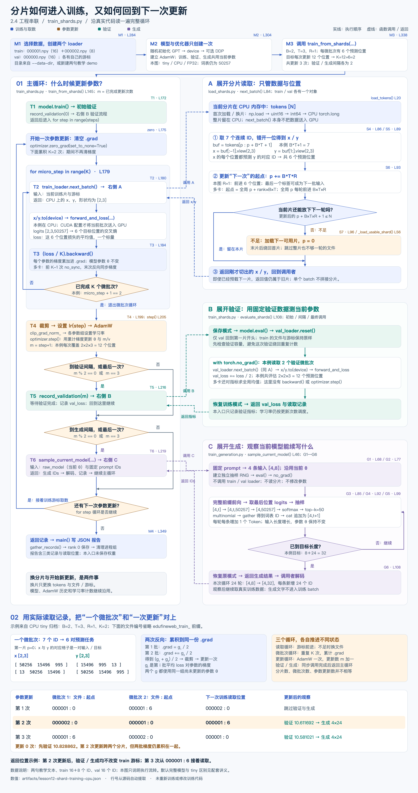
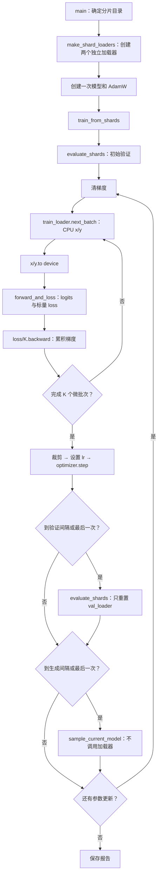

# 2.4 实践（三）：把分片加载器接入完整训练循环

入口：[train_shards.py](train_shards.py)。前面的 `prepare_fineweb.py`、`load_shards.py`、`train_validation.py`、`train_generation.py` 和配套讲义全部保留。

答疑和从原始正文开始的完整复习已合并到[数据处理全流程笔记](docs/fineweb-edu-sharding-notes.md)第十三节，与原 FineWeb-Edu 笔记保持在同一篇。

[打开完整流程图 PNG](docs/diagrams/gpt2-shard-training-flow.png) · [可缩放 SVG](docs/diagrams/gpt2-shard-training-flow.svg) · [读图说明与源码定位](docs/diagrams/gpt2-shard-training-flow.md)



先沿左侧读训练主循环，再看右侧 A/B/C 的函数展开。底部用实际取数记录说明：每微批次有 6 个预测位置，累积 2 批才更新一次；第 2 次更新的两批来自不同分片，验证和生成返回后仍接着原来的训练游标读取。

## 0. 本次解决什么问题

上一块可以从文件取出 x/y，但还没有把它交给训练模型。这次完成下面这条链路：

```text
train 分片 → train_loader.next_batch() → x/y → 计算设备
    → 模型前向 → loss/K → backward（重复 K 次）
    → 梯度同步/裁剪 → 学习率 → AdamW 更新一次
    → 到间隔时验证、生成 → 继续取训练数据
```

学完要能解释：两个加载器在哪里创建、哪里搬运 batch、换片是否会重置参数、验证和生成结束后训练从哪里继续。

这仍是阶段二 → 单元 2 → **2.4 的工程串联**。2.5 HellaSwag 尚未开始；三次短跑不能代表完整预训练或整个 2.4 的实践全部完成。

来源：原视频[约 3:17:58 起的分片读取](https://www.youtube.com/watch?v=l8pRSuU81PU&t=11878s)、[约 3:23:05 起的验证](https://www.youtube.com/watch?v=l8pRSuU81PU&t=12185s)、[约 3:25:06 起的生成](https://www.youtube.com/watch?v=l8pRSuU81PU&t=12306s)，以及作者 [4a63e6a 历史训练代码](https://github.com/karpathy/build-nanogpt/blob/4a63e6a599fea4f78d25e78a4970585ae5c6e27f/train_gpt2.py)。已核对[非官方自动字幕副本](https://github.com/nolimitkun/ai-kol-wiki/blob/main/sources/karpathy/20240609-l8pRSuU81PU/transcript.md)与历史源码，未直接观看视频画面。字幕中把验证的指标累计口误为梯度累计，以实际代码中的 no_grad、无 backward 为准。

| 项目 | 本次使用方式 |
|---|---|
| 模型参数起点 | 每次启动随机初始化；不承接上个脚本的参数，不加载 GPT-2 预训练权重 |
| 默认模型 | GPT-2 124M；`--model-size tiny` 缩小到 2 层、64 维作流程检查，词表仍为 50257 |
| 默认数据 | 两句已核对的教学文本，按整句话分配 train/val；新建 16/16/8 小分片，明确不是 FineWeb |
| 原课数据 | FineWeb-Edu train/val 分片；已有同格式数据时用 `--data-dir` 指定，不自动下载 |
| 训练主干 | 复用权重共享、初始化、梯度累积、DDP、裁剪、调度和 AdamW |
| 模型执行 | eager；训练可选 FP32/BF16，默认自动选择；生成沿用 FP32 |
| 原课的生成状态 | 该历史提交因当时的 compile 问题暂时禁用采样；本地沿用第 14 块已验证的 eager 采样 |
| 观察时机 | 初始验证；默认更新 2、3 次后验证和生成，最后一次额外保证观察 |
| 输出 | 训练、验证、生成及文件/游标记录的 JSON；没有保存模型检查点 |

## 1. 先看代码之间的调用关系



| 代码位置/标记 | 输入 → 输出 | 谁完成什么 |
|---|---|---|
| `main` M1 / `make_shard_loaders` D1 | 目录、B/T/rank → 两个加载器 | 我们组织文件、split 和读取状态 |
| `load_shards.py` S1—S7 | 分片/游标 → CPU x/y `[B,T]` | NumPy 读文件，PyTorch 保存整数 Tensor；我们的代码决定切片和换片 |
| `main` M2 | 配置 → 模型、优化器 | 我们创建一次对象；PyTorch 管理参数和设备 |
| `train_from_shards` T2—T4 | x/y、当前参数 → loss、梯度、新参数 | 我们组织顺序；PyTorch 执行前向、自动求导、裁剪与 AdamW |
| `evaluate_shards` V1—V4 | 当前参数、val 文件 → 平均 loss | 只测量，恢复原模式；不接收优化器 |
| `train_generation.py` G1—G6 | 当前参数、提示词 ID → 生成 ID | 复用已有独立 RNG 采样函数 |
| `main` M4 | 各 rank 的记录 → JSON | 保存学习证据，不是模型权重文件 |

## 2. 两个加载器只创建一次

```python
train_loader = ShardDataLoaderLite(data_dir, B, T, 'train', rank, world_size)
val_loader   = ShardDataLoaderLite(data_dir, B, T, 'val',   rank, world_size)
```

同一个目录里，训练对象只匹配 `edufineweb_train_*.npy`，验证对象只匹配 `edufineweb_val_*.npy`。它们各有自己的 `tokens`、文件编号和游标，不共享读取状态。

| 状态 | train_loader | val_loader |
|---|---|---|
| 文件列表 | 训练文件 | 验证文件 |
| 调用者 | 训练微批次循环 | `evaluate_shards()` |
| 何时 reset | 初始化时；训练循环里不主动 reset | 每次验证开始 |
| 文件读完 | 下一片；末片后绕回 | 同样规则，但一次验证限制在不重复的一轮以内 |

不要在每个训练 step 内重新创建加载器，否则总从第一片的开头取数。也不要在验证时 reset 训练加载器，否则训练会反复回到开头。

新入口额外拒绝 train/val 通过符号链接指向同一个文件，但文件名隔离并不自动保证正文没有重复。正式数据的文档去重仍属于数据准备工作。

## 3. 从 batch 到参数更新

T2—T4 保留先前学过的顺序。下面是单进程阅读版，完整代码还包含 DDP 同步和记录：

```python
optimizer.zero_grad(set_to_none=True)
for micro_step in range(K):
    x, y = train_loader.next_batch()       # 两个 CPU long Tensor，[B,T]
    x, y = x.to(device), y.to(device)      # 只搬当前这一批
    logits, loss = forward_and_loss(model, x, y, device, precision)
    (loss / K).backward()

torch.nn.utils.clip_grad_norm_(raw_model.parameters(), clip_norm)
for group in optimizer.param_groups:
    group['lr'] = lr
optimizer.step()
```

`forward_and_loss` 调用 `model(x)` 得到 `[B,T,50257]` 的 logits，再用 y 算交叉熵。y 已经在加载器里错开一位，**这里不再 shift 一次**。`loss` 是 B×T 个预测位置的平均值。

默认 B=2、T=3、R=1、每次更新 12 个预测位置，因此：

\[
K=\frac{12}{2\times3\times1}=2.
\]

一次更新取两批，每批有 6 个预测位置；两次 backward 的梯度累积后才调用一次 `optimizer.step()`。更新三次共处理 36 个训练预测位置，不包含验证或生成。

GPU 时模型与 x/y 必须位于同一设备；分片的一维完整 Tensor 仍在 CPU。CPU 模式下 `.to(cpu)` 不发生 CPU→GPU 搬运。

## 4. 换片时，训练会发生什么？

**只改变加载器正在读取的数据，模型和优化器继续沿用。** 不重新随机初始化，不重建 AdamW，不清除它的 m/v/step，也不重新开始 warmup。

本次默认两个 train 分片分别有 16、8 个 ID。B2/T3 每批需 7 个 ID，因此第一片提供两批，第二片提供一批，然后绕回。

| 参数更新 | 第一个微批次 | 第二个微批次 | 之后的操作 |
|---|---|---|---|
| 1 | train_000001，起点 0 | train_000001，起点 6 | 更新一次参数 |
| 2 | train_000002，起点 0 | train_000001，起点 0 | 更新一次参数，再验证/生成 |
| 3 | train_000001，起点 6 | train_000002，起点 0 | 更新一次参数，再验证/生成 |

**单个 batch 不跨分片，但一次参数更新使用的多个微批次可以来自不同分片。** 第二次更新正是这个例子。梯度累积窗口由 K 决定，分片边界不会强制结束它。

本例两片一轮提供 18 个输入预测位置，三次更新共走两轮。源文件里还有不足以启动新 batch 的尾部；其中某些 ID 已作为上一批的标签用过。

## 5. 验证为什么需要一个新的函数？

旧验证函数面向一整段内存中的 Token。若只看 `len(val_loader.tokens)`，就只能看到当前文件，无法算出多个 val 文件总共能提供多少批。

新 `shard_inventory()` 读取文件数组形状，逐文件计算：

\[
\text{每片完整轮数}=\max\left(0,\left\lfloor\frac{N-1}{BTR}\right\rfloor\right).
\]

再把各片的完整轮数相加。必须先按片计算，因为我们不跨文件拼接尾部。这里使用 NumPy 内存映射获取数组信息，不将全部分片转换成常驻的 Torch Tensor。

`evaluate_shards()` 的操作：

1. 检查本次验证批数不超过所有 val 文件的一轮容量，避免绕回重复计数。
2. 保存模式，`eval()`，只对 `val_loader.reset()`。
3. `no_grad()` 中逐批取 val 的 x/y，计算各批 loss；可以换到下一验证分片。
4. 平均各批指标；多进程时所有 rank 参与指标归约。
5. 恢复进入前的模型模式，返回 loss 与取数记录。

默认验证在已更新 0、2、3 次时进行，每次固定读取 val 的起点 0、6，共 12 个预测位置。报告记录验证前后的训练游标，两者必须相同。

验证累计的是 **loss 数值**，没有梯度累计或 AdamW 更新。学习率继续由参数更新次数决定，不把 val loss 自动反馈给调度器。

## 6. 生成结束后如何继续训练？

T6 直接调用上一块的 `sample_current_model(raw_model, prompt_ids, ...)`。

输入是当前模型参数和固定提示词；它不调用 train_loader 或 val_loader。内部暂时 eval/no_grad，用独立采样 RNG，退出恢复模型模式。生成的文字只作为报告内容，不追加进训练分片。

之后回到主循环下一次更新，先清上次梯度，再从原 train 游标继续取数。报告也保存生成前后两个加载器的游标，方便直接核对。

## 7. 运行方法

本机先用小模型检查整个流程：

```bash
/Users/guqun/micrograd/venv/bin/python /Users/guqun/micrograd/gpt2_pretrain_lab/train_shards.py --device cpu --model-size tiny
```

省略 `--model-size tiny` 时，默认构造完整 GPT-2 124M，仍从随机参数开始。脚本默认另建教学分片目录，不覆盖之前的 demo，也不下载 FineWeb。报告默认写入项目 `.cache/runtime-check/lesson12-shard-training.json`。

已有分片时，在项目目录执行以下命令，并替换示意目录。B/T/K 和验证批数应与分片容量相容：

```bash
/Users/guqun/micrograd/venv/bin/python train_shards.py \
  --data-dir /实际的分片目录 \
  --device cpu --model-size tiny \
  --batch-size 2 --seq-len 32 --total-tokens 512 --val-batches 2
```

`--data-dir` 中必须同时存在 train/val 文件，并使用与当前 GPT-2 模型相匹配的 Token ID；单凭文件名不能证明来源是 FineWeb。此前 5+3 个 ID 的准备示例不足以组成这里的默认 batch，应使用新入口默认创建的教学数据或足够大的已有分片。

## 8. 本机已经核对到哪里

单进程 CPU/FP32、tiny 3,324,736 参数、B2/T3/R1/K2 的三次更新已跑通：

| 已更新次数 | 本次更新使用的训练 loss | 当前参数的验证 loss |
|---|---:|---:|
| 0 | — | 10.828862 |
| 1 | 10.789542 | — |
| 2 | 10.358176 | 10.611692 |
| 3 | 10.125737 | 10.581021 |

更新 2、3 次后各生成 4 条、每条新增 24 个 Token。原始记录见 [CPU 报告](artifacts/lesson12-shard-training-cpu.json)。训练 loss 来自更新前的微批次，验证 loss 来自更新后的当前参数；两者不是同一批数据上的同一时刻测量。

4 项新增行为检查与 9 项已有分片/生成检查通过。新检查覆盖：跨多个 val 文件、一次验证不重复绕回、验证模式恢复、文件/游标隔离，以及带非零 Dropout 时加入验证和生成仍与纯训练保持相同参数、梯度、AdamW 状态及训练 RNG。

另跑了真实双进程 CPU/Gloo：每进程 B1/T3，R2/K2，仍是每次更新 12 个预测位置。两个 rank 的文件名相同、片内起点分别相差 3，合起来与单进程 B2/T3 的数据一致。三次训练和三次验证的 loss 与单进程最大差均为 `9.5367431640625e-07`。这是 CPU 多进程检查，不是 GPU 提速或 CUDA/NCCL 实测。见 [双进程报告](artifacts/lesson12-shard-training-ddp-cpu.json)与[核对记录](artifacts/lesson12-shard-training-alignment.json)。

在项目目录复现该 CPU 对照：

```bash
GLOO_SOCKET_IFNAME=lo0 /Users/guqun/micrograd/venv/bin/python -m torch.distributed.run \
  --nnodes=1 --nproc_per_node=2 --master_addr=127.0.0.1 --master_port=29541 \
  train_shards.py --device cpu --model-size tiny \
  --batch-size 1 --seq-len 3 --total-tokens 12 \
  --report .cache/runtime-check/lesson12-shard-training-ddp.json
```

`lo0` 是本机 macOS 的回环接口，此命令用于同一台机器的两个 CPU 进程。正式多机使用共享可访问的真实分片目录，不能依赖 rank 0 在本机生成的教学目录；本次没有测试多机。

两句教学文本用于说明程序流转，数量和覆盖面不足以衡量真实语言能力。它不是实际 FineWeb-Edu 实跑；本次小模型结果也不代替用户的完整 124M 训练或 CUDA/NCCL 实践。2.4 保持未整体完成，2.5 尚未开始。
