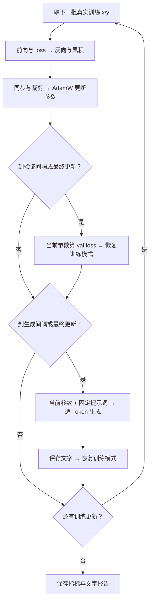

# 知识块 14：在训练过程中定期生成文本

所属：阶段二 → 单元 2「预训练工程：复现 GPT-2」→ 2.4「多卡与数据」。

## 0. 这次解决什么问题

上一块已经可以打印训练 loss 和验证 loss。但数字下降以后，模型究竟会写出什么文字？是否只会重复、是否开始形成句子？这次让**正在训练的同一个模型，隔一段时间续写同一个提示词**，保留文字供人观察。

已经学过的“最后位置 logits → 选择 Token → 接回输入”继续使用。这次新增的是把生成放在训练循环的正确位置，并保护训练状态。学完应能说明：用的是哪一份参数、为什么生成不更新参数、在哪里恢复训练，以及为什么使用独立的采样 RNG。

本块新建 [train_generation.py](train_generation.py)，保留上一节 [train_validation.py](train_validation.py) / [lesson13.md](lesson13.md) 和之前的 [generate_text.py](generate_text.py) / [lesson03.md](lesson03.md)，没有覆盖旧代码。

配套[完整代码流转图](docs/diagrams/gpt2-periodic-generation-flow.md)（[PNG](docs/diagrams/gpt2-periodic-generation-flow.png) / [可缩放 SVG](docs/diagrams/gpt2-periodic-generation-flow.svg)）：左侧对应训练与验证的执行顺序，右侧展开 G1—G6 的生成调用及返回；底部用真实运行记录说明第 2、3 次更新为什么生成，以及一次生成中的张量形状和实际 ID。

来源是 [Karpathy 视频约 3:25:06—3:28:07](https://www.youtube.com/watch?v=l8pRSuU81PU&t=12306s)、[非官方自动字幕副本](https://github.com/nolimitkun/ai-kol-wiki/blob/main/sources/karpathy/20240609-l8pRSuU81PU/transcript.md)以及作者的 [4a63e6a 历史源码](https://github.com/karpathy/build-nanogpt/blob/4a63e6a599fea4f78d25e78a4970585ae5c6e27f/train_gpt2.py)。已核对字幕和历史代码，未直接观看视频画面。

该历史版本把采样代码移入主循环，设计为每 100 次更新生成一次，跳过初始模型；随后因为作者当时遇到 `torch.compile` 错误，在条件里加入 `and False` 暂时禁用。这是当时的实现状态，不能据此认为今天 `torch.compile` 一概不能生成。本项目使用此前的 eager 模型，实际启用生成观察。

| 项目 | 原课这一段 | 本地教学配套 |
|---|---|---|
| 模型参数 | 随机初始化后逐步训练，生成使用当前参数 | 相同；不加载预训练权重，不重新创建生成模型 |
| 数据 | FineWeb-Edu train/val 分片 | 沿用 Tiny Shakespeare 前 90%/后 10% 位置切分 |
| 模型与执行 | GPT-2、对齐词表 50304、CUDA，采样/compile 问题见上文 | 默认完整 GPT-2、词表 50257；可选 tiny；eager；支持已有 CPU/Gloo 或 CUDA/NCCL 入口 |
| 生成时机 | 原设计每 100 次更新，跳过 0；该提交实际禁用 | 默认在已更新 2、3 次时生成；最后一次额外保证生成，跳过 0 |
| 提示词与条数 | `Hello, I'm a language model,`；每 rank 4 条 | 保留原提示词和每 rank 4 条 |
| 长度与选取 | 含 8 个提示 Token 共 32 个；top-k=50 | 默认新生成 24 个，总计 32；top-k=50、温度 1 |
| 参数精度 | 该采样分支没有 autocast | 生成 FP32；训练精度另由 `--precision` 控制 |
| 停止 | 固定长度，没有 EOS 提前停止 | 保留；另限制总长度不超过位置表 |
| 采样随机数 | 独立 Generator，种子 `42 + rank` | 相同；可用 `--sample-seed` 改基数 |
| DDP 生成 | 通过 model 包装调用 | 各 rank 调用自己的 raw_model，生成无梯度通信；训练/验证仍使用 DDP 包装 |

当前验证记录仅证明本机 CPU 流程；不代表 CUDA/NCCL 实测或完整预训练完成。

## 1. 先分清三条分支

| 分支 | 输入 | 输出 | backward / 参数更新 |
|---|---|---|---|
| 训练 | 训练集的真实 x/y | 训练 loss、梯度、新参数 | 有 |
| 验证 | 留出的真实 x/y | 验证 loss | 无 |
| 生成观察 | 固定提示词，之后逐次接上自己选出的 ID | 一段续写文本 | 无 |

验证衡量当前模型给真实目标的概率；生成展示它顺着自己选出的内容写下去的结果。文字样本补充数值观察，但一段写得通顺的文字不能代替验证集指标。

生成文本仅打印、写入实验报告，**没有放回训练集，也不作为下一个训练 batch 的标签**。本节没有自动打分、早停或根据文字修改学习率的机制。



这里每次到生成节点都会**从原提示词重新开始**。例如更新 100 次时用参数 θ₁₀₀ 续写，更新 200 次时用 θ₂₀₀ 重新续写；不是把上次生成的长句接着写。固定提示词、采样设置和种子，才能更好地观察参数变化带来的差别。

## 2. 一次生成内部：输入、计算与返回

入口为 `sample_current_model(raw_model, prompt_ids, ...)`。`raw_model` 就是训练对象的本体，没有复制或加载新模型。源码标记 G1—G6 对应：

| 标记 | 做什么 | 数据与目的 |
|---|---|---|
| G1 | 建立独立 Generator；复制提示词 S 条 | `[T0] → [S,T0]`；S 是生成条数，与训练 batch size 无关 |
| G2 | 保存原模式，调用 `eval()`，进入 `no_grad()` | 关闭 Dropout、不建立反向图；保留当前参数和已有梯度 |
| G3 | 当前前缀前向，取最后位置的 logits | `[S,T] → [S,T,V] → [S,V]` |
| G4 | softmax → top-k → 按权重抽样 → 找回词表 ID | `[S,V] → [S,k] → [S,1]`；每条序列本轮各追加一个 ID |
| G5 | 把新 ID 接到前缀，回到 G3 | `[S,T] + [S,1] → [S,T+1]`；输入变长，参数不变 |
| G6 | 达到长度上限后返回，恢复调用前的模式 | 返回全部 ID 和过程记录；外层解码、打印与存报告 |

以默认配置为例：第一次前向输入 `[4,8]`，输出 `[4,8,50257]`，取最后位置得到 `[4,50257]`。每行抽一个 ID 后，输入变为 `[4,9]`。重复到 `[4,32]`，就得到 4 条续写。4 条可以通过 batch 维一起计算；每条内部仍然逐 Token 生成。

```python
logits = raw_model(ids)                    # 当前参数；本项目只返回 logits
probs = F.softmax(logits[:, -1, :], dim=-1)
top_probs, top_ids = torch.topk(probs, top_k, dim=-1)
selected = torch.multinomial(top_probs, 1, generator=sample_rng)
next_ids = torch.gather(top_ids, -1, selected)
ids = torch.cat((ids, next_ids), dim=1)
```

`selected` 是 top-k 列表内部的下标；`gather` 把它转换回原词表 ID。截取的 k 个概率总和可以小于 1，`multinomial` 会按这些非负权重的相对比例抽样。

这一分支没有 y、交叉熵、backward 或 optimizer.step。它不是把训练 batch 再训练一次。本例没有 KV cache，每轮重算完整前缀；直接追加 ID，不必每轮转成文字再重新分词。

## 3. 为什么采样也要保护训练状态

`eval()` 和 `no_grad()` 已经在验证循环学过：前者切换模块行为，后者关闭反向图记录。生成结束后，`finally: raw_model.train(was_training)` 恢复原模式，下一轮继续训练。

新增问题是**随机数状态**。假如训练中的 Dropout 和生成抽样使用同一个全局随机数序列，那么多生成几次，就可能改变后面 Dropout 取到的随机数。模型参数虽然没在生成期间更新，后续训练的具体轨迹仍可能改变。

因此使用：

```python
sample_rng = torch.Generator(device=device).manual_seed(42 + rank)
selected = torch.multinomial(top_probs, 1, generator=sample_rng)
```

这里重置的是 `sample_rng` 自己的状态，不是全局 `torch.manual_seed(...)`。本例每次观察都重新建立相同种子的局部 Generator；不同 rank 的种子不同，同一 rank 在不同训练时刻保持相同。相同种子不保证不同设备、版本、模型参数下生成相同文字。

当前课程训练 Dropout 为 0；独立 RNG 仍保留为合理的训练/观察边界。行为测试另使用非零 Dropout，检查插入生成以后参数、梯度、AdamW 状态、取数顺序与随机状态仍与只训练/验证的基线一致。

## 4. 从哪里读代码、怎样运行

建议顺序：`sample_current_model()` 的 G1—G6 → `train_with_generation()` 中的 `record_generation()` → 主循环 T4 → `main()` 的参数初始化与报告。

先用小模型检查执行顺序：

```bash
/Users/guqun/micrograd/venv/bin/python /Users/guqun/micrograd/gpt2_pretrain_lab/train_generation.py --device cpu --model-size tiny
```

完整 GPT-2 可将 `--model-size tiny` 改为 `--model-size gpt2`，运行成本更高。这两种模式都从随机参数开始。每次启动会新建模型：上一节 JSON 只保存指标，没有可恢复的模型权重，不能用它续训。

默认顺序：

```text
验证：已更新 0 次
训练：更新 1 次
训练：更新 2 次
验证：已更新 2 次
生成：用更新 2 次后的参数续写 4 条文字
训练：更新 3 次
验证：已更新 3 次
生成：用更新 3 次后的参数，从同一个提示词重新续写 4 条文字
```

`--sample-every 2` 的 2 是参数更新次数；`--max-new-tokens 24` 的 24 是每条续写新增的 Token 数，两者不是同一个循环。生成出来的 Token 也不计入训练的 `total_tokens` 或学习率调度。

默认报告写入 `.cache/runtime-check/lesson14-report.json`，保留第 13 块报告；不保存 checkpoint。生成只记录在报告的 `ranks[*].generation` 中。

## 5. 已核对的本机结果与学习边界

本机已运行 tiny / CPU / FP32：2 层、64 维、3,324,736 参数，B=2、T=32、K=8，3 次参数更新。在更新 2、3 次时，各生成 4 条、每条新增 24 个 Token，见 [实际报告](artifacts/lesson14-cpu-report.json)。

| 已更新次数 | 验证 loss | 生成观察 |
|---|---:|---|
| 0 | 10.799194 | 跳过随机初值生成 |
| 2 | 10.646638 | 4 条续写 |
| 3 | 10.610084 | 重新生成 4 条续写 |

输出仍是缺乏连贯含义的零散文本。三次更新只验证代码流转，不能据此声称模型已经会写作，或比较训练方案的质量。

4 项行为测试通过：当前权重/最后位置/追加流程；参数、已有梯度、AdamW 与 RNG 保留；含非零 Dropout 的训练轨迹一致；异常恢复模式与上下文边界。CPU 小模型结果不代表 CUDA/NCCL 验证。此处是配套检查，不自动记为用户已经掌握。

2026-10-27 用户已亲自运行默认完整 GPT-2 并反馈“大概了解了”，本块记为已学习、初步理解、单进程 CPU 实践完成。完整模型三次训练与验证记录和上一块用户报告完全一致；更新 2、3 次后各生成 4×24 个新 Token，主要是换行与逗号，符合流程检查预期，不代表生成质量合格。详见[复习笔记](docs/periodic-generation-notes.md)（[Notion](https://app.notion.com/p/406eaea31414814ea785fee733047ffc)）和[用户报告](artifacts/lesson14-user-gpt2-cpu-report.json)。上述 tiny 表格与图仍保留为配套示例。

下一步 2.5 HellaSwag 评测；FineWeb-Edu 分片实作、用户多进程与 CUDA 工程待办继续保留，2.4 整节尚未完成，完整段落计数仍为 1/5、5/32。
