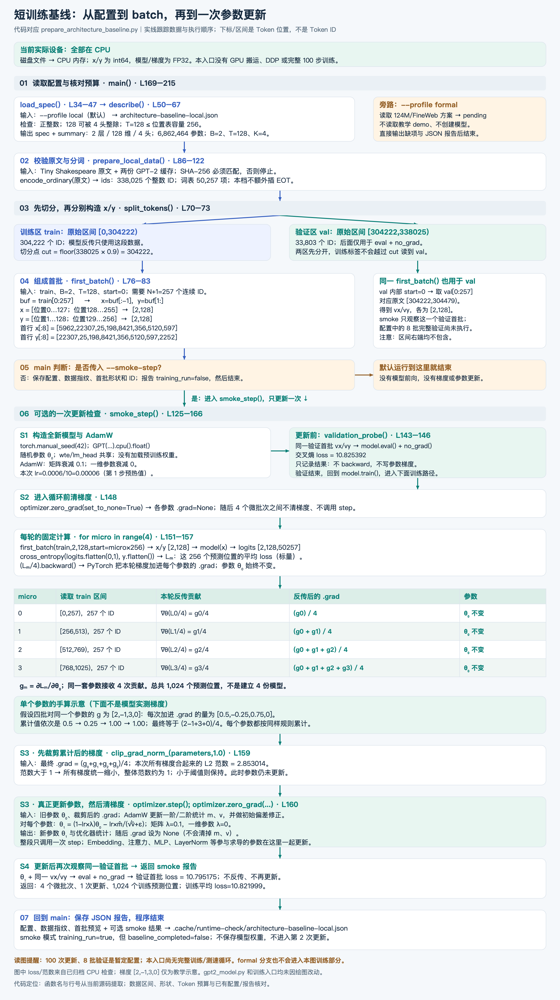

# 单元 3 · 3.1：短训练基线的模型与数据配置

后续已新增 [两份独立运行入口及完整短训练对照讲义](lesson17-architecture-comparison.md)。本篇的准备入口仍保持原来的检查用途；完整训练在新文件中进行。

配套：[代码流程图（SVG，可放大）](docs/diagrams/architecture-baseline-code-flow.svg) · [PNG 图片](docs/diagrams/architecture-baseline-code-flow.png) · [读图与代码定位](docs/diagrams/architecture-baseline-code-flow.md)。图中展开配置、数据切分、batch 构造及可选的一次梯度累积更新；默认运行不会进入训练部分。



## 1. 这次先做什么

确定后续结构改造的比较起点：使用什么模型、喂什么数据、一个更新处理多少预测位置，以及如何保证前后可比。本节新增独立配置和准备入口，保留先前各课代码。

来源边界：结构学习承接 Raschka 的 [GPT → Llama 配套材料](https://github.com/rasbt/LLMs-from-scratch/tree/main/ch05/07_gpt_to_llama) 与官方模型实现；训练管线沿用前面学过的 build-nanogpt 思路。本节的两档配置、预算和公平比较规则属于既定项目实验设计，不是视频原样超参数，也不是声称作者跑过相同实验。

本次入口只完成配置检查、数据编码/隔离和首批展示；可选执行一次更新以检查管线。完整短训练、测速、检查点保存放到后续独立入口，不把一次更新当作基线已经完成。

## 2. 结合当前机器，分清两档用途

当前课程环境为 PyTorch 2.2.2，检测到 CUDA=False、MPS=False，实际检查使用 CPU/FP32。项目已有 Tiny Shakespeare 原文和 GPT-2 分词缓存；现有 FineWeb 分片目录主要是两句话重复的教学 demo，不能用作结构对照语料。

| 设置 | 本机流程检查 | 计划中的正式结构对照 |
| --- | --- | --- |
| 配置文件 | configs/architecture-baseline-local.json | configs/architecture-baseline-124m.json |
| 模型 | GPT-2 风格缩小版 | GPT-2 124M |
| Block 数 | 2 | 12 |
| 隐藏维度 D | 128 | 768 |
| 注意力头数 | 4 | 12 |
| 每头维度 | 32 | 64 |
| MLP 中间宽度 | 512 | 3072 |
| 位置表容量 | 256 | 1024 |
| 参数量（共享权重去重） | 6,862,464 | 124,439,808 |
| 词表 | GPT-2，50,257 项，不补齐 | 相同 |
| 参数起点 | 随机初始化 | 随机初始化 |
| 数据 | 已有 Tiny Shakespeare | FineWeb-Edu sample-10BT 的固定子集，待准备 |
| 当前用途 | 读懂代码、验证数据与更新管线 | 后续 E1—E5 等结构对照 |

不能把两个不同尺寸、不同语料的结果横向比较。未来的“原结构 vs 改结构”应在同一档内部、同一个固定实验协议下比较。

两档均沿用项目的 gpt2_model.GPT：LayerNorm、带 bias 的投影、学习式绝对位置表、MHA、GELU、两次残差、最终 LayerNorm；lm_head 与 Token Embedding 共享权重，lm_head 没有 bias。还没有换成 RMSNorm/RoPE/SwiGLU/GQA/QK-Norm。

Dropout 均设为 0；显式 QK → softmax → V 的注意力实现、FP32 和未启用 compile 作为当前清楚可读的起点。以后如果为 GPU 引入 BF16/SDPA/compile，需要两边统一，并重新记录基线，不能把计算后端变化混入结构比较。

使用 GPT(config, tie_embeddings=True, gpt2_init=True) 初始化：线性/Embedding 标准差 0.02，残差输出投影按 1/√(2L) 缩放。这里“GPT-2”是结构名称，不表示加载 GPT-2 的预训练参数；程序不读取 model.safetensors。

## 3. 本机数据：先切分，再构造输入与答案

沿用固定课程版本 Tiny Shakespeare，原文 SHA-256：

```text
86c4e6aa9db7c042ec79f339dcb96d42b0075e16b8fc2e86bf0ca57e2dc565ed
```

使用项目已有 GPT-2 分词资产，由 tiktoken.encode_ordinary 编码整篇原文，不在开头或末尾额外加 EOT。词表仍有 50,257 项，EOT 只是本次连续莎剧数据没有额外插入。

本次实测总共 338,025 个 Token，按 Token 位置切成：

- train：`[0,304222)`，304,222 个 Token。
- val：`[304222,338025)`，33,803 个 Token。

区间右端不包含。先切出两段，再在各段内构造 x/y，训练最后一个标签不能跨进验证区。这是位置隔离，不等于做了文档级去重，不能宣称训练/验证没有重复表达。

本机 `B=2、T=128`，每个微批次有 256 个预测位置。取 257 个连续 ID：前 256 个排为 x，后 256 个排为 y，二者都是 `[2,128]` 的整数张量。

```text
原文 → GPT-2 编码 → 338,025 个整数 ID
                         ↓ 先分开
             train                    val
               ↓                       ↓
       前 257 个 ID             固定验证窗口
               ↓                       ↓
        x = buf[:-1]             同样构造 x/y
        y = buf[1:]              eval + 不求梯度
               ↓
         reshape [2,128]
               ↓
    model(x) → logits [2,128,50257]
               ↓ 和 y 计算交叉熵
             loss
```

实测首行前八项：

```text
x: [5962, 22307, 25, 198, 8421, 356, 5120, 597]
y: [22307, 25, 198, 8421, 356, 5120, 597, 2252]
```

后续训练按顺序向前取不同微批次，不能每次都训练第一批。尾部不足时只在本 split 内回绕，不从另一个 split 补数据；每次验证重新回到同一窗口。

计划每次验证 8 批，即 2,048 个预测位置，读取验证区前 2,049 个 ID。当前一次更新检查只使用验证首批 256 个预测位置作为探针，不把它称为完整验证集 loss。

## 4. 训练量与优化器的初始方案

| 设置 | 本机流程档 | 124M/FineWeb 档 |
| --- | --- | --- |
| 微批次 B×T | 2×128=256 | 4×256=1024 |
| 设备进程数 R | 1 | 1 |
| 累积微批次数 K | 4 | 32 |
| 每次参数更新的预测位置 | 1,024 | 32,768 |
| 暂定更新次数 | 100 | 1,000 |
| 暂定训练 Token 总量 | 102,400 | 32,768,000 |
| 学习率预热更新数 | 10 | 100 |
| 每隔多少更新验证 | 20 | 100 |
| 每次验证预测位置 | 2,048 | 65,536 |

更新预算属于测速前的初始方案，配置明确标为 proposed_until_benchmark。本机预算约为训练区 Token 数的 0.337 倍，足以学习管线，不是训练出成熟语言模型。正式预算也只是受算力约束的短训练预算，不是最优训练量或完整预训练。

优化器暂统一：AdamW，betas=(0.9,0.95)，epsilon=1e-8；矩阵权重衰减 0.1，一维 bias/LayerNorm 参数不衰减；全局梯度范数裁剪为 1.0。峰值学习率 6e-4，最低 6e-5，先线性预热、后余弦衰减。正式入口需在同样的更新编号约定下实现调度；本节 smoke 只用第一步预热学习率。

计算关系：

```text
每次更新 Token 数 = B × T × R × K
训练 Token 总量 = 每次更新 Token 数 × 参数更新次数
```

K 次 loss 分别除以 K 后反传，梯度累积完成才裁剪并调用一次 optimizer.step()。验证 Token 不计入训练预算。

## 5. FineWeb 正式档还缺什么

配置保留 FineWeb-Edu sample-10BT 方向，但当前 revision 和 manifest 明确为 null，状态 pending。还需：

1. 固定数据版本、子集文档 ID 和读取顺序。
2. 按文档 ID 分开 train/val 后，再分别做 GPT-2 编码和分片。不能先拼成一条流、任意切 shard 就声称文档隔离。
3. 文档前加 EOT=50256，正文按普通文本编码，磁盘使用 uint16 `.npy`。同一文档可能跨训练分片，但不能同时落入训练和验证分区。
4. 归档每片 SHA-256、长度、来源及文档清单；从固定文件顺序读取，沿用尾部不足一批则换片、不跨 shard 补齐的规则。
5. 确认可用批次数覆盖预算。训练至少需要 32,768,001 个 ID、验证至少 65,537 个 ID；若分成多片，还要加上各片尾部跳过的损耗，不能只看原始总 Token 数。

`--profile formal` 只显示方案和缺项，不自动下载数据，不拿 demo 或莎剧替代 FineWeb，也不创建 124M 模型。数据下载和正式训练是后续明确的工作。

## 6. 怎么运行新文件

依赖沿用 `requirements-data.txt`（包含原课程依赖与 tiktoken 0.14.0），当前课程环境已具备。使用项目内已校验的两份 GPT-2 分词缓存，入口不自动联网下载。

在项目目录下使用已装依赖的课程解释器。先运行默认检查：

```bash
/Users/guqun/micrograd/venv/bin/python prepare_architecture_baseline.py
```

它会输出模型规格、数据区间、首批形状/ID 和报告路径；不会创建模型或更新参数。

可选，一次完整更新检查：

```bash
/Users/guqun/micrograd/venv/bin/python prepare_architecture_baseline.py --smoke-step
```

这会创建本机小模型，顺序读取四个微批次，累积反传、裁剪、更新一次，再看同一个验证首批。结束后不保存权重，不影响未来从相同种子重新初始化的正式运行。

查看正式档方案：

```bash
/Users/guqun/micrograd/venv/bin/python prepare_architecture_baseline.py --profile formal
```

当前入口不接受完整训练步数参数。这样“先确认模型与数据”不会误触长时间训练。下一节再建立独立测速/训练入口。

## 7. 代码阅读对应

| 顺序 | 本项目函数 | 输入 → 输出 | 主要工具 |
| --- | --- | --- | --- |
| C1 | load_spec | profile 名 → 已检查的配置字典 | Python JSON |
| C2 | describe | 模型/训练配置 → 参数量、预算 | Python 算术，无需分配模型 |
| D3 | prepare_local_data | 原文/分词缓存 → train、val、数据指纹 | tiktoken + Python |
| D1 | split_tokens | 完整 ID 列表 → 独立两段 | Python 切片 |
| D2 | first_batch | 一段 ID、B/T/start → x/y | PyTorch Tensor、view |
| S1 | smoke_step 的构造部分 | 配置 → 新模型/优化器 | 项目 GPT + PyTorch AdamW |
| S2 | smoke_step 的微批次循环 | 4 个不同 x/y → 累积梯度 | 项目 forward；PyTorch loss/backward |
| S3 | 裁剪、step | 累积梯度 → 更新后参数 | PyTorch |
| S4 | validation_probe | 同一验证首批 → loss 标量 | eval、no_grad、交叉熵 |

QK-Norm 等结构本次还没有加入。后续改造应保持这份基线可独立运行。

## 8. 公平比较的约定

- 同档实验保持 tokenizer、train/val 数据指纹、顺序、B/T、有效 batch、训练 Token 总量和验证窗口一致。
- 固定随机种子及初始化实现。结构变化会改变随机数消费顺序；同一个 seed 不保证未修改层初值自动相同。后续需按参数名/形状复制共同部分的初始值，新增参数单独初始化并记录。
- 每个独立结构实验从新初始化开始，不能让改造组额外继承基线已经训练过的参数和优化器状态。
- 记录硬件、精度、实现/配置哈希和后端。若批大小因显存调整，应通过 K 保持有效 batch，验证集按相同 Token 窗口，仍注明微批大小改变会影响测速。
- 先做固定超参数对照，再讨论是否为某结构单独调参。一次短跑小差异不能直接宣称胜负。

## 9. 本次实际验证

CPU/FP32 小模型，seed=42，四个微批次共 1,024 个预测位置，完成一次参数更新：平均训练 loss=10.821999；同一验证首批 loss=10.825392 → 10.795175。它只证明此配置的管线运行成功，不是完整 100 次短训练结果，也不是性能基线。

四项检查覆盖切分后标签不泄漏、Token 预算、共享权重参数量与正式档 pending 状态。旧 Python 教学文件保持原样。

核对报告：`artifacts/architecture-baseline-local-check.json`；正式方案：`artifacts/architecture-baseline-formal-plan.json`。下一步先测速，再决定是否调整暂定训练预算并锁定对照协议。
