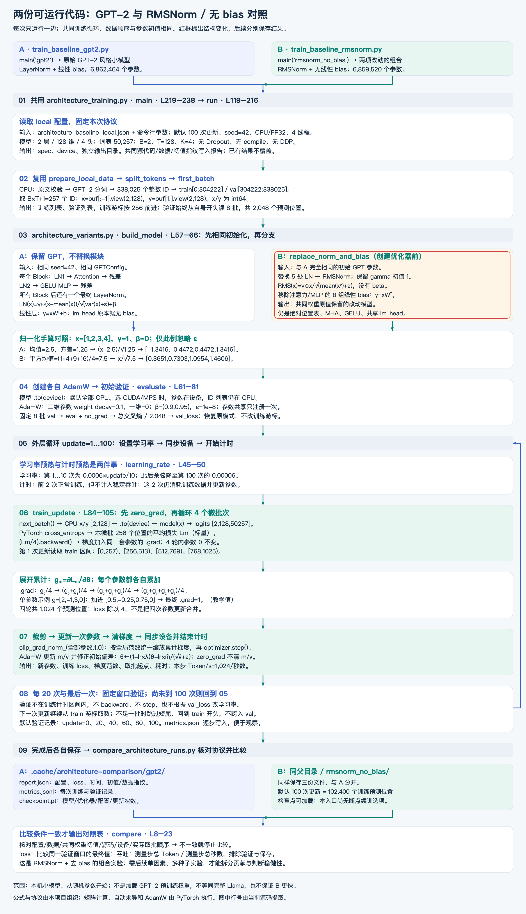

# 单元 3：GPT-2 与 RMSNorm / 去 bias 的短训练对照

本节将已学结构差异变成可以分别运行的两份实验。A 保留 GPT-2；B 将所有 LayerNorm 换成 RMSNorm，并去掉注意力与 MLP 线性层的 bias。两者从随机参数开始，使用本机小模型和相同的 Tiny Shakespeare 数据。

这是两项修改的**组合实验**。结果不能单独归因于 RMSNorm；也不是完整 Llama/Qwen。原来的所有课程入口和 `gpt2_model.py` 均保留。

来源：[Raschka：GPT → Llama 配套材料](https://github.com/rasbt/LLMs-from-scratch/tree/main/ch05/07_gpt_to_llama)、[RMSNorm 原论文](https://arxiv.org/abs/1910.07467)。本节的小模型、莎剧数据、100 次更新和配对初始化是项目教学实验设计，不是原视频或论文的原样训练配置。

## 1. 先运行两边，再比较

使用已经装好依赖的课程解释器。以下命令可在任意目录执行；两次训练请顺序执行，避免同时争抢计算资源影响吞吐统计。

**A：GPT-2 基线**

```bash
/Users/guqun/micrograd/venv/bin/python /Users/guqun/micrograd/gpt2_pretrain_lab/train_baseline_gpt2.py
```

**B：RMSNorm + 无线性 bias**

```bash
/Users/guqun/micrograd/venv/bin/python /Users/guqun/micrograd/gpt2_pretrain_lab/train_baseline_rmsnorm.py
```

**读取报告并比较**

```bash
/Users/guqun/micrograd/venv/bin/python /Users/guqun/micrograd/gpt2_pretrain_lab/compare_architecture_runs.py
```

默认两边各运行 100 次参数更新、102,400 个训练预测位置。输出在项目 `.cache/architecture-comparison/gpt2/` 和 `.cache/architecture-comparison/rmsnorm_no_bias/`，分别包含：

| 文件 | 用途 |
| --- | --- |
| `metrics.jsonl` | 每次更新及定期验证的日志，训练中逐步写入 |
| `report.json` | 完成后保存配置、数据指纹、参数量、完整指标和汇总 |
| `checkpoint.pt` | 当前模型、优化器、配置及更新次数；不是预训练权重 |

已有结果不会覆盖。重跑时用 `--output` 指定新目录；比较工具相应传入 `--gpt2 路径/report.json --modified 路径/report.json`。失败或中断的目录可能只含日志，没有完成报告，不应当作完成实验。

若只想快速核对，可以给两条训练命令都加 `--steps 3`，并各自选择新输出目录；这时学习率预热自动变成 1 次，实际协议记录到报告。3 次与 100 次训练不允许直接比较。

默认是 CPU/FP32、4 个 CPU 线程。也支持 `--device cuda` 或 `--device mps`，但需当前解释器确实支持对应设备；本次已验证的范围是 CPU。两边设备/线程/步数/seed 等必须相同。MPS 与 CUDA 实测仍待补。

## 2. 图和代码怎样对应

[流程图 SVG（可放大）](docs/diagrams/architecture-comparison-training-flow.svg) · [PNG](docs/diagrams/architecture-comparison-training-flow.png)



两个入口都很短，因为它们只决定模型版本；训练逻辑共用，避免复制两遍以后意外产生差异。阅读时先看下面这条调用链，不必重新逐行研究分词器或配置解析：

```text
train_baseline_gpt2.py                 train_baseline_rmsnorm.py
main('gpt2')                          main('rmsnorm_no_bias')
              \                      /
                architecture_training.main
                           ↓
                          run
                           ├─ prepare_local_data：相同数据和切分
                           ├─ build_model：选择 A/B 结构
                           ├─ AdamW + SequentialBatches
                           ├─ evaluate：初始验证
                           └─ 更新循环
                               ├─ learning_rate
                               ├─ train_update：四轮反传、一次更新
                               └─ evaluate：每 20 次及最后一次
                           ↓
                 report + checkpoint
                           ↓
                 compare_architecture_runs
```

| 图中位置 | 打开哪个文件 / 函数 | 关注的输入和输出 |
| --- | --- | --- |
| 01、02 | [architecture_training.py](architecture_training.py) 的 `run` | 配置、原文 → train/val ID 列表、实验协议 |
| 03 红框 | [architecture_variants.py](architecture_variants.py) 的 `build_model`、`replace_norm_and_bias`、`RMSNorm.forward` | 相同初始 GPT → A 原样保留 / B 替换模块 |
| 04、08 | `evaluate` | 同一验证窗口、新参数 → 平均验证 loss；不更新模型 |
| 05 | `learning_rate` 与 `run` 的外层循环 | 更新编号 → 当前学习率与计时边界 |
| 06、07 | `SequentialBatches.next_batch`、`train_update` | 四批 x/y → 累计梯度 → 更新后的参数 |
| 09 | `run` 收尾及 [compare_architecture_runs.py](compare_architecture_runs.py) | 两边报告 → 协议检查与指标对照 |

## 3. 两边究竟改了哪里

| 部位 | A：GPT-2 | B：本次改动 |
| --- | --- | --- |
| 每个 Block 的 Norm1/Norm2 | LayerNorm：减均值、除标准差、乘 gamma、加 beta | RMSNorm：除均方根、乘 gamma |
| 最后一个 Block 后的归一化 | LayerNorm | RMSNorm |
| Attention QKV 与输出投影 | 有 bias | 无 bias |
| MLP 两个线性层 | 有 bias | 无 bias |
| 位置、注意力、激活、输出头 | 学习式绝对位置、MHA、GELU、共享 wte/lm_head | 相同 |
| 参数量 | 6,862,464 | 6,859,520 |

两层 Block 的 4 个内部归一化，加最终归一化，共替换 5 个模块。删掉的参数共 2,944 个：5×128 个归一化 beta，以及两层共 2×9×128 个线性 bias。gamma 仍然可训练。

`RMSNorm.forward` 的输入/输出都是 `[B,T,128]`：

```python
inverse_rms = torch.rsqrt(x.square().mean(dim=-1, keepdim=True) + self.eps)
return x * inverse_rms * self.weight
```

`self.weight` 就是逐维 gamma，初始为全 1。这里没有 QK-Norm：替换的是原来 Block 输入/MLP 前/最终的归一化，不是在拆头后新增 Q、K 的归一化。

线性 bias 通过 `register_parameter('bias', None)` 真正移除。它不再出现在参数集合中，也不会被优化器更新；不是每轮强制把一个仍存在的参数设为零。

## 4. 为什么两边共同参数初值能完全相同

仅仅用相同 seed、分别构造两个不同结构，可能因随机数消耗顺序不同而得到不同权重。本课先在两边用相同 seed 构造同一个 GPT，再在 B 上替换归一化、移除 bias。共同的矩阵和 gamma 数值保留，随后才创建 AdamW。

`common_parameter_digest()` 对所有非 bias 参数的名称、形状、初值计算指纹。比较程序检查这个指纹一致，避免把不同初始化混入结构比较。两边不是共享同一个运行中的模型：它们是两个独立进程，训练后权重各自变化。

同一初值不意味着初始 logits/loss 相同：LayerNorm 和 RMSNorm 处理同一向量的结果本来就不同。图中 `[1,2,3,4]` 的例子展示这个差异。

## 5. 一次更新怎样执行

沿用前课 `B=2,T=128,K=4`。每批产生 256 个预测位置，四批合成一次更新的 1,024 个预测位置。

```text
设置本次学习率 → 清梯度
    ↓
微批 0：取 x/y → model(x) → CE → (loss/4).backward()
微批 1：取下一批 → 同上；累加 .grad
微批 2：取下一批 → 同上；累加 .grad
微批 3：取下一批 → 同上；累加 .grad
    ↓
全局梯度范数裁剪到最多 1
    ↓
AdamW.step()：更新一次参数和 m/v
    ↓
清梯度，保留参数与 m/v → 下一次更新
```

微批之间参数不变。相邻取批窗口共用一个边界 ID，它是上批末尾标签、下批首个输入，不表示重复计算同一个预测位置。数据不足一批时跳过短尾，回到 train 开头；不从 val 补齐。

## 6. 如何理解时间、验证和比较结果

**学习率预热**改变学习率：默认前 10 次从 0.00006 线性增至 0.0006，随后余弦下降，最后一次回到 0.00006。**计时预热**只改变统计口径：前 2 次仍参与训练，但不计入稳定吞吐。两者都不会重置模型或重新读取训练开头。

计时包含当前更新的取批、设备搬运、前向、反向、裁剪和参数更新；GPU 计时两端同步。验证、模型创建、分词、保存文件不计入训练更新耗时。

总吞吐用 `测量步总预测位置 / 测量步总秒数`，不是直接平均每步 Token/s。默认统计后 98 次更新。CPU 上后台负载、温度、运行顺序会影响结果；比较速度时应重复运行并交替 A/B 顺序。这次 RMSNorm 用多个可读 Tensor 操作，LayerNorm 则是 PyTorch 标准算子，不能从公式更短推断实现一定更快。

验证在更新 0、20、40、60、80、100 时运行，始终读取相同 8 批、2,048 个预测位置。每次 `eval + no_grad`，用总交叉熵除以总预测位置；验证结束恢复模式。验证不更新参数，也不根据 loss 自动调整本课学习率。

对照表中：

- `val_loss_delta_b_minus_a < 0`：本次 B 的最终验证 loss 更低。
- `throughput_ratio_b_over_a > 1`：本次 B 的测量吞吐更高。
- 两项都需要结合训练预算、随机种子与重复实验理解。默认只训练约训练语料的三分之一遍，不代表成熟语言模型的优劣。

如果要知道究竟是 RMSNorm 还是去 bias 贡献了变化，后续需要“只换 RMSNorm”和“只去 bias”的消融；本节先准备用户要求的两份入口。

## 7. 检查与实验边界

行为检查覆盖：RMSNorm 数值/求导、共同初值和模块替换范围、因果遮罩、微批累积与完整 batch 更新等价、验证不改参数/梯度/RNG/训练模式、数据尾部处理、学习率边界、不同协议拒绝比较。

所有本节源码为新增文件。原 GPT、之前的准备入口、训练脚本均保留。助手实跑与用户学习掌握分别记录；本机小模型实验不替代正式 124M/FineWeb 或 CUDA/MPS 实验。

## 8. 已核验的本机结果（2026-11-12）

CPU/FP32、4 线程、seed=42；两个版本顺序运行，各 100 次更新、102,400 个训练预测位置。共同参数初值指纹、实际取批起点与实验协议相同。

| 指标 | GPT-2 | RMSNorm + 去 bias |
| --- | ---: | ---: |
| 初始验证 loss | 10.826553 | 10.828862 |
| 最终验证 loss | 6.879385 | 6.916411 |
| 测量吞吐 Token/s | 2972.94 | 2959.17 |

本次 B 的最终验证 loss 高 0.037026，吞吐约为 A 的 0.995 倍。没有观察到本轮改动带来提升；不到 1% 的速度差不应视为稳定差异。它是短预算、小模型、单种子的结果，不能推断更大模型或更长训练的结论。

11 项行为检查通过。两份检查点均严格重新加载，重新计算的固定窗口验证 loss 与报告完全一致，wte/lm_head 共享关系保留。

记录：[A 完整报告](artifacts/architecture-comparison-gpt2-report.json) · [B 完整报告](artifacts/architecture-comparison-rmsnorm-no-bias-report.json) · [核验与比较汇总](artifacts/architecture-comparison-verification.json)。助手实跑使用 `verified-gpt2` / `verified-rmsnorm` 子目录，保留默认输出目录供用户运行。
