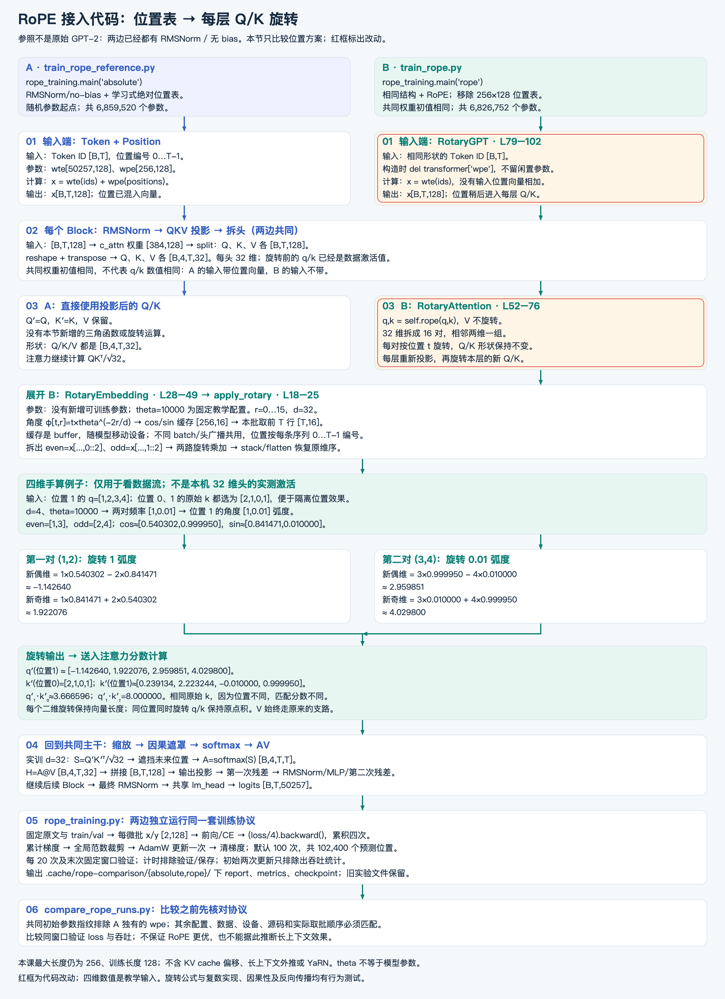

# 单元 3：将绝对位置表替换为 RoPE

本节目的：把已经理解的二维旋转接入真实注意力代码，并用同样的数据与训练循环比较两种位置方案。重点读三个改动位置，不重复配置读取、分词和优化器基础。

依据：[RoFormer / RoPE 论文](https://arxiv.org/abs/2104.09864)、[Meta Llama 3 的位置旋转实现](https://github.com/meta-llama/llama3/blob/main/llama/model.py)，承接 [Raschka GPT→Llama 学习材料](https://github.com/rasbt/LLMs-from-scratch/tree/main/ch05/07_gpt_to_llama)。本节使用等价的实数乘加展开，便于看清数据流；不是直接调用 Meta 的模型。

本次 theta=10000 是教学实验选择；Llama 3 官方配置默认为 500000。这里只学习接入 RoPE，不是复刻完整 Llama 3，也没有加入 GQA、SwiGLU、QK-Norm、KV cache 或 YaRN。

## 1. 比较谁与谁

| 设置 | 本节 A：参照 | 本节 B：RoPE |
| --- | --- | --- |
| 入口 | [train_rope_reference.py](train_rope_reference.py) | [train_rope.py](train_rope.py) |
| 基础模型 | RMSNorm、无 bias、MHA、GELU、共享输出权重 | 相同 |
| 输入 | Token Embedding + 学习式 Position Embedding | 只有 Token Embedding |
| 每层拆头后 | Q、K 直接计算注意力分数 | 先旋转 Q、K，再计算分数 |
| V | 不额外旋转 | 不额外旋转 |
| 参数量 | 6,859,520 | 6,826,752 |

本节 A 对应上一课 B 的结构。重新提供 A 入口，是为了让两边报告使用同一个位置实验协议、相同的公共参数指纹定义和当前运行环境；不是加载上一课训练后的权重接着训练。两边都从相同随机起点开始。

减少的 32,768 个参数来自位置表 `256×128`。其余共同参数初值逐项相同，RoPE 三角函数没有新增可训练参数。整个“绝对位置方案→旋转位置方案”是本次干预；它同时移除输入位置向量并改变每层 Q/K。

## 2. 三个改动，按前向顺序读

代码集中在 [rope_model.py](rope_model.py)，旧模型与上一课代码都保留。

**第一处：移除输入端的位置表。**

原来：

```python
x = token_embedding(input_ids) + position_embedding(positions)
```

现在 `RotaryGPT.forward`：

```python
x = self.transformer.drop(self.transformer.wte(input_ids))
```

输入仍是 `[2,128]` 整数 ID，输出仍是 `[2,128,128]` 浮点向量。`RotaryGPT.__init__` 删除 `wpe`，它不会留在优化器参数集合里。

**第二处：每层 Q/K 投影、拆头之后加旋转。**

`RotaryAttention.forward` 先执行熟悉的步骤：

```text
当前 Block 的 RMSNorm 输出 [B,T,128]
    ↓ c_attn：一次线性运算生成三份投影
Q、K、V 各 [B,T,128]
    ↓ 拆为 4 个头，每头 32 维
Q、K、V 各 [B,4,T,32]
    ↓ 新增
q, k = self.rope(q, k)
    ↓
Q′、K′ 各 [B,4,T,32]；V 保留原值
```

这里的 q/k 是输入数据投影后的张量，不是参数 Wq/Wk。改变 q/k 的处理方式仍然会通过反向传播影响投影权重。旋转本身可微，并不会切断梯度。

**第三处：让旋转后的 Q/K 继续原来的注意力计算。**

```python
scores = (q @ k.transpose(-2, -1)) / math.sqrt(self.head_dim)
scores = scores.masked_fill(~causal_mask, float('-inf'))
weights = softmax(scores, dim=-1)
heads = weights @ v
```

缩放、因果遮罩、softmax、AV、拼接、输出投影与残差都保留。每个 Block 都做一次 RoPE，因为每层都会从当前隐藏状态重新产生 Q/K。不是只在模型最开始旋转一次，也不是重复旋转上层留下来的同一份 Q/K。

## 3. 旋转角度从哪里来

`RotaryEmbedding.__init__` 根据每头维度 d、位置 t 和常数 theta 预计算：

```python
inv_freq = theta ** (-torch.arange(0, head_dim, 2)/head_dim)
angles = positions[:, None] * inv_freq[None, :]
cos = angles.cos()
sin = angles.sin()
```

公式为 `angle[t,r]=t×theta^(−2r/d)`。本机每头 d=32，所以每头有 16 对。位置是每条独立输入序列内部的 `0…127`；它不是词表 ID，也不是整个语料的 Token 下标。进入下一批后重新从 0 编号。

cos/sin 以 buffer 注册，随模型移动到 CPU/GPU；不参与优化器。缓存容量仍为 256，本课输入长度为 128。这里没有解除模型长度限制，也没有检验长文本外推。使用 KV cache 逐 Token 生成时需要正确的起始位置偏移，那属于后续课程。

## 4. apply_rotary：对应具体数值

为便于手算，下面用 **4 维头**，不是本机训练的 32 维。取 theta=10000，位置 1 的投影后 q 为 `[1,2,3,4]`。

```text
配对：(1,2) 和 (3,4)
频率：[10000⁰, 10000⁻¹ᐟ²] = [1,0.01]
角度：位置 1 × 频率 = [1,0.01] 弧度
```

第一对旋转：

```text
x′ = 1×cos(1) − 2×sin(1) ≈ −1.142640
y′ = 1×sin(1) + 2×cos(1) ≈  1.922076
```

第二对旋转：

```text
x′ = 3×cos(0.01) − 4×sin(0.01) ≈ 2.959851
y′ = 3×sin(0.01) + 4×cos(0.01) ≈ 4.029800
```

输出 q′ 约为 `[-1.142640,1.922076,2.959851,4.029800]`，形状保持 4 维。对应代码：

```python
even, odd = x[..., 0::2], x[..., 1::2]
rotated_even = even*cos - odd*sin
rotated_odd = even*sin + odd*cos
return torch.stack((rotated_even, rotated_odd), dim=-1).flatten(-2)
```

这里 even=`[1,3]`、odd=`[2,4]`；stack 后是 `[[−1.142640,1.922076],[2.959851,4.029800]]`，flatten 恢复原维度顺序。

K 用自己所在位置的角度进行同样计算。位置 0 的角度为 0，所以其 K 不变；位置 1 的 K 则旋转。Q 和 K 的位置不必相同，正是它们之间的角度差让注意力分数依赖相对位置。

以上投影值为教学选取值，不是两种模型实际前向所得的共同 q/k。实际 A 的输入包含位置向量、B 不包含，所以两边到达投影时的激活值已经可能不同。

## 5. 运行与比较

两条命令顺序运行，避免资源争抢影响测速：

```bash
/Users/guqun/micrograd/venv/bin/python /Users/guqun/micrograd/gpt2_pretrain_lab/train_rope_reference.py
/Users/guqun/micrograd/venv/bin/python /Users/guqun/micrograd/gpt2_pretrain_lab/train_rope.py
/Users/guqun/micrograd/venv/bin/python /Users/guqun/micrograd/gpt2_pretrain_lab/compare_rope_runs.py
```

默认各 100 次更新、102,400 个训练预测位置，CPU/FP32，seed=42。仍使用同一个固定验证窗口，每 20 次更新和最后一次评估。学习率、batch、累积、裁剪与 AdamW 等全部沿用上一课。

输出分别在 `.cache/rope-comparison/absolute/` 与 `.cache/rope-comparison/rope/`，各保存 `report.json`、`metrics.jsonl`、`checkpoint.pt`。已有结果不覆盖，可以通过 `--output` 指定新目录。比较工具使用 `--reference` 和 `--rope` 指定其他报告。

独立的 [rope_training.py](rope_training.py) 从前课训练循环复制，只更换模型工厂、记录协议的来源和默认输出位置；公共取批/验证/累积/学习率函数由测试核对 AST 相同。这样既保留旧文件，也防止两份课程训练逻辑意外分叉。

本节不直接拿上一课旧报告与新报告做速度结论。新比较工具核对共同参数（排除 A 独有的 wpe）、数据、源码、硬件和实际取批顺序。单次短跑不证明普遍优劣；RoPE 有额外运算，本实现也不保证更快。

## 6. 配套图与检验

[代码对照图 SVG](docs/diagrams/rope-code-comparison.svg) · [PNG](docs/diagrams/rope-code-comparison.png)



测试覆盖：实数计算与独立复数旋转一致、零位置恒等、长度保持、共同平移后点积不变、梯度检查、移除位置表、共同参数初值一致、关闭双方位置处理后完整前向一致、因果性、长度边界、梯度累积等价及不兼容报告拒绝比较。

数学中的共同平移不变性测试固定原始 q/k，验证 RoPE 的旋转点积性质；不表示整个已训练模型对任何文本移位都严格不变。

## 7. 本机实跑核验（2026-11-12）

两边各 100 次更新、102,400 个训练预测位置；CPU/FP32，4 线程，seed=42。

| 指标 | 绝对位置参照 | RoPE |
| --- | ---: | ---: |
| 初始验证 loss | 10.828862 | 10.832004 |
| 最终验证 loss | 6.916411 | 6.916340 |
| 测量吞吐 Token/s | 2876.99 | 2879.96 |

最终 loss 差（RoPE−参照）约为 −0.000071，非常接近，不能凭此确认优势。吞吐差约 0.1%，也不能认定为稳定提速。早先与检查任务重叠的 RoPE 运行未用于归档速度对照；检查结束后重新单独运行，再与参照比较。

8 项 RoPE 专项与 11 项既有基线检查通过。两份权重严格重新加载后，固定窗口验证 loss 与各自报告一致。25 个本轮开始时已有的根目录 Python 文件哈希保持不变。

[参照完整报告](artifacts/rope-comparison-absolute-report.json) · [RoPE 完整报告](artifacts/rope-comparison-rope-report.json) · [核验汇总](artifacts/rope-comparison-verification.json)。

助手使用 verified 子目录，默认输出位置留给用户运行。此次实跑不等于用户已经完成本节，也不结算整个 RoPE/长上下文段落。
