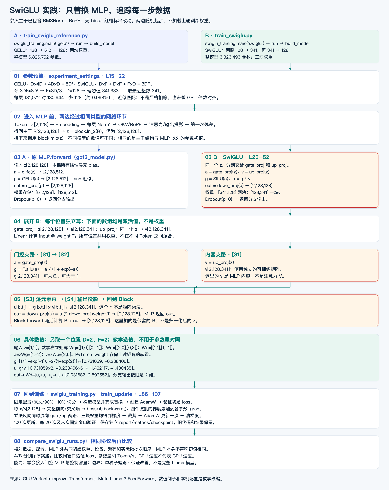

# 第 19 块：把 GELU MLP 换成 SwiGLU，并控制参数量

接续已运行的 RoPE 实践。本节解决的问题是：加入门控分支后，如何实现前向与反向，并让结构对比不被明显增加的参数量干扰。读完应能指出三块权重各自的输入输出，解释 8D/3 的来源，并独立运行两份程序比较固定验证集上的 loss。

这是单元 3 的结构实践，依据 [GLU Variants Improve Transformer](https://arxiv.org/abs/2002.05202) 与 [Meta Llama 3 FeedForward 实现](https://github.com/meta-llama/llama3/blob/main/llama/model.py)，不是 Karpathy 视频新增段落，也不是完整 Llama 复现。小模型、莎剧、初始化和训练预算属于本项目教学改编。

## 1. 本次比较什么

| 项目 | A：GELU 参照 | B：SwiGLU 改动 |
|---|---|---|
| 新入口 | `train_swiglu_reference.py` | `train_swiglu.py` |
| 模型起点 | 随机初始化 | 随机初始化，不加载上轮检查点 |
| 共同主干 | RoPE、RMSNorm、无 bias、MHA、共享 lm_head | 相同 |
| MLP | 两块矩阵，128 → 512 → 128 | 三块矩阵，两路 128 → 341，再 341 → 128 |
| 每个 MLP 参数 | 131,072 | 130,944 |
| 整模型参数 | 6,826,752 | 6,826,496 |

MLP 以外所有参数初值逐项相同。MLP 的数量、形状不同，新模块独立随机初始化；不能说它们也具有相同初值。旧代码全部保留；新课参照组需运行新的入口，旧报告的来源协议不同，不能直接混入比较。

默认两边均为 seed=42、2 层、D=128、4 个头、FP32、CPU、Dropout=0。相同莎剧原文、GPT-2 分词、90%/10% 位置切分；每微批 B=2、T=128，累积 K=4，每次更新 1,024 个预测位置，100 次共 102,400 个预测位置。每 20 次和末次在同一个 2,048 预测位置验证窗口评估。

## 2. 为什么宽度是 341，而不是 512

本例无 bias，GELU 的两块权重共：

\[
P_{GELU}=D(4D)+(4D)D=8D^2.
\]

SwiGLU 有门控、内容、输出三块权重。如果中间宽度为 F：

\[
P_{SwiGLU}=DF+DF+FD=3DF.
\]

让两者相同：\(3DF=8D^2\)，得到 \(F=8D/3\)。D=128 时理想值是 341.333…，本 CPU 教学实验取最近整数 **341**。因此每层少 128 个参数，约为 MLP 参数的 0.098%；两层合计少 256。称为“近似参数量匹配”，不能称严格相等。

若仍用 F=512，SwiGLU 每层为 196,608 个参数，比原 MLP 多 50%。这会让“门控变化”和“容量增加”混在一起。实际 Llama 实现还会按配置乘宽度系数、向硬件友好的倍数取整；本例的 341 是为了控制变量，不是 GPU 性能建议。

## 3. 代码中数据怎么流转

只看一个 Block 的第二条分支。R 是第一次注意力残差之后的主干数据：

```python
z = block.ln_2(R)         # [B,T,128]，前课已有 RMSNorm
mlp_output = block.mlp(z) # 本次替换这里
block_output = R + mlp_output
```

`SwiGLU.forward(z)` 内部：

| 代码 | 输入与参数（PyTorch 存储形状） | 输出与用途 |
|---|---|---|
| `gate_logits = gate_proj(z)` | z[B,T,128]；weight[341,128] | a[B,T,341]，生成门控的原始数值 |
| `content = up_proj(z)` | 同一个 z；另一套 weight[341,128] | v[B,T,341]，生成待调节的内容 |
| `gate = F.silu(gate_logits)` | a | g=a×sigmoid(a)，形状不变 |
| `gated = gate * content` | g 和 v | u[B,T,341]，同位置同维度相乘 |
| `down_proj(gated)` | u；weight[128,341] | [B,T,128]，混合并回到主干宽度 |
| `dropout(...)` | 上述结果；本实验 p=0 | MLP 分支输出，交回 Block 加 R |

`nn.Linear` 实际算 `input @ weight.T`。数学行向量写法为：

\[
F(z)=\big[\mathrm{SiLU}(zW_g)\odot(zW_u)\big]W_d.
\]

两路都读取完整 z，不是把 z 切成两段；这里的 v 也不是注意力 V。门控值经过 SiLU 后可为负、可大于 1，不是概率开关。最后的逐元素乘法会同时向门控和内容两路反传梯度；所有三块权重由同一个 optimizer 更新。残差相加仍在 `Block.forward`，不在 `SwiGLU.forward` 里面。

【本项目负责】选宽度、连接三层、保持训练与比较条件。【PyTorch 负责】Linear、SiLU、逐元素乘法及它们的自动求导、AdamW 参数更新。

## 4. 可手算的例子

为了看清数据流，另取 D=2、F=2、一个位置，输入 z=[1,2]。这只演示计算，不用于本次参数量比较。以下矩阵按数学右乘方向列出，PyTorch `.weight` 存其转置：

\[
W_g=\begin{bmatrix}1&0\\0&-1\end{bmatrix},\quad
W_u=\begin{bmatrix}2&0\\0&3\end{bmatrix},\quad
W_d=\begin{bmatrix}1&1\\1&-1\end{bmatrix}.
\]

1. 门控投影：a=zWg=[1,−2]。
2. 内容投影：v=zWu=[2,6]。
3. SiLU：g=[1/(1+e⁻¹), −2/(1+e²)]≈[0.731059,−0.238406]。
4. 逐元素乘：u=[0.731059×2,−0.238406×6]≈[1.462117,−1.430435]。
5. 输出投影：uWd=[u₀+u₁,u₀−u₁]≈[0.031682,2.892552]。
6. Block 加回自己的 R；不能直接把 z 当作 R，因为 z 已经过 RMSNorm。

## 5. 两份独立程序的运行顺序

在项目目录执行，保持同一个解释器和运行环境，两边顺序运行：

```bash
/Users/guqun/micrograd/venv/bin/python /Users/guqun/micrograd/gpt2_pretrain_lab/train_swiglu_reference.py
/Users/guqun/micrograd/venv/bin/python /Users/guqun/micrograd/gpt2_pretrain_lab/train_swiglu.py
/Users/guqun/micrograd/venv/bin/python /Users/guqun/micrograd/gpt2_pretrain_lab/compare_swiglu_runs.py
```

默认输出分别在 `.cache/swiglu-comparison/gelu/` 与 `swiglu/`，包含 report.json、metrics.jsonl 和 checkpoint.pt。已有输出拒绝覆盖；重跑用 `--output` 指向新目录，比较时用 `--reference` 与 `--swiglu` 指定对应的 report.json。

比较前核对配置、数据、MLP 外共同初值、代码版本、设备及实际微批次起点。重点看固定窗口最终验证 loss 与实测 Token/s；初始两次更新只排除出计时统计，仍计入训练。单次短训练无法证明哪种结构普遍更好，也不能把 CPU 结果当成 GPU 性能结论。

## 6. 从哪段代码开始读

先看 [swiglu_model.py](swiglu_model.py) 的 `experiment_settings` 与 `SwiGLU.forward`，然后看 `build_model` 怎样替换每层 MLP。原 `Block.forward` 的调用顺序未改。最后对照 [swiglu_training.py](swiglu_training.py) 的 `run → train_update/evaluate`；无需重新逐行学习配置解析。

训练链为：读取固定配置/数据 → 构造 A 或 B → 固定窗口验证 → 取四个微批并分别 `(loss/4).backward()` → 裁剪 → AdamW → 清梯度 → 按间隔验证 → 保存 → 比较。替换 MLP 必须发生在创建 optimizer 之前。



[可放大的 SVG 原图](docs/diagrams/swiglu-code-comparison.svg)。红框标出本课的结构改动，图内给出输入输出、数值例子与源代码位置。

## 7. 已完成的本机核验（2026-11-12）

助手顺序运行两组默认 100 次更新，CPU/FP32、seed=42。结果不是用户已经完成本课的记录。

| 指标 | GELU | SwiGLU |
|---|---:|---:|
| 初始验证 loss | 10.832004 | 10.773669 |
| 最终验证 loss | 6.916340 | 6.917344 |
| 测量吞吐 Token/s | 2943.55 | 2732.78 |

本次 SwiGLU 的验证 loss 高约 0.001004、吞吐约为参照的 0.928 倍，没有观察到改善。不据单种子、短训练和 CPU 推广结构优劣；初始 loss 不同也反映了新 MLP 的数值分布不同。近似参数匹配不等于硬件执行速度相同。

5 项新增检查通过：数值/梯度、替换范围、因果性/梯度累积/重载、训练函数一致性、协议拒绝；此前 19 项相关检查也通过。两份实际检查点严格重载后固定验证 loss 与报告完全一致；30 个既有根目录 Python 文件未改动。

[GELU 报告](artifacts/swiglu-comparison-gelu-report.json) · [SwiGLU 报告](artifacts/swiglu-comparison-swiglu-report.json) · [复核记录](artifacts/swiglu-comparison-verification.json)。本次助手使用 `verified-gelu` / `verified-swiglu` 输出目录，默认运行目录留给用户。
