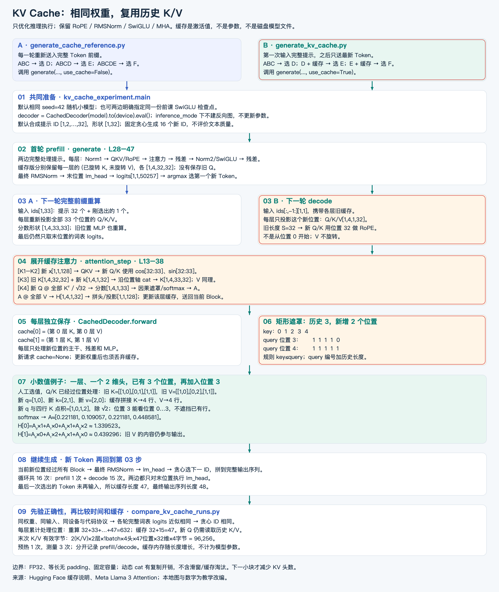

# 第 20 块：KV Cache，让逐 Token 生成复用历史计算

原理与答疑归档：[KV Cache 独立学习笔记](docs/kv-cache-learning-notes.md)，包含逐 Token 生成、缓存不变的原因、工程实现及上下文长度。

进入单元 3 · 3.6「KV Cache + GQA」的第一小块。本节先实现缓存，保留前课 RoPE/RMSNorm/SwiGLU/MHA 主干和全部参数；下一小块再用 GQA 减少 K/V 头数。缓存的目标是改变推理执行方式，得到与完整前缀重算近似相同的 logits；不需要重新训练一种“缓存权重”。

依据 [Hugging Face 缓存说明](https://huggingface.co/docs/transformers/cache_explanation) 和 [Meta Llama 3 官方 Attention 实现](https://github.com/meta-llama/llama3/blob/main/llama/model.py)。本地使用显式传入/返回的动态拼接缓存帮助理解，官方实现使用预分配缓存；这不是生产级缓存管理，也不是原 Karpathy 视频新增内容。

## 1. 当前遇到什么重复计算

假设提示词已编码成 3 个 Token，记为 A、B、C（字母代表 ID，并非真实分词规则）。

| 轮次 | 完整前缀重算的输入 | KV Cache 的输入 | 此轮选出的 Token |
|---|---|---|---|
| 1 | A B C | A B C，建立缓存 | D |
| 2 | A B C D | 只输入 D，携带 ABC 的各层 K/V | E |
| 3 | A B C D E | 只输入 E，携带 ABCD 的各层 K/V | F |

两种方式仍然一轮选择一个 Token。缓存版不会只根据 D 本身猜 E：D 的新 Q 可以读取已经缓存的 ABC 的 K/V，再加上自己的 K/V。

第一轮处理整个提示词，叫 **prefill**；后续输入最新一个 Token 的步骤叫 **decode**。生成 N 个 Token 时需要 1 次 prefill 和 N−1 次 decode。最后选出的 Token 如果不继续生成，就不必再输入模型，它也尚未进入缓存。

## 2. 为什么旧 K/V 能复用

固定模型权重、eval 模式、因果注意力下，旧位置看不到后来追加的位置。随着新 Token 加入，旧位置在每层的表示不需要改变，所以对应的 K/V 可以保留。新请求、修改前缀或更新权重后必须丢弃旧缓存。

缓存保存的是每层前向计算得到的**激活值**，不是 Wk/Wv 参数矩阵。默认运行时与模型在同一设备：CPU 模式是内存张量，GPU 模式是显存张量；不是 Hugging Face 的磁盘模型缓存。

本课每层保存 `(K_rotated, V)`：K 已经做过 RoPE，V 没旋转。旧 K 不能再次旋转。旧 Q 没有保存，因为生成下一 Token 只需要当前新位置的 Q。

## 3. 输入、计算与输出

新文件 [kv_cache_model.py](kv_cache_model.py) 的 `attention_step(attn, x, past)`：

设历史长度 S=3、新输入 T=1、batch=1、4 个头、每头 32 维：

| 步骤 | 输入与计算 | 输出 |
|---|---|---|
| 投影并拆头 | 新位置 x[1,1,128] 乘原 QKV 权重 | q/k/v 各 [1,4,1,32] |
| RoPE | 新 q/k 用位置 S=3 的 cos/sin | q′、k′，形状不变 |
| 追加缓存 | 旧 K/V[1,4,3,32] 与新 k′/v 沿位置轴拼接 | 各 [1,4,4,32] |
| 匹配分数 | 新 q′ @ 全部 Kᵀ / √32 | [1,4,1,4] |
| 遮罩和 softmax | 每个查询只能读不晚于自己绝对位置的 key | A[1,4,1,4] |
| 汇总 V | A @ 全部 V | H[1,4,1,32] |
| 拼头/投影 | H → [1,1,128] → 原输出投影 | 注意力分支 [1,1,128] |

这轮只为新位置执行残差、Norm2 和 SwiGLU，并传到下一 Block。每层使用自己对应的缓存。所有 Block 完成后最终 RMSNorm 和 lm_head 得到下一 Token 的分数。

`CachedDecoder.forward` 返回 `(logits, new_cache)`。这里缓存是长度等于 Block 数量的 tuple，每项为该层 `(K,V)`；不是所有层共享同一份 K/V。调用者接住它，并在下一次调用时传回。

## 4. 为什么不能简单套一个左上角三角遮罩

已有 S=3 个旧位置，一次送进两个新位置 3、4，分数形状的最后两维是 [2,5]。允许读取的矩阵应该是：

```text
              key 的绝对位置
              0  1  2  3  4
query 位置 3  1  1  1  1  0
query 位置 4  1  1  1  1  1
```

规则是 `key_position <= query_position`，而 query 的位置必须加上历史长度 S。本节代码用显式位置比较构造长方形遮罩；不能忘掉 S，也不能把单个新 Token 当成位置 0。单 Token decode 的 query 就在上下文末尾，所有已有位置都可见。

## 5. 两份可运行入口

旧训练与推理代码保留。新入口默认相同 seed=42 的随机小模型、合成 32 个合法 Token ID、贪心生成 16 个新 Token。选择合成 ID 是为了直接观察形状和计算次数，不依赖分词或数据下载，也不评价文本通顺程度。

```bash
/Users/guqun/micrograd/venv/bin/python /Users/guqun/micrograd/gpt2_pretrain_lab/generate_cache_reference.py
/Users/guqun/micrograd/venv/bin/python /Users/guqun/micrograd/gpt2_pretrain_lab/generate_kv_cache.py
/Users/guqun/micrograd/venv/bin/python /Users/guqun/micrograd/gpt2_pretrain_lab/compare_kv_cache_runs.py
```

两边均可加 `--checkpoint`，明确指定上一课自己的 SwiGLU `checkpoint.pt`，必须使用相同文件。`--device cpu` 为默认值；`--prompt-length` 与 `--new-tokens` 控制实验长度。这里没有 backward、optimizer 或参数更新。

默认结果目录为 `.cache/kv-cache-comparison/reference/` 和 `cached/`。各保存 report.json 与 logits.pt；输出目录非空时拒绝覆盖，重跑用 `--output` 指定新目录，比较时对应使用 `--reference`、`--cached`。

## 6. 重点读哪些代码

1. [kv_cache_model.py](kv_cache_model.py) 的 `attention_step`：只投影新数据、带偏移 RoPE、拼接旧 K/V、矩形遮罩。
2. 同文件的 `CachedDecoder.forward`：每层独立缓存；新位置继续执行完整 Block。
3. [kv_cache_experiment.py](kv_cache_experiment.py) 的 `generate`：prefill 后把输入切换成 `ids[:, -1:]`，缓存独立于模型保存在局部变量中。
4. [compare_kv_cache_runs.py](compare_kv_cache_runs.py)：先核对同权重、同输入、同执行环境，再比较各轮完整词表 logits 和贪心 ID，最后看时间。

PyTorch 提供线性层、切片、cat、softmax 与矩阵乘法；缓存的传递、位置偏移和调用顺序由本项目显式实现。两种模式都只为末位置执行 lm_head，避免把多余的词表投影混入速度比较。

## 7. 应观察到什么

输入长度 P=32，生成 N=16：

- 完整重算每层处理 `32+33+…+47=632` 个位置。
- 缓存版每层处理 `32+1×15=47` 个位置；这不是“整个注意力只算 47 次”，每个新 Q 仍需读取增长中的全部 K/V。
- 末次输入完成后缓存长度 47，输出序列长度为 48；第 48 个 Token 刚刚选出，尚未输入模型。
- FP32、2 层、B=1、4 个 KV 头、每头 32 维，缓存有效字节为 `2(K和V)×2层×1×4×47×32×4字节=96,256`。

存储开销随上下文长度增长。这里使用 `torch.cat`，每次追加会分配和复制张量，不是最优的生产实现；缓存字节指标只表示存活 K/V 数据，不是整个进程峰值内存。

预热一次、测量三次，分别记录 prefill/decode 和整体中位耗时。计时覆盖前向、贪心与 ID 追加，排除日志、CPU 分数复制和保存；GPU 模式在边界同步。新旧矩阵计算形状不同，允许浮点误差，不能要求逐 bit 相同。若近似并列导致贪心路径分岔，工具会拒绝直接比较后续不同前缀的分数。

本节先证明缓存正确，然后看本机速度。GQA 将在下一块减少 KV 头数，从而减少这个缓存公式中的 Hkv；本节没有更改头数或增加 QK-Norm。



[打开可放大的 SVG](docs/diagrams/kv-cache-code-flow.svg)。

## 8. 已验证的结果（2026-11-12）

助手 CPU/FP32 顺序运行两组对照，每组预热一次、测量三次。所有输入均为合成合法 ID：

| 条件 | 重算/缓存处理位置 | logits 最大绝对差 | 贪心 ID | 重算/缓存中位时间 |
|---|---|---|---|---|
| 随机权重，提示 32，生成 16 | 632 / 47 | 2.38×10⁻⁷ | 一致 | 43.51 / 49.60 ms |
| 上课短训权重，提示 128，生成 32 | 4592 / 159 | 1.91×10⁻⁶ | 一致 | 111.58 / 65.23 ms |

短输入实验未提速；较长输入实验本次约快 1.71 倍。两行同时改变了长度和权重条件，不是隔离长度的严格实验；不能用它们推导确定的长度—速度曲线，也不代表 GPU 结果。缓存改善的是重复计算，实际收益还受内核、张量形状、拼接与调用开销影响。

5 项专项测试通过，覆盖原模型前向一致、单步/分块输入、独立复数 RoPE 对照、矩形因果遮罩、缓存重置、边界和参数不变。35 个既有根目录 Python 文件保持不变。当前是本课实践准备与助手验证，不表示用户已完成 3.6；GQA、KV 头数缩减和正式缓存性能实验继续保留。

[完整核验记录](artifacts/kv-cache-verification.json)；默认报告与较长输入报告均已归档到 artifacts/kv-cache-*-report.json。用户默认输出目录保留未占用。
