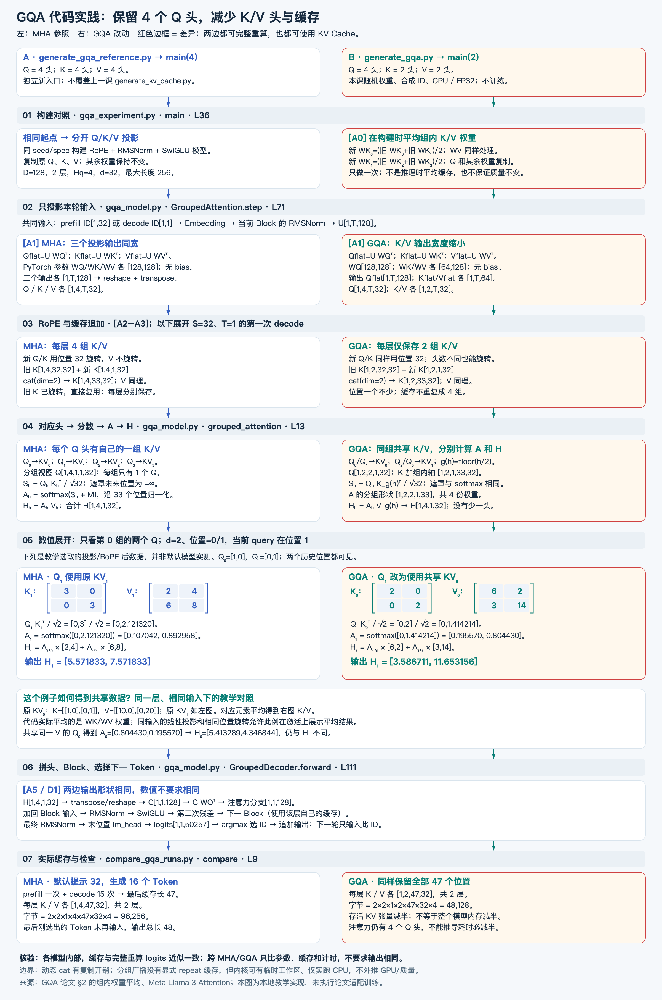

# 第 21 块：GQA，减少每个位置的 K/V 头与缓存

本课承接单元 3 · 3.6 的 KV Cache 实践。之前解决“旧位置不必每轮重算”，现在解决“每个旧位置保存的 K/V 能否更少”。所有旧 Python 文件保留，新增独立入口；这次先做结构、缓存正确性与内存对照，不启动训练。

## 1. 先看对照图



[浏览器打开可放大的 SVG](docs/diagrams/gqa-code-comparison.svg)。图中红框标出差异，A0—A5、D1、E1—E3 与代码注释对应，源码行号由绘图程序自动提取。图中有两种尺度：上半部分是默认 128 维模型的形状，下半部分是单头 2 维的手算例子，不能混成同一组实测数据。

## 2. 本次用什么模型、数据和参数

- 模型：前课 RoPE + RMSNorm + 无 bias + SwiGLU + 共享 lm_head，2 层、D=128、4 个 Q 头、每头 32 维、词表 50257、固定上下文容量 256。
- 数据：合成合法 Token ID `[1,2,…,32]`，不下载文本；贪心生成 16 个新 ID。这是计算核验，不评价文本质量。
- 参数起点：两入口使用同一 seed=42 随机 MHA 模型，不加载预训练权重。MHA 保留 4 个 K/V 头；GQA 改成 2 个 K/V 头。
- 设备：默认 CPU/FP32、4 线程；代码提供设备选择，但当前只验证 CPU。关闭 TF32，无 autocast/compile。
- 继承不变：RoPE theta=10000 为教学配置；固定等长无 padding；无滑窗；动态 cat 缓存。这不是完整 Llama 3。

**本课 GQA 初值如何产生？** `GroupedAttention.__init__` 将原融合投影拆为 Q/K/V 三个 Linear；Q 完整复制，组内 K/V 权重取均值：

```text
GQA WK0 = (MHA WK0 + MHA WK1) / 2
GQA WK1 = (MHA WK2 + MHA WK3) / 2
WV 同理；Q、输出投影、Embedding、Norm、MLP 等保持原数值。
```

均值只在模型构建时做一次；运行时直接使用较小的 WK/WV 投影，并不每次先计算四个 KV 再丢掉两个。它是一种初始化/转换方法，不是 GQA 的定义要求。也可以从头初始化并训练 GQA。

GQA 论文讨论组内平均后继续适配训练；本课只借用平均构建可解释的起点，**没有执行论文的适配训练，也不保证保持原模型语言质量**。模型结构改变后不能直接复用原 MHA 缓存；本课两入口各自从 cache=None 开始。

## 3. 先运行两份代码，再比较

在 VS Code 选择课程解释器，或依次执行：

```bash
/Users/guqun/micrograd/venv/bin/python /Users/guqun/micrograd/gpt2_pretrain_lab/generate_gqa_reference.py
/Users/guqun/micrograd/venv/bin/python /Users/guqun/micrograd/gpt2_pretrain_lab/generate_gqa.py
/Users/guqun/micrograd/venv/bin/python /Users/guqun/micrograd/gpt2_pretrain_lab/compare_gqa_runs.py
```

| 文件 | 职责 |
|---|---|
| [generate_gqa_reference.py](generate_gqa_reference.py) | MHA：4 Q + 4 KV；先核验重算/缓存等价，再计时 |
| [generate_gqa.py](generate_gqa.py) | GQA：4 Q + 2 KV；做同样的内部核验和计时 |
| [gqa_experiment.py](gqa_experiment.py) | E1 建模转换；E2 核验；E3 重复计时并保存报告 |
| [gqa_model.py](gqa_model.py) | 投影、RoPE、分组注意力、缓存传递与各层前向 |
| [compare_gqa_runs.py](compare_gqa_runs.py) | 重验保存的 logits；比较共同协议、缓存和参数数量 |
| [kv_cache_experiment.py](kv_cache_experiment.py) | 复用前课未修改的 generate：prefill 后每次只输入新 ID |

默认输出 `.cache/gqa-comparison/mha/` 和 `.cache/gqa-comparison/gqa/`，包含 report.json 与 logits.pt。默认目录已为你的首次运行保留。再次运行时用 `--output` 指定新目录，比较程序相应传 `--reference 新目录/report.json --gqa 新目录/report.json`，不会覆盖旧结果。支持 `--prompt-length`、`--new-tokens`、`--repeats`、`--threads`、`--device`；要对照时两入口使用相同设置。

## 4. 跟着新 Token 走一遍：输入、参数、输出

用已有 S=32 个位置、新增 T=1 个 Token 展开。B=1、D=128、Hq=4、d=32。

1. `generate` 输入末尾 ID `[1,1]` 和每层缓存；Embedding 得到 `[1,1,128]`。各 Block 先对本层输入做 RMSNorm，得到 U。
2. **A1 投影：** `q_proj(U)` 输出 `[1,1,128]`，拆头为 `[1,4,1,32]`。GQA 的 `k_proj/v_proj(U)` 各输出 `[1,1,64]`，拆头为 `[1,2,1,32]`。所有输出维使用完整 128 维输入。
3. **A2 位置：** Q、K 用位置 32 的 cos/sin 旋转；头数不同不影响逐头旋转，V 不旋转。
4. **A3 缓存：** 旧 K `[1,2,32,32]` 与新 K `[1,2,1,32]` 在 dim=2 拼接，得 `[1,2,33,32]`；V 同理。旧 K 已旋转，不再旋转。
5. **A4 注意力：** 每两个 Q 头对应同一组 K/V，各自求分数、softmax 和 H；输出 `[1,4,1,32]`。
6. **A5 拼头：** `[1,4,1,32] → [1,1,128] → 输出投影`，加回 Block 输入，再做 RMSNorm/SwiGLU/第二次残差。
7. **D1 各层：** 下一 Block 接收当前新位置的特征，并使用自己的缓存；全层完成后最终 Norm、末位置 lm_head 输出 `[1,1,50257]`，选出一个新 ID。

`Linear.weight` 在 PyTorch 中存 `[输出维,输入维]`，所以代码数学公式是 `U @ weight.T`。Q 权重 `[128,128]`，K/V 权重各 `[64,128]`，不是 `[128,64]`；此前数学图采用后一种记号时是直接右乘、不转置的约定。

## 5. 不复制缓存，如何让两个 Q 使用同一组 K/V

`grouped_attention` 将 Q 的头轴分为两部分：

```text
Q   [B,4,T,d] → [B,2,2,T,d]
                       │ └ 每组两个 Q
                       └ 两个 KV 组
K/V [B,2,L,d] → [B,2,1,L,d]，L=S+T
```

`unsqueeze(2)` 加出的 1 轴允许 PyTorch 在组内广播；缓存依然是两组。计算：

```text
scores = Q_grouped @ K.unsqueeze(2).transpose(-2,-1) / sqrt(d)
       → [B,2,2,T,L]
A = softmax(masked_scores, dim=-1)
H_grouped = A @ V.unsqueeze(2)
          → [B,2,2,T,d]
H = H_grouped.reshape(B,4,T,d)
```

Q0/Q1 对应 KV0，Q2/Q3 对应 KV1。共享的是 K/V，A 与 H 分别计算，缓存里不存旧 Q。因果遮罩仍按 `key_position <= S + query_local_position`；单 Token decode 所有已有位置都可见，分块输入则要遮住新块中较晚的位置。

这里没有显式 repeat 成四份的持久缓存；底层 matmul 仍可能使用临时工作区。我们只统计存活 K/V 张量，不能称为整个进程峰值显存。

PyTorch 提供 Linear、reshape、transpose、广播 matmul、softmax 和 cat；本项目实现组对应、位置偏移和缓存接口。测试另用 `repeat_interleave` 写出独立参照，核对数值和反向梯度。GQA 结构可训练，本课推理包装器使用 inference_mode，不反传、不更新。

## 6. 数值例子：共享同一个 V，H 仍然不同

图中已给出 Q1 的左右对照。这里单独看 GQA 共享组，假设 Q/K 已旋转，当前位于位置 1，两个 key 位置均可见：

```text
q0 = [1,0]    q1 = [0,1]
K = [[2,0],   V = [[6,2],
     [0,2]]        [3,14]]
```

q1 的过程：

```text
点积并缩放：[0,2] / sqrt(2) = [0,1.414214]
softmax：  A1 = [0.195570,0.804430]
加权 V：   H1 = 0.195570*[6,2] + 0.804430*[3,14]
             = [3.586711,11.653156]（按未舍入权重计算）
```

q0 使用同一 K/V，却得到 `A0=[0.804430,0.195570]` 和 `H0=[5.413289,4.346844]`。这是两个独立的查询结果；后面仍要拼接四个头的 H。

图中为了演示构建时组内平均，右侧 K/V 是左侧两组相应元素的均值。该关系限定相同层输入的教学例子；两套模型经过不同注意力之后，上层输入可以不同，不能认为所有后续层的 GQA 缓存总等于 MHA 缓存的简单平均。

## 7. 为什么缓存减半，参数却只少了一点

最后一次前向的上下文长为 `32+16−1=47`；最后选出的新 ID 没再输入，因此输出序列长 48，而缓存长 47。

| 指标 | MHA | GQA |
|---|---:|---:|
| Q 头 | 4 | 4 |
| K、V 各有多少头 | 4 | 2 |
| 每层单个 K/V 形状 | [1,4,47,32] | [1,2,47,32] |
| 全部两层 K/V 有效字节 | 96,256 | 48,128 |
| 参数总量 | 6,826,496 | 6,793,728 |

缓存公式 `2 × 层数 × B × Hkv × L × d × 每元素字节` 中，只有 Hkv 从 4 变 2，因此缓存减半。参数只减少每层 K/V 的一半：`2层 × 2矩阵 × (128−64) × 128 = 32768`。Embedding 等大部分参数未变，Q 头数和注意力权重 A 的数量也未变，所以不能说“整个模型大小、全部计算量和耗时都减半”。

## 8. 核验规则与本机结果

本课先分别核验：

- 同一个 MHA 模型：完整重算 vs 缓存。
- 同一个 GQA 模型：完整重算 vs 缓存。

每轮比较完整词表 logits，容许浮点误差 rtol=1e-4、atol=1e-5，并要求本次贪心 ID 相同。若生成路径分岔，程序停止而不继续比较不同前缀的分数。**不要求 MHA 的 logits 与 GQA 相同**，因为结构和 K/V 权重已经不同。

2026-11-12，助手 CPU/FP32 实跑默认配置：

| 检查 | MHA | GQA |
|---|---:|---:|
| 缓存/重算最大 logits 差 | 2.38e-7 | 2.38e-7 |
| 各自两条路径的贪心 ID | 一致 | 一致 |
| 缓存路径中位耗时（3 次） | 29.29 ms | 36.98 ms |

本次 GQA 缓存减半，但 CPU 小模型的分组广播实现未提速。计时包括前向、贪心、ID 追加，设备同步；排除日志、CPU 分数复制和落盘，每条路径先完整预热一次。单机三次测量只用于观察，不支持 GPU 或语言质量结论，也没有与以前不同时间的运行直接混比。

6 项专项检查通过：MHA 退化一致、独立重复 K/V 对照与梯度、权重分组平均、1/2/4 KV 头的分块与缓存实存字节、生成重置与权重不变、非法缓存与容量边界。旧 KV Cache 的 5 项检查也通过。用户实践尚待运行反馈；本课不代表 3.6 全部实验或后续结构整合已完成。

## 9. 来源与改编边界

- [GQA 原论文 §2](https://arxiv.org/html/2305.13245v3)：分组共享与转换权重的组内均值；论文随后做适配训练，本课没有做。
- [Meta Llama 3 Attention](https://github.com/meta-llama/llama3/blob/main/llama/model.py)：区分 Q/KV 头数，先保存较少的 KV，再为注意力建立头对应。
- 本地教学改编：动态 cat、显式五维分组广播、随机小模型、合成 ID。官方代码的缓存预分配和 repeat_kv 与本课实现方式不同；相同的是分组注意力数学。

这是既定单元 3 的论文/官方代码实践，不是 Karpathy 原视频的新章节。
