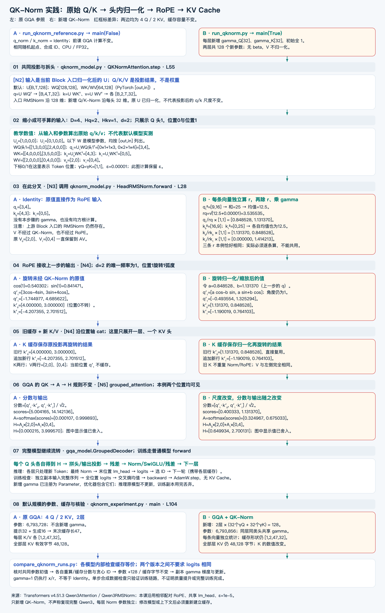

# 第 22 块：把 QK-Norm 接入 GQA、RoPE 与 KV Cache

本课属于单元 3 · 3.7 的第一块实现，承接第 21 块 GQA。之前已理解 QK-Norm 原理，现在用代码确认：归一化插在哪里、输入输出是什么、新参数如何学习、缓存应保存哪个阶段的 K。所有前课 Python 文件保留。

## 1. 先看图，再运行



[可放大的 SVG](docs/diagrams/qknorm-code-comparison.svg)。红框标新增或改变的部分；图中 N0—N5 / E1—E4 对应源码注释。上方和底部使用默认 128 维配置，中间单独缩成 4 维输入、2 维头的手算例子，包含输入、权重、q/k/v、r、归一化、旋转、缓存、softmax 和 H。

依次执行：

```bash
/Users/guqun/micrograd/venv/bin/python /Users/guqun/micrograd/gpt2_pretrain_lab/run_qknorm_reference.py
/Users/guqun/micrograd/venv/bin/python /Users/guqun/micrograd/gpt2_pretrain_lab/run_qknorm.py
/Users/guqun/micrograd/venv/bin/python /Users/guqun/micrograd/gpt2_pretrain_lab/compare_qknorm_runs.py
```

| 新文件 | 用途 |
|---|---|
| [run_qknorm_reference.py](run_qknorm_reference.py) | 同一 GQA 起点，不加入 QK-Norm |
| [run_qknorm.py](run_qknorm.py) | 新增头内 QK-Norm，核验缓存及 gamma 的反传更新 |
| [qknorm_model.py](qknorm_model.py) | HeadRMSNorm、注意力接入位置、模型构建 |
| [qknorm_experiment.py](qknorm_experiment.py) | 共同初值、数值探针、生成核验和独立副本梯度检查 |
| [compare_qknorm_runs.py](compare_qknorm_runs.py) | 重验 logits、共同初值、参数增加、缓存不变和 gamma 更新 |

新默认输出目录为 `.cache/qknorm-comparison/reference/` 与 `.cache/qknorm-comparison/qknorm/`，保存 `report.json` 和 `logits.pt`，已保留给你的首次运行。再次运行用 `--output` 指定新目录；比较时相应传 `--reference 路径/report.json --qknorm 路径/report.json`。默认拒绝覆盖旧结果。

支持 `--device cpu/cuda/mps/auto`、`--prompt-length`、`--new-tokens`、`--threads`。当前仅 CPU/FP32 已实跑；两入口应使用相同设置。

## 2. 实验配置与边界

默认复用本地配置：2 层、D=128、4 个 Q 头、2 个 KV 头、d=32、词表 50257、最大长度 256、RoPE theta=10000、epsilon=1e-5、Dropout=0。两边从相同 seed=42 随机小模型构建，GQA 起点同前课按组平均 K/V 权重，不加载 Qwen3 或其他预训练检查点。

数据是合成合法 ID `[1,…,32]`，贪心生成 16 个新 ID。新增归一化前，两边全部已有参数逐项一致。新增 gamma 初值全 1。这里不研究分词或生成质量。

本课首先验证推理，再在一个独立副本上做一次反传和 AdamW 更新；这一次更新只证明新参数接入训练链路，不是正式短训练、适配训练或模型能力比较。推理原模型与其参数保持不变。

## 3. 一次前向的具体流转

```text
当前 Block 输入 X
    ↓ 入口 RMSNorm（沿整个128维）
U[B,T,128]
    ├─ q_proj → 拆头 Q[B,4,T,32] → Q-Norm → RoPE ─────────┐
    ├─ k_proj → 拆头 K[B,2,T,32] → K-Norm → RoPE → K缓存 ─┤
    └─ v_proj → 拆头 V[B,2,T,32] ───────────────→ V缓存 ─┤
                                                          ↓
                       分组 QKᵀ/√32 → 因果遮罩 → softmax → A
                                                          ↓
                                               A×V → H[B,4,T,32]
                                                          ↓
       拼头/输出投影 → 第一次残差 → RMSNorm/SwiGLU → 第二次残差
```

- **N0：** 构建相同 GQA 主干；仅改动版新增 gamma。
- **N2：** q/k/v 是投影后的激活，不是参数。上游 U 归一化后经过权重矩阵，尺度仍可改变。
- **N3：** `q = self.q_norm(q)`、`k = self.k_norm(k)`，V 不处理。
- **N4：** 新 q/k 归一化后再做 RoPE；旧 K 已经完成这些处理，直接 cat。
- **N5：** 复用前课 `grouped_attention`，共享关系、遮罩、A×V 与拼头不变。

完整序列训练走普通模型 `forward`，没有 inference_mode；缓存生成走前课 `GroupedDecoder`，要求 eval 且不建反向图。`QKNormAttention` 继承前课的 `forward`，该函数内部调用当前对象新的 `step`，因此训练和推理都使用了新增归一化。

## 4. HeadRMSNorm 究竟计算什么

```python
values = x.float()
mean_square = values.square().mean(dim=-1, keepdim=True)
normalized = values * torch.rsqrt(mean_square + self.eps)
return normalized.to(x.dtype) * self.weight
```

`x` 是一个 Q 或 K 张量。例如 Q 为 `[B,4,T,32]`，对最后 32 维求均方得到 `[B,4,T,1]`。每个 batch、每个头、每个 Token 位置分别计算自己的值，不跨位置、不跨头统计，也不减均值。

`rsqrt(a)` 等于 `1/sqrt(a)`，所以这段就是 `gamma × x / sqrt(mean(x²)+eps)`。`keepdim=True` 保留长度为 1 的特征轴，方便把每条向量自己的缩放值广播到全部 32 维。

每层的 `q_norm.weight[32]` 和 `k_norm.weight[32]` 是不同的 Parameter；同层 Q 头共用前者，K 头共用后者，各层彼此独立。**共享的是 gamma，均方根 r 每条向量独立计算。** 无 beta。

gamma 用 `torch.ones` 初始化，无须从预训练数据读取。gamma=1 仅表示初始逐维缩放不额外放大或缩小；仍然要除以 r，**不等于关闭归一化**。参照版本使用 `nn.Identity()` 才真正跳过这个步骤。

## 5. 从原始数值到 RoPE 输入

图中手算例子使用 D=4、Hq=2、Hkv=1、d=2，仅展开一个 Q 头。U 是入口 RMSNorm 之后的教学输入，以下矩阵按 PyTorch `[out,in]` 写：

```text
U0 = [1,0,0,0]                U1 = [0,1,0,0]
WQ头1 = [[1,3,0,0],           WK = [[4,0,0,0],
         [2,4,0,0]]                 [3,5,0,0]]
WV = [[2,0,0,0],
      [0,4,0,0]]
```

投影后得到：

```text
位置1的 q1 = U1 @ WQ头1.T = [3,4]
位置0的 k0 = U0 @ WK.T    = [4,3]
位置1的 k1 = U1 @ WK.T    = [0,5]
V 的两行分别为 [2,0]、[0,4]
```

以 q1 为例，gamma=[1,1]、eps=0.00001：

```text
平方：[9,16]
求和：9+16=25
均值：25/2=12.5
加eps再开根：r=sqrt(12.50001)≈3.535535
原值除r：[3/r,4/r]≈[0.848528,1.131370]
乘gamma：仍为 [0.848528,1.131370]
```

这是送进 RoPE 的 q，不是 [3,4]。本例 k0、k1 的平方和也恰好为 25，归一化后分别约为 `[1.131370,0.848528]`、`[0,1.414213]`；一般情况下三个 r 不会相同。

位置1旋转1弧度，对归一化后的 `[a,b]` 计算：

```text
q_rotated = [a*cos(1)-b*sin(1), a*sin(1)+b*cos(1)]
```

图中左右两侧使用相同角度，但归一化改动了进入旋转的数值，因此之后的 QK、softmax、H 均可改变。图与代码的核验用未舍入数值，文字显示约数。

## 6. KV Cache 如何保存

每层保存的对象变为：

```text
K cache = 历史每个位置的 RoPE(K-Norm(K投影结果))
V cache = 历史每个位置的 V投影结果
```

已有 S 个位置时，新位置从 S 开始做 RoPE；本轮只归一化和旋转新 q/k。历史 K 不再归一化，也不重新旋转。不能把参照模型的缓存传给改动模型；权重、gamma 或前缀变动后同样要重新建立缓存。

默认末次缓存长度为 `32+16−1=47`。两边每层的 K/V 都为 `[1,2,47,32]`，有效字节均：

```text
2(K和V) × 2层 × 1batch × 2个KV头 × 47位置 × 32维 × 4字节 = 48,128
```

QK-Norm 改变 K 的数值，不改变其形状。新增 gamma 是模型参数，不是每个位置多存一份的缓存数据。缓存仍不保存 Q、A 或 H。

## 7. 默认运行还会展示真实数值

`first_layer_probe` 会读取第一层、Q/K 头0、提示词末位置，并在报告保存完整的32维向量，终端只打印前4维。这个位置是31，RoPE 从对应角度表取值；它与图中2维手算例子不同。

本次 CPU 运行的 q：

```text
原始前4维：[0.116724, 0.504311, -0.460378, 0.244909]
r（从完整32维计算）≈0.181701
归一化后：[0.642393, 2.775496, -2.533714, 1.347867]
RoPE后： [1.709030, 2.279313, 0.943748, 2.710312]
```

报告还保存原始 k、k 的 r、归一化 k、最终缓存 k、原始/缓存 v，以及输入 U。自动核对缓存 K 恰好等于本层 K-Norm 后的 RoPE 输出，缓存 V 等于原 V。

参照版本打印的 r 是探针为了对比单独计算的观察值，参照注意力前向本身没有做 Q/K 均方根计算或除法。归一化不限制每个元素处于 [-1,1]；例如上面的 2.775496 完全可能出现。

## 8. gamma 怎样参与训练

`gradient_probe` 在独立模型副本上执行：

```text
复制模型 → train()
输入ID  [1,2,3,4,5,6,7,8]
目标ID  [2,3,4,5,6,7,8,9]
完整序列前向 → 8个位置的交叉熵取平均
→ loss.backward()
→ 查看每层 gamma_Q/gamma_K 的梯度
→ AdamW.step()
→ 核对 gamma 发生变化
→ 丢弃副本
```

优化器包含全部模型参数，学习率 0.001、weight_decay=0，确保 gamma 的变化不是仅由权重衰减造成。四组 gamma 均检查非零、有限梯度和非零更新。原来用于缓存核验的模型参数、梯度和 eval 状态不变，也不保存更新后权重。

`nn.Parameter` 让 gamma 被 `model.parameters()` 收集；PyTorch autograd 沿乘法、rsqrt、mean、投影和注意力反传，不需要手写 gamma 更新公式。

## 9. 已验证结果与能得出的结论

2026-11-13，助手 CPU/FP32 默认配置实跑：

| 指标 | 原 GQA | GQA + QK-Norm |
|---|---:|---:|
| 参数总数 | 6,793,728 | 6,793,856 |
| 新增 gamma 参数 | 0 | 128 |
| KV 缓存有效字节 | 48,128 | 48,128 |
| 各自缓存/重算最大 logits 差 | 2.38e-7 | 4.77e-7 |
| 各自缓存/重算的贪心 ID | 一致 | 一致 |
| 独立副本参与梯度与更新的 gamma 组 | 无新增 gamma | 4组 |

比较程序要求共同参数、输入、代码和设备协议一致；重新加载保存的 logits，在各模型内部比较缓存/重算结果，不要求原 GQA 与新增 QK-Norm 输出相同。误差容限 rtol=1e-4、atol=1e-5；贪心路径若分岔则停止，不拿不同前缀继续比较。

6 项新测试覆盖：最后一维手算与 gamma 梯度、参照退化和共同初值、新增参数独立性、非均匀 gamma 下的先 Norm 后 RoPE 顺序、缓存 V 保持原值、多种分块/因果性、独立副本更新、容量及 eval 检查。旧 GQA 6项及 KV Cache 5项也做回归检查。

本课未运行训练质量、速度优劣或长上下文基准。合成 ID 的一次更新和两种模型的 loss 数值不用于判断哪种结构更好。用户实践待运行反馈；不能据此把 3.7 的全部整合与 E1—E5 汇总记为完成。

## 10. 来源与整合范围

- [Transformers v4.51.3 Qwen3 实现](https://github.com/huggingface/transformers/blob/v4.51.3/src/transformers/models/qwen3/modeling_qwen3.py)：用于核对头内 RMSNorm、gamma 初值以及 Q/K-Norm→RoPE→缓存的顺序；本课不是复制完整实现。
- 沿用项目已有 RoPE、GQA、SwiGLU、RMSNorm、共享 lm_head 与固定容量。官方对应实现采用另一种等价维度排列的 RoPE 表达；本课保持原相邻配对约定，不直接加载官方权重。
- epsilon=1e-5、theta=10000 和教学尺寸来自本地配置，不冒充任何具体 Qwen3 型号的默认配置。本课完成的是 QK-Norm 这一项接入，不能称为完整 Qwen3 复现。

这是既定单元 3 的官方实现对照实践，不是 Karpathy 视频新增内容。
